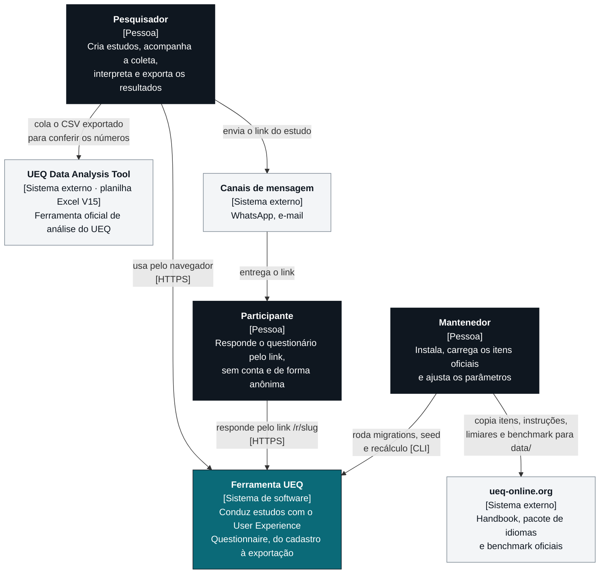
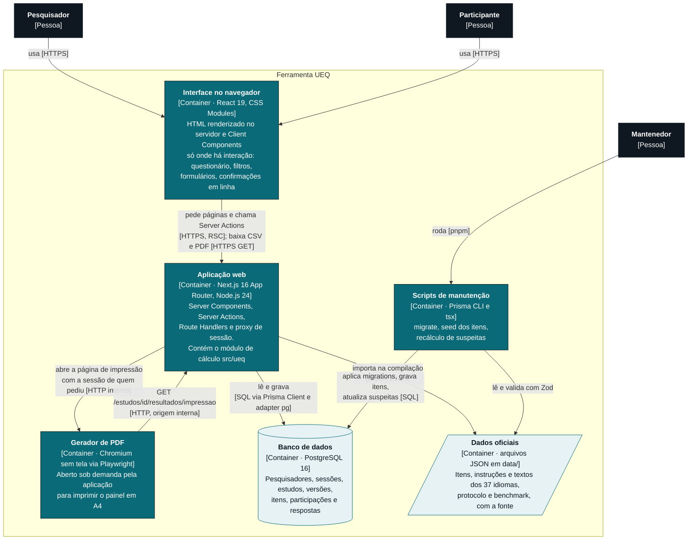
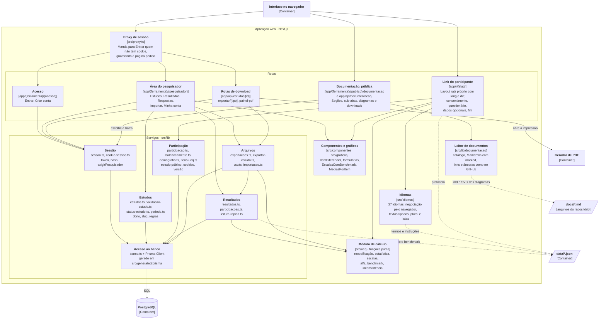
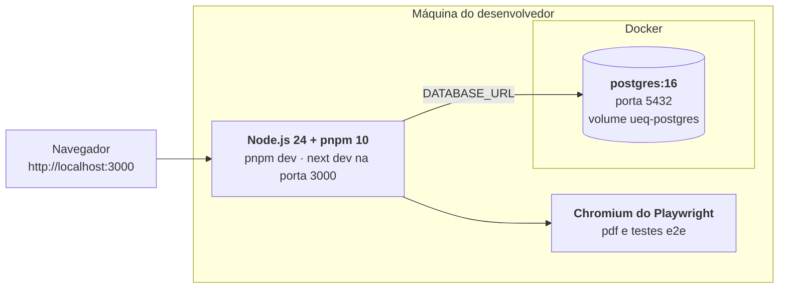

# Arquitetura

A arquitetura é descrita com o [modelo C4](https://c4model.com), em três níveis de zoom:

1. **Contexto:** quem usa a ferramenta e com que sistemas ela se relaciona;
2. **Containers:** as partes que rodam separadas (aplicação, banco, gerador de PDF, scripts) e como se falam;
3. **Componentes:** como a aplicação Next.js se organiza por dentro.

Os diagramas usam Mermaid, que o GitHub desenha direto na página. Cada caixa traz o nome, o tipo entre colchetes e a tecnologia. As setas dizem o que passa e por qual protocolo.

## Visão geral

A Ferramenta UEQ é uma aplicação web única em **Next.js 16 (App Router)** com **React 19** e **TypeScript strict**, que guarda os dados num **PostgreSQL 16** pelo **Prisma 7**.

- Não existe uma API REST separada. As páginas são Server Components que leem o banco no servidor. As escritas são Server Actions chamadas pelos formulários.
- Só os downloads (CSV e PDF) são rotas de API, porque devolvem arquivo.
- O cálculo do UEQ fica isolado em `src/ueq/`, em funções puras, para ser testado contra a planilha oficial sem banco nem interface.
- Os parâmetros do protocolo, o benchmark e os textos oficiais dos 37 idiomas são arquivos JSON versionados em `data/`, com a fonte de cada valor.

## Nível 1 · Contexto



A ferramenta não chama nenhum sistema externo em tempo de execução. A planilha oficial e o site do UEQ entram por pessoas: a equipe copia os dados oficiais para `data/` (com a fonte em cada arquivo) e o pesquisador cola a exportação na planilha para conferir.

## Nível 2 · Containers



| Container | Tecnologia | Responsabilidade | Onde está |
|---|---|---|---|
| Interface no navegador | React 19, CSS Modules, variáveis CSS, SVG feito à mão | Mostrar as telas e tratar a interação. Sem biblioteca de componentes nem de gráficos | `src/app/**/*.tsx` com `"use client"`, `src/componentes/`, `src/graficos/`, `src/styles/` |
| Aplicação web | Next.js 16, Node.js 24, Zod 4, bcryptjs | Renderizar as páginas, validar e gravar dados, proteger a área do pesquisador, gerar exportações | `src/app/`, `src/lib/`, `src/ueq/`, `src/idiomas/`, `src/proxy.ts` |
| Gerador de PDF | Playwright 1.64 (Chromium) | Imprimir o painel em PDF com gráficos em vetor | `src/app/api/estudos/[id]/painel-pdf/route.ts` |
| Banco de dados | PostgreSQL 16 (Docker no desenvolvimento) | Persistir o modelo de domínio, com cascata e `CHECK` | `prisma/schema.prisma`, `prisma/migrations/`, `docker-compose.yml` |
| Dados oficiais | JSON versionado | Fonte única dos itens, instruções, protocolo e benchmark, cada um com o campo `fonte` | `data/` |
| Documentação | Markdown e SVG versionados | Os documentos que a aba Documentação mostra, e os diagramas já desenhados | `docs/`, `docs/documentacao/diagramas/` |
| Scripts de manutenção | Prisma CLI, tsx | Criar o banco, carregar os itens, recalcular suspeitas | `prisma/seed.ts`, `prisma/recalcular-suspeitas.ts`, `package.json` |

## Nível 3 · Componentes da aplicação web



O link do participante e a documentação não passam pelo proxy: o `matcher` de `src/proxy.ts` exclui `/r/`, `/entrar`, `/cadastrar`, `/documentacao` e `/api/documentacao`. Toda rota nova do pesquisador já nasce protegida. O link do participante tem layout raiz próprio, sem barra e sem link para o resto da ferramenta: quem responde só vê o formulário e o seletor de idioma.

### Regras de dependência

- **`src/ueq/` não depende de nada do projeto.** Não importa Prisma, React, Next nem `src/lib`. Recebe números e devolve objetos. É o que permite testá-lo contra a planilha oficial.
- **Componentes e gráficos não sabem de Prisma.** Recebem dados prontos por props.
- **Toda página, Server Action e rota do pesquisador confere a sessão no banco e o dono do estudo**, não só o proxy.
- **As rotas do participante só leem o que o participante pode ver:** título, produto, objetivo e status do estudo. Nada do pesquisador e nada da análise.
- **Parâmetros do protocolo nunca ficam no código.** Vêm de `data/protocolo.json` e `data/benchmark.json`.

## Decisões de arquitetura

| Decisão | Por quê | Consequência |
|---|---|---|
| Server Components e Server Actions em vez de API REST | Menos código entre a tela e o banco; validação com Zod no servidor em cada ação; formulários funcionam com o comportamento nativo do navegador | A ferramenta não oferece API pública. Integrações usam as exportações em CSV |
| Cálculo em funções puras em `src/ueq/` | O número tem que bater com a planilha oficial; funções puras são testáveis com fixtures e bordas | Quem busca os dados (`src/lib/resultados.ts`) só monta a entrada e repassa |
| Sessão guardada no banco, com o hash do token | Trocar a senha encerra as outras sessões; quem lê o banco não consegue montar um cookie | Cada página do pesquisador faz uma consulta de sessão (com `cache` do React por requisição) |
| Dois layouts raiz: ferramenta em pt-BR e link do participante | O `<html lang>` e o `dir` do participante seguem o idioma escolhido (WCAG 3.1.1), incluindo árabe, hebraico e persa | `experimental.globalNotFound` em `next.config.ts` para a página 404 |
| Gráficos em SVG feitos à mão | Controle total de `title`, `desc`, contraste, formas por versão e reorganização em tela estreita | Sem biblioteca de gráficos para atualizar |
| PDF gerado por Chromium no servidor | O PDF sai igual ao painel, com gráficos em vetor e as mesmas fontes | O servidor precisa do navegador do Playwright instalado |
| Documentação lida dos mesmos `.md` do repositório, com os diagramas desenhados antes, em SVG (`pnpm docs:diagramas`) | Um arquivo só para o GitHub e para a ferramenta; a ferramenta não carrega a biblioteca Mermaid e cada diagrama vira imagem com texto alternativo | Mudar um diagrama exige gerar o SVG de novo; um teste de unidade avisa |
| Dados oficiais em JSON versionado | Cada número tem fonte rastreável e muda por pull request, não no código | Mudar um limiar exige `pnpm suspeitas:recalcular` para atualizar as participações já gravadas |
| Cookies do participante restritos a `/r/<slug>` | Anonimato: só o id aleatório da participação, a marca de já respondido e o idioma | A proteção contra envio duplicado vale por navegador, não por pessoa |

## Implantação

Hoje a ferramenta roda localmente. O passo a passo está no [README](../../README.md#como-rodar).



Para publicar num servidor, o mesmo desenho vale com:

| Item | O que configurar |
|---|---|
| `DATABASE_URL` | Conexão com o PostgreSQL de produção |
| `NODE_ENV=production` | Liga o atributo `secure` dos cookies de sessão e do participante |
| `PORT` e `URL_INTERNA` | Endereço pelo qual a rota do PDF alcança a própria aplicação. Sem `URL_INTERNA`, vale `http://localhost:$PORT` |
| HTTPS | Obrigatório: os cookies `secure` só trafegam por HTTPS |
| Navegador do Playwright | `pnpm exec playwright install chromium` no servidor, para o PDF |
| Banco | `pnpm prisma migrate deploy` e `pnpm db:seed` na primeira vez |

`PESQUISADOR_TESTE_EMAIL` e `PESQUISADOR_TESTE_SENHA` servem só ao seed de desenvolvimento e não devem existir em produção.

## Estrutura de pastas

```
src/
  app/
    (ferramenta)/         layout raiz em pt-BR
      (acesso)/           Entrar e Criar conta
      (pesquisador)/      Estudos, Resultados, Respostas, Importar, Minha conta
    r/[slug]/             link do participante, com layout raiz próprio (lang e dir do idioma)
    api/estudos/[id]/     downloads: exportar/[tipo] e painel-pdf
  ueq/                    cálculo do UEQ em funções puras
  lib/                    sessão, estudos, participação, resultados, CSV, importação
  idiomas/                37 idiomas: textos tipados, negociação, plural
  componentes/            ItemDiferencial, formulários, avisos
  graficos/               EscalasComBenchmark e MediasPorItem em SVG
  styles/                 tokens de cor, tipografia e espaçamento
  proxy.ts                checagem otimista de sessão
scripts/                  geração dos SVG dos diagramas da documentação
prisma/                   schema, migrations, seed e recálculo de suspeitas
data/                     itens, instruções, idiomas, protocolo, benchmark e fixtures
tests/e2e/                Playwright com axe-core
docs/                     especificação, requisitos de IHC, protótipos e esta documentação
```
