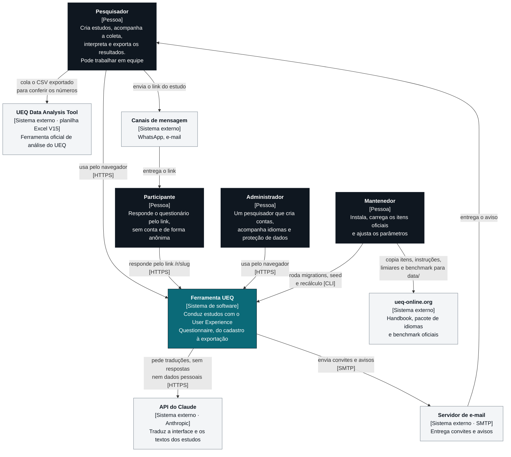
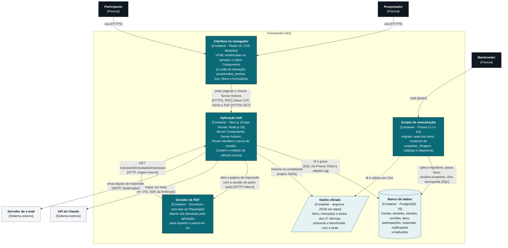
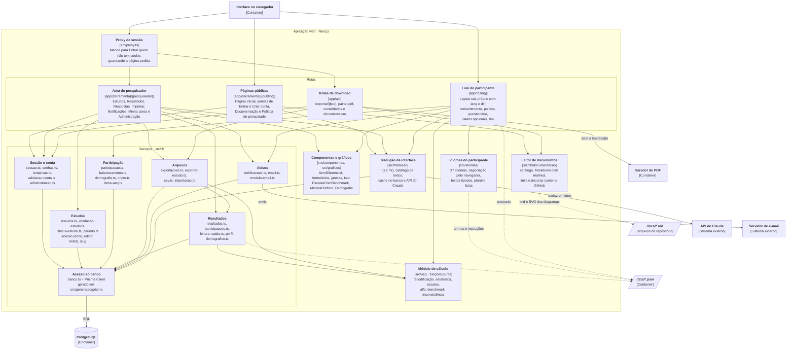
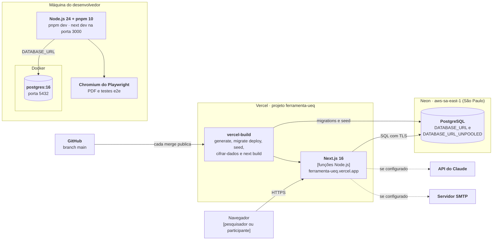

# Arquitetura

A arquitetura é descrita com o [modelo C4](https://c4model.com), em três níveis de zoom:

1. **Contexto:** quem usa a ferramenta e com que sistemas ela se relaciona;
2. **Containers:** as partes que rodam separadas (aplicação, banco, gerador de PDF, scripts) e como se falam;
3. **Componentes:** como a aplicação Next.js se organiza por dentro.

Um quarto diagrama mostra a implantação, em produção e no desenvolvimento.

Os diagramas usam Mermaid, que o GitHub desenha direto na página. Cada caixa traz o nome, o tipo entre colchetes e a tecnologia. As setas dizem o que passa e por qual protocolo. Logo abaixo de cada diagrama estão a ferramenta usada, o arquivo-fonte para baixar e a versão da ferramenta que ele representa.

## Visão geral

A Ferramenta UEQ é uma aplicação web única em **Next.js 16 (App Router)** com **React 19** e **TypeScript strict**, que guarda os dados num **PostgreSQL 16** pelo **Prisma 7**. Está no ar em [ferramenta-ueq.vercel.app](https://ferramenta-ueq.vercel.app), na Vercel, com o banco na Neon, região de São Paulo.

- Não existe uma API REST separada. As páginas são Server Components que leem o banco no servidor. As escritas são Server Actions chamadas pelos formulários.
- Só o que devolve arquivo é rota de API: as exportações em CSV, o painel em PDF, os dados da conta e os downloads da documentação.
- O cálculo do UEQ fica isolado em `src/ueq/`, em funções puras, para ser testado contra a planilha oficial sem banco nem interface.
- Os parâmetros do protocolo, o benchmark e os textos oficiais dos 37 idiomas são arquivos JSON versionados em `data/`, com a fonte de cada valor.
- A interface do pesquisador e os textos dos estudos são traduzidos sob demanda pela API do Claude, com o resultado guardado no banco. O questionário usa só as traduções oficiais do UEQ.

## Nível 1 · Contexto



**Ferramenta do diagrama:** Mermaid 12.2.0 (`flowchart`), gerado por `pnpm docs:diagramas`. **Arquivo-fonte:** [arquitetura-1.mmd](fontes/arquitetura-1.mmd). **Versão representada:** Ferramenta UEQ de 06/11/2026.

Em tempo de execução, a ferramenta chama só dois sistemas externos, e os dois são opcionais:

- **API do Claude:** sem `ANTHROPIC_API_KEY`, a interface fica em português e os textos dos estudos ficam no idioma original. Vão para a API os textos da interface e o título, o produto, o objetivo e os nomes de versão de cada estudo. Nenhuma resposta, nome, e-mail ou dado demográfico vai junto.
- **Servidor de e-mail:** sem as variáveis `SMTP_*`, os avisos ficam só no sino, e quem convida recebe um link de e-mail pronto para enviar por conta própria.

A planilha oficial e o site do UEQ entram por pessoas: a equipe copia os dados oficiais para `data/` (com a fonte em cada arquivo) e o pesquisador cola a exportação na planilha para conferir.

## Nível 2 · Containers



**Ferramenta do diagrama:** Mermaid 12.2.0 (`flowchart`), gerado por `pnpm docs:diagramas`. **Arquivo-fonte:** [arquitetura-2.mmd](fontes/arquitetura-2.mmd). **Versão representada:** Ferramenta UEQ de 06/11/2026.

| Container | Tecnologia | Responsabilidade | Onde está |
|---|---|---|---|
| Interface no navegador | React 19.3, CSS Modules, variáveis CSS, SVG feito à mão | Mostrar as telas e tratar a interação. Sem biblioteca de componentes nem de gráficos | `src/app/**/*.tsx` com `"use client"`, `src/componentes/`, `src/graficos/`, `src/styles/` |
| Aplicação web | Next.js 16.4, Node.js 24, Zod 4, bcryptjs, Nodemailer, SDK da Anthropic | Renderizar as páginas, validar e gravar dados, proteger a área do pesquisador, gerar exportações, traduzir e avisar | `src/app/`, `src/lib/`, `src/ueq/`, `src/idiomas/`, `src/traducao/`, `src/proxy.ts` |
| Gerador de PDF | Playwright 1.64 (Chromium) | Imprimir o painel em PDF com gráficos em vetor | `src/app/api/estudos/[id]/painel-pdf/route.ts` |
| Banco de dados | PostgreSQL 16 (Docker no desenvolvimento, Neon em produção) | Persistir o modelo de domínio, com cascata e `CHECK`. Detalhes no [modelo lógico](modelo-logico.md) | `prisma/schema.prisma`, `prisma/migrations/`, `docker-compose.yml` |
| Dados oficiais | JSON versionado | Fonte única dos itens, instruções, protocolo e benchmark, cada um com o campo `fonte` | `data/` |
| Documentação | Markdown e SVG versionados | Os documentos que a aba Documentação mostra, os diagramas já desenhados e o arquivo-fonte de cada um | `docs/`, `docs/documentacao/diagramas/`, `docs/documentacao/fontes/` |
| Scripts de manutenção | Prisma CLI, tsx | Criar o banco, carregar os itens, recalcular suspeitas, cifrar dados antigos, gerar o catálogo de textos e os diagramas | `prisma/seed.ts`, `prisma/recalcular-suspeitas.ts`, `prisma/cifrar-dados.ts`, `scripts/` |

## Nível 3 · Componentes da aplicação web



**Ferramenta do diagrama:** Mermaid 12.2.0 (`flowchart`), gerado por `pnpm docs:diagramas`. **Arquivo-fonte:** [arquitetura-3.mmd](fontes/arquitetura-3.mmd). **Versão representada:** Ferramenta UEQ de 06/11/2026.

O `matcher` de [`src/proxy.ts`](../../src/proxy.ts) exclui o que nunca exige sessão: `/entrar`, `/cadastrar`, `/privacidade`, `/r/`, `/documentacao`, `/api/documentacao` e os ícones do site. A raiz `/` passa pelo proxy e segue sem cookie. Toda rota nova do pesquisador já nasce protegida. O link do participante tem layout raiz próprio, sem barra e sem link para o resto da ferramenta: quem responde só vê o formulário, o seletor de idioma e a política de privacidade, que tem uma versão em `/r/<slug>/privacidade`.

### Regras de dependência

- **`src/ueq/` não depende de nada do projeto.** Não importa Prisma, React, Next nem `src/lib`. Recebe números e devolve objetos. É o que permite testá-lo contra a planilha oficial.
- **Componentes e gráficos não sabem de Prisma.** Recebem dados prontos por props.
- **Toda página, Server Action e rota do pesquisador confere a sessão no banco e o acesso ao estudo**, não só o proxy. O acesso passa sempre por `estudoDoPesquisador(id, pessoa, "ver" | "editar" | "gerenciar")` ou por `filtroDeAcesso`. Sem acesso, a resposta é igual à de um estudo que não existe.
- **O administrador não vê estudos de outras pessoas.** As respostas são dados de pesquisa de quem conduz o estudo. As páginas de Administração respondem 404 para quem não é administrador.
- **As rotas do participante só leem o que o participante pode ver:** título, produto, objetivo e status do estudo. Nada do pesquisador e nada da análise.
- **Parâmetros do protocolo nunca ficam no código.** Vêm de `data/protocolo.json` e `data/benchmark.json`.
- **Texto de tela do pesquisador passa por `t()` ou `m()`,** e `pnpm i18n:catalogo` gera o catálogo. Texto do participante fica em `src/idiomas/textos/`, um arquivo por idioma.

## Segurança e LGPD

| Medida | Onde está |
|---|---|
| Cabeçalhos de segurança em toda resposta: CSP, HSTS, `X-Frame-Options`, `X-Content-Type-Options`, `Referrer-Policy` e `Permissions-Policy` | `next.config.ts` |
| Senha em bcrypt custo 12, com hash refeito no login quando o custo sobe | `src/lib/senhas.ts` |
| 5 senhas erradas em 15 minutos bloqueiam o e-mail, contando pelo hash dele | `src/lib/tentativas.ts` |
| Sessão no banco pelo hash do token, com cookie `httpOnly` e `secure` em produção | `src/lib/sessao.ts` |
| Dados demográficos cifrados com AES-256-GCM, com a chave fora do banco | `src/lib/cripto.ts`, `prisma/cifrar-dados.ts` |
| Coleta demográfica desligada por padrão em cada estudo | `Estudo.coletarDemografia` |
| Participação abandonada há mais de 2 dias é apagada | `src/app/r/[slug]/acoes.ts` |
| Baixar os próprios dados e excluir a conta, sem pedir a ninguém | `src/app/api/conta/dados/route.ts`, `conta/` |
| Destino de `?voltar=` e `?de=` só aceita caminho interno | `destinoInterno` em `src/lib/validacao-conta.ts` |
| Política pública, sem exigir conta, também dentro do link do participante | `src/app/(ferramenta)/(publico)/privacidade/`, `src/app/r/[slug]/privacidade/` |

## Decisões de arquitetura

| Decisão | Por quê | Consequência |
|---|---|---|
| Server Components e Server Actions em vez de API REST | Menos código entre a tela e o banco; validação com Zod no servidor em cada ação; formulários funcionam com o comportamento nativo do navegador | A ferramenta não oferece API pública. Integrações usam as exportações em CSV |
| Cálculo em funções puras em `src/ueq/` | O número tem que bater com a planilha oficial; funções puras são testáveis com fixtures e bordas | Quem busca os dados (`src/lib/resultados.ts`) só monta a entrada e repassa |
| Sessão guardada no banco, com o hash do token | Trocar a senha encerra as outras sessões; quem lê o banco não consegue montar um cookie | Cada página do pesquisador faz uma consulta de sessão (com `cache` do React por requisição) |
| Dois layouts raiz: ferramenta e link do participante | O `<html lang>` e o `dir` do participante seguem o idioma escolhido por quem responde, e os da ferramenta seguem o idioma da conta (WCAG 3.1.1), incluindo árabe, hebraico e persa | `experimental.globalNotFound` em `next.config.ts` para a página 404 |
| Dois sistemas de texto: `src/idiomas` e `src/traducao` | O questionário é instrumento de medida: precisa dos termos oficiais e de textos revisáveis, sem tradução automática. O resto da ferramenta pode ser traduzido sob demanda | Texto novo do participante exige os 37 arquivos; texto novo do pesquisador só exige `pnpm i18n:catalogo` |
| Tradução sob demanda, guardada no banco | Traduzir cada texto uma vez só, sem custo em leituras seguintes e sem manter 37 arquivos à mão | A primeira visita a um idioma pode sair em português enquanto os lotes rodam em segundo plano |
| E-mail enviado depois da resposta (`after`) | Quem clicou não espera o servidor de e-mail, e uma falha de envio não desfaz a ação | O sino é o registro que sempre existe; o e-mail é um extra |
| Gráficos em SVG feitos à mão | Controle total de `title`, `desc`, contraste, formas por versão e reorganização em tela estreita | Sem biblioteca de gráficos para atualizar |
| PDF gerado por Chromium no servidor | O PDF sai igual ao painel, com gráficos em vetor e as mesmas fontes | O servidor precisa de um navegador disponível (ver [Implantação](#implantação)) |
| Documentação lida dos mesmos `.md` do repositório, com os diagramas desenhados antes, em SVG (`pnpm docs:diagramas`) | Um arquivo só para o GitHub e para a ferramenta; a ferramenta não carrega a biblioteca Mermaid e cada diagrama vira imagem com texto alternativo | Mudar um diagrama exige gerar o SVG e a fonte de novo; um teste de unidade avisa |
| Dados oficiais em JSON versionado | Cada número tem fonte rastreável e muda por pull request, não no código | Mudar um limiar exige `pnpm suspeitas:recalcular` para atualizar as participações já gravadas |
| Cookies do participante restritos a `/r/<slug>` | Anonimato: só o id aleatório da participação, a marca de já respondido e o idioma | A proteção contra envio duplicado vale por navegador, não por pessoa |

## Implantação



**Ferramenta do diagrama:** Mermaid 12.2.0 (`flowchart`), gerado por `pnpm docs:diagramas`. **Arquivo-fonte:** [arquitetura-4.mmd](fontes/arquitetura-4.mmd). **Versão representada:** Ferramenta UEQ de 06/11/2026.

**Produção.** Cada merge na `main` publica uma versão nova. O script `vercel-build` roda `prisma generate`, `prisma migrate deploy`, o seed, `prisma/cifrar-dados.ts` e `next build`. Em produção o seed grava só os 26 itens, sem conta de teste. As migrations usam `DATABASE_URL_UNPOOLED` quando ela existe.

**Desenvolvimento.** O passo a passo está no [README](../../README.md#como-rodar).

| Variável | Obrigatória | Para que serve |
|---|---|---|
| `DATABASE_URL` | Sim | Conexão com o PostgreSQL |
| `DATABASE_URL_UNPOOLED` | Na Neon | Conexão direta, usada pelas migrations |
| `CHAVE_CRIPTOGRAFIA` | Em produção | Chave AES-256-GCM da demografia. Sem ela, o dado fica em texto puro e Administração avisa. Guarde uma cópia: sem a chave, o dado cifrado não pode mais ser lido |
| `ANTHROPIC_API_KEY` | Não | Liga a tradução automática |
| `SMTP_HOST`, `SMTP_PORTA`, `SMTP_USUARIO`, `SMTP_SENHA`, `EMAIL_REMETENTE` | Não | Ligam o envio de e-mail |
| `URL_INTERNA` e `PORT` | Não | Endereço pelo qual a rota do PDF alcança a própria aplicação. Sem `URL_INTERNA`, vale `http://localhost:$PORT` |
| `PESQUISADOR_TESTE_EMAIL` e `PESQUISADOR_TESTE_SENHA` | Só no desenvolvimento | Conta criada pelo seed. Não devem existir em produção |
| `TRADUCAO_PSEUDO` | Só para conferência | Com `1`, marca os textos do catálogo com ⟦ ⟧ para achar o que não passa por `t()` |

**Pendência conhecida: painel em PDF em produção.** A rota usa `chromium.launch()` do Playwright, que precisa de um Chromium instalado no servidor, e o build da Vercel não instala nenhum. A adaptação para a Vercel foi feita no commit `d9b4344`, da branch `chore/faxina-e-deploy`, mas não chegou à `main`. Até ela entrar, espera-se que o PDF funcione só localmente. Esse comportamento não foi testado em produção. As exportações em CSV não dependem de navegador.

## Estrutura de pastas

```
src/
  app/
    (ferramenta)/         layout raiz no idioma da conta
      (publico)/          página inicial, Entrar, Criar conta, Documentação, Privacidade
      (pesquisador)/      Estudos, Resultados, Respostas, Notificações, Minha conta, Administração
    r/[slug]/             link do participante, com layout raiz próprio (lang e dir do idioma)
    api/                  downloads: exportar/[tipo], painel-pdf, conta/dados, documentacao
  ueq/                    cálculo do UEQ em funções puras
  lib/                    sessão, estudos, participação, resultados, CSV, avisos, criptografia
  idiomas/                37 idiomas do participante: textos tipados, negociação, plural
  traducao/               t() e m(), catálogo e tradução da interface pela API do Claude
  componentes/            ItemDiferencial, formulários, janelas, tour, ajuda e painéis
  graficos/               EscalasComBenchmark, MediasPorItem e Demografia em SVG
  styles/                 tokens de cor, tipografia e espaçamento
  proxy.ts                checagem otimista de sessão
scripts/                  SVG e fontes dos diagramas; catálogo de textos
prisma/                   schema, migrations, seed, recálculo de suspeitas e cifragem
data/                     itens, instruções, idiomas, protocolo, benchmark e fixtures
tests/e2e/                Playwright com axe-core
docs/                     especificação, requisitos de IHC, protótipos e esta documentação
```
