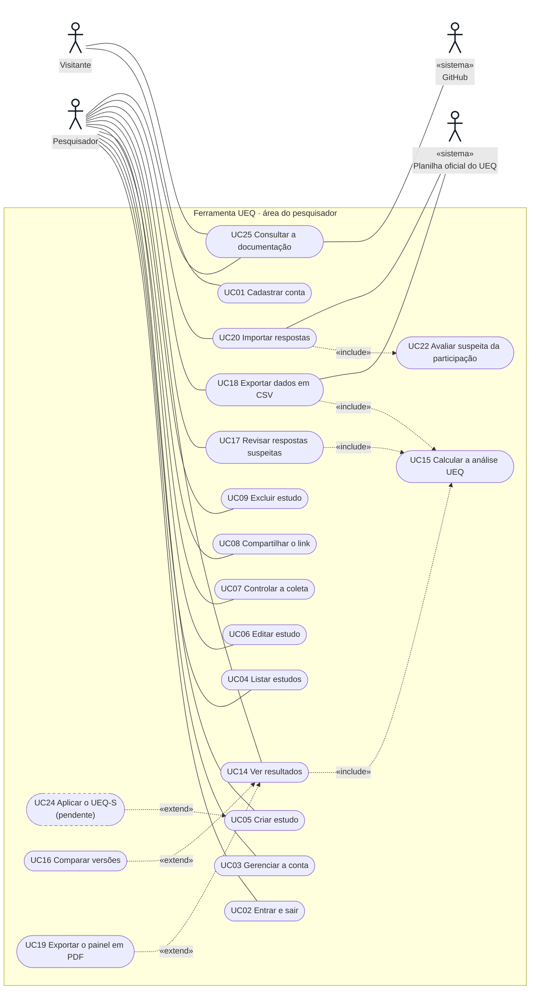
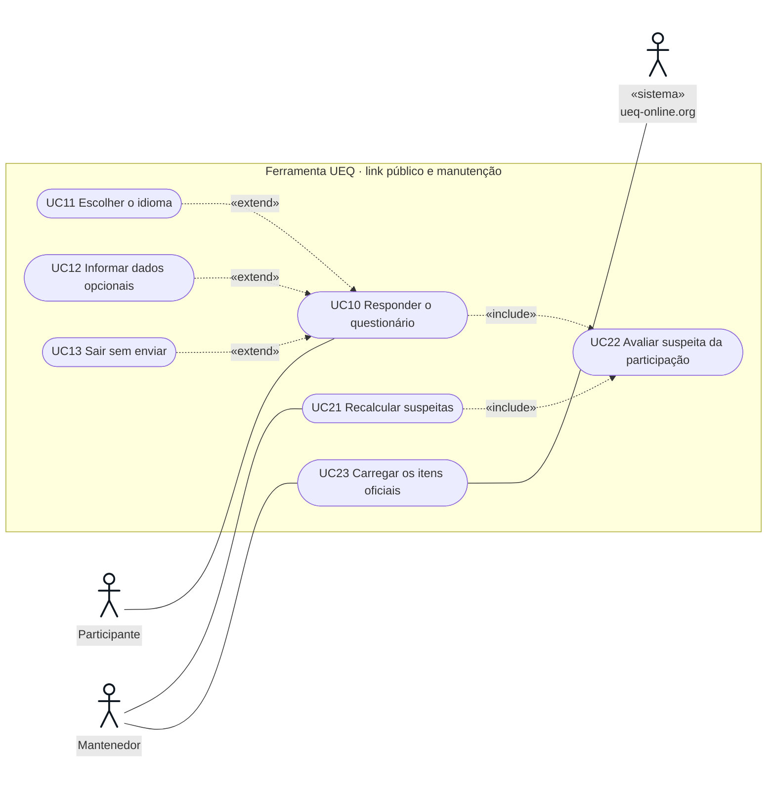
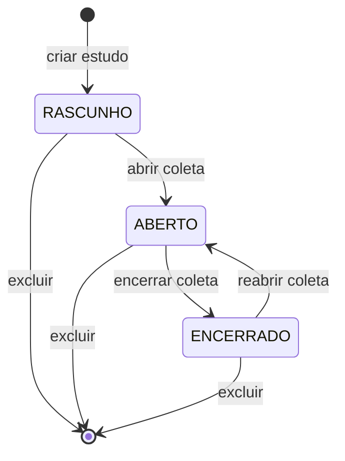

# Casos de uso

25 casos de uso descrevem o que cada ator faz com a Ferramenta UEQ. Os diagramas seguem a notação UML de casos de uso, desenhada em Mermaid para aparecer direto no GitHub:

- o boneco é o ator: os primários, que iniciam o caso de uso, ficam à esquerda; os secundários, que participam sem iniciar, à direita. Quando o ator é outro sistema, o nome leva «sistema»;
- a forma arredondada é o caso de uso;
- a moldura é o limite do sistema;
- a linha cheia liga o ator ao caso de uso que ele inicia;
- a seta tracejada «include» aponta para um caso de uso que sempre acontece junto;
- a seta tracejada «extend» sai de um caso de uso opcional e aponta para o caso de uso que ele estende.

A ligação de cada caso de uso com os requisitos está na [matriz de rastreabilidade](matriz-rastreabilidade.md#requisitos-funcionais--casos-de-uso).

## Atores

| Ator | Quem é | Personas |
|---|---|---|
| Visitante | Pessoa sem conta que chega a Entrar ou Criar conta | [PE01](personas.md#pe01), [PE02](personas.md#pe02) antes do cadastro |
| Pesquisador | Dono dos estudos. Tem conta e sessão | [PE01](personas.md#pe01), [PE02](personas.md#pe02) |
| Participante | Quem responde pelo link público. Não tem conta e nunca precisa de sessão | [PE03](personas.md#pe03), [PE04](personas.md#pe04), [PE05](personas.md#pe05) |
| Mantenedor | Quem roda comandos na instalação: seed, migrations, recálculo | [PE06](personas.md#pe06) |
| Sistema | Comportamento disparado pela própria ferramenta, sem ação direta de um ator (cálculo, regra de suspeita) | — |

Atores secundários: participam de um caso de uso sem iniciá-lo.

| Ator secundário | Onde participa | O que troca com a ferramenta |
|---|---|---|
| Planilha oficial do UEQ «sistema» | [UC18](#uc18) Exportar dados em CSV, [UC20](#uc20) Importar respostas | Recebe as respostas no formato dela (UEQ Data Analysis Tool) e é a origem do CSV importado |
| GitHub «sistema» | [UC25](#uc25) Consultar a documentação | Guarda o arquivo de cada documento, aberto pelo link Ver no GitHub |
| ueq-online.org «sistema» | [UC23](#uc23) Carregar os itens oficiais | Fonte dos termos, instruções e benchmark oficiais copiados para `data/` |

## Diagrama 1 · Área do pesquisador

UC24 está tracejado porque está pendente: só existe a estrutura de dados (ver [RF51](requisitos.md#rf51)).

## Diagrama 2 · Participante e manutenção

## Lista

| ID | Caso de uso | Ator | Requisitos | Relações |
|---|---|---|---|---|
| [UC01](#uc01) | Cadastrar conta | Visitante | [RF01](requisitos.md#rf01) | — |
| [UC02](#uc02) | Entrar e sair | Pesquisador | [RF02](requisitos.md#rf02), [RF03](requisitos.md#rf03), [RF04](requisitos.md#rf04) | — |
| [UC03](#uc03) | Gerenciar a conta | Pesquisador | [RF05](requisitos.md#rf05) a [RF08](requisitos.md#rf08) | — |
| [UC04](#uc04) | Listar estudos | Pesquisador | [RF09](requisitos.md#rf09) | — |
| [UC05](#uc05) | Criar estudo | Pesquisador | [RF10](requisitos.md#rf10), [RF11](requisitos.md#rf11) | estendido por UC24 |
| [UC06](#uc06) | Editar estudo | Pesquisador | [RF12](requisitos.md#rf12) | — |
| [UC07](#uc07) | Controlar a coleta | Pesquisador | [RF14](requisitos.md#rf14), [RF16](requisitos.md#rf16) | — |
| [UC08](#uc08) | Compartilhar o link | Pesquisador | [RF13](requisitos.md#rf13) | — |
| [UC09](#uc09) | Excluir estudo | Pesquisador | [RF15](requisitos.md#rf15) | — |
| [UC10](#uc10) | Responder o questionário | Participante | [RF16](requisitos.md#rf16) a [RF23](requisitos.md#rf23), [RF26](requisitos.md#rf26), [RF27](requisitos.md#rf27) | inclui UC22; estendido por UC11, UC12, UC13 |
| [UC11](#uc11) | Escolher o idioma | Participante | [RF28](requisitos.md#rf28) a [RF31](requisitos.md#rf31) | estende UC10 |
| [UC12](#uc12) | Informar dados opcionais | Participante | [RF25](requisitos.md#rf25) | estende UC10 |
| [UC13](#uc13) | Sair sem enviar | Participante | [RF24](requisitos.md#rf24) | estende UC10 |
| [UC14](#uc14) | Ver resultados | Pesquisador | [RF37](requisitos.md#rf37), [RF38](requisitos.md#rf38), [RF40](requisitos.md#rf40), [RF41](requisitos.md#rf41) | inclui UC15; estendido por UC16, UC19 |
| [UC15](#uc15) | Calcular a análise UEQ | Sistema | [RF33](requisitos.md#rf33) a [RF36](requisitos.md#rf36) | incluído por UC14, UC17, UC18 |
| [UC16](#uc16) | Comparar versões | Pesquisador | [RF39](requisitos.md#rf39) | estende UC14 |
| [UC17](#uc17) | Revisar respostas suspeitas | Pesquisador | [RF31](requisitos.md#rf31), [RF42](requisitos.md#rf42), [RF43](requisitos.md#rf43) | inclui UC15 |
| [UC18](#uc18) | Exportar dados em CSV | Pesquisador | [RF45](requisitos.md#rf45) a [RF48](requisitos.md#rf48) | inclui UC15 |
| [UC19](#uc19) | Exportar o painel em PDF | Pesquisador | [RF49](requisitos.md#rf49) | estende UC14 |
| [UC20](#uc20) | Importar respostas | Pesquisador | [RF50](requisitos.md#rf50) | inclui UC22 |
| [UC21](#uc21) | Recalcular suspeitas | Mantenedor | [RF44](requisitos.md#rf44) | inclui UC22 |
| [UC22](#uc22) | Avaliar suspeita da participação | Sistema | [RF36](requisitos.md#rf36) | incluído por UC10, UC20, UC21 |
| [UC23](#uc23) | Carregar os itens oficiais | Mantenedor | [RF32](requisitos.md#rf32) | — |
| [UC24](#uc24) | Aplicar o UEQ-S | Pesquisador | [RF51](requisitos.md#rf51) | pendente; estende UC05 |
| [UC25](#uc25) | Consultar a documentação | Visitante ou Pesquisador | [RF52](requisitos.md#rf52) | — |

## Especificações

Os casos de uso centrais têm especificação completa. Os demais, por serem curtos, têm só o fluxo principal.

### UC10

**Responder o questionário**

| | |
|---|---|
| Ator | Participante |
| Objetivo | Responder os 26 itens do UEQ sobre uma versão do produto, de forma anônima |
| Pré-condições | O estudo existe e o participante tem o link `/r/<slug>` |
| Pós-condições de sucesso | Existe uma participação concluída, com 26 respostas de 1 a 7, idioma, versão atribuída e suspeita calculada |
| Pós-condições de desistência | Nenhuma participação nem resposta gravada |
| Telas | p1 consentimento, p2/p7 questionário, p3 item faltando, p4 dados opcionais, p5 fim, p6 link fechado |

Fluxo principal:

1. O participante abre o link. O sistema escolhe o idioma pelo navegador e mostra o termo de consentimento: título, objetivo, tempo estimado, participação voluntária e anônima, direito de desistir.
2. O participante clica em "Concordo e quero participar".
3. O sistema atribui a versão com menos respostas concluídas, cria a participação com a data do consentimento e o idioma, e guarda o id dela num cookie restrito ao link.
4. O sistema mostra a instrução oficial e os 26 itens na ordem e polaridade oficiais, nenhum marcado, com o rodapé "0 de 26 respondidos" e "Sair sem enviar".
5. O participante marca uma posição em cada item. O rodapé atualiza o contador e o rascunho é guardado na aba.
6. O participante clica em "Enviar respostas".
7. O sistema confere os 26 valores, avalia a suspeita (UC22) e grava as 26 respostas e a conclusão numa transação. Marca o link como respondido nesse navegador.
8. O sistema mostra a etapa de dados opcionais (UC12). O participante responde ou clica em "Pular esta etapa".
9. O sistema mostra a página final: as respostas foram registradas e a pessoa pode fechar a página.

Fluxos alternativos:

- **1a. Estudo em rascunho ou encerrado.** O sistema explica a situação ("ainda não está aberto", "a coleta foi encerrada") e não oferece o consentimento.
- **1b. Link já respondido neste navegador.** O sistema diz que as respostas já foram registradas.
- **1c. Outro idioma.** O participante escolhe no seletor e clica em "Aplicar" (UC11).
- **2a. Não quero participar.** O participante sai sem que nada seja gravado.
- **4a. Participação em andamento.** Quem já consentiu e volta ao link vai direto ao questionário.
- **5a. Recarregar a página.** O sistema recupera os itens marcados e avisa.
- **5b. Sair sem enviar (UC13).** O participante confirma em linha. O sistema apaga a participação incompleta.
- **7a. Itens faltando.** O sistema não grava nada, mostra o resumo "Faltam N itens" com um link para cada item e leva o foco ao resumo. Volta ao passo 5.
- **7b. A coleta foi encerrada durante a resposta.** O sistema avisa que o estudo não aceita mais respostas.

Regras: [RNF06](requisitos.md#rnf06) (validade do instrumento) e [RNF09](requisitos.md#rnf09) (anonimato).

### UC05

**Criar estudo**

| | |
|---|---|
| Ator | Pesquisador |
| Pré-condições | Sessão válida |
| Pós-condições | Estudo em RASCUNHO, com slug público único e de 1 a 6 versões numeradas |

Fluxo principal:

1. O pesquisador clica em "Criar estudo".
2. O sistema mostra o formulário em seções numeradas, com a prévia do termo do participante ao lado.
3. O pesquisador informa título, produto avaliado, objetivo e datas. O sistema sugere o produto como nome da primeira versão.
4. O pesquisador adiciona ou renomeia versões.
5. O pesquisador clica em "Criar estudo".
6. O sistema valida, gera o slug público e grava o estudo com as versões.
7. O sistema abre a página do estudo em rascunho, com o aviso de sucesso e a lista "Antes de abrir, confira".

Fluxos alternativos:

- **6a. Dados inválidos.** O sistema mostra o resumo de erros com um link para cada campo, leva o foco ao resumo e marca cada campo com a mensagem. Volta ao passo 3.

### UC07

**Controlar a coleta**

Fluxo principal:

1. Na página do estudo em RASCUNHO, o pesquisador clica em "Abrir coleta".
2. O sistema muda o status para ABERTO e anuncia "Coleta aberta. O link já aceita respostas."
3. Mais tarde, o pesquisador clica em "Encerrar coleta". O sistema muda para ENCERRADO; o link passa a dizer que a coleta foi encerrada.

Fluxos alternativos:

- **3a. Reabrir.** Com o estudo encerrado, "Reabrir coleta" volta para ABERTO. Por ser reversível, encerrar não pede confirmação.
- **2a. Estado mudou em outra aba.** O sistema recusa a transição e pede para recarregar.

### UC14

**Ver resultados**

| | |
|---|---|
| Ator | Pesquisador |
| Pré-condições | Sessão válida e estudo do próprio pesquisador |
| Pós-condições | Nenhuma: o caso de uso só lê |

Fluxo principal:

1. O pesquisador abre a aba Resultados do estudo.
2. O sistema busca as participações concluídas e calcula a análise das incluídas, para todas as versões e para cada uma (UC15).
3. O sistema mostra o resumo em texto, a leitura rápida, o gráfico das 6 escalas com benchmark e IC95, a tabela equivalente, as médias de pragmática e hedônica, o gráfico por item e a seção Exportar.
4. O pesquisador abre as explicações de benchmark, IC95 ou alfa quando precisa.

Fluxos alternativos:

- **2a. Ninguém na análise.** O sistema mostra "Nenhuma resposta na análise ainda." no lugar dos gráficos.
- **3a. Amostra pequena ou alfa abaixo de 0,7.** O sistema mostra o aviso com o que significa e o que fazer.
- **3b. Outra versão.** O pesquisador escolhe outra versão; a URL guarda a escolha.
- **3c. Comparar versões (UC16).** Com mais de uma versão, o pesquisador alterna para "Comparar versões".
- **3d. Exportar o painel em PDF (UC19).**

### UC17

**Revisar respostas suspeitas**

Fluxo principal:

1. O pesquisador abre a aba Respostas.
2. O sistema mostra o panorama (na análise, fora da análise, suspeitas), a tabela de participações com o motivo da suspeita e a regra de suspeita ao lado.
3. O pesquisador marca "Mostrar só suspeitas" e abre "Ver escalas" de uma linha.
4. O sistema mostra a amplitude de cada escala, destacando as que passaram do limiar.
5. O pesquisador clica em "Tirar suspeitas da análise".
6. O sistema marca as suspeitas como fora da análise, sem apagar nada, e anuncia quantas saíram.

Fluxos alternativos:

- **5a. Uma a uma.** O pesquisador desmarca "Na análise" numa linha. Marcar de novo devolve a participação.

### UC18

**Exportar dados em CSV**

1. Na seção Exportar do painel, o pesquisador escolhe um dos quatro arquivos: respostas brutas, respostas recodificadas, resultados por escala ou formato da planilha oficial.
2. O sistema confere a sessão e o dono do estudo, monta o CSV e devolve como download, com nome `ueq_<titulo>_<tipo>_<aaaa-mm-dd>.csv`.

Alternativo: **2a.** Sem sessão ou estudo de outro pesquisador, nada sai.

### UC20

**Importar respostas**

| | |
|---|---|
| Ator | Pesquisador |
| Pré-condições | Sessão válida, estudo do próprio pesquisador e um CSV com 26 valores de 1 a 7 por linha |
| Pós-condições | Uma participação concluída por linha, com origem IMPORTADA, sem idioma e com a suspeita avaliada; ou nada, se houver erro |

Fluxo principal:

1. Em Respostas, o pesquisador clica em "Importar respostas de um CSV".
2. O pesquisador escolhe a versão (quando há mais de uma) e o arquivo, e clica em "Ver prévia".
3. O sistema lê o arquivo sem gravar e mostra as 5 primeiras linhas e o total.
4. O pesquisador confirma.
5. O sistema grava todas as linhas numa transação, avaliando a suspeita de cada uma (UC22), e volta para Respostas com o aviso de quantas foram importadas.

Fluxos alternativos:

- **3a. Linhas com erro.** O sistema lista o problema de cada linha (número de valores, valor fora de 1 a 7) e não oferece a confirmação.
- **3b. Arquivo inválido.** Extensão errada, vazio ou maior que 500 KB: o sistema diz o que fazer.

### Demais casos de uso

#### UC01

Cadastrar conta. O visitante informa nome, e-mail e senha (regras visíveis antes de digitar). O sistema valida, grava a senha com bcrypt, cria a sessão e abre Seus estudos. Alternativo: e-mail já cadastrado mostra o erro com link para Entrar.

#### UC02

Entrar e sair. O pesquisador informa e-mail e senha. O sistema confere, cria a sessão e volta para a página pedida, se houver. Sair apaga a sessão.

#### UC03

Gerenciar a conta. Em Minha conta, o pesquisador salva nome e e-mail, troca a senha (encerra as outras sessões) ou exclui a conta digitando o e-mail. A ficha lateral resume estudos e respostas.

#### UC04

Listar estudos. O sistema mostra a tabela dos estudos do pesquisador. O título leva à página do estudo.

#### UC06

Editar estudo. Igual a UC05, com os dados preenchidos. Versões com respostas não podem ser removidas.

#### UC08

Compartilhar o link. O pesquisador clica em "Copiar link"; o sistema copia e anuncia.

#### UC09

Excluir estudo. O pesquisador abre "Excluir estudo", lê quantas respostas vão junto e digita o título. O sistema apaga em cascata e volta para a lista.

#### UC11

Escolher o idioma. No consentimento, o participante escolhe o idioma no seletor e clica em "Aplicar". O sistema guarda a escolha num cookie do link, ajusta `lang` e `dir` e mostra o aviso quando a tradução não é aprovada.

#### UC12

Informar dados opcionais. O participante responde faixa etária, gênero, escolaridade e familiaridade, ou pula. Só opções da lista são gravadas.

#### UC13

Sair sem enviar. O participante clica em "Sair sem enviar" e confirma em linha. O sistema apaga a participação incompleta.

#### UC15

Calcular a análise UEQ. O sistema recodifica as respostas, calcula por escala n, média, dp, IC95, alfa e faixa, classifica no benchmark, calcula pragmática, hedônica e cada item, e avalia a suspeita de cada participação. Só as participações incluídas entram nas estatísticas.

#### UC16

Comparar versões. O pesquisador escolhe "Comparar versões". O sistema mostra um marcador por versão em cada escala e a leitura das maiores diferenças.

#### UC19

Exportar o painel em PDF. O pesquisador clica em "Exportar painel em PDF". O sistema abre a página de impressão num navegador sem tela, com a mesma versão e modo, e devolve um PDF A4.

#### UC21

Recalcular suspeitas. Depois de mudar `data/protocolo.json`, o mantenedor roda `pnpm suspeitas:recalcular`. O sistema reavalia todas as participações concluídas.

#### UC22

Avaliar suspeita da participação. Com os 26 valores, o sistema calcula a amplitude por escala e o número de respostas iguais e marca a participação como suspeita se passar dos limiares de `data/protocolo.json`.

#### UC23

Carregar os itens oficiais. O mantenedor roda `pnpm db:seed`. O sistema valida `data/ueq-itens-ptbr.json` e grava os 26 itens; se algo estiver errado, para e diz qual item.

#### UC24

Aplicar o UEQ-S. Pendente. Ao criar o estudo, o pesquisador escolherá entre UEQ e UEQ-S; a escolha trava depois da primeira resposta.

#### UC25

Consultar a documentação. Qualquer pessoa, com ou sem conta, abre /documentacao; o pesquisador também chega pelo link Documentação da barra superior. Quem não entrou vê uma barra só com Documentação, Entrar e Criar conta; quem entrou continua com a barra do pesquisador. O sistema mostra a visão geral e as seções em abas; cada seção tem sub-abas, uma por documento. O sistema lê o `.md` do repositório, mostra o documento com os diagramas como imagem e uma ficha que diz o que ele é, para que serve e quem deve ler, com o arquivo no GitHub, os downloads e o índice da página. Links para outros documentos abrem na mesma aba. Alternativo: endereço fora do catálogo dá a página de não encontrado.
