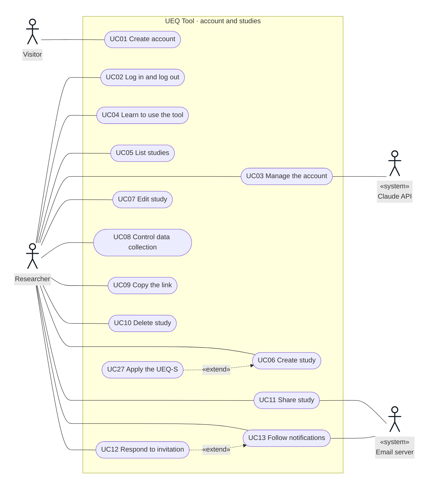
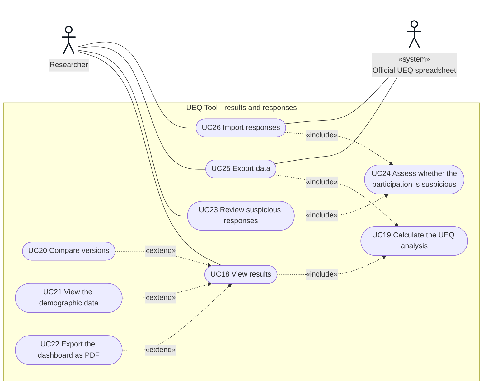
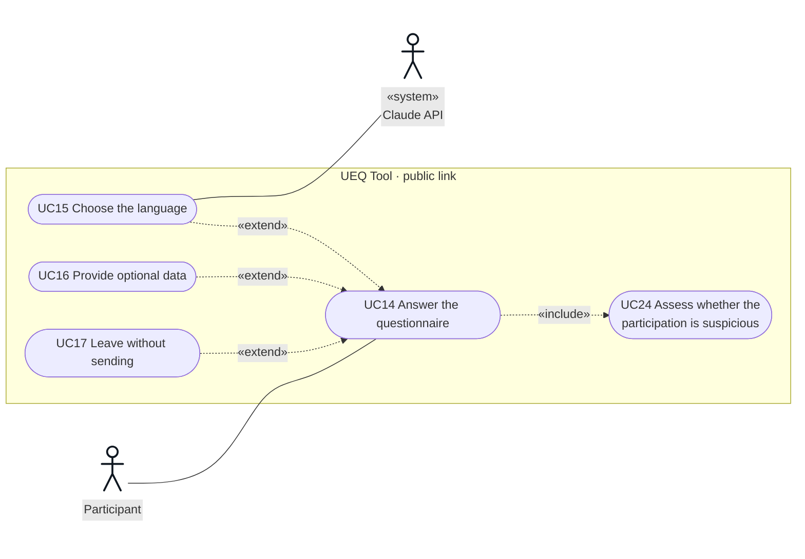
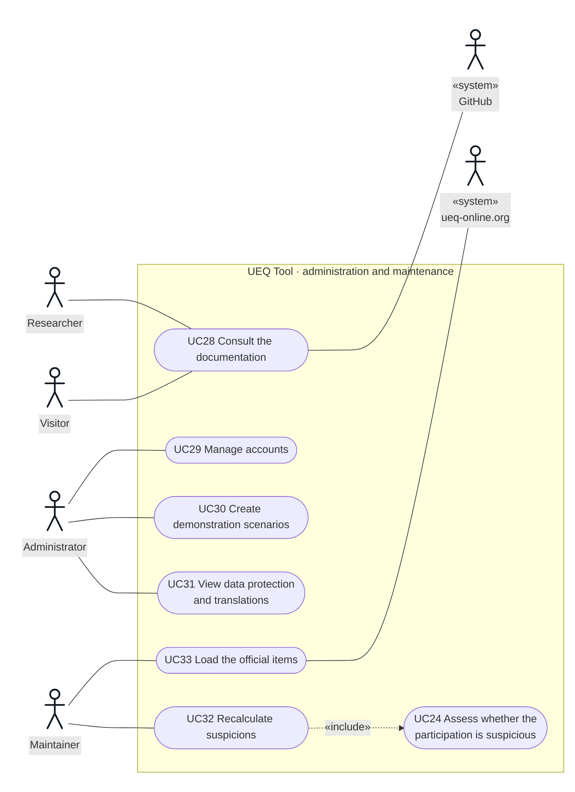
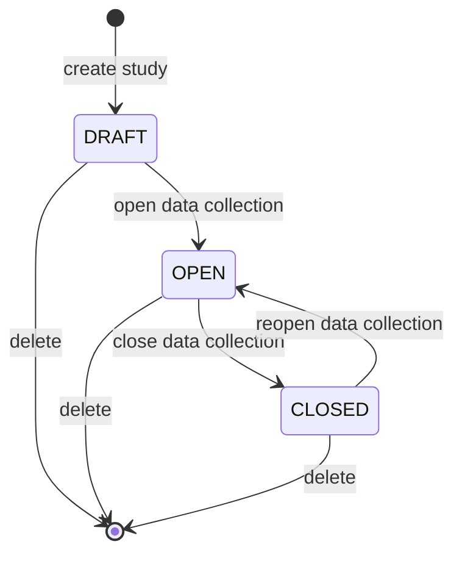

# Casos de uso

33 casos de uso descrevem o que cada ator faz com a Ferramenta UEQ. Os diagramas seguem a notação UML de casos de uso, desenhada em Mermaid para aparecer direto no GitHub:

- o boneco é o ator. Os primários, que iniciam o caso de uso, ficam à esquerda; os secundários, que participam sem iniciar, ficam à direita. Quando o ator é outro sistema, o nome leva «sistema»;
- a forma arredondada é o caso de uso;
- a moldura é o limite do sistema;
- a linha cheia liga o ator ao caso de uso de que ele participa;
- a seta tracejada «include» aponta para um caso de uso que sempre acontece junto;
- a seta tracejada «extend» sai de um caso de uso opcional e aponta para o caso de uso que ele estende.

Logo abaixo de cada diagrama estão a ferramenta usada, o arquivo-fonte para baixar e a versão da ferramenta que ele representa. A ligação de cada caso de uso com os requisitos está na [lista](#lista) e na [matriz de rastreabilidade](matriz-rastreabilidade.md#casos-de-uso).

## Atores

| Ator | Quem é | Personas |
|---|---|---|
| Visitante | Pessoa sem conta, ou que ainda não entrou. Lê a página inicial e a documentação e pode criar uma conta | [PE08](personas.md#pe08) e qualquer pesquisador antes do cadastro |
| Pesquisador | Tem conta e sessão. É dono dos estudos que cria e pode ser Editor ou Leitor dos estudos que outra pessoa compartilhou com ele | [PE01](personas.md#pe01), [PE02](personas.md#pe02), [PE03](personas.md#pe03) |
| Participante | Responde pelo link público. Não tem conta e nunca precisa de sessão | [PE04](personas.md#pe04), [PE05](personas.md#pe05), [PE06](personas.md#pe06), [PE07](personas.md#pe07) |
| Administrador | Pesquisador com a marca de administrador: faz tudo o que o pesquisador faz e abre a página Administração. Não vê os estudos de outras pessoas | [PE08](personas.md#pe08) |
| Mantenedor | Quem roda os comandos da instalação: migrations, seed e recálculo | [PE08](personas.md#pe08) |

Atores secundários, que participam de um caso de uso sem iniciá-lo:

| Ator secundário | Onde participa | O que troca com a ferramenta |
|---|---|---|
| Servidor de e-mail «sistema» | [UC11](#uc11) Compartilhar estudo, [UC13](#uc13) Acompanhar notificações | Entrega o convite e as notificações por e-mail, quando o envio está configurado |
| API do Claude «sistema» | [UC03](#uc03) Gerenciar a conta, [UC15](#uc15) Escolher o idioma | Traduz a interface do pesquisador e o título, o produto e o objetivo do estudo. Nunca traduz o questionário |
| Planilha oficial do UEQ «sistema» | [UC25](#uc25) Exportar dados, [UC26](#uc26) Importar respostas | Recebe as respostas preenchidas nela mesma (UEQ Data Analysis Tool) e é a origem do CSV importado |
| GitHub «sistema» | [UC28](#uc28) Consultar a documentação | Guarda o arquivo de cada documento, aberto pelo link Ver no GitHub |
| ueq-online.org «sistema» | [UC33](#uc33) Carregar os itens oficiais | Fonte dos termos, das instruções e do benchmark oficiais copiados para `data/` |

O Participante é sempre ator primário: ele inicia o próprio caso de uso pelo link e não participa dos casos de uso de outros atores.

## Diagrama 1 · Conta e estudos

**Ferramenta do diagrama:** Mermaid 12.2.0 (`flowchart`), gerado por `pnpm docs:diagramas`. **Arquivo-fonte:** [casos-de-uso-1.mmd](fontes/casos-de-uso-1.mmd). **Versão representada:** Ferramenta UEQ de 17/11/2026.

UC12 estende UC13 porque o convite chega como notificação: aceitar ou recusar é uma escolha opcional de quem abre o sino. UC27 estende UC06 porque escolher o UEQ-S é uma opção de quem cria o estudo; sem ela, o estudo usa o UEQ completo.

## Diagrama 2 · Resultados e respostas

**Ferramenta do diagrama:** Mermaid 12.2.0 (`flowchart`), gerado por `pnpm docs:diagramas`. **Arquivo-fonte:** [casos-de-uso-2.mmd](fontes/casos-de-uso-2.mmd). **Versão representada:** Ferramenta UEQ de 17/11/2026.

UC19 e UC24 não têm ator: só acontecem dentro de outro caso de uso. Os dois são as funções puras do módulo de cálculo ([diagrama de classes](diagrama-de-classes.md#2-módulo-de-cálculo)).

## Diagrama 3 · Participante

**Ferramenta do diagrama:** Mermaid 12.2.0 (`flowchart`), gerado por `pnpm docs:diagramas`. **Arquivo-fonte:** [casos-de-uso-3.mmd](fontes/casos-de-uso-3.mmd). **Versão representada:** Ferramenta UEQ de 17/11/2026.

A API do Claude só entra em UC15 para traduzir o título, o produto e o objetivo escritos pelo pesquisador. Os 26 itens, a instrução e os textos das telas do participante vêm dos arquivos oficiais e revisados, nunca da API.

## Diagrama 4 · Administração, manutenção e documentação

**Ferramenta do diagrama:** Mermaid 12.2.0 (`flowchart`), gerado por `pnpm docs:diagramas`. **Arquivo-fonte:** [casos-de-uso-4.mmd](fontes/casos-de-uso-4.mmd). **Versão representada:** Ferramenta UEQ de 17/11/2026.

O Administrador é um Pesquisador com permissão a mais, por isso também faz todos os casos de uso do Pesquisador dos diagramas 1 e 2. O Mantenedor não usa a interface: roda comandos no terminal da instalação.

## Lista

| ID | Caso de uso | Ator primário | Requisitos | Relações |
|---|---|---|---|---|
| [UC01](#uc01) | Criar conta | Visitante | [RF01](requisitos.md#rf01), [RF08](requisitos.md#rf08) | — |
| [UC02](#uc02) | Entrar e sair | Pesquisador | [RF02](requisitos.md#rf02), [RF03](requisitos.md#rf03), [RF11](requisitos.md#rf11) | — |
| [UC03](#uc03) | Gerenciar a conta | Pesquisador | [RF04](requisitos.md#rf04), [RF05](requisitos.md#rf05), [RF06](requisitos.md#rf06), [RF07](requisitos.md#rf07), [RF08](requisitos.md#rf08), [RF23](requisitos.md#rf23) | — |
| [UC04](#uc04) | Aprender a usar | Pesquisador | [RF09](requisitos.md#rf09), [RF10](requisitos.md#rf10) | — |
| [UC05](#uc05) | Listar estudos | Pesquisador | [RF12](requisitos.md#rf12) | — |
| [UC06](#uc06) | Criar estudo | Pesquisador | [RF13](requisitos.md#rf13), [RF18](requisitos.md#rf18), [RF19](requisitos.md#rf19) | estendido por UC27 |
| [UC07](#uc07) | Editar estudo | Pesquisador | [RF14](requisitos.md#rf14) | — |
| [UC08](#uc08) | Controlar a coleta | Pesquisador | [RF15](requisitos.md#rf15) | — |
| [UC09](#uc09) | Copiar o link | Pesquisador | [RF16](requisitos.md#rf16) | — |
| [UC10](#uc10) | Excluir estudo | Pesquisador | [RF17](requisitos.md#rf17) | — |
| [UC11](#uc11) | Compartilhar estudo | Pesquisador | [RF20](requisitos.md#rf20) | — |
| [UC12](#uc12) | Responder convite | Pesquisador | [RF21](requisitos.md#rf21) | estende UC13 |
| [UC13](#uc13) | Acompanhar notificações | Pesquisador | [RF22](requisitos.md#rf22), [RF23](requisitos.md#rf23) | estendido por UC12 |
| [UC14](#uc14) | Responder o questionário | Participante | [RF24](requisitos.md#rf24), [RF25](requisitos.md#rf25), [RF26](requisitos.md#rf26), [RF27](requisitos.md#rf27), [RF28](requisitos.md#rf28), [RF29](requisitos.md#rf29), [RF30](requisitos.md#rf30), [RF33](requisitos.md#rf33) | inclui UC24; estendido por UC15, UC16, UC17 |
| [UC15](#uc15) | Escolher o idioma | Participante | [RF34](requisitos.md#rf34), [RF35](requisitos.md#rf35) | estende UC14 |
| [UC16](#uc16) | Informar dados opcionais | Participante | [RF32](requisitos.md#rf32) | estende UC14 |
| [UC17](#uc17) | Sair sem enviar | Participante | [RF31](requisitos.md#rf31) | estende UC14 |
| [UC18](#uc18) | Ver resultados | Pesquisador | [RF43](requisitos.md#rf43), [RF44](requisitos.md#rf44), [RF45](requisitos.md#rf45), [RF46](requisitos.md#rf46), [RF48](requisitos.md#rf48), [RF49](requisitos.md#rf49) | inclui UC19; estendido por UC20, UC21, UC22 |
| [UC19](#uc19) | Calcular a análise UEQ | — | [RF36](requisitos.md#rf36), [RF37](requisitos.md#rf37), [RF38](requisitos.md#rf38), [RF39](requisitos.md#rf39), [RF40](requisitos.md#rf40), [RF41](requisitos.md#rf41), [RF42](requisitos.md#rf42) | incluído por UC18, UC25 |
| [UC20](#uc20) | Comparar versões | Pesquisador | [RF47](requisitos.md#rf47) | estende UC18 |
| [UC21](#uc21) | Ver os dados demográficos | Pesquisador | [RF50](requisitos.md#rf50) | estende UC18 |
| [UC22](#uc22) | Exportar o painel em PDF | Pesquisador | [RF60](requisitos.md#rf60) | estende UC18 |
| [UC23](#uc23) | Revisar respostas suspeitas | Pesquisador | [RF52](requisitos.md#rf52), [RF53](requisitos.md#rf53), [RF54](requisitos.md#rf54) | inclui UC24 |
| [UC24](#uc24) | Avaliar a suspeita da participação | — | [RF51](requisitos.md#rf51) | incluído por UC14, UC23, UC26, UC32 |
| [UC25](#uc25) | Exportar dados | Pesquisador | [RF56](requisitos.md#rf56), [RF57](requisitos.md#rf57), [RF58](requisitos.md#rf58), [RF59](requisitos.md#rf59) | inclui UC19 |
| [UC26](#uc26) | Importar respostas | Pesquisador | [RF61](requisitos.md#rf61) | inclui UC24 |
| [UC27](#uc27) | Aplicar o UEQ-S | Pesquisador | [RF62](requisitos.md#rf62) | estende UC06 |
| [UC28](#uc28) | Consultar a documentação | Visitante ou Pesquisador | [RF63](requisitos.md#rf63), [RF64](requisitos.md#rf64), [RF65](requisitos.md#rf65) | — |
| [UC29](#uc29) | Gerenciar contas | Administrador | [RF66](requisitos.md#rf66) | — |
| [UC30](#uc30) | Criar cenários de demonstração | Administrador | [RF67](requisitos.md#rf67) | — |
| [UC31](#uc31) | Ver proteção de dados e traduções | Administrador | [RF68](requisitos.md#rf68) | — |
| [UC32](#uc32) | Recalcular suspeitas | Mantenedor | [RF55](requisitos.md#rf55) | inclui UC24 |
| [UC33](#uc33) | Carregar os itens oficiais | Mantenedor | [RNF10](requisitos.md#rnf10) | — |

## Especificações

Os casos de uso centrais têm especificação completa: ator, pré-condições, pós-condições, fluxo principal e fluxos alternativos. Os demais, por serem curtos, têm só o fluxo principal. Os nomes de botão são os da tela em português.

### UC14

**Responder o questionário**

| | |
|---|---|
| Ator | Participante |
| Objetivo | Responder os 26 itens do UEQ sobre uma versão do produto, de forma anônima |
| Pré-condições | O estudo existe, a coleta está aberta e o participante tem o link `/r/<slug>` |
| Pós-condições de sucesso | Existe uma participação concluída, com 26 respostas de 1 a 7, o idioma, a versão atribuída, a suspeita avaliada e, se for o caso, a marca de menor de idade |
| Pós-condições de desistência | Nenhuma resposta gravada; a participação começada e não enviada é apagada em até 2 dias |
| Telas | p1 consentimento, p2 e p7 questionário, p3 item faltando, p4 dados opcionais, p5 fim, p6 link fechado |

Fluxo principal:

1. O participante abre o link. O sistema escolhe o idioma do estudo (ou o do navegador, quando o estudo deixa) e mostra o termo de consentimento: objetivo, tempo estimado, o que acontece depois de enviar, riscos, benefícios, guarda dos dados, participação voluntária e anônima, quem responde pela pesquisa e o contato.
2. O participante informa a idade e clica em "Concordo e quero participar".
3. O sistema atribui a versão com menos respostas concluídas, cria a participação com a data do consentimento e o idioma e guarda a participação num cookie restrito ao link.
4. O sistema mostra a instrução oficial e os 26 itens na ordem e na polaridade oficiais, nenhum marcado, com o rodapé "0 de 26 respondidos" e "Sair sem enviar".
5. O participante marca uma posição em cada item. O rodapé atualiza o contador, e as marcações ficam guardadas na aba do navegador.
6. O participante clica em "Enviar respostas".
7. O sistema confere os 26 valores, avalia a suspeita (UC24) e grava as respostas e a conclusão numa transação. Marca o link como respondido nesse navegador.
8. Se o estudo coleta dados demográficos, o sistema mostra a etapa de dados opcionais (UC16).
9. O sistema mostra a página final: as respostas foram registradas e a pessoa pode fechar a página.

Fluxos alternativos:

- **1a. Estudo em rascunho ou encerrado.** O sistema explica a situação ("ainda não está aberto", "a coleta foi encerrada") e não oferece o termo.
- **1b. Link já respondido neste navegador.** O sistema diz que as respostas já foram registradas.
- **1c. Outro idioma.** O participante escolhe no seletor (UC15).
- **1d. Política de privacidade.** O participante abre a política pelo termo, dentro do próprio link, e volta ao termo.
- **1e. Via do termo.** O participante imprime ou salva em PDF uma via do termo.
- **2a. Não quero participar.** O participante sai sem que nada seja gravado.
- **2b. Sem idade.** O sistema pede a idade e não grava nada.
- **2c. Menos de 18 anos.** O sistema pede a confirmação de que o responsável autorizou. Sem ela, não grava nada; com ela, grava a participação com a marca de menor de idade.
- **4a. Participação em andamento.** Quem já consentiu e volta ao link vai direto ao questionário.
- **5a. Recarregar a página.** O sistema recupera os itens marcados e avisa.
- **5b. Sair sem enviar (UC17).**
- **7a. Itens faltando.** O sistema não grava nada, mostra o resumo "Faltam N itens" com um link para cada item e leva o foco ao resumo. Volta ao passo 5.
- **7b. A coleta foi encerrada durante a resposta.** O sistema avisa que o estudo não aceita mais respostas.

Regras: [RNF09](requisitos.md#rnf09) (questionário sem viés de interface), [RNF10](requisitos.md#rnf10) (termos oficiais) e [RNF12](requisitos.md#rnf12) (anonimato). O caminho do clique até o banco está no [diagrama de sequência 2](diagramas-de-sequencia.md#2-responder-o-questionário).

### UC06

**Criar estudo**

| | |
|---|---|
| Ator | Pesquisador |
| Pré-condições | Sessão válida |
| Pós-condições | Estudo em RASCUNHO, com link público único, de 1 a 6 versões numeradas, idioma, responsável, riscos e benefícios |

Fluxo principal:

1. O pesquisador clica em "Criar estudo".
2. O sistema mostra o formulário em seções numeradas, com a prévia do termo do participante ao lado. Nome, e-mail de contato e instituição vêm preenchidos da conta e do último estudo; riscos e benefícios vêm com um texto sugerido.
3. O pesquisador informa título, produto avaliado, objetivo, período de coleta e idioma. O sistema sugere o produto como nome da primeira versão.
4. O pesquisador adiciona ou renomeia versões e decide se o link coleta dados demográficos (desligado por padrão).
5. O pesquisador clica em "Criar estudo". O botão mostra que está processando e ignora novos cliques.
6. O sistema valida, gera o link público e grava o estudo com as versões.
7. O sistema abre a página do estudo em rascunho, com a confirmação e a lista "Antes de abrir, confira".

Fluxos alternativos:

- **6a. Dados inválidos.** O sistema mostra o resumo de erros com um link para cada campo, leva o foco ao resumo e marca cada campo com a mensagem. Volta ao passo 3.
- **3a. UEQ-S (UC27).** Em Questionário, o pesquisador escolhe UEQ-S, versão curta. O formulário diz o que muda (questionário, tempo no termo, painel e planilha exportada) e que a escolha trava na primeira resposta.

### UC08

**Controlar a coleta**

| | |
|---|---|
| Ator | Pesquisador (dono ou Editor) |
| Pré-condições | Sessão válida e estudo do pesquisador ou compartilhado com ele como Editor |
| Pós-condições | Status do estudo mudado; o link passa a aceitar ou recusar respostas |

Fluxo principal:

1. Na página do estudo em RASCUNHO, o pesquisador clica em "Abrir coleta".
2. O sistema muda o status para ABERTO e anuncia "Coleta aberta. O link já aceita respostas."
3. Mais tarde, o pesquisador clica em "Encerrar coleta". O sistema muda para ENCERRADO; o link passa a dizer que a coleta foi encerrada.

Fluxos alternativos:

- **3a. Reabrir.** Com o estudo encerrado, "Reabrir coleta" volta para ABERTO. Por ser reversível, encerrar não pede confirmação.
- **2a. Estado mudou em outra aba.** O sistema recusa a transição e pede para recarregar.

**Ferramenta do diagrama:** Mermaid 12.2.0 (`stateDiagram-v2`), gerado por `pnpm docs:diagramas`. **Arquivo-fonte:** [casos-de-uso-5.mmd](fontes/casos-de-uso-5.mmd). **Versão representada:** Ferramenta UEQ de 17/11/2026.

### UC11

**Compartilhar estudo**

| | |
|---|---|
| Ator | Pesquisador dono do estudo |
| Ator secundário | Servidor de e-mail |
| Pré-condições | Sessão válida, estudo do próprio pesquisador e a pessoa convidada já tem conta |
| Pós-condições | Colaboração PENDENTE com o papel escolhido e uma notificação de convite para a pessoa convidada |

Fluxo principal:

1. Na página do estudo, o dono clica em "Compartilhar".
2. O sistema abre a janela com a equipe atual e o campo de convite.
3. O dono informa o e-mail da pessoa, escolhe Editor ou Leitor e confirma.
4. O sistema cria a colaboração pendente, cria a notificação no sino da pessoa e, se o envio estiver configurado e a pessoa não tiver desligado, manda o e-mail no idioma dela.
5. O sistema confirma o convite na janela.

Fluxos alternativos:

- **3a. E-mail sem conta.** O sistema diz que a pessoa precisa criar uma conta antes.
- **3b. Pessoa já está na equipe.** O sistema avisa e não duplica o convite.
- **3c. Mudar papel ou remover.** O dono troca o papel de alguém, cancela um convite ou tira a pessoa da equipe; quem sai é avisado.
- **3d. Sair do estudo.** Quem foi convidado também pode sair do estudo; o dono é avisado.
- **1a. Quem não é dono.** Editor e Leitor veem a equipe, mas não convidam.

### UC18

**Ver resultados**

| | |
|---|---|
| Ator | Pesquisador (dono, Editor ou Leitor) |
| Pré-condições | Sessão válida e acesso ao estudo |
| Pós-condições | Nenhuma: o caso de uso só lê |

Fluxo principal:

1. O pesquisador abre a aba Resultados do estudo.
2. O sistema busca as participações concluídas e calcula a análise das que estão na análise, para todas as versões e para cada uma (UC19).
3. O sistema mostra o resumo da coleta, a leitura rápida, o gráfico das 6 escalas com benchmark e IC95, a tabela equivalente, as médias de pragmática e hedônica, o gráfico por item e a seção Exportar.
4. O pesquisador abre as explicações dos termos quando precisa.

Fluxos alternativos:

- **2a. Ninguém na análise.** O sistema mostra "Nenhuma resposta na análise ainda." no lugar dos gráficos.
- **3a. Amostra pequena ou alfa abaixo de 0,7.** O sistema mostra o aviso com o que significa e o que fazer.
- **3b. Outra versão.** O pesquisador escolhe outra versão; o endereço guarda a escolha.
- **3c. Comparar versões (UC20).** Com mais de uma versão, o pesquisador alterna para "Comparar versões".
- **3d. Dados demográficos (UC21).** Quando o estudo coleta, a sub-aba mostra o perfil de quem respondeu.
- **3e. Painel em PDF (UC22).**

### UC23

**Revisar respostas suspeitas**

| | |
|---|---|
| Ator | Pesquisador (dono ou Editor para mudar; Leitor só vê) |
| Pré-condições | Sessão válida e acesso ao estudo |
| Pós-condições | Participações marcadas como dentro ou fora da análise; nenhuma resposta apagada |

Fluxo principal:

1. O pesquisador abre a aba Respostas.
2. O sistema mostra o panorama (na análise, fora da análise, suspeitas), a tabela de participações com o motivo da suspeita e a regra de suspeita ao lado.
3. O pesquisador marca "Mostrar só suspeitas" e abre "Ver escalas" de uma linha.
4. O sistema mostra a amplitude de cada escala, destacando as que passaram do limiar.
5. O pesquisador clica em "Tirar suspeitas da análise".
6. O sistema marca as suspeitas como fora da análise, sem apagar nada, e anuncia quantas saíram.

Fluxos alternativos:

- **5a. Uma a uma.** O pesquisador desmarca "Na análise" numa linha. Marcar de novo devolve a participação.

### UC25

**Exportar dados**

| | |
|---|---|
| Ator | Pesquisador (dono, Editor ou Leitor) |
| Ator secundário | Planilha oficial do UEQ |
| Pré-condições | Sessão válida e acesso ao estudo |
| Pós-condições | Nenhuma no banco; o navegador recebe o arquivo |

Fluxo principal:

1. Na seção Exportar do painel, o pesquisador escolhe um dos quatro arquivos: respostas brutas, respostas recodificadas, resultados por escala (os três em CSV) ou a planilha oficial do UEQ (XLSX).
2. O sistema confere a sessão e o acesso ao estudo, monta o CSV (com BOM, `;` e vírgula decimal) e devolve como download, com o nome `ueq_<titulo>_<tipo>_<aaaa-mm-dd>.csv`.
3. Na planilha oficial, o sistema preenche a própria UEQ Data Analysis Tool V15 com as participações na análise da versão escolhida no painel (ou do estudo inteiro), a partir de Data!A4, no idioma da interface, e devolve `ueq_<titulo>_planilha-oficial[_<versao>]_<aaaa-mm-dd>.xlsx`.
4. O pesquisador abre a planilha no Excel e clica em Habilitar edição: a planilha recalcula com as fórmulas dela, e ele confere os números com os do painel.

Alternativo: **2a.** Sem sessão ou sem acesso ao estudo, nada sai. **3a.** A seleção tem mais de 1000 participações, o máximo da planilha oficial: no lugar do link, o painel explica e sugere escolher uma versão ou usar as respostas brutas.

### UC26

**Importar respostas**

| | |
|---|---|
| Ator | Pesquisador (dono ou Editor) |
| Ator secundário | Planilha oficial do UEQ |
| Pré-condições | Sessão válida, acesso de edição ao estudo e um CSV com 26 valores de 1 a 7 por linha |
| Pós-condições | Uma participação concluída por linha, com origem IMPORTADA, sem idioma e com a suspeita avaliada; ou nada, se houver erro |

Fluxo principal:

1. Em Respostas, o pesquisador clica em "Importar respostas de um CSV".
2. O pesquisador escolhe a versão (quando há mais de uma) e o arquivo, e clica em "Ver prévia".
3. O sistema lê o arquivo sem gravar e mostra as primeiras linhas e o total.
4. O pesquisador confirma.
5. O sistema grava todas as linhas numa transação, avaliando a suspeita de cada uma (UC24), e volta para Respostas com o aviso de quantas foram importadas.

Fluxos alternativos:

- **3a. Linhas com erro.** O sistema lista o problema de cada linha (número de valores, valor fora de 1 a 7) e não oferece a confirmação.
- **3b. Arquivo inválido.** Extensão errada, vazio ou grande demais: o sistema diz o que fazer.

### Demais casos de uso

#### UC01

Criar conta. O visitante clica em "Criar conta", que abre numa janela sobre a página. Informa nome, e-mail, senha (com as regras visíveis antes de digitar) e o idioma da ferramenta. O sistema valida, grava a senha com bcrypt, cria a sessão e confirma. Alternativo: e-mail já cadastrado mostra o erro com link para Entrar.

#### UC02

Entrar e sair. O pesquisador clica em "Entrar", que abre numa janela sobre a página, e informa e-mail e senha. O sistema confere, cria a sessão e volta para a página pedida, se houver. Sair pede confirmação numa janela e apaga a sessão. Alternativos: senha errada mostra o erro sem dizer qual dos dois campos está errado; depois de 5 senhas erradas em 15 minutos, o e-mail espera antes de tentar de novo.

#### UC03

Gerenciar a conta. Em Minha conta, o pesquisador salva nome e e-mail, troca a senha (o que encerra as outras sessões), escolhe o idioma da ferramenta, liga ou desliga as notificações por e-mail, baixa os dados da conta em JSON ou exclui a conta digitando o e-mail. O idioma também troca pelo seletor da barra. Os textos da interface que ainda não estão traduzidos no idioma escolhido são pedidos à API do Claude e guardados.

#### UC04

Aprender a usar. No primeiro acesso, o sistema abre o tour guiado nas telas reais; a pessoa avança fazendo a ação, pula ou fecha. Em qualquer página, o (?) do cabeçalho abre a ajuda daquela página, de onde o tour pode ser revisto.

#### UC05

Listar estudos. O sistema mostra a tabela dos estudos do pesquisador e, em outra seção, os compartilhados com ele, com título, produto, status, versões, respostas e última resposta. O título leva à página do estudo.

#### UC07

Editar estudo. Igual a UC06, com os dados preenchidos. Com a coleta aberta, uma versão que já tem respostas não pode ser removida. Os parceiros do estudo são avisados da mudança.

#### UC09

Copiar o link. O pesquisador clica em "Copiar link"; o sistema copia o endereço público e anuncia que copiou.

#### UC10

Excluir estudo. Só o dono exclui. O pesquisador abre "Excluir estudo", lê quantas respostas vão junto e digita o título. O sistema apaga em cascata versões, participações, respostas, colaborações e volta para a lista.

#### UC12

Responder convite. No sino, a pessoa convidada aceita ou recusa o convite. Aceito, o estudo aparece em "Compartilhados com você"; recusado, quem convidou é avisado.

#### UC13

Acompanhar notificações. O sino mostra quantas notificações não foram lidas: convites, respostas novas (agrupadas enquanto não lidas) e mudanças feitas pelos parceiros. Abrir uma notificação leva ao lugar dela e a marca como lida. Cada notificação também vai por e-mail quando o envio está configurado e a pessoa não desligou.

#### UC15

Escolher o idioma. No termo ou no questionário, o participante escolhe o idioma no seletor e clica em "Aplicar". O sistema guarda a escolha num cookie do link, ajusta `lang` e `dir` (da direita para a esquerda em árabe, hebraico e persa), mantém as marcações já feitas e mostra o aviso quando a tradução do UEQ não foi aprovada pelos autores. Título, produto e objetivo do estudo aparecem traduzidos pela API do Claude; sem tradução, ficam no original.

#### UC16

Informar dados opcionais. O participante responde faixa etária, gênero, escolaridade e familiaridade com o produto, todas com "Prefiro não responder", ou clica em "Pular esta etapa". Só opções da lista são gravadas, cifradas.

#### UC17

Sair sem enviar. O participante clica em "Sair sem enviar" e confirma na janela. O sistema não grava nenhuma resposta e mostra a página de saída.

#### UC19

Calcular a análise UEQ. O sistema recodifica as respostas para -3 a +3, calcula por escala n, média, desvio-padrão, IC95, alfa de Cronbach e interpretação, classifica no benchmark, calcula pragmática, hedônica e cada item. Só as participações na análise entram nas estatísticas. As fórmulas estão no [Protocolo UEQ](../ueq-protocolo.md) e foram conferidas à mão na [verificação do cálculo](verificacao-do-calculo.md).

#### UC20

Comparar versões. O pesquisador escolhe "Comparar versões". O sistema mostra um marcador de forma diferente por versão em cada escala e a leitura das maiores diferenças.

#### UC21

Ver os dados demográficos. Na sub-aba Dados demográficos, o sistema mostra cada pergunta num gráfico com a tabela dos números, separando quem preferiu não responder e quem pulou, com filtro por versão.

#### UC22

Exportar o painel em PDF. O pesquisador clica em "Painel em PDF". O sistema abre a página de impressão num navegador sem tela, com a mesma versão e modo, e devolve um PDF A4 com título, n e data no cabeçalho.

#### UC24

Avaliar a suspeita da participação. Com os 26 valores, o sistema calcula a amplitude por escala e o número de respostas iguais e marca a participação como suspeita se passar dos limiares de `data/protocolo.json` (3 ou mais escalas com amplitude maior que 3, ou mais de 15 respostas iguais).

#### UC27

Aplicar o UEQ-S. Ao criar o estudo, o pesquisador escolhe entre o UEQ completo e o UEQ-S (8 itens: qualidade pragmática, hedônica e geral). O participante responde os 8 pares, com o termo negativo sempre à esquerda; as respostas ficam nos itens equivalentes do UEQ. Os resultados mostram o UEQ-S numa aba própria, com o benchmark e a planilha oficial dele. Alternativo: com o estudo já respondido, a edição mostra a escolha travada e o motivo, e o servidor recusa a troca.

#### UC28

Consultar a documentação. Qualquer pessoa, com ou sem conta, abre /documentacao; o pesquisador também chega pelo link Documentação da barra. O sistema mostra as seções em abas e, em cada seção, um documento por sub-aba, lido do `.md` do repositório, com os diagramas como imagem que abre em tela cheia e a ficha que diz o que o documento é, para que serve, quem deve ler, o arquivo no GitHub e os downloads. Documento longo abre como índice, e cada seção ganha página própria. Alternativo: endereço fora do catálogo dá a página de não encontrado.

#### UC29

Gerenciar contas. Em Administração › Contas, o administrador vê as contas, com a quantidade de estudos de cada uma, cria uma conta para outra pessoa e dá ou tira a marca de administrador. Quem não é administrador não abre a página.

#### UC30

Criar cenários de demonstração. Em Administração › Cenários, o administrador escolhe um cenário, e o sistema cria na conta dele um estudo com respostas inventadas coerentes com o perfil do cenário.

#### UC31

Ver proteção de dados e traduções. Em Administração › Proteção de dados, o sistema mostra se a chave de criptografia e o envio de e-mail estão configurados; em Administração › Idiomas, quanto de cada idioma da interface já foi traduzido.

#### UC32

Recalcular suspeitas. Depois de mudar `data/protocolo.json`, o mantenedor roda `pnpm suspeitas:recalcular`. O sistema reavalia todas as participações concluídas (UC24).

#### UC33

Carregar os itens oficiais. O mantenedor roda `pnpm db:seed`. O sistema valida `data/ueq-itens-ptbr.json`, copiado do pacote oficial de ueq-online.org, e grava os 26 itens; se algo estiver errado, para e diz qual item.
