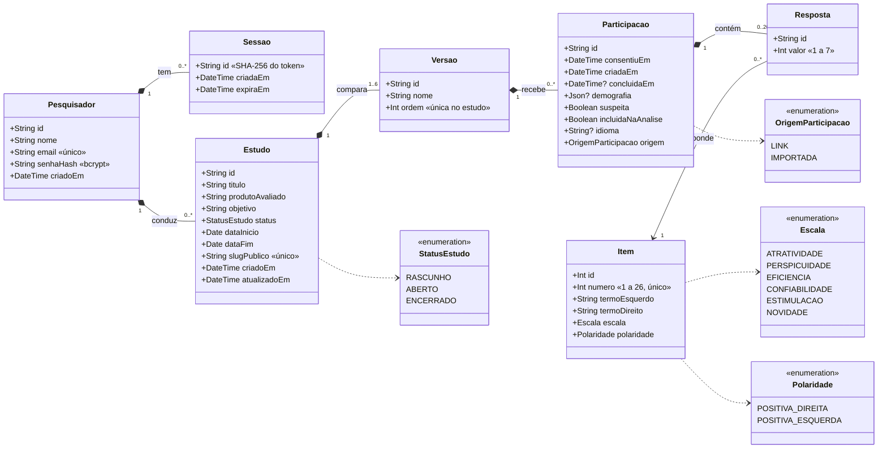

# Diagrama de classes

Dois diagramas descrevem a estrutura estática da Ferramenta UEQ:

1. **Modelo de domínio:** as entidades persistidas no PostgreSQL, como estão em [`prisma/schema.prisma`](../../prisma/schema.prisma).
2. **Módulo de cálculo:** os tipos e as funções de [`src/ueq/`](../../src/ueq/), que transformam respostas em resultados sem tocar no banco.

Os nomes são os do código (sem acento, como em `Versao` e `Participacao`). Os tipos seguem o TypeScript: `?` marca campo que pode ser nulo e `[]` marca lista.

## 1. Modelo de domínio

### Leitura

- **Composição (losango cheio)** é exclusão em cascata no banco: apagar o pesquisador apaga sessões e estudos; apagar o estudo apaga versões, participações e respostas ([RF07](requisitos.md#rf07), [RF15](requisitos.md#rf15)).
- **Item** é a única entidade que não pertence a ninguém: os 26 itens são carregados pelo seed a partir do pacote oficial ([RF32](requisitos.md#rf32)) e compartilhados por todos os estudos. Uma resposta aponta para o item; apagar a resposta não apaga o item.
- **Versao** tem de 1 a 6 por estudo. A ordem é única no estudo e define a ordem na tela e no desempate do balanceamento ([RF18](requisitos.md#rf18)).
- **Participacao** nasce no consentimento, sem respostas, e só ganha as 26 respostas e `concluidaEm` no envio ([RF17](requisitos.md#rf17), [RF22](requisitos.md#rf22)). Por isso a multiplicidade é 0..26: zero enquanto está em andamento, 26 depois de concluída.
- **Resposta** guarda o valor bruto de 1 (polo esquerdo) a 7 (polo direito), com `CHECK` no banco e unicidade por participação e item ([RNF12](requisitos.md#rnf12)). A recodificação para -3 a +3 acontece no cálculo, nunca no banco.
- **Participacao.idioma** é o código do idioma (`pt`, `es`, `ar`…); fica nulo nas importadas porque o CSV não diz o idioma ([RF31](requisitos.md#rf31)).
- **Participacao.demografia** é um JSON com as quatro faixas opcionais, sempre em português ([RF25](requisitos.md#rf25)).
- **Sessao.id** é o hash SHA-256 do token do cookie: quem lê o banco não consegue montar um cookie válido ([RNF10](requisitos.md#rnf10)).
- Nada no modelo identifica o participante: não há IP, nome, e-mail nem user-agent ([RNF09](requisitos.md#rnf09)).

### Tabelas no banco

Os models usam `@@map` para nomes em snake_case: `pesquisador`, `sessao`, `estudo`, `versao`, `item`, `participacao`, `resposta`. As migrations ficam em [`prisma/migrations/`](../../prisma/migrations/).

## 2. Módulo de cálculo

O módulo [`src/ueq/`](../../src/ueq/) é feito de funções puras: não importa Prisma, React nem Next ([RNF16](requisitos.md#rnf16)). No diagrama, cada arquivo aparece como uma classe com o estereótipo «módulo» e as funções que exporta. Os tipos de entrada e saída aparecem como classes comuns.

```mermaid
classDiagram
    direction TB

    class index {
        <<módulo>>
        +analisarEstudo(participacoes, itens, config) AnaliseEstudo
    }
    class recodificar {
        <<módulo>>
        +recodificar(valor, polaridade) number
        +recodificarParticipante(valores, itens) number[]
    }
    class estatistica {
        <<módulo>>
        +media(valores) number?
        +desvioPadraoAmostral(valores) number?
        +intervaloConfianca95(media, dp, n, z) Intervalo?
        +correlacao(x, y) number?
        +alfaCronbach(colunas) number?
    }
    class escalas {
        <<módulo>>
        +escoresPorParticipante(valores, itens) Record~Escala, number~
        +faixaInterpretacao(media, faixaNeutra) FaixaInterpretacao
        +resultadoPorEscala(respostas, itens, parametros) ResultadoEscala[]
        +resultadoPorItem(respostas, itens, z) ResultadoItem[]
    }
    class inconsistencia {
        <<módulo>>
        +amplitudePorEscala(valores, itens) Record~Escala, number~
        +respostasIguais(valores) number
        +avaliarSuspeita(valores, itens, parametros) AvaliacaoSuspeita
        +marcarSuspeitos(respostas, itens, parametros) AvaliacaoSuspeita[]
    }
    class benchmark {
        <<módulo>>
        +classificarBenchmark(escala, media, tabela) FaixaBenchmark?
    }

    class ItemUEQ {
        +number numero
        +Escala escala
        +Polaridade polaridade
    }
    class ParticipacaoParaAnalise {
        +number[] valores
        +boolean incluidaNaAnalise
    }
    class ConfigAnalise {
        +protocolo
        +TabelaBenchmark benchmark
    }
    class ParametrosInconsistencia {
        +number amplitudeMaxima
        +number escalasParaSuspeita
        +number respostasIguaisMaximas
    }
    class AnaliseEstudo {
        +number n
        +number nExcluidas
        +ResultadoEscalaAnalisada[] escalas
        +grupos pragmatica e hedonica
        +ResultadoItem[] itens
        +AvaliacaoSuspeita[] participantes
    }
    class ResultadoEscala {
        +Escala escala
        +number n
        +number? media
        +number? dp
        +Intervalo? ic
        +number? alfa
        +FaixaInterpretacao? faixaInterpretacao
    }
    class ResultadoEscalaAnalisada {
        +FaixaBenchmark? benchmark
        +boolean alfaAbaixoDoMinimo
    }
    class ResultadoItem {
        +number numero
        +Escala escala
        +number n
        +number? media
        +number? dp
        +Intervalo? ic
        +number[] distribuicao
    }
    class AvaliacaoSuspeita {
        +Record~Escala, number~ amplitudes
        +Escala[] escalasInconsistentes
        +number respostasIguais
        +MotivoSuspeita[] motivos
        +boolean suspeita
    }
    class Intervalo {
        +number inferior
        +number superior
    }
    class LimitesBenchmark {
        +number excelente
        +number bom
        +number acimaDaMedia
        +number abaixoDaMedia
    }

    ResultadoEscala <|-- ResultadoEscalaAnalisada
    ConfigAnalise *-- ParametrosInconsistencia
    ConfigAnalise *-- "6" LimitesBenchmark
    AnaliseEstudo *-- "6" ResultadoEscalaAnalisada
    AnaliseEstudo *-- "26" ResultadoItem
    AnaliseEstudo *-- "0..*" AvaliacaoSuspeita
    ResultadoEscala o-- Intervalo
    ResultadoItem o-- Intervalo

    index ..> ParticipacaoParaAnalise : recebe
    index ..> ItemUEQ : recebe
    index ..> ConfigAnalise : recebe
    index ..> AnaliseEstudo : devolve
    index ..> escalas : usa
    index ..> inconsistencia : usa
    index ..> benchmark : usa
    escalas ..> recodificar : usa
    escalas ..> estatistica : usa
    inconsistencia ..> recodificar : usa
```

### Leitura

- **`analisarEstudo`** é a porta de entrada. Recebe as participações (26 valores de 1 a 7 e se estão na análise), os 26 itens e a configuração. Calcula as estatísticas só com as incluídas e avalia a suspeita de todas ([RF33](requisitos.md#rf33) a [RF36](requisitos.md#rf36)).
- **`ConfigAnalise`** tem o mesmo formato de [`data/protocolo.json`](../../data/protocolo.json) e de [`data/benchmark.json`](../../data/benchmark.json). Os limiares não ficam no código ([RNF08](requisitos.md#rnf08)).
- **Valores nulos** seguem a planilha oficial: sem n suficiente, com dp zero ou com item que não varia, a função devolve `null` onde a planilha mostra `#NUM!` ou `#DIV/0!`.
- **`ResultadoEscalaAnalisada`** acrescenta ao resultado da escala a faixa do benchmark e a marca de alfa abaixo de 0,7.
- **`avaliarSuspeita`** também é usada fora do painel: no envio do questionário, na importação, na página Respostas e no script de recálculo ([UC22](casos-de-uso.md#uc22)). `marcarSuspeitos` aplica a mesma avaliação a uma lista.

### Quem usa o módulo

O módulo não sabe de onde vêm os dados. Quem busca no banco e chama o módulo:

| Arquivo | O que faz |
|---|---|
| `src/lib/resultados.ts` | Busca as participações concluídas, monta a entrada por versão e chama `analisarEstudo` para o painel, o PDF e a exportação de resultados |
| `src/lib/participacoes.ts` | Chama `avaliarSuspeita` para cada participação da página Respostas |
| `src/lib/exportacoes.ts` | Usa `recodificarParticipante` na exportação recodificada |
| `src/app/r/[slug]/acoes.ts` | Chama `avaliarSuspeita` no envio do questionário |
| `src/app/(ferramenta)/(pesquisador)/estudos/[id]/respostas/importar/acoes.ts` | Chama `avaliarSuspeita` em cada linha importada |
| `prisma/recalcular-suspeitas.ts` | Chama `avaliarSuspeita` em todas as participações concluídas |

O caminho completo, do banco à tela, está no [diagrama de sequência de resultados](diagramas-de-sequencia.md#3-ver-resultados).
