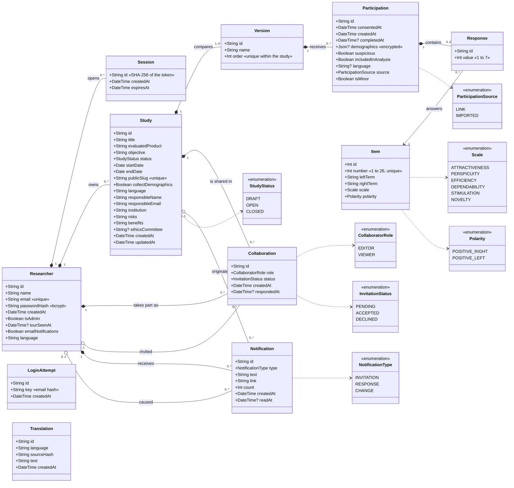

# Diagrama de classes

Dois diagramas descrevem a estrutura estática da Ferramenta UEQ:

1. **Modelo de domínio:** as 11 entidades guardadas no PostgreSQL e os 7 tipos enumerados, como estão em [`prisma/schema.prisma`](../../prisma/schema.prisma).
2. **Módulo de cálculo:** os tipos e as funções de [`src/ueq/`](../../src/ueq/), que transformam respostas em resultados sem tocar no banco.

Os diagramas estão em inglês, em todos os idiomas da documentação. No código e nas explicações abaixo, os nomes são os do código, em português e sem acento: Researcher é `Pesquisador`, Study é `Estudo`, Version é `Versao`, Participation é `Participacao` e Response é `Resposta`. Os tipos seguem o TypeScript: `?` marca campo que pode ser vazio e `[]` marca lista. As tabelas, colunas, chaves e regras de exclusão do banco, campo a campo, estão no [modelo lógico](modelo-logico.md); este documento mostra as mesmas entidades como classes, com as associações e a multiplicidade de cada uma.

Logo abaixo de cada diagrama estão a ferramenta usada, o arquivo-fonte para baixar e a versão da ferramenta que ele representa.

## 1. Modelo de domínio

**Ferramenta do diagrama:** Mermaid 12.2.0 (`classDiagram`), gerado por `pnpm docs:diagramas`. **Arquivo-fonte:** [diagrama-de-classes-1.mmd](fontes/diagrama-de-classes-1.mmd). **Versão representada:** Ferramenta UEQ de 17/11/2026.

### Leitura

- **Composição (losango cheio)** é exclusão em cascata no banco. Apagar o pesquisador apaga as sessões, os estudos dele, as colaborações em que ele entrou e as notificações que ele recebeu ([RF06](requisitos.md#rf06)). Apagar o estudo apaga versões, participações, respostas e colaborações ([RF17](requisitos.md#rf17)).
- **Agregação (losango vazio)** é uma referência que fica vazia quando o outro lado é apagado: se quem convidou exclui a conta, a colaboração continua, sem o nome de quem convidou; se o estudo ou o autor de uma notificação some, a notificação continua no sino de quem a recebeu.
- **Item** não pertence a ninguém: os 26 itens são carregados pelo seed a partir do pacote oficial ([RNF10](requisitos.md#rnf10)) e compartilhados por todos os estudos. Uma resposta aponta para o item; apagar a resposta não apaga o item.
- **Versao** tem de 1 a 6 por estudo. A ordem é única no estudo e define a ordem na tela e o desempate da distribuição dos participantes ([RF26](requisitos.md#rf26)).
- **Participacao** nasce no consentimento, sem respostas, e só ganha as 26 respostas e `concluidaEm` no envio ([RF25](requisitos.md#rf25), [RF33](requisitos.md#rf33)). Por isso a multiplicidade é 0..26: zero enquanto está em andamento, 26 depois de concluída. A que não é concluída em 2 dias é apagada ([RNF13](requisitos.md#rnf13)).
- **Resposta** guarda o valor bruto de 1 (polo esquerdo) a 7 (polo direito), com `CHECK` no banco e unicidade por participação e item. A recodificação para -3 a +3 acontece no cálculo, nunca no banco.
- **Participacao.idioma** é o código do idioma (`pt`, `es`, `ar`…); fica vazio nas importadas, porque o CSV não diz o idioma ([RF61](requisitos.md#rf61)). **Participacao.demografia** guarda as quatro faixas opcionais, cifradas com AES-256-GCM quando a chave está configurada ([RNF14](requisitos.md#rnf14)). **Participacao.menorDeIdade** registra que a pessoa confirmou a autorização do responsável ([RF25](requisitos.md#rf25)).
- **Colaboracao** liga um estudo a outra conta, como Editor ou Leitor. Há no máximo uma por estudo e pessoa, e o estudo só aparece para a pessoa convidada depois de ACEITO ([RF20](requisitos.md#rf20), [RF21](requisitos.md#rf21)).
- **Notificacao** é o que o sino mostra. As de tipo RESPOSTA somam em `quantidade` enquanto não são lidas ([RF22](requisitos.md#rf22)).
- **TentativaAcesso** e **Traducao** não se ligam a nenhuma outra entidade. A primeira guarda só o hash do e-mail de cada login que falhou ([RNF16](requisitos.md#rnf16)); a segunda guarda cada texto já traduzido pela API, pelo hash do original e pelo idioma ([RF08](requisitos.md#rf08), [RF35](requisitos.md#rf35)).
- **Sessao.id** é o hash SHA-256 do token do cookie: quem lê o banco não consegue montar um cookie válido ([RNF15](requisitos.md#rnf15)).
- Nada no modelo identifica o participante: não há nome, e-mail, IP nem user-agent ([RNF12](requisitos.md#rnf12)).

## 2. Módulo de cálculo

O módulo [`src/ueq/`](../../src/ueq/) é feito de funções puras: não importa Prisma, React nem Next ([RNF25](requisitos.md#rnf25)). No diagrama, cada arquivo aparece como uma classe com o estereótipo «módulo» e as funções que exporta. Os tipos de entrada e saída aparecem como classes comuns.

```mermaid
classDiagram
    direction TB

    class index {
        <<module>>
        +analyzeStudy(participations, items, config) StudyAnalysis
    }
    class recode {
        <<module>>
        +recode(value, polarity) number
        +recodeParticipant(values, items) number[]
    }
    class statistics {
        <<module>>
        +mean(values) number?
        +sampleStdDev(values) number?
        +confidenceInterval95(mean, sd, n, z) Interval?
        +correlation(x, y) number?
        +cronbachAlpha(columns) number?
    }
    class scales {
        <<module>>
        +scoresPerParticipant(values, items) Record~Scale, number~
        +interpretationBand(mean, neutralBand) InterpretationBand
        +resultByScale(responses, items, parameters) ScaleResult[]
        +resultByItem(responses, items, z) ItemResult[]
    }
    class inconsistency {
        <<module>>
        +rangeByScale(values, items) Record~Scale, number~
        +identicalAnswers(values) number
        +assessSuspicion(values, items, parameters) SuspicionAssessment
        +flagSuspicious(responses, items, parameters) SuspicionAssessment[]
    }
    class benchmark {
        <<module>>
        +classifyBenchmark(scale, mean, table) BenchmarkBand?
    }
    class items {
        <<module>>
        +SCALES
        +GROUPS
        +numbersByScale(items) Record~Scale, number[]~
    }

    class UEQItem {
        +number number
        +Scale scale
        +Polarity polarity
    }
    class ParticipationForAnalysis {
        +number[] values
        +boolean includedInAnalysis
    }
    class AnalysisConfig {
        +protocol
        +BenchmarkTable benchmark
    }
    class InconsistencyParameters {
        +number maxRange
        +number scalesForSuspicion
        +number maxIdenticalAnswers
    }
    class StudyAnalysis {
        +number n
        +number nExcluded
        +AnalyzedScaleResult[] scales
        +groups pragmatic and hedonic
        +ItemResult[] items
        +SuspicionAssessment[] participants
    }
    class ScaleResult {
        +Scale scale
        +number n
        +number? mean
        +number? sd
        +Interval? ci
        +number? alpha
        +InterpretationBand? interpretationBand
    }
    class AnalyzedScaleResult {
        +BenchmarkBand? benchmark
        +boolean alphaBelowMinimum
    }
    class ItemResult {
        +number number
        +Scale scale
        +number n
        +number? mean
        +number? sd
        +Interval? ci
        +number[] distribution
    }
    class SuspicionAssessment {
        +Record~Scale, number~ ranges
        +Scale[] inconsistentScales
        +number identicalAnswers
        +SuspicionReason[] reasons
        +boolean suspicious
    }
    class Interval {
        +number lower
        +number upper
    }
    class BenchmarkLimits {
        +number excellent
        +number good
        +number aboveAverage
        +number belowAverage
    }

    ScaleResult <|-- AnalyzedScaleResult
    AnalysisConfig *-- InconsistencyParameters
    AnalysisConfig *-- "6" BenchmarkLimits
    StudyAnalysis *-- "6" AnalyzedScaleResult
    StudyAnalysis *-- "26" ItemResult
    StudyAnalysis *-- "0..*" SuspicionAssessment
    ScaleResult o-- Interval
    ItemResult o-- Interval

    index ..> ParticipationForAnalysis : receives
    index ..> UEQItem : receives
    index ..> AnalysisConfig : receives
    index ..> StudyAnalysis : returns
    index ..> scales : uses
    index ..> inconsistency : uses
    index ..> benchmark : uses
    index ..> items : uses
    scales ..> recode : uses
    scales ..> statistics : uses
    scales ..> items : uses
    inconsistency ..> recode : uses
    inconsistency ..> items : uses
```

**Ferramenta do diagrama:** Mermaid 12.2.0 (`classDiagram`), gerado por `pnpm docs:diagramas`. **Arquivo-fonte:** [diagrama-de-classes-2.mmd](fontes/diagrama-de-classes-2.mmd). **Versão representada:** Ferramenta UEQ de 17/11/2026.

### Leitura

- **`analisarEstudo`** é a porta de entrada. Recebe as participações (26 valores de 1 a 7 e se estão na análise), os 26 itens e a configuração. Calcula as estatísticas só com as que estão na análise e avalia a suspeita de todas ([RF36](requisitos.md#rf36) a [RF42](requisitos.md#rf42), [RF51](requisitos.md#rf51)).
- **`ConfigAnalise`** tem o mesmo formato de [`data/protocolo.json`](../../data/protocolo.json) e de [`data/benchmark.json`](../../data/benchmark.json). Os limiares e as faixas não ficam no código: mudam por pull request, com a fonte de cada número.
- **Valores vazios** seguem a planilha oficial: sem n suficiente, com desvio-padrão zero ou com item que não varia, a função devolve `null` onde a planilha mostra `#NUM!` ou `#DIV/0!`.
- **`ResultadoEscalaAnalisada`** acrescenta ao resultado da escala a faixa do benchmark e a marca de alfa abaixo de 0,7.
- **`GRUPOS`** define a qualidade pragmática (Perspicuidade, Eficiência e Confiabilidade) e a hedônica (Estimulação e Novidade). Atratividade fica fora dos dois grupos ([RF39](requisitos.md#rf39)).
- **`avaliarSuspeita`** também é usada fora do painel: no envio do questionário, na importação, na página Respostas, no estudo de exemplo e no recálculo ([UC24](casos-de-uso.md#uc24)). `marcarSuspeitos` aplica a mesma avaliação a uma lista.

Cada fórmula foi refeita à mão, com os dados do estudo de exemplo, na [verificação do cálculo](verificacao-do-calculo.md).

### Quem usa o módulo

O módulo não sabe de onde vêm os dados. Quem busca no banco e chama o módulo:

| Arquivo | O que faz |
|---|---|
| `src/lib/resultados.ts` | Busca as participações concluídas, monta a entrada por versão e chama `analisarEstudo` para o painel, o PDF e a exportação de resultados |
| `src/lib/participacoes.ts` | Chama `avaliarSuspeita` para cada participação da página Respostas |
| `src/lib/exportacoes.ts` | Usa `recodificarParticipante` na exportação recodificada |
| `src/app/r/[slug]/acoes.ts` | Chama `avaliarSuspeita` no envio do questionário |
| `src/app/(ferramenta)/(pesquisador)/estudos/[id]/respostas/importar/acoes.ts` | Chama `avaliarSuspeita` em cada linha importada |
| `src/lib/cenarios/respostas-sinteticas.ts` | Chama `avaliarSuspeita` para conferir que as respostas de demonstração ficam coerentes com cada cenário |
| `prisma/recalcular-suspeitas.ts` | Chama `avaliarSuspeita` em todas as participações concluídas |
| `prisma/estudo-exemplo.ts` | Chama `avaliarSuspeita` ao gravar as respostas do estudo de exemplo |

O caminho completo, do banco à tela, está no [diagrama de sequência de resultados](diagramas-de-sequencia.md#3-ver-resultados).
