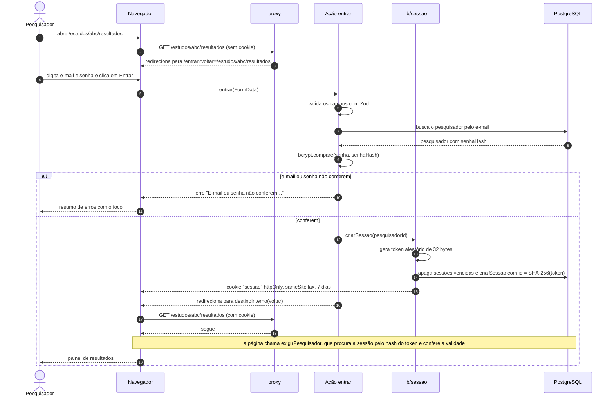
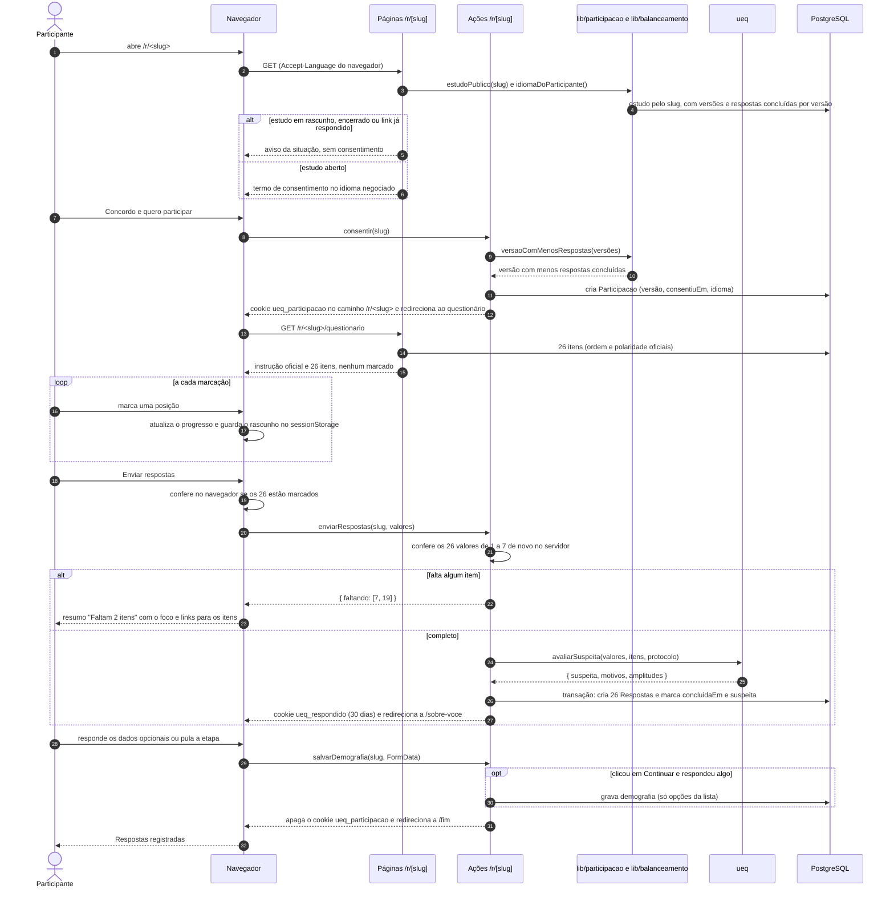
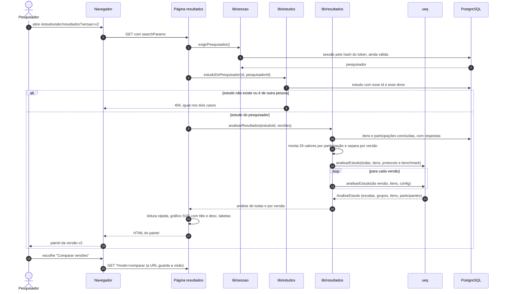
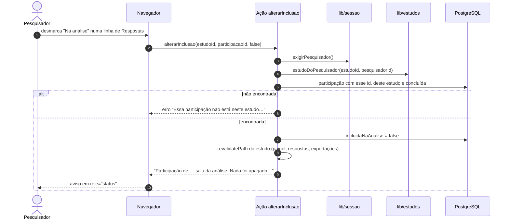
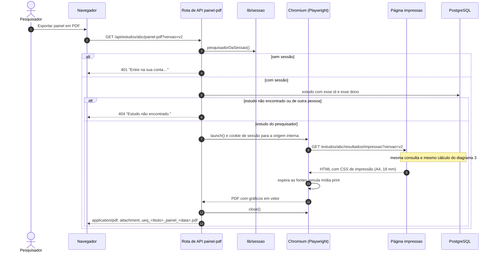
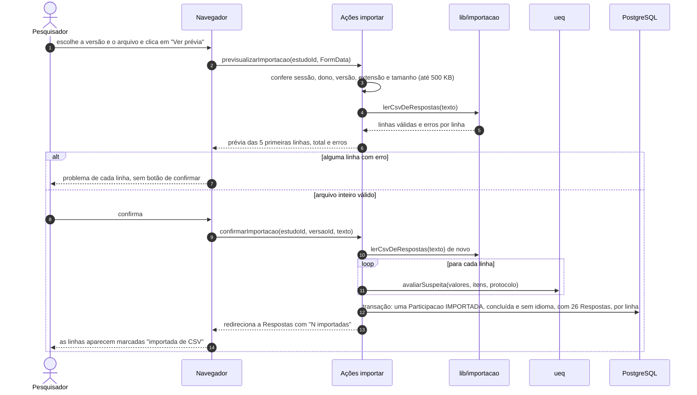

# Diagramas de sequência

Seis diagramas mostram como as partes da ferramenta conversam nos fluxos mais importantes. Os participantes de cada diagrama são os blocos da [arquitetura](arquitetura.md):

- **Navegador:** a página React no navegador da pessoa (Client Components e formulários);
- **proxy:** [`src/proxy.ts`](../../src/proxy.ts), que roda antes de cada requisição;
- **Página:** um Server Component do App Router;
- **Ação:** uma Server Action (`"use server"`);
- **Rota de API:** um Route Handler em `src/app/api/`;
- **lib:** os serviços de `src/lib/` (sessão, estudos, participação, resultados…);
- **ueq:** o módulo de cálculo [`src/ueq/`](../../src/ueq/), funções puras;
- **PostgreSQL:** o banco, acessado pelo Prisma.

Seta cheia é chamada; seta tracejada é resposta.

| Diagrama | Caso de uso | Requisitos principais |
|---|---|---|
| [1. Entrar e voltar à página pedida](#1-entrar-e-voltar-à-página-pedida) | a definir | a definir |
| [2. Responder o questionário](#2-responder-o-questionário) | a definir | a definir |
| [3. Ver resultados](#3-ver-resultados) | a definir | a definir |
| [4. Tirar uma participação da análise](#4-tirar-uma-participação-da-análise) | a definir | a definir |
| [5. Exportar o painel em PDF](#5-exportar-o-painel-em-pdf) | a definir | a definir |
| [6. Importar respostas por CSV](#6-importar-respostas-por-csv) | a definir | a definir |

## 1. Entrar e voltar à página pedida

O proxy só confere se existe o cookie. Quem garante que a sessão vale é a consulta ao banco, feita em toda página e ação do pesquisador.

## 2. Responder o questionário

Nada sobre a pessoa é gravado antes do consentimento, e nenhuma resposta é gravada antes do envio completo.

## 3. Ver resultados

Todo cálculo estatístico acontece em `src/ueq`. A página só busca, organiza por versão e desenha.

## 4. Tirar uma participação da análise

Excluir da análise só muda um campo. Nada é apagado, e a mudança aparece no painel e nas exportações.

## 5. Exportar o painel em PDF

O servidor abre a página de impressão num Chromium sem tela, com a sessão de quem pediu, e devolve o PDF.

A rota usa sempre a origem interna do servidor, nunca o cabeçalho `Host` da requisição, para o cookie de sessão não ir para outro domínio.

## 6. Importar respostas por CSV

Dois passos: a prévia lê sem gravar; a confirmação grava tudo numa transação.

O servidor lê o arquivo de novo na confirmação: a prévia não é confiável só porque veio do navegador.
