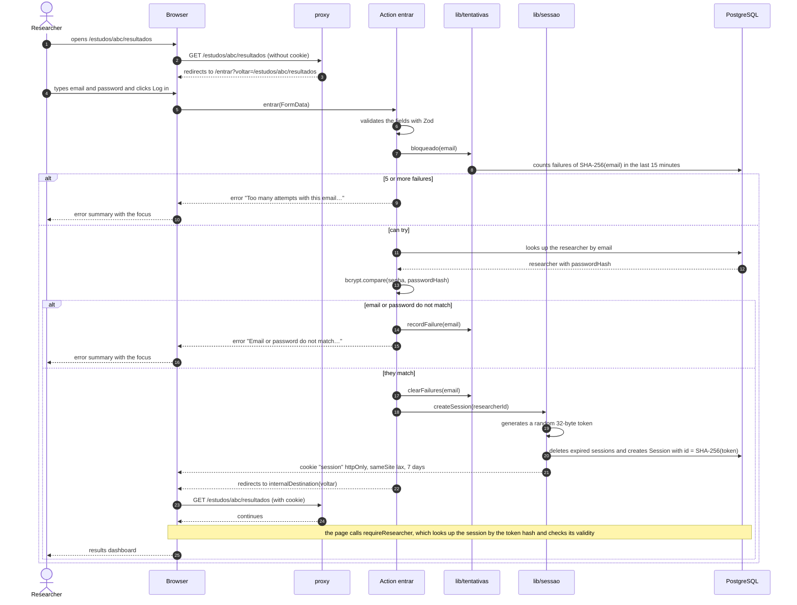
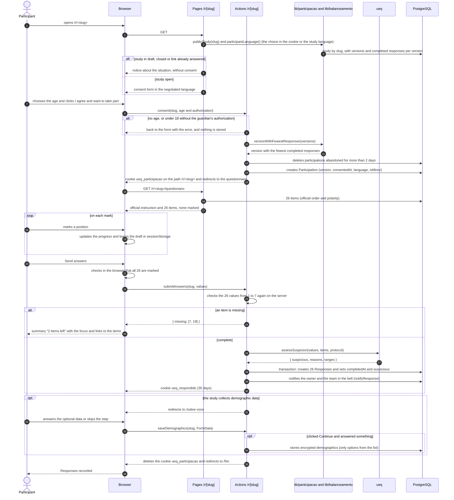
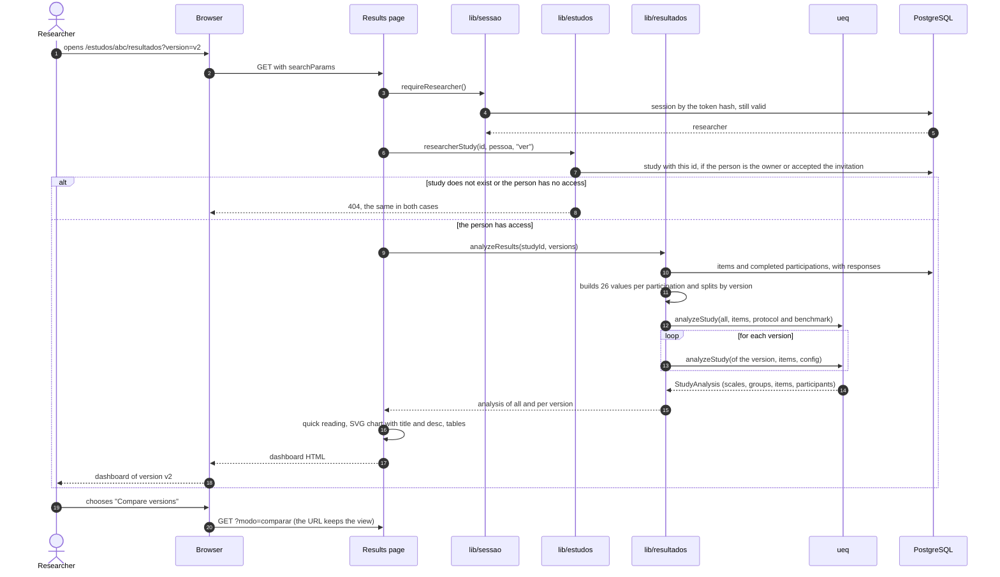
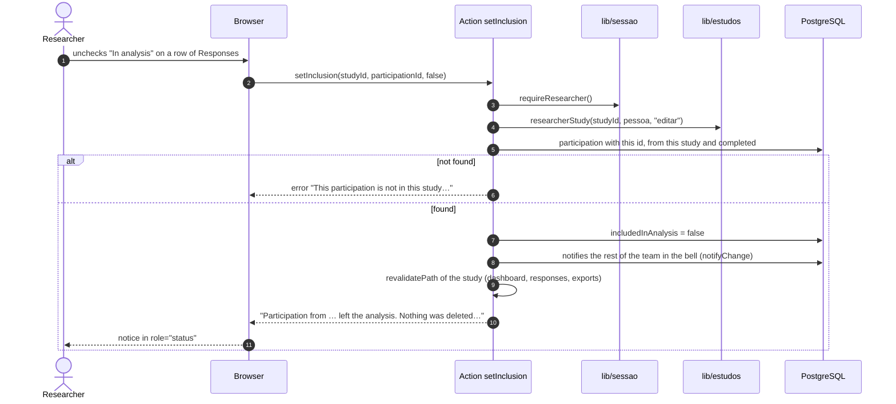
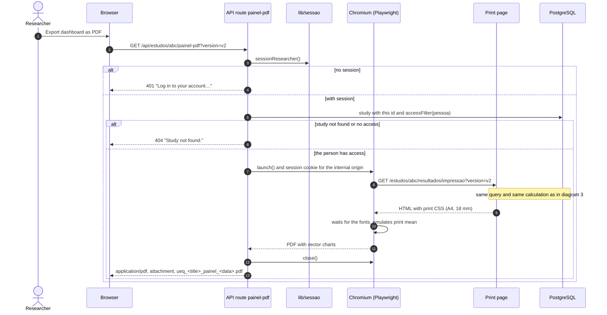
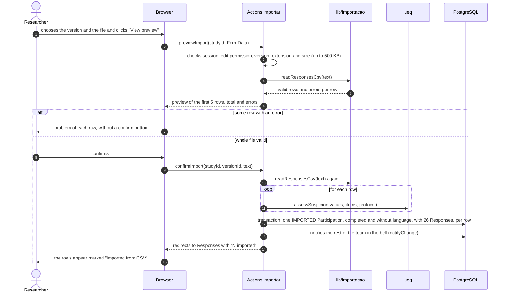
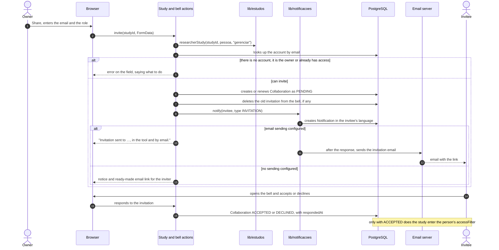
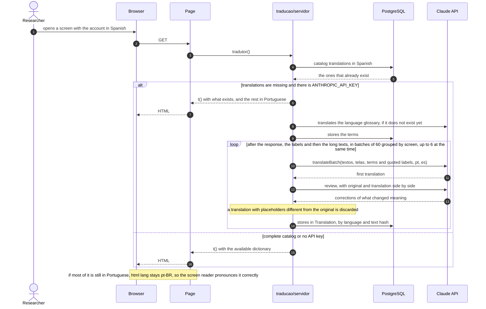

# Diagramas de sequência

Oito diagramas mostram como as partes da ferramenta conversam nos fluxos mais importantes. Os participantes de cada diagrama são os blocos da [arquitetura](arquitetura.md):

- **Navegador:** a página React no navegador da pessoa (Client Components e formulários);
- **proxy:** [`src/proxy.ts`](../../src/proxy.ts), que roda antes de cada requisição;
- **Página:** um Server Component do App Router;
- **Ação:** uma Server Action (`"use server"`);
- **Rota de API:** um Route Handler em `src/app/api/`;
- **lib:** os serviços de `src/lib/` (sessão, estudos, participação, resultados…);
- **ueq:** o módulo de cálculo [`src/ueq/`](../../src/ueq/), funções puras;
- **PostgreSQL:** o banco, acessado pelo Prisma.

Seta cheia é chamada; seta tracejada é resposta. Logo abaixo de cada diagrama estão a ferramenta usada, o arquivo-fonte para baixar e a versão da ferramenta que ele representa.

A coluna de casos de uso e a de requisitos ficam preenchidas quando esses documentos forem publicados.

| Diagrama | Caso de uso | Requisitos principais |
|---|---|---|
| [1. Entrar e voltar à página pedida](#1-entrar-e-voltar-à-página-pedida) | a definir | a definir |
| [2. Responder o questionário](#2-responder-o-questionário) | a definir | a definir |
| [3. Ver resultados](#3-ver-resultados) | a definir | a definir |
| [4. Tirar uma participação da análise](#4-tirar-uma-participação-da-análise) | a definir | a definir |
| [5. Exportar o painel em PDF](#5-exportar-o-painel-em-pdf) | a definir | a definir |
| [6. Importar respostas por CSV](#6-importar-respostas-por-csv) | a definir | a definir |
| [7. Convidar alguém para o estudo](#7-convidar-alguém-para-o-estudo) | a definir | a definir |
| [8. Traduzir a interface sob demanda](#8-traduzir-a-interface-sob-demanda) | a definir | a definir |

## 1. Entrar e voltar à página pedida

O proxy só confere se existe o cookie. Quem garante que a sessão vale é a consulta ao banco, feita em toda página e ação do pesquisador. `/entrar` mostra a página inicial com a janela de Entrar aberta. Sem página pedida, o login termina na página inicial.

**Ferramenta do diagrama:** Mermaid 12.2.0 (`sequenceDiagram`), gerado por `pnpm docs:diagramas`. **Arquivo-fonte:** [diagramas-de-sequencia-1.mmd](fontes/diagramas-de-sequencia-1.mmd). **Versão representada:** Ferramenta UEQ de 06/11/2026.

## 2. Responder o questionário

Nada sobre a pessoa é gravado antes do consentimento, e nenhuma resposta é gravada antes do envio completo. A etapa de dados opcionais só existe quando o pesquisador ligou a coleta no estudo. O título, o produto e o objetivo saem traduzidos para o idioma de quem responde, como no [diagrama 8](#8-traduzir-a-interface-sob-demanda).

**Ferramenta do diagrama:** Mermaid 12.2.0 (`sequenceDiagram`), gerado por `pnpm docs:diagramas`. **Arquivo-fonte:** [diagramas-de-sequencia-2.mmd](fontes/diagramas-de-sequencia-2.mmd). **Versão representada:** Ferramenta UEQ de 17/11/2026.

## 3. Ver resultados

Todo cálculo estatístico acontece em `src/ueq`. A página só busca, organiza por versão e desenha.

**Ferramenta do diagrama:** Mermaid 12.2.0 (`sequenceDiagram`), gerado por `pnpm docs:diagramas`. **Arquivo-fonte:** [diagramas-de-sequencia-3.mmd](fontes/diagramas-de-sequencia-3.mmd). **Versão representada:** Ferramenta UEQ de 06/11/2026.

## 4. Tirar uma participação da análise

Excluir da análise só muda um campo. Nada é apagado, e a mudança aparece no painel e nas exportações. Leitor não chega aqui: a ação exige a permissão de editar.

**Ferramenta do diagrama:** Mermaid 12.2.0 (`sequenceDiagram`), gerado por `pnpm docs:diagramas`. **Arquivo-fonte:** [diagramas-de-sequencia-4.mmd](fontes/diagramas-de-sequencia-4.mmd). **Versão representada:** Ferramenta UEQ de 06/11/2026.

## 5. Exportar o painel em PDF

O servidor abre a página de impressão num Chromium sem tela, com a sessão de quem pediu, e devolve o PDF. Na Vercel, esse Chromium é baixado na primeira chamada, como explica a [arquitetura](arquitetura.md#implantação).

**Ferramenta do diagrama:** Mermaid 12.2.0 (`sequenceDiagram`), gerado por `pnpm docs:diagramas`. **Arquivo-fonte:** [diagramas-de-sequencia-5.mmd](fontes/diagramas-de-sequencia-5.mmd). **Versão representada:** Ferramenta UEQ de 06/11/2026.

A rota usa sempre a origem interna do servidor, nunca o cabeçalho `Host` da requisição, para o cookie de sessão não ir para outro domínio.

## 6. Importar respostas por CSV

Dois passos: a prévia lê sem gravar; a confirmação grava tudo numa transação.

**Ferramenta do diagrama:** Mermaid 12.2.0 (`sequenceDiagram`), gerado por `pnpm docs:diagramas`. **Arquivo-fonte:** [diagramas-de-sequencia-6.mmd](fontes/diagramas-de-sequencia-6.mmd). **Versão representada:** Ferramenta UEQ de 06/11/2026.

O servidor lê o arquivo de novo na confirmação: a prévia não é confiável só porque veio do navegador.

## 7. Convidar alguém para o estudo

Só o dono convida. A pessoa precisa já ter conta, e o estudo só aparece para ela depois de aceitar. O e-mail sai depois da resposta, e o aviso no sino existe mesmo sem servidor de e-mail.

**Ferramenta do diagrama:** Mermaid 12.2.0 (`sequenceDiagram`), gerado por `pnpm docs:diagramas`. **Arquivo-fonte:** [diagramas-de-sequencia-7.mmd](fontes/diagramas-de-sequencia-7.mmd). **Versão representada:** Ferramenta UEQ de 06/11/2026.

## 8. Traduzir a interface sob demanda

A tela nunca espera a tradução da interface. O que ainda não foi traduzido sai em português, e os lotes rodam depois da resposta. Cada lote é guardado assim que volta, então uma execução interrompida continua de onde parou. Os textos escritos pelo pesquisador têm um caminho parecido, mas a página espera até 8 segundos pela API antes de mostrar o original.

**Ferramenta do diagrama:** Mermaid 12.2.0 (`sequenceDiagram`), gerado por `pnpm docs:diagramas`. **Arquivo-fonte:** [diagramas-de-sequencia-8.mmd](fontes/diagramas-de-sequencia-8.mmd). **Versão representada:** Ferramenta UEQ de 06/11/2026.
