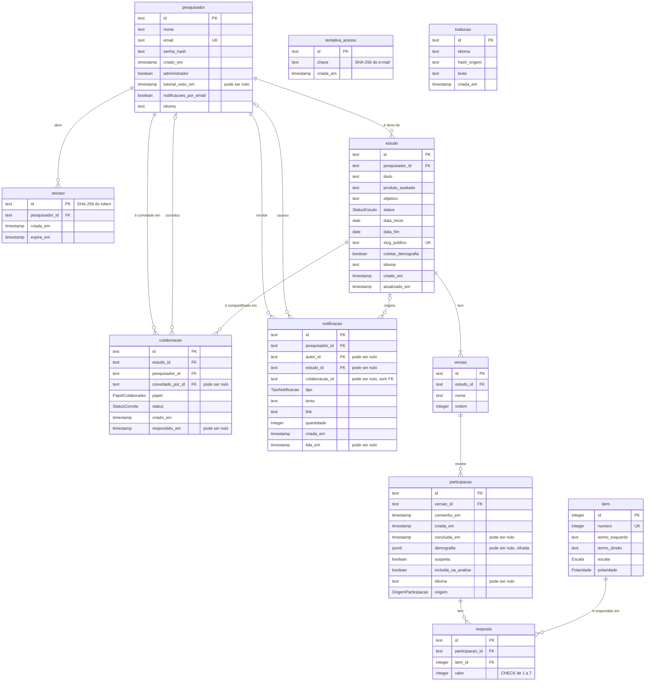

# Modelo lógico do banco de dados

O banco da Ferramenta UEQ é um **PostgreSQL 16** com 11 tabelas e 7 tipos enumerados. O modelo é declarado em [`prisma/schema.prisma`](../../prisma/schema.prisma) e aplicado pelas 9 migrations de [`prisma/migrations/`](../../prisma/migrations/). Os nomes abaixo são os do banco. No código, os mesmos campos aparecem em camelCase (`slug_publico` é `slugPublico`).

As colunas, as chaves e as regras de exclusão deste documento foram lidas do catálogo do próprio PostgreSQL (`information_schema` e `pg_constraint`) em 06/11/2026, com todas as migrations aplicadas.

## Diagrama

**Ferramenta do diagrama:** Mermaid 12.2.0 (`erDiagram`), gerado por `pnpm docs:diagramas`. **Arquivo-fonte:** [modelo-logico-1.mmd](fontes/modelo-logico-1.mmd). **Versão representada:** Ferramenta UEQ de 06/11/2026.

Duas tabelas ficam soltas de propósito: `tentativa_acesso` não aponta para a conta, porque guarda só o hash do e-mail, e `traducao` é um cache sem dono.

## Como ler as tabelas

- **Chaves `text`** são geradas pela aplicação com CUID. A exceção é `sessao.id`, que é o hash do token do cookie.
- **`timestamp`** é `timestamp(3) without time zone`, gravado em UTC pelo Prisma.
- **Nulo** indica que a coluna aceita valor vazio. As outras são obrigatórias.
- **Padrão** é o valor do banco quando o `INSERT` não informa a coluna.

## Conta e acesso

### pesquisador

A conta de quem usa a ferramenta. O participante não tem conta.

| Coluna | Tipo | Nulo | Padrão | Chave | Para que serve |
|---|---|---|---|---|---|
| `id` | text | não | | PK | Identificador |
| `nome` | text | não | | | Nome mostrado aos colegas de estudo |
| `email` | text | não | | Único | Login e destino dos avisos |
| `senha_hash` | text | não | | | Hash bcrypt, custo 12. A senha nunca é gravada |
| `criado_em` | timestamp | não | agora | | Data da conta |
| `administrador` | boolean | não | `false` | | Abre a página de Administração. Não dá acesso a estudos de outras pessoas |
| `tutorial_visto_em` | timestamp | sim | | | Vazio até a pessoa terminar, pular ou fechar o tour |
| `notificacoes_por_email` | boolean | não | `true` | | Além do sino, manda o aviso por e-mail |
| `idioma` | text | não | `'pt'` | | Idioma da interface e padrão dos estudos que a pessoa cria |

### sessao

Uma linha por login ativo. Fica no banco para que trocar a senha possa encerrar as outras sessões.

| Coluna | Tipo | Nulo | Padrão | Chave | Para que serve |
|---|---|---|---|---|---|
| `id` | text | não | | PK | SHA-256 do token do cookie. Quem lê o banco não consegue montar um cookie válido |
| `pesquisador_id` | text | não | | FK, índice | Dono da sessão |
| `criada_em` | timestamp | não | agora | | |
| `expira_em` | timestamp | não | | | Fim da validade |

### tentativa_acesso

Conta as senhas erradas para limitar a adivinhação: 5 erros em 15 minutos bloqueiam o e-mail. Linhas com mais de um dia são apagadas.

| Coluna | Tipo | Nulo | Padrão | Chave | Para que serve |
|---|---|---|---|---|---|
| `id` | text | não | | PK | |
| `chave` | text | não | | Índice com `criada_em` | SHA-256 do e-mail. O e-mail não fica guardado |
| `criada_em` | timestamp | não | agora | Índice com `chave` | Início da contagem |

## Estudo

### estudo

| Coluna | Tipo | Nulo | Padrão | Chave | Para que serve |
|---|---|---|---|---|---|
| `id` | text | não | | PK | |
| `pesquisador_id` | text | não | | FK, índice | Dono do estudo |
| `titulo` | text | não | | | |
| `produto_avaliado` | text | não | | | |
| `objetivo` | text | não | | | Lido pelo participante no consentimento |
| `status` | StatusEstudo | não | `RASCUNHO` | | Decide se o link aceita respostas |
| `data_inicio` | date | não | | | |
| `data_fim` | date | não | | | |
| `slug_publico` | text | não | | Único | O endereço `/r/<slug>` do participante |
| `coletar_demografia` | boolean | não | `false` | | LGPD, princípio da necessidade: a etapa de dados opcionais só existe se o pesquisador ligar |
| `idioma` | text | não | `'pt'` | | Idioma em que o estudo foi escrito e em que o link abre |
| `criado_em` | timestamp | não | agora | | |
| `atualizado_em` | timestamp | não | | | Atualizado pelo Prisma |

### colaboracao

O convite para trabalhar num estudo. O estudo só aparece para a pessoa convidada depois de `ACEITO`.

| Coluna | Tipo | Nulo | Padrão | Chave | Para que serve |
|---|---|---|---|---|---|
| `id` | text | não | | PK | |
| `estudo_id` | text | não | | FK, único com `pesquisador_id` | Cada pessoa tem um convite por estudo |
| `pesquisador_id` | text | não | | FK, índice com `status` | Quem foi convidado |
| `convidado_por_id` | text | sim | | FK | Quem convidou. Fica vazio se essa conta for excluída |
| `papel` | PapelColaborador | não | `EDITOR` | | O que a pessoa pode fazer |
| `status` | StatusConvite | não | `PENDENTE` | | |
| `criado_em` | timestamp | não | agora | | |
| `respondido_em` | timestamp | sim | | | Quando aceitou ou recusou |

### versao

As versões do produto que o estudo compara. Todo estudo tem pelo menos uma, regra garantida pela validação do formulário.

| Coluna | Tipo | Nulo | Padrão | Chave | Para que serve |
|---|---|---|---|---|---|
| `id` | text | não | | PK | |
| `estudo_id` | text | não | | FK, único com `ordem` | |
| `nome` | text | não | | | |
| `ordem` | integer | não | | Único com `estudo_id` | Ordem de exibição e desempate na distribuição dos participantes |

## Questionário e respostas

### item

Os 26 itens do UEQ, carregados pelo seed a partir de `data/ueq-itens-ptbr.json`. Os termos dos outros 36 idiomas ficam em `data/ueq-idiomas.json`, não no banco.

| Coluna | Tipo | Nulo | Padrão | Chave | Para que serve |
|---|---|---|---|---|---|
| `id` | integer | não | sequência | PK | |
| `numero` | integer | não | | Único | De 1 a 26, a ordem oficial |
| `termo_esquerdo` | text | não | | | |
| `termo_direito` | text | não | | | |
| `escala` | Escala | não | | | A que escala o item pertence |
| `polaridade` | Polaridade | não | | | De que lado está o termo positivo |

### participacao

Uma pessoa respondendo uma versão. Não há nome, e-mail, IP nem ligação com conta: é isso que torna a resposta anônima.

| Coluna | Tipo | Nulo | Padrão | Chave | Para que serve |
|---|---|---|---|---|---|
| `id` | text | não | | PK | Também vai no cookie do participante enquanto ele responde |
| `versao_id` | text | não | | FK, índice | Versão que a pessoa avalia: a que tinha menos respostas quando ela consentiu |
| `consentiu_em` | timestamp | não | | | Registro do consentimento |
| `criada_em` | timestamp | não | agora | | Usado para apagar as abandonadas depois de 2 dias |
| `concluida_em` | timestamp | sim | | | Vazio enquanto não enviou. Só as concluídas entram na análise |
| `demografia` | jsonb | sim | | | Faixa etária, gênero, escolaridade e familiaridade. Cifrada com AES-256-GCM quando `CHAVE_CRIPTOGRAFIA` existe |
| `suspeita` | boolean | não | `false` | | Calculada pelas regras do [protocolo](../ueq-protocolo.md#7-respostas-inconsistentes) |
| `incluida_na_analise` | boolean | não | `true` | | Decisão do pesquisador. Tirar da análise não apaga nada |
| `idioma` | text | sim | `'pt'` | | Idioma em que respondeu. Vazio nas importadas, porque o CSV não informa |
| `origem` | OrigemParticipacao | não | `LINK` | | Resposta pelo link ou importada de CSV |

### resposta

Uma linha por item respondido. Uma participação concluída tem 26.

| Coluna | Tipo | Nulo | Padrão | Chave | Para que serve |
|---|---|---|---|---|---|
| `id` | text | não | | PK | |
| `participacao_id` | text | não | | FK, único com `item_id` | Impede responder o mesmo item duas vezes |
| `item_id` | integer | não | | FK | |
| `valor` | integer | não | | `CHECK` de 1 a 7 | 1 é o polo esquerdo e 7 o direito, antes da recodificação |

## Avisos e tradução

### notificacao

O sino do cabeçalho. Respostas que chegam enquanto o aviso não foi lido só aumentam `quantidade`.

| Coluna | Tipo | Nulo | Padrão | Chave | Para que serve |
|---|---|---|---|---|---|
| `id` | text | não | | PK | |
| `pesquisador_id` | text | não | | FK, índice com `lida_em` | Quem recebe |
| `autor_id` | text | sim | | FK | Quem causou. Fica vazio se a conta for excluída |
| `estudo_id` | text | sim | | FK | Fica vazio se o estudo for excluído, e o aviso continua no sino |
| `colaboracao_id` | text | sim | | Sem FK | Referência ao convite, para aceitar ou recusar pelo aviso. Pode apontar para um convite que já não existe |
| `tipo` | TipoNotificacao | não | | | |
| `texto` | text | não | | | Já no idioma de quem recebe |
| `link` | text | não | | | Caminho dentro da ferramenta |
| `quantidade` | integer | não | `1` | | Respostas acumuladas |
| `criada_em` | timestamp | não | agora | | |
| `lida_em` | timestamp | sim | | Índice com `pesquisador_id` | Vazio é não lida |

### traducao

Cache das traduções feitas pela API do Claude, para não traduzir o mesmo texto duas vezes.

| Coluna | Tipo | Nulo | Padrão | Chave | Para que serve |
|---|---|---|---|---|---|
| `id` | text | não | | PK | |
| `idioma` | text | não | | Único com `hash_origem` | Idioma de destino |
| `hash_origem` | text | não | | Único com `idioma` | SHA-256 do texto original |
| `texto` | text | não | | | A tradução |
| `criada_em` | timestamp | não | agora | | |

## Tipos enumerados

| Tipo | Valores | Observação |
|---|---|---|
| `StatusEstudo` | `RASCUNHO`, `ABERTO`, `ENCERRADO` | Só `ABERTO` aceita respostas |
| `Escala` | `ATRATIVIDADE`, `PERSPICUIDADE`, `EFICIENCIA`, `CONFIABILIDADE`, `ESTIMULACAO`, `NOVIDADE` | As 6 escalas do UEQ |
| `Polaridade` | `POSITIVA_DIREITA`, `POSITIVA_ESQUERDA` | `+` e `-` no [protocolo](../ueq-protocolo.md#1-itens-escalas-e-polaridade) |
| `OrigemParticipacao` | `LINK`, `IMPORTADA` | |
| `PapelColaborador` | `EDITOR`, `LEITOR` | Editor mexe no estudo; leitor só vê e exporta. Excluir o estudo e convidar ficam com o dono |
| `StatusConvite` | `PENDENTE`, `ACEITO`, `RECUSADO` | |
| `TipoNotificacao` | `CONVITE`, `RESPOSTA`, `ALTERACAO` | |

## O que cada exclusão leva junto

Todas as chaves estrangeiras têm `ON UPDATE CASCADE`. A coluna abaixo é o `ON DELETE` do banco.

| Chave estrangeira | Ao apagar o pai |
|---|---|
| `sessao.pesquisador_id` → `pesquisador` | Apaga |
| `estudo.pesquisador_id` → `pesquisador` | Apaga |
| `colaboracao.pesquisador_id` → `pesquisador` | Apaga |
| `colaboracao.convidado_por_id` → `pesquisador` | Fica vazio |
| `colaboracao.estudo_id` → `estudo` | Apaga |
| `versao.estudo_id` → `estudo` | Apaga |
| `participacao.versao_id` → `versao` | Apaga |
| `resposta.participacao_id` → `participacao` | Apaga |
| `resposta.item_id` → `item` | **Impede** a exclusão do item que já tem resposta |
| `notificacao.pesquisador_id` → `pesquisador` | Apaga |
| `notificacao.autor_id` → `pesquisador` | Fica vazio |
| `notificacao.estudo_id` → `estudo` | Fica vazio |

Na prática:

- **Excluir a conta** apaga as sessões, os estudos de que a pessoa é dona (com versões, participações e respostas), os convites dela e os avisos dela. Em estudos de outras pessoas, a participação dela como colega some, e os avisos que ela causou continuam, sem autor.
- **Excluir um estudo** apaga versões, participações, respostas e convites. Os avisos ficam no sino de quem os recebeu, sem o vínculo com o estudo.
- **Remover uma versão**, no banco, apaga as participações e as respostas dela.
- **Nenhum item pode sumir** depois de ter resposta. Esse `RESTRICT` protege o instrumento.

## Regras que o banco garante e regras que a aplicação garante

| Regra | Onde fica |
|---|---|
| `resposta.valor` entre 1 e 7 | `CHECK resposta_valor_entre_1_e_7`, escrito à mão na migration inicial, porque o Prisma não declara `CHECK` |
| Uma resposta por item em cada participação | Índice único `(participacao_id, item_id)` |
| Um convite por pessoa em cada estudo | Índice único `(estudo_id, pesquisador_id)` |
| Slug público e e-mail sem repetição | Índices únicos |
| Exatamente 26 respostas numa participação concluída | Aplicação (`enviarRespostas`, numa transação) |
| Só opções da lista em `demografia` | Aplicação (`src/lib/demografia.ts`) |
| Quem pode ver ou mudar um estudo | Aplicação (`estudoDoPesquisador` em `src/lib/estudos.ts`) |
| Apagar participação abandonada há mais de 2 dias | Aplicação: acontece quando a próxima pessoa consente |

## Dados pessoais

Este mapa liga o modelo à política de privacidade da ferramenta, em `/privacidade` (LGPD).

| Dado | Tabela | Proteção |
|---|---|---|
| Nome e e-mail | `pesquisador` | Só aparecem para quem divide um estudo com a pessoa |
| Senha | `pesquisador.senha_hash` | Hash bcrypt, custo 12 |
| Cookie de sessão | `sessao.id` | Só o hash SHA-256 |
| E-mail em tentativa de login | `tentativa_acesso.chave` | Só o hash SHA-256, apagado em até um dia |
| Dados demográficos do participante | `participacao.demografia` | Cifrados com AES-256-GCM, com a chave fora do banco |
| Respostas ao questionário | `resposta` | Nada as liga a uma pessoa |

Sem `CHAVE_CRIPTOGRAFIA` no ambiente, a demografia fica em texto puro e a página de Administração avisa. O script `pnpm dados:cifrar` cifra as linhas antigas e roda no build de produção.
