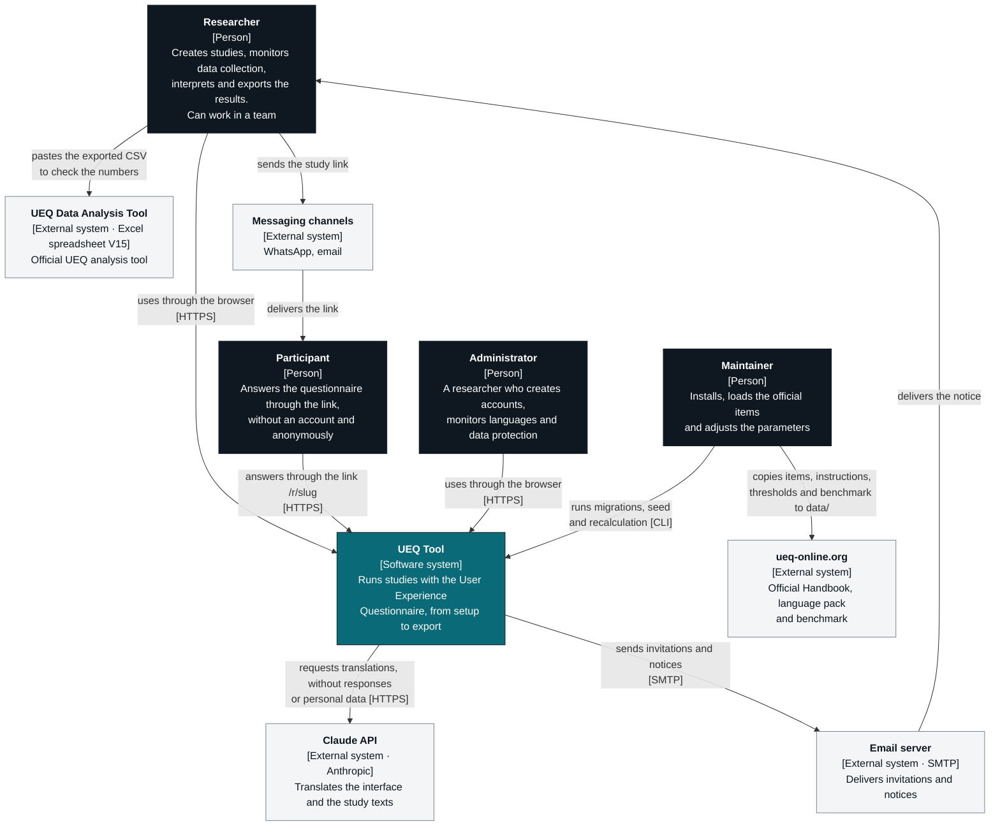
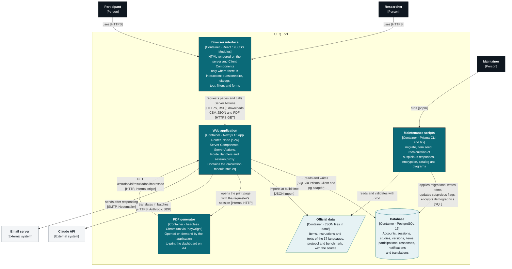
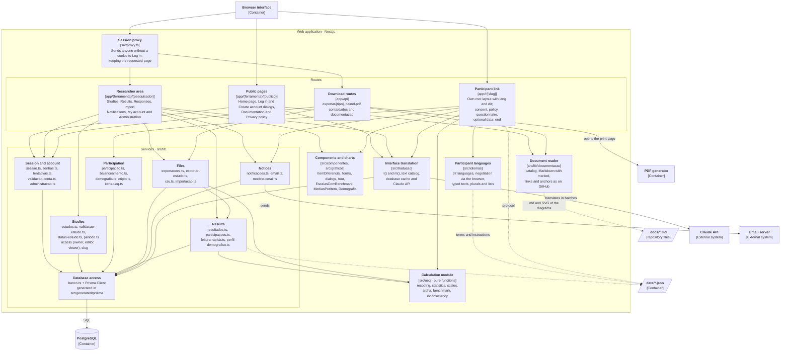
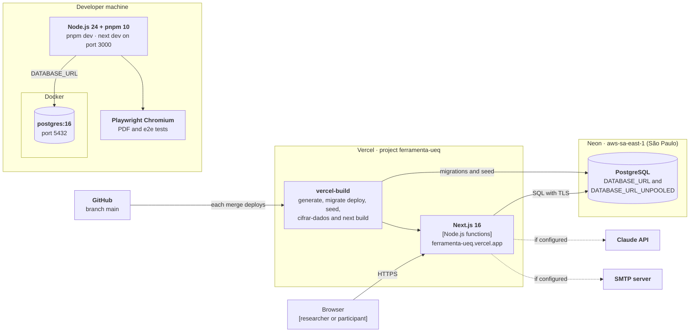

# Architektur

Die Architektur wird mit dem [C4-Modell](https://c4model.com) beschrieben, in drei Zoomstufen:

1. **Kontext:** wer das Tool verwendet und mit welchen Systemen es in Beziehung steht;
2. **Container:** die Teile, die getrennt laufen (Anwendung, Datenbank, PDF-Generator, Skripte), und wie sie miteinander kommunizieren;
3. **Komponenten:** wie die Next.js-Anwendung innen aufgebaut ist.

Ein viertes Diagramm zeigt die Bereitstellung, in Produktion und in der Entwicklung.

Die Diagramme verwenden Mermaid, das GitHub direkt auf der Seite zeichnet. Jedes Kästchen enthält den Namen, den Typ in eckigen Klammern und die Technologie. Die Pfeile sagen, was übertragen wird und über welches Protokoll. Direkt unter jedem Diagramm stehen das verwendete Werkzeug, die Quelldatei zum Herunterladen und die Version des Tools, die es darstellt.

## Überblick

Das UEQ-Tool ist eine einzige Webanwendung in **Next.js 16 (App Router)** mit **React 19** und **TypeScript strict**, die die Daten über **Prisma 7** in einem **PostgreSQL 16** speichert. Es ist unter [ferramenta-ueq.vercel.app](https://ferramenta-ueq.vercel.app) online, auf Vercel, mit der Datenbank bei Neon, Region São Paulo.

- Es gibt keine getrennte REST-API. Die Seiten sind Server Components, die die Datenbank auf dem Server lesen. Schreibvorgänge sind Server Actions, die von den Formularen aufgerufen werden.
- Nur was eine Datei zurückgibt, ist eine API-Route: die CSV-Exporte, das Dashboard als PDF, die Kontodaten und die Downloads der Dokumentation.
- Die UEQ-Berechnung ist in `src/ueq/` isoliert, in reinen Funktionen, damit sie ohne Datenbank und Oberfläche gegen die offizielle Tabelle getestet werden kann.
- Die Parameter des Protokolls, der Benchmark und die offiziellen Texte der 37 Sprachen sind versionierte JSON-Dateien in `data/`, mit der Quelle jedes Werts.
- Die Oberfläche der Forschenden und die Texte der Studien werden bei Bedarf von der Claude-API übersetzt, und das Ergebnis wird in der Datenbank gespeichert. Der Fragebogen verwendet nur die offiziellen Übersetzungen des UEQ.

## Ebene 1 · Kontext



**Diagrammwerkzeug:** Mermaid 12.2.0 (`flowchart`), erzeugt mit `pnpm docs:diagramas`. **Quelldatei:** [arquitetura-1.mmd](fontes/arquitetura-1.mmd). **Dargestellte Version:** UEQ-Tool vom 06.11.2026.

Zur Laufzeit ruft das Tool nur zwei externe Systeme auf, und beide sind optional:

- **Claude-API:** Ohne `ANTHROPIC_API_KEY` bleibt die Oberfläche auf Portugiesisch und die Texte der Studien bleiben in der Originalsprache. An die API gehen die Texte der Oberfläche sowie Titel, Produkt, Ziel und Versionsnamen jeder Studie. Keine Antwort, kein Name, keine E-Mail-Adresse und keine demografische Angabe geht mit.
- **E-Mail-Server:** Ohne die Variablen `SMTP_*` bleiben die Hinweise nur in der Glocke, und wer einlädt, erhält einen fertigen E-Mail-Link, um ihn selbst zu verschicken.

Die offizielle Tabelle und die UEQ-Website kommen über Personen ins Spiel: Das Team kopiert die offiziellen Daten nach `data/` (mit der Quelle in jeder Datei). Der Export der offiziellen Tabelle geht von einer unveränderten Kopie der UEQ Data Analysis Tool V15 in `data/planilha-oficial/` aus, und die forschende Person öffnet sie in Excel, um die Zahlen zu prüfen.

## Ebene 2 · Container



**Diagrammwerkzeug:** Mermaid 12.2.0 (`flowchart`), erzeugt mit `pnpm docs:diagramas`. **Quelldatei:** [arquitetura-2.mmd](fontes/arquitetura-2.mmd). **Dargestellte Version:** UEQ-Tool vom 06.11.2026.

| Container | Technologie | Verantwortung | Wo er liegt |
|---|---|---|---|
| Oberfläche im Browser | React 19.3, CSS Modules, CSS-Variablen, handgemachtes SVG | Die Bildschirme anzeigen und die Interaktion behandeln. Ohne Komponenten- oder Diagrammbibliothek | `src/app/**/*.tsx` mit `"use client"`, `src/componentes/`, `src/graficos/`, `src/styles/` |
| Webanwendung | Next.js 16.4, Node.js 24, Zod 4, bcryptjs, Nodemailer, Anthropic-SDK | Seiten rendern, Daten validieren und speichern, den Bereich der Forschenden schützen, Exporte erzeugen, übersetzen und benachrichtigen | `src/app/`, `src/lib/`, `src/ueq/`, `src/idiomas/`, `src/traducao/`, `src/proxy.ts` |
| PDF-Generator | Playwright 1.64 mit dessen Chromium in der Entwicklung und `@sparticuz/chromium-min` 153 auf Vercel | Das Dashboard mit Vektordiagrammen als PDF drucken | `src/app/api/estudos/[id]/painel-pdf/route.ts` |
| Datenbank | PostgreSQL 16 (Docker in der Entwicklung, Neon in Produktion) | Das Domänenmodell speichern, mit Kaskade und `CHECK`. Details im [logischen Datenmodell](modelo-logico.md) | `prisma/schema.prisma`, `prisma/migrations/`, `docker-compose.yml` |
| Offizielle Daten | Versioniertes JSON | Einzige Quelle der Items, Anweisungen, des Protokolls und des Benchmarks, jeweils mit dem Feld `fonte` | `data/` |
| Dokumentation | Versioniertes Markdown und SVG | Die Dokumente, die der Reiter Dokumentation zeigt, die bereits gezeichneten Diagramme und die Quelldatei jedes einzelnen | `docs/`, `docs/documentacao/diagramas/`, `docs/documentacao/fontes/` |
| Wartungsskripte | Prisma CLI, tsx | Die Datenbank anlegen, die Items laden, Verdachtsfälle neu berechnen, alte Daten verschlüsseln, den Textkatalog und die Diagramme erzeugen | `prisma/seed.ts`, `prisma/recalcular-suspeitas.ts`, `prisma/cifrar-dados.ts`, `scripts/` |

## Ebene 3 · Komponenten der Webanwendung



**Diagrammwerkzeug:** Mermaid 12.2.0 (`flowchart`), erzeugt mit `pnpm docs:diagramas`. **Quelldatei:** [arquitetura-3.mmd](fontes/arquitetura-3.mmd). **Dargestellte Version:** UEQ-Tool vom 06.11.2026.

Der `matcher` von [`src/proxy.ts`](../../src/proxy.ts) schließt aus, was nie eine Sitzung verlangt: `/entrar`, `/cadastrar`, `/privacidade`, `/r/`, `/documentacao`, `/api/documentacao` und die Icons der Website. Die Wurzel `/` läuft durch den Proxy und geht ohne Cookie weiter. Jede neue Route der Forschenden ist von Anfang an geschützt. Der Link der Teilnehmenden hat ein eigenes Root-Layout, ohne Leiste und ohne Link zum Rest des Tools: Wer antwortet, sieht nur das Formular, den Sprachwähler und die Datenschutzerklärung, die eine Version unter `/r/<slug>/privacidade` hat.

### Abhängigkeitsregeln

- **`src/ueq/` hängt von nichts im Projekt ab.** Es importiert weder Prisma noch React, Next oder `src/lib`. Es erhält Zahlen und gibt Objekte zurück. Das macht es möglich, es gegen die offizielle Tabelle zu testen.
- **Komponenten und Diagramme wissen nichts von Prisma.** Sie erhalten fertige Daten über Props.
- **Jede Seite, Server Action und Route der Forschenden prüft die Sitzung in der Datenbank und den Zugang zur Studie**, nicht nur der Proxy. Der Zugang läuft immer über `estudoDoPesquisador(id, pessoa, "ver" | "editar" | "gerenciar")` oder über `filtroDeAcesso`. Ohne Zugang ist die Antwort dieselbe wie bei einer Studie, die nicht existiert.
- **Der Administrator sieht keine Studien anderer Personen.** Die Antworten sind Forschungsdaten der Person, die die Studie durchführt. Die Seiten der Verwaltung antworten mit 404 für alle, die nicht Administrator sind.
- **Die Routen der Teilnehmenden lesen nur, was die Teilnehmenden sehen dürfen:** Titel, Produkt, Ziel und Status der Studie. Nichts von der forschenden Person und nichts von der Auswertung.
- **Parameter des Protokolls stehen nie im Code.** Sie kommen aus `data/protocolo.json` und `data/benchmark.json`.
- **Bildschirmtext der Forschenden läuft über `t()` oder `m()`,** und `pnpm i18n:catalogo` erzeugt den Katalog. Text der Teilnehmenden liegt in `src/idiomas/textos/`, eine Datei pro Sprache.

## Sicherheit und LGPD

| Maßnahme | Wo sie liegt |
|---|---|
| Sicherheitsheader in jeder Antwort: CSP, HSTS, `X-Frame-Options`, `X-Content-Type-Options`, `Referrer-Policy` und `Permissions-Policy` | `next.config.ts` |
| Passwort mit bcrypt, Kostenfaktor 12, mit erneutem Hash bei der Anmeldung, wenn der Kostenfaktor steigt | `src/lib/senhas.ts` |
| 5 falsche Passwörter in 15 Minuten sperren die E-Mail-Adresse, gezählt über ihren Hash | `src/lib/tentativas.ts` |
| Sitzung in der Datenbank über den Hash des Tokens, mit Cookie `httpOnly` und in Produktion `secure` | `src/lib/sessao.ts` |
| Demografische Angaben mit AES-256-GCM verschlüsselt, der Schlüssel liegt außerhalb der Datenbank | `src/lib/cripto.ts`, `prisma/cifrar-dados.ts` |
| Demografische Erhebung in jeder Studie standardmäßig ausgeschaltet | `Estudo.coletarDemografia` |
| Eine seit mehr als 2 Tagen abgebrochene Teilnahme wird gelöscht | `src/app/r/[slug]/acoes.ts` |
| Die eigenen Daten herunterladen und das Konto löschen, ohne jemanden fragen zu müssen | `src/app/api/conta/dados/route.ts`, `conta/` |
| Das Ziel von `?voltar=` und `?de=` akzeptiert nur interne Pfade | `destinoInterno` in `src/lib/validacao-conta.ts` |
| Öffentliche Datenschutzerklärung, ohne Konto, auch innerhalb des Links der Teilnehmenden | `src/app/(ferramenta)/(publico)/privacidade/`, `src/app/r/[slug]/privacidade/` |

## Architekturentscheidungen

| Entscheidung | Warum | Folge |
|---|---|---|
| Server Components und Server Actions statt einer REST-API | Weniger Code zwischen Bildschirm und Datenbank; Validierung mit Zod auf dem Server bei jeder Aktion; Formulare funktionieren mit dem nativen Verhalten des Browsers | Das Tool bietet keine öffentliche API. Integrationen nutzen die CSV-Exporte |
| Berechnung in reinen Funktionen in `src/ueq/` | Die Zahl muss mit der offiziellen Tabelle übereinstimmen; reine Funktionen sind mit Fixtures und Grenzfällen testbar | Wer die Daten holt (`src/lib/resultados.ts`), baut nur die Eingabe und reicht sie weiter |
| Sitzung in der Datenbank gespeichert, mit dem Hash des Tokens | Eine Passwortänderung beendet die anderen Sitzungen; wer die Datenbank liest, kann kein Cookie erzeugen | Jede Seite der Forschenden macht eine Sitzungsabfrage (mit dem `cache` von React pro Anfrage) |
| Zwei Root-Layouts: Tool und Link der Teilnehmenden | `<html lang>` und `dir` der Teilnehmenden folgen der von der antwortenden Person gewählten Sprache, die des Tools der Sprache des Kontos (WCAG 3.1.1), einschließlich Arabisch, Hebräisch und Persisch | `experimental.globalNotFound` in `next.config.ts` für die 404-Seite |
| Zwei Textsysteme: `src/idiomas` und `src/traducao` | Der Fragebogen ist ein Messinstrument: Er braucht die offiziellen Begriffe und überprüfbare Texte, ohne automatische Übersetzung. Der Rest des Tools kann bei Bedarf übersetzt werden | Neuer Text der Teilnehmenden erfordert die 37 Dateien; neuer Text der Forschenden erfordert nur `pnpm i18n:catalogo` |
| Übersetzung bei Bedarf, in der Datenbank gespeichert | Jeden Text nur einmal übersetzen, ohne Kosten bei späteren Lesevorgängen und ohne 37 Dateien von Hand zu pflegen | Der erste Besuch in einer Sprache kann auf Portugiesisch erscheinen, während die Stapel im Hintergrund laufen |
| E-Mail nach der Antwort verschickt (`after`) | Wer geklickt hat, wartet nicht auf den E-Mail-Server, und ein Versandfehler macht die Aktion nicht rückgängig | Die Glocke ist der Eintrag, der immer existiert; die E-Mail ist eine Zugabe |
| Handgemachte SVG-Diagramme | Volle Kontrolle über `title`, `desc`, Kontrast, Formen pro Version und Umordnung auf schmalen Bildschirmen | Keine Diagrammbibliothek, die aktualisiert werden muss |
| PDF von Chromium auf dem Server erzeugt | Das PDF sieht aus wie das Dashboard, mit Vektordiagrammen und denselben Schriften | Auf Vercel wird der Browser beim ersten Aufruf heruntergeladen (siehe [Bereitstellung](#implantação)) |
| Dokumentation aus denselben `.md`-Dateien des Repositorys gelesen, mit vorab als SVG gezeichneten Diagrammen (`pnpm docs:diagramas`) | Eine einzige Datei für GitHub und für das Tool; das Tool lädt die Mermaid-Bibliothek nicht, und jedes Diagramm wird zu einem Bild mit Alternativtext | Eine Diagrammänderung erfordert, SVG und Quelle neu zu erzeugen; ein Unit-Test weist darauf hin |
| Langes Dokument beim Anzeigen in Seiten geteilt, ohne die `.md` zu ändern | Die Datei bleibt einzeln und auf GitHub lesbar, und das Tool zwingt nicht dazu, durch ein ganzes Dokument zu scrollen | Links und Anker laufen über `rotaDaAncora`, das die Seite jedes Ankers findet, und alte Adressen nur mit Fragment werden umgeleitet |
| Offizielle Daten in versioniertem JSON | Jede Zahl hat eine nachvollziehbare Quelle und ändert sich per Pull Request, nicht im Code | Eine Schwellenwertänderung erfordert `pnpm suspeitas:recalcular`, um die bereits gespeicherten Teilnahmen zu aktualisieren |
| Cookies der Teilnehmenden auf `/r/<slug>` beschränkt | Anonymität: nur die zufällige ID der Teilnahme, die Markierung „bereits beantwortet“ und die Sprache | Der Schutz vor doppeltem Absenden gilt pro Browser, nicht pro Person |

## Bereitstellung



**Diagrammwerkzeug:** Mermaid 12.2.0 (`flowchart`), erzeugt mit `pnpm docs:diagramas`. **Quelldatei:** [arquitetura-4.mmd](fontes/arquitetura-4.mmd). **Dargestellte Version:** UEQ-Tool vom 06.11.2026.

**Produktion.** Jeder Merge in `main` veröffentlicht eine neue Version. Das Skript `vercel-build` führt `prisma generate`, `prisma migrate deploy`, den Seed, `prisma/cifrar-dados.ts` und `next build` aus. In Produktion speichert der Seed nur die 26 Items, ohne Testkonto. Die Migrations verwenden `DATABASE_URL_UNPOOLED`, wenn sie existiert.

**Entwicklung.** Die Schritt-für-Schritt-Anleitung steht im [README](../../README.md#como-rodar).

| Variable | Pflicht | Wofür sie dient |
|---|---|---|
| `DATABASE_URL` | Ja | Verbindung zu PostgreSQL |
| `DATABASE_URL_UNPOOLED` | Bei Neon | Direkte Verbindung, von den Migrations verwendet |
| `CHAVE_CRIPTOGRAFIA` | In Produktion | AES-256-GCM-Schlüssel der demografischen Angaben. Ohne ihn bleibt das Datum im Klartext, und Verwaltung weist darauf hin. Bewahren Sie eine Kopie auf: Ohne den Schlüssel kann das verschlüsselte Datum nicht mehr gelesen werden |
| `ANTHROPIC_API_KEY` | Nein | Schaltet die automatische Übersetzung ein |
| `SMTP_HOST`, `SMTP_PORTA`, `SMTP_USUARIO`, `SMTP_SENHA`, `EMAIL_REMETENTE` | Nein | Schalten den E-Mail-Versand ein |
| `URL_INTERNA` und `PORT` | Nein | Adresse, über die die PDF-Route die Anwendung selbst erreicht. Ohne `URL_INTERNA` gilt `http://localhost:$PORT` |
| `PESQUISADOR_TESTE_EMAIL` und `PESQUISADOR_TESTE_SENHA` | Nur in der Entwicklung | Vom Seed angelegtes Konto. Dürfen in Produktion nicht existieren |
| `TRADUCAO_PSEUDO` | Nur zur Prüfung | Mit `1` werden die Texte des Katalogs mit ⟦ ⟧ markiert, um zu finden, was nicht über `t()` läuft |

**Dashboard als PDF in Produktion.** Die Vercel-Funktion hat keinen Browser installiert. Beim ersten Aufruf lädt die Route ein eigenes Server-Chromium herunter (`@sparticuz/chromium-min` 153), das in `/tmp` bleibt, solange die Funktion läuft, und öffnet die Druckseite über die öffentliche Produktionsadresse. Deshalb dauert die erste Erzeugung nach einer Ruhepause länger, und das Limit der Funktion liegt bei 60 s. In der Entwicklung gilt das Chromium von Playwright. Die CSV-Exporte hängen von keinem Browser ab.

## Ordnerstruktur

```
src/
  app/
    (ferramenta)/         layout raiz no idioma da conta
      (publico)/          página inicial, Entrar, Criar conta, Documentação, Privacidade
      (pesquisador)/      Estudos, Resultados, Respostas, Notificações, Minha conta, Administração
    r/[slug]/             link do participante, com layout raiz próprio (lang e dir do idioma)
    api/                  downloads: exportar/[tipo], painel-pdf, conta/dados, documentacao
  ueq/                    cálculo do UEQ em funções puras
  lib/                    sessão, estudos, participação, resultados, CSV, avisos, criptografia
  idiomas/                37 idiomas do participante: textos tipados, negociação, plural
  traducao/               t() e m(), catálogo e tradução da interface pela API do Claude
  componentes/            ItemDiferencial, formulários, janelas, tour, ajuda e painéis
  graficos/               EscalasComBenchmark, MediasPorItem e Demografia em SVG
  styles/                 tokens de cor, tipografia e espaçamento
  proxy.ts                checagem otimista de sessão
scripts/                  SVG e fontes dos diagramas; catálogo de textos
prisma/                   schema, migrations, seed, recálculo de suspeitas e cifragem
data/                     itens, instruções, idiomas, protocolo, benchmark e fixtures
tests/e2e/                Playwright com axe-core
docs/                     especificação, requisitos de IHC, protótipos e esta documentação
```
