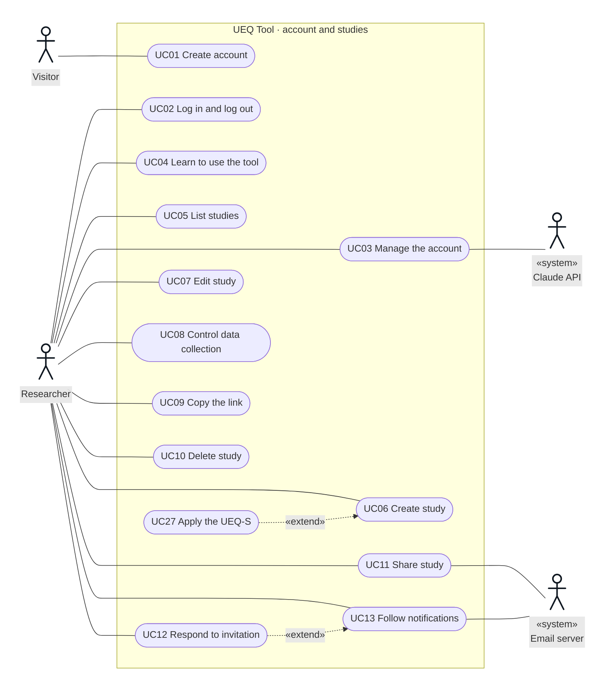
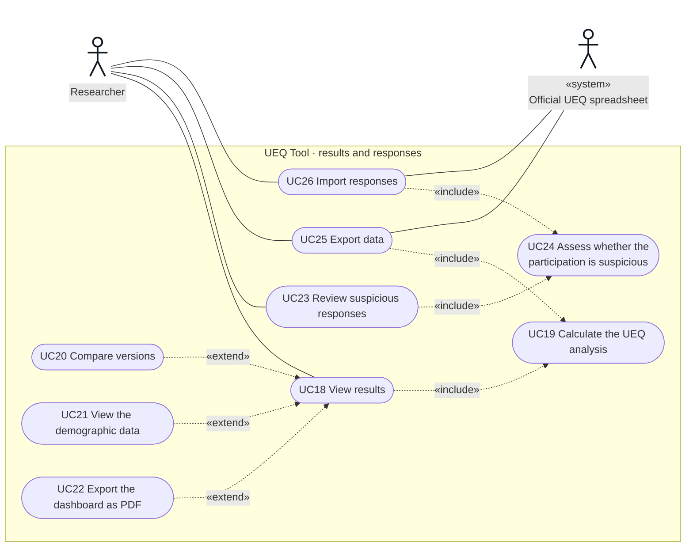
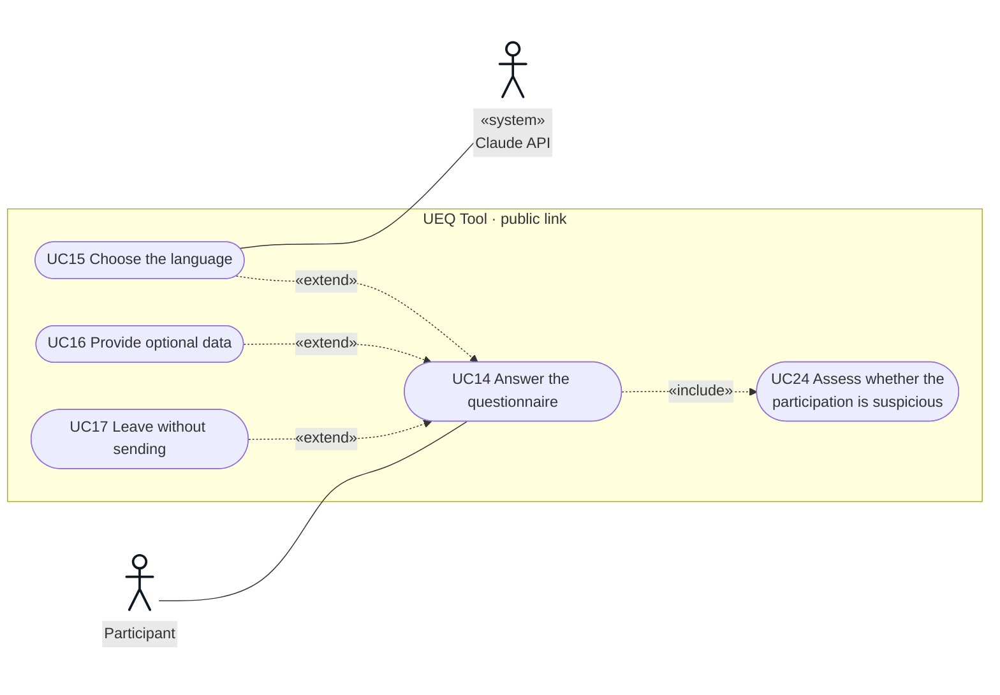
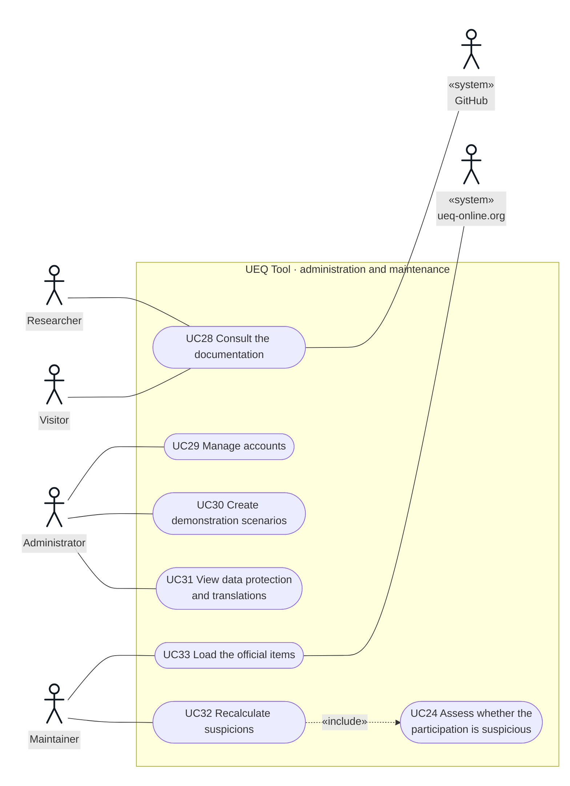
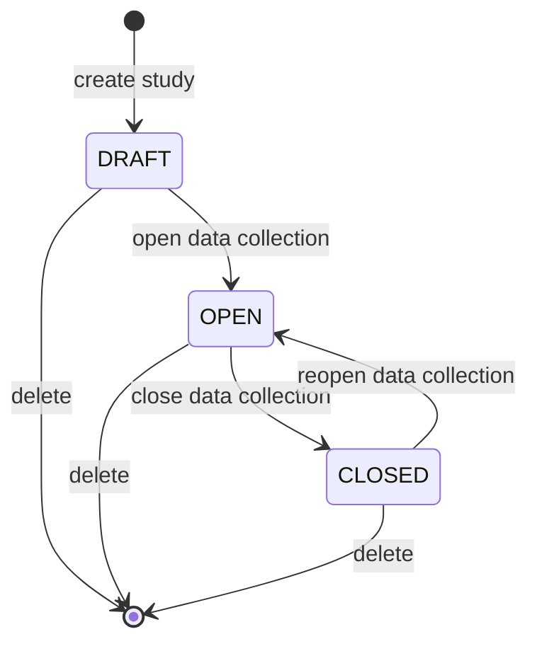

# Anwendungsfälle

33 Anwendungsfälle beschreiben, was jeder Akteur mit dem UEQ-Tool tut. Die Diagramme folgen der UML-Notation für Anwendungsfälle und sind in Mermaid gezeichnet, damit sie direkt auf GitHub erscheinen:

- Das Strichmännchen ist der Akteur. Die primären Akteure, die den Anwendungsfall auslösen, stehen links; die sekundären, die mitwirken, ohne ihn auszulösen, stehen rechts. Ist der Akteur ein anderes System, trägt sein Name «system»;
- die abgerundete Form ist der Anwendungsfall;
- der Rahmen ist die Systemgrenze;
- die durchgezogene Linie verbindet den Akteur mit dem Anwendungsfall, an dem er beteiligt ist;
- der gestrichelte Pfeil «include» zeigt auf einen Anwendungsfall, der immer mit abläuft;
- der gestrichelte Pfeil «extend» geht von einem optionalen Anwendungsfall aus und zeigt auf den Anwendungsfall, den er erweitert.

Direkt unter jedem Diagramm stehen das verwendete Werkzeug, die Quelldatei zum Herunterladen und die Version des Tools, die es darstellt. Die Verbindung jedes Anwendungsfalls mit den Anforderungen steht in der [Liste](#lista) und in der [Rückverfolgbarkeitsmatrix](matriz-rastreabilidade.md#casos-de-uso).

## Akteure

| Akteur | Wer das ist | Personas |
|---|---|---|
| Besucher | Person ohne Konto oder noch nicht angemeldet. Liest die Startseite und die Dokumentation und kann ein Konto erstellen | [PE08](personas.md#pe08) und jede forschende Person vor der Registrierung |
| Forschende(r) | Hat ein Konto und eine Sitzung. Besitzt die Studien, die sie anlegt, und kann Bearbeiter oder Leser der Studien sein, die eine andere Person mit ihr geteilt hat | [PE01](personas.md#pe01), [PE02](personas.md#pe02), [PE03](personas.md#pe03) |
| Teilnehmende(r) | Antwortet über den öffentlichen Link. Hat kein Konto und braucht nie eine Sitzung | [PE04](personas.md#pe04), [PE05](personas.md#pe05), [PE06](personas.md#pe06), [PE07](personas.md#pe07) |
| Administrator | Forschende Person mit der Administratormarkierung: tut alles, was Forschende tun, und öffnet die Seite Verwaltung. Sieht die Studien anderer Personen nicht | [PE08](personas.md#pe08) |
| Maintainer | Wer die Befehle der Installation ausführt: Migrations, Seed und Neuberechnung | [PE08](personas.md#pe08) |

Sekundäre Akteure, die an einem Anwendungsfall mitwirken, ohne ihn auszulösen:

| Sekundärer Akteur | Wo er mitwirkt | Was er mit dem Tool austauscht |
|---|---|---|
| E-Mail-Server «system» | [UC11](#uc11) Studie teilen, [UC13](#uc13) Benachrichtigungen verfolgen | Stellt die Einladung und die Benachrichtigungen per E-Mail zu, wenn der Versand konfiguriert ist |
| Claude-API «system» | [UC03](#uc03) Konto verwalten, [UC15](#uc15) Sprache wählen | Übersetzt die Oberfläche der Forschenden sowie Titel, Produkt und Ziel der Studie. Übersetzt nie den Fragebogen |
| Offizielle UEQ-Tabelle «system» | [UC25](#uc25) Daten exportieren, [UC26](#uc26) Antworten importieren | Erhält die Antworten in sich selbst eingetragen (UEQ Data Analysis Tool) und ist die Herkunft der importierten CSV-Datei |
| GitHub «system» | [UC28](#uc28) Dokumentation lesen | Bewahrt die Datei jedes Dokuments auf, geöffnet über den Link Auf GitHub ansehen |
| ueq-online.org «system» | [UC33](#uc33) Offizielle Items laden | Quelle der offiziellen Begriffe, Anweisungen und des Benchmarks, die nach `data/` kopiert werden |

Die teilnehmende Person ist immer primärer Akteur: Sie löst ihren eigenen Anwendungsfall über den Link aus und wirkt nicht an Anwendungsfällen anderer Akteure mit.

## Diagramm 1 · Konto und Studien

**Diagrammwerkzeug:** Mermaid 12.2.0 (`flowchart`), erzeugt mit `pnpm docs:diagramas`. **Quelldatei:** [casos-de-uso-1.mmd](fontes/casos-de-uso-1.mmd). **Dargestellte Version:** UEQ-Tool vom 17.11.2026.

UC12 erweitert UC13, weil die Einladung als Benachrichtigung ankommt: Annehmen oder Ablehnen ist eine optionale Entscheidung der Person, die die Glocke öffnet. UC27 erweitert UC06, weil die Wahl des UEQ-S eine Option der Person ist, die die Studie anlegt; ohne sie verwendet die Studie den vollständigen UEQ.

## Diagramm 2 · Ergebnisse und Antworten

**Diagrammwerkzeug:** Mermaid 12.2.0 (`flowchart`), erzeugt mit `pnpm docs:diagramas`. **Quelldatei:** [casos-de-uso-2.mmd](fontes/casos-de-uso-2.mmd). **Dargestellte Version:** UEQ-Tool vom 17.11.2026.

UC19 und UC24 haben keinen Akteur: Sie laufen nur innerhalb eines anderen Anwendungsfalls ab. Beide sind die reinen Funktionen des Berechnungsmoduls ([Klassendiagramm](diagrama-de-classes.md#2-módulo-de-cálculo)).

## Diagramm 3 · Teilnehmende

**Diagrammwerkzeug:** Mermaid 12.2.0 (`flowchart`), erzeugt mit `pnpm docs:diagramas`. **Quelldatei:** [casos-de-uso-3.mmd](fontes/casos-de-uso-3.mmd). **Dargestellte Version:** UEQ-Tool vom 17.11.2026.

Die Claude-API kommt in UC15 nur ins Spiel, um Titel, Produkt und Ziel zu übersetzen, die die forschende Person geschrieben hat. Die 26 Items, die Anweisung und die Texte der Bildschirme der Teilnehmenden stammen aus den offiziellen und geprüften Dateien, nie von der API.

## Diagramm 4 · Verwaltung, Wartung und Dokumentation

**Diagrammwerkzeug:** Mermaid 12.2.0 (`flowchart`), erzeugt mit `pnpm docs:diagramas`. **Quelldatei:** [casos-de-uso-4.mmd](fontes/casos-de-uso-4.mmd). **Dargestellte Version:** UEQ-Tool vom 17.11.2026.

Der Administrator ist eine forschende Person mit einer zusätzlichen Berechtigung und führt daher auch alle Anwendungsfälle der Forschenden aus den Diagrammen 1 und 2 aus. Der Maintainer nutzt die Oberfläche nicht: Er führt Befehle im Terminal der Installation aus.

## Liste

| ID | Anwendungsfall | Primärer Akteur | Anforderungen | Beziehungen |
|---|---|---|---|---|
| [UC01](#uc01) | Konto erstellen | Besucher | [RF01](requisitos.md#rf01), [RF08](requisitos.md#rf08) | — |
| [UC02](#uc02) | Anmelden und abmelden | Forschende(r) | [RF02](requisitos.md#rf02), [RF03](requisitos.md#rf03), [RF11](requisitos.md#rf11) | — |
| [UC03](#uc03) | Konto verwalten | Forschende(r) | [RF04](requisitos.md#rf04), [RF05](requisitos.md#rf05), [RF06](requisitos.md#rf06), [RF07](requisitos.md#rf07), [RF08](requisitos.md#rf08), [RF23](requisitos.md#rf23) | — |
| [UC04](#uc04) | Die Nutzung lernen | Forschende(r) | [RF09](requisitos.md#rf09), [RF10](requisitos.md#rf10) | — |
| [UC05](#uc05) | Studien auflisten | Forschende(r) | [RF12](requisitos.md#rf12) | — |
| [UC06](#uc06) | Studie erstellen | Forschende(r) | [RF13](requisitos.md#rf13), [RF18](requisitos.md#rf18), [RF19](requisitos.md#rf19) | erweitert durch UC27 |
| [UC07](#uc07) | Studie bearbeiten | Forschende(r) | [RF14](requisitos.md#rf14) | — |
| [UC08](#uc08) | Erhebung steuern | Forschende(r) | [RF15](requisitos.md#rf15) | — |
| [UC09](#uc09) | Link kopieren | Forschende(r) | [RF16](requisitos.md#rf16) | — |
| [UC10](#uc10) | Studie löschen | Forschende(r) | [RF17](requisitos.md#rf17) | — |
| [UC11](#uc11) | Studie teilen | Forschende(r) | [RF20](requisitos.md#rf20) | — |
| [UC12](#uc12) | Auf Einladung antworten | Forschende(r) | [RF21](requisitos.md#rf21) | erweitert UC13 |
| [UC13](#uc13) | Benachrichtigungen verfolgen | Forschende(r) | [RF22](requisitos.md#rf22), [RF23](requisitos.md#rf23) | erweitert durch UC12 |
| [UC14](#uc14) | Fragebogen beantworten | Teilnehmende(r) | [RF24](requisitos.md#rf24), [RF25](requisitos.md#rf25), [RF26](requisitos.md#rf26), [RF27](requisitos.md#rf27), [RF28](requisitos.md#rf28), [RF29](requisitos.md#rf29), [RF30](requisitos.md#rf30), [RF33](requisitos.md#rf33) | schließt UC24 ein; erweitert durch UC15, UC16, UC17 |
| [UC15](#uc15) | Sprache wählen | Teilnehmende(r) | [RF34](requisitos.md#rf34), [RF35](requisitos.md#rf35) | erweitert UC14 |
| [UC16](#uc16) | Optionale Angaben machen | Teilnehmende(r) | [RF32](requisitos.md#rf32) | erweitert UC14 |
| [UC17](#uc17) | Ohne Senden verlassen | Teilnehmende(r) | [RF31](requisitos.md#rf31) | erweitert UC14 |
| [UC18](#uc18) | Ergebnisse ansehen | Forschende(r) | [RF43](requisitos.md#rf43), [RF44](requisitos.md#rf44), [RF45](requisitos.md#rf45), [RF46](requisitos.md#rf46), [RF48](requisitos.md#rf48), [RF49](requisitos.md#rf49) | schließt UC19 ein; erweitert durch UC20, UC21, UC22 |
| [UC19](#uc19) | UEQ-Auswertung berechnen | — | [RF36](requisitos.md#rf36), [RF37](requisitos.md#rf37), [RF38](requisitos.md#rf38), [RF39](requisitos.md#rf39), [RF40](requisitos.md#rf40), [RF41](requisitos.md#rf41), [RF42](requisitos.md#rf42) | eingeschlossen von UC18, UC25 |
| [UC20](#uc20) | Versionen vergleichen | Forschende(r) | [RF47](requisitos.md#rf47) | erweitert UC18 |
| [UC21](#uc21) | Demografische Daten ansehen | Forschende(r) | [RF50](requisitos.md#rf50) | erweitert UC18 |
| [UC22](#uc22) | Dashboard als PDF exportieren | Forschende(r) | [RF60](requisitos.md#rf60) | erweitert UC18 |
| [UC23](#uc23) | Verdächtige Antworten prüfen | Forschende(r) | [RF52](requisitos.md#rf52), [RF53](requisitos.md#rf53), [RF54](requisitos.md#rf54) | schließt UC24 ein |
| [UC24](#uc24) | Verdacht der Teilnahme bewerten | — | [RF51](requisitos.md#rf51) | eingeschlossen von UC14, UC23, UC26, UC32 |
| [UC25](#uc25) | Daten exportieren | Forschende(r) | [RF56](requisitos.md#rf56), [RF57](requisitos.md#rf57), [RF58](requisitos.md#rf58), [RF59](requisitos.md#rf59) | schließt UC19 ein |
| [UC26](#uc26) | Antworten importieren | Forschende(r) | [RF61](requisitos.md#rf61) | schließt UC24 ein |
| [UC27](#uc27) | Den UEQ-S einsetzen | Forschende(r) | [RF62](requisitos.md#rf62) | erweitert UC06 |
| [UC28](#uc28) | Dokumentation lesen | Besucher oder Forschende(r) | [RF63](requisitos.md#rf63), [RF64](requisitos.md#rf64), [RF65](requisitos.md#rf65) | — |
| [UC29](#uc29) | Konten verwalten | Administrator | [RF66](requisitos.md#rf66) | — |
| [UC30](#uc30) | Demo-Szenarien erstellen | Administrator | [RF67](requisitos.md#rf67) | — |
| [UC31](#uc31) | Datenschutz und Übersetzungen ansehen | Administrator | [RF68](requisitos.md#rf68) | — |
| [UC32](#uc32) | Verdachtsfälle neu berechnen | Maintainer | [RF55](requisitos.md#rf55) | schließt UC24 ein |
| [UC33](#uc33) | Offizielle Items laden | Maintainer | [RNF10](requisitos.md#rnf10) | — |

## Spezifikationen

Die zentralen Anwendungsfälle haben eine vollständige Spezifikation: Akteur, Vorbedingungen, Nachbedingungen, Hauptablauf und alternative Abläufe. Die übrigen haben, weil sie kurz sind, nur den Hauptablauf. Die Namen der Schaltflächen sind die der deutschen Oberfläche.

### UC14

**Fragebogen beantworten**

| | |
|---|---|
| Akteur | Teilnehmende(r) |
| Ziel | Die 26 Items des UEQ zu einer Version des Produkts anonym beantworten |
| Vorbedingungen | Die Studie existiert, die Erhebung ist geöffnet, und die teilnehmende Person hat den Link `/r/<slug>` |
| Nachbedingungen bei Erfolg | Es gibt eine abgeschlossene Teilnahme mit 26 Antworten von 1 bis 7, der Sprache, der zugewiesenen Version, dem bewerteten Verdacht und gegebenenfalls der Markierung als minderjährig |
| Nachbedingungen bei Abbruch | Keine Antwort gespeichert; die begonnene und nicht abgesendete Teilnahme wird innerhalb von 2 Tagen gelöscht |
| Bildschirme | p1 Einwilligung, p2 und p7 Fragebogen, p3 fehlendes Item, p4 optionale Angaben, p5 Ende, p6 geschlossener Link |

Hauptablauf:

1. Die teilnehmende Person öffnet den Link. Das System wählt die Sprache der Studie (oder die des Browsers, wenn die Studie es zulässt) und zeigt die Einwilligungserklärung: Ziel, geschätzte Dauer, was nach dem Absenden geschieht, Risiken, Nutzen, Aufbewahrung der Daten, freiwillige und anonyme Teilnahme, verantwortliche Person der Forschung und Kontakt.
2. Die teilnehmende Person gibt ihr Alter an und klickt auf „Ich stimme zu und möchte teilnehmen“.
3. Das System weist die Version mit den wenigsten abgeschlossenen Antworten zu, legt die Teilnahme mit dem Datum der Einwilligung und der Sprache an und speichert die Teilnahme in einem auf den Link beschränkten Cookie.
4. Das System zeigt die offizielle Anweisung und die 26 Items in offizieller Reihenfolge und Polarität, keines markiert, mit der Fußzeile „0 von 26 beantwortet“ und „Ohne Senden verlassen“.
5. Die teilnehmende Person markiert bei jedem Item eine Position. Die Fußzeile aktualisiert den Zähler, und die Markierungen bleiben im Browser-Tab gespeichert.
6. Die teilnehmende Person klickt auf „Antworten senden“.
7. Das System prüft die 26 Werte, bewertet den Verdacht (UC24) und speichert die Antworten und den Abschluss in einer Transaktion. Es markiert den Link in diesem Browser als beantwortet.
8. Wenn die Studie demografische Daten erhebt, zeigt das System den Schritt mit den optionalen Angaben (UC16).
9. Das System zeigt die Abschlussseite: Die Antworten wurden gespeichert, und die Person kann die Seite schließen.

Alternative Abläufe:

- **1a. Studie im Entwurf oder beendet.** Das System erklärt die Situation („noch nicht geöffnet“, „die Erhebung wurde beendet“) und bietet die Einwilligungserklärung nicht an.
- **1b. Link in diesem Browser bereits beantwortet.** Das System sagt, dass die Antworten bereits gespeichert wurden.
- **1c. Andere Sprache.** Die teilnehmende Person wählt im Sprachwähler (UC15).
- **1d. Datenschutzerklärung.** Die teilnehmende Person öffnet die Datenschutzerklärung über die Einwilligungserklärung, innerhalb des Links, und kehrt zur Einwilligungserklärung zurück.
- **1e. Kopie der Einwilligungserklärung.** Die teilnehmende Person druckt eine Kopie der Einwilligungserklärung aus oder speichert sie als PDF.
- **2a. Ich möchte nicht teilnehmen.** Die teilnehmende Person verlässt die Seite, ohne dass etwas gespeichert wird.
- **2b. Ohne Alter.** Das System fragt nach dem Alter und speichert nichts.
- **2c. Jünger als 18.** Das System verlangt die Bestätigung, dass die erziehungsberechtigte Person zugestimmt hat. Ohne sie speichert es nichts; mit ihr speichert es die Teilnahme mit der Markierung als minderjährig.
- **4a. Laufende Teilnahme.** Wer bereits eingewilligt hat und zum Link zurückkehrt, gelangt direkt zum Fragebogen.
- **5a. Seite neu laden.** Das System stellt die markierten Items wieder her und weist darauf hin.
- **5b. Ohne Senden verlassen (UC17).**
- **7a. Fehlende Items.** Das System speichert nichts, zeigt die Zusammenfassung „Noch N Begriffspaare offen“ mit einem Link zu jedem Item und setzt den Fokus auf die Zusammenfassung. Zurück zu Schritt 5.
- **7b. Die Erhebung wurde während der Beantwortung beendet.** Das System weist darauf hin, dass die Studie keine Antworten mehr annimmt.

Regeln: [RNF09](requisitos.md#rnf09) (Fragebogen ohne Verzerrung durch die Oberfläche), [RNF10](requisitos.md#rnf10) (offizielle Begriffe) und [RNF12](requisitos.md#rnf12) (Anonymität). Der Weg vom Klick bis zur Datenbank steht im [Sequenzdiagramm 2](diagramas-de-sequencia.md#2-responder-o-questionário).

### UC06

**Studie erstellen**

| | |
|---|---|
| Akteur | Forschende(r) |
| Vorbedingungen | Gültige Sitzung |
| Nachbedingungen | Studie im Status RASCUNHO (Entwurf), mit eindeutigem öffentlichem Link, 1 bis 6 nummerierten Versionen, Sprache, verantwortlicher Person, Risiken und Nutzen |

Hauptablauf:

1. Die forschende Person klickt auf „Studie erstellen“.
2. Das System zeigt das Formular in nummerierten Abschnitten, mit der Vorschau der Einwilligungserklärung der Teilnehmenden daneben. Name, Kontakt-E-Mail und Institution sind aus dem Konto und der letzten Studie vorausgefüllt; Risiken und Nutzen kommen mit einem vorgeschlagenen Text.
3. Die forschende Person gibt Titel, bewertetes Produkt, Ziel, Erhebungszeitraum und Sprache an. Das System schlägt das Produkt als Namen der ersten Version vor.
4. Die forschende Person fügt Versionen hinzu oder benennt sie um und entscheidet, ob der Link demografische Daten erhebt (standardmäßig ausgeschaltet).
5. Die forschende Person klickt auf „Studie erstellen“. Die Schaltfläche zeigt, dass sie arbeitet, und ignoriert weitere Klicks.
6. Das System validiert, erzeugt den öffentlichen Link und speichert die Studie mit den Versionen.
7. Das System öffnet die Seite der Studie im Entwurf, mit der Bestätigung und der Liste „Vor dem Öffnen prüfen“.

Alternative Abläufe:

- **6a. Ungültige Daten.** Das System zeigt die Fehlerzusammenfassung mit einem Link zu jedem Feld, setzt den Fokus auf die Zusammenfassung und kennzeichnet jedes Feld mit der Meldung. Zurück zu Schritt 3.
- **3a. UEQ-S (UC27).** Unter Fragebogen wählt die forschende Person UEQ-S, Kurzfassung. Das Formular sagt, was sich ändert (Fragebogen, Dauer in der Einwilligungserklärung, Dashboard und exportierte Tabelle) und dass die Wahl bei der ersten Antwort gesperrt wird.

### UC08

**Erhebung steuern**

| | |
|---|---|
| Akteur | Forschende(r) (Besitzer oder Bearbeiter) |
| Vorbedingungen | Gültige Sitzung und eine Studie der forschenden Person oder eine, die als Bearbeiter mit ihr geteilt wurde |
| Nachbedingungen | Status der Studie geändert; der Link nimmt nun Antworten an oder lehnt sie ab |

Hauptablauf:

1. Auf der Seite der Studie im Status RASCUNHO (Entwurf) klickt die forschende Person auf „Erhebung öffnen“.
2. Das System setzt den Status auf ABERTO (geöffnet) und meldet „Erhebung geöffnet. Der Link nimmt bereits Antworten an.“
3. Später klickt die forschende Person auf „Erhebung beenden“. Das System setzt den Status auf ENCERRADO (beendet); der Link sagt nun, dass die Erhebung beendet wurde.

Alternative Abläufe:

- **3a. Wieder öffnen.** Bei beendeter Studie setzt „Erhebung wieder öffnen“ den Status zurück auf ABERTO. Weil es umkehrbar ist, verlangt das Beenden keine Bestätigung.
- **2a. Der Status hat sich in einem anderen Tab geändert.** Das System lehnt den Übergang ab und bittet, die Seite neu zu laden.

**Diagrammwerkzeug:** Mermaid 12.2.0 (`stateDiagram-v2`), erzeugt mit `pnpm docs:diagramas`. **Quelldatei:** [casos-de-uso-5.mmd](fontes/casos-de-uso-5.mmd). **Dargestellte Version:** UEQ-Tool vom 17.11.2026.

### UC11

**Studie teilen**

| | |
|---|---|
| Akteur | Forschende(r), Besitzer der Studie |
| Sekundärer Akteur | E-Mail-Server |
| Vorbedingungen | Gültige Sitzung, eigene Studie der forschenden Person, und die eingeladene Person hat bereits ein Konto |
| Nachbedingungen | Zusammenarbeit im Status PENDENTE (ausstehend) mit der gewählten Rolle und eine Einladungsbenachrichtigung für die eingeladene Person |

Hauptablauf:

1. Auf der Seite der Studie klickt der Besitzer auf „Teilen“.
2. Das System öffnet das Fenster mit dem aktuellen Team und dem Einladungsfeld.
3. Der Besitzer gibt die E-Mail-Adresse der Person an, wählt Bearbeiter oder Leser und bestätigt.
4. Das System legt die ausstehende Zusammenarbeit an, erstellt die Benachrichtigung in der Glocke der Person und schickt, wenn der Versand konfiguriert ist und die Person ihn nicht ausgeschaltet hat, die E-Mail in ihrer Sprache.
5. Das System bestätigt die Einladung im Fenster.

Alternative Abläufe:

- **3a. E-Mail-Adresse ohne Konto.** Das System sagt, dass die Person zuerst ein Konto erstellen muss.
- **3b. Die Person ist bereits im Team.** Das System weist darauf hin und verdoppelt die Einladung nicht.
- **3c. Rolle ändern oder entfernen.** Der Besitzer ändert die Rolle einer Person, zieht eine Einladung zurück oder nimmt die Person aus dem Team; wer ausscheidet, wird benachrichtigt.
- **3d. Die Studie verlassen.** Die eingeladene Person kann die Studie auch selbst verlassen; der Besitzer wird benachrichtigt.
- **1a. Wer nicht Besitzer ist.** Bearbeiter und Leser sehen das Team, laden aber nicht ein.

### UC18

**Ergebnisse ansehen**

| | |
|---|---|
| Akteur | Forschende(r) (Besitzer, Bearbeiter oder Leser) |
| Vorbedingungen | Gültige Sitzung und Zugang zur Studie |
| Nachbedingungen | Keine: Der Anwendungsfall liest nur |

Hauptablauf:

1. Die forschende Person öffnet den Reiter Ergebnisse der Studie.
2. Das System holt die abgeschlossenen Teilnahmen und berechnet die Auswertung der Teilnahmen in der Auswertung, für alle Versionen und für jede einzelne (UC19).
3. Das System zeigt die Zusammenfassung der Erhebung, die Kurzinterpretation, das Diagramm der 6 Skalen mit Benchmark und KI95, die entsprechende Tabelle, die Mittelwerte der pragmatischen und hedonischen Qualität, das Diagramm pro Item und den Abschnitt Exportieren.
4. Die forschende Person öffnet bei Bedarf die Erklärungen der Begriffe.

Alternative Abläufe:

- **2a. Niemand in der Auswertung.** Das System zeigt „Noch keine Antworten in der Auswertung.“ anstelle der Diagramme.
- **3a. Kleine Stichprobe oder Alpha unter 0,7.** Das System zeigt den Hinweis mit der Bedeutung und dem, was zu tun ist.
- **3b. Andere Version.** Die forschende Person wählt eine andere Version; die Adresse speichert die Wahl.
- **3c. Versionen vergleichen (UC20).** Bei mehr als einer Version wechselt die forschende Person zu „Versionen vergleichen“.
- **3d. Demografische Daten (UC21).** Wenn die Studie sie erhebt, zeigt der Unterreiter das Profil der Antwortenden.
- **3e. Dashboard als PDF (UC22).**

### UC23

**Verdächtige Antworten prüfen**

| | |
|---|---|
| Akteur | Forschende(r) (Besitzer oder Bearbeiter zum Ändern; Leser sieht nur) |
| Vorbedingungen | Gültige Sitzung und Zugang zur Studie |
| Nachbedingungen | Teilnahmen als in oder außerhalb der Auswertung markiert; keine Antwort gelöscht |

Hauptablauf:

1. Die forschende Person öffnet den Reiter Antworten.
2. Das System zeigt den Überblick (in der Auswertung, außerhalb der Auswertung, verdächtig), die Tabelle der Teilnahmen mit dem Grund des Verdachts und daneben die Verdachtsregel.
3. Die forschende Person markiert „Nur verdächtige anzeigen“ und öffnet „Skalen ansehen“ in einer Zeile.
4. Das System zeigt die Spannweite jeder Skala und hebt diejenigen hervor, die den Schwellenwert überschritten haben.
5. Die forschende Person klickt auf „Verdächtige aus der Auswertung nehmen“.
6. Das System markiert die Verdächtigen als außerhalb der Auswertung, ohne etwas zu löschen, und meldet, wie viele herausgenommen wurden.

Alternative Abläufe:

- **5a. Einzeln.** Die forschende Person entfernt in einer Zeile das Häkchen bei „In der Auswertung“. Erneutes Setzen nimmt die Teilnahme wieder auf.

### UC25

**Daten exportieren**

| | |
|---|---|
| Akteur | Forschende(r) (Besitzer, Bearbeiter oder Leser) |
| Sekundärer Akteur | Offizielle UEQ-Tabelle |
| Vorbedingungen | Gültige Sitzung und Zugang zur Studie |
| Nachbedingungen | Keine in der Datenbank; der Browser erhält die Datei |

Hauptablauf:

1. Im Abschnitt Exportieren des Dashboards wählt die forschende Person eine der vier Dateien: Rohantworten, umkodierte Antworten, Ergebnisse pro Skala (alle drei als CSV) oder die offizielle UEQ-Tabelle (XLSX).
2. Das System prüft die Sitzung und den Zugang zur Studie, baut die CSV-Datei (mit BOM, `;` und Dezimalkomma) und gibt sie als Download zurück, mit dem Namen `ueq_<titulo>_<tipo>_<aaaa-mm-dd>.csv`.
3. Bei der offiziellen Tabelle füllt das System die UEQ Data Analysis Tool V15 selbst mit den Teilnahmen in der Auswertung der im Dashboard gewählten Version (oder der ganzen Studie) ab Data!A4, in der Sprache der Oberfläche, und gibt `ueq_<titulo>_planilha-oficial[_<versao>]_<aaaa-mm-dd>.xlsx` zurück.
4. Die forschende Person öffnet die Tabelle in Excel und klickt auf Bearbeitung aktivieren: Die Tabelle rechnet mit ihren eigenen Formeln neu, und die Person vergleicht die Zahlen mit denen des Dashboards.

Alternativ: **2a.** Ohne Sitzung oder ohne Zugang zur Studie wird nichts ausgegeben. **3a.** Die Auswahl umfasst mehr als 1000 Teilnahmen, das Maximum der offiziellen Tabelle: Anstelle des Links erklärt das Dashboard dies und schlägt vor, eine Version zu wählen oder die Rohantworten zu verwenden.

### UC26

**Antworten importieren**

| | |
|---|---|
| Akteur | Forschende(r) (Besitzer oder Bearbeiter) |
| Sekundärer Akteur | Offizielle UEQ-Tabelle |
| Vorbedingungen | Gültige Sitzung, Bearbeitungszugang zur Studie und eine CSV-Datei mit 26 Werten von 1 bis 7 pro Zeile |
| Nachbedingungen | Eine abgeschlossene Teilnahme pro Zeile, mit der Herkunft IMPORTADA (importiert), ohne Sprache und mit bewertetem Verdacht; oder nichts, wenn ein Fehler auftritt |

Hauptablauf:

1. Unter Antworten klickt die forschende Person auf „Antworten aus einer CSV-Datei importieren“.
2. Die forschende Person wählt die Version (wenn es mehr als eine gibt) und die Datei und klickt auf „Vorschau ansehen“.
3. Das System liest die Datei, ohne zu speichern, und zeigt die ersten Zeilen und die Gesamtzahl.
4. Die forschende Person bestätigt.
5. Das System speichert alle Zeilen in einer Transaktion, bewertet dabei den Verdacht jeder Zeile (UC24) und kehrt zu Antworten zurück, mit dem Hinweis, wie viele importiert wurden.

Alternative Abläufe:

- **3a. Zeilen mit Fehler.** Das System listet das Problem jeder Zeile auf (Anzahl der Werte, Wert außerhalb von 1 bis 7) und bietet die Bestätigung nicht an.
- **3b. Ungültige Datei.** Falsche Endung, leer oder zu groß: Das System sagt, was zu tun ist.

### Weitere Anwendungsfälle

#### UC01

Konto erstellen. Der Besucher klickt auf „Konto erstellen“, das sich in einem Fenster über der Seite öffnet. Er gibt Name, E-Mail-Adresse, Passwort (mit den vor der Eingabe sichtbaren Regeln) und die Sprache des Tools an. Das System validiert, speichert das Passwort mit bcrypt, legt die Sitzung an und bestätigt. Alternativ: Eine bereits registrierte E-Mail-Adresse zeigt den Fehler mit einem Link zu Anmelden.

#### UC02

Anmelden und abmelden. Die forschende Person klickt auf „Anmelden“, das sich in einem Fenster über der Seite öffnet, und gibt E-Mail-Adresse und Passwort ein. Das System prüft, legt die Sitzung an und kehrt zur angeforderten Seite zurück, falls es eine gibt. Abmelden verlangt eine Bestätigung in einem Fenster und löscht die Sitzung. Alternativ: Ein falsches Passwort zeigt den Fehler, ohne zu sagen, welches der beiden Felder falsch ist; nach 5 falschen Passwörtern in 15 Minuten muss die E-Mail-Adresse warten, bevor sie es erneut versucht.

#### UC03

Konto verwalten. Unter Mein Konto speichert die forschende Person Name und E-Mail-Adresse, ändert das Passwort (was die anderen Sitzungen beendet), wählt die Sprache des Tools, schaltet die Benachrichtigungen per E-Mail ein oder aus, lädt die Daten des Kontos als JSON herunter oder löscht das Konto durch Eingabe der E-Mail-Adresse. Die Sprache lässt sich auch über den Sprachwähler in der Leiste ändern. Die Texte der Oberfläche, die in der gewählten Sprache noch nicht übersetzt sind, werden bei der Claude-API angefragt und gespeichert.

#### UC04

Die Nutzung lernen. Beim ersten Zugriff öffnet das System die geführte Tour auf den echten Bildschirmen; die Person kommt weiter, indem sie die Aktion ausführt, oder überspringt bzw. schließt sie. Auf jeder Seite öffnet das (?) in der Kopfzeile die Hilfe zu dieser Seite, von wo aus die Tour erneut angesehen werden kann.

#### UC05

Studien auflisten. Das System zeigt die Tabelle der Studien der forschenden Person und in einem anderen Abschnitt die mit ihr geteilten Studien, mit Titel, Produkt, Status, Versionen, Antworten und letzter Antwort. Der Titel führt zur Seite der Studie.

#### UC07

Studie bearbeiten. Wie UC06, mit den vorausgefüllten Daten. Bei geöffneter Erhebung kann eine Version, die bereits Antworten hat, nicht entfernt werden. Die Partner der Studie werden über die Änderung benachrichtigt.

#### UC09

Link kopieren. Die forschende Person klickt auf „Link kopieren“; das System kopiert die öffentliche Adresse und meldet, dass sie kopiert wurde.

#### UC10

Studie löschen. Nur der Besitzer löscht. Die forschende Person öffnet „Studie löschen“, liest, wie viele Antworten mitgelöscht werden, und gibt den Titel ein. Das System löscht kaskadierend Versionen, Teilnahmen, Antworten und Zusammenarbeiten und kehrt zur Liste zurück.

#### UC12

Auf Einladung antworten. In der Glocke nimmt die eingeladene Person die Einladung an oder lehnt sie ab. Wird sie angenommen, erscheint die Studie unter „Mit Ihnen geteilt“; wird sie abgelehnt, wird die einladende Person benachrichtigt.

#### UC13

Benachrichtigungen verfolgen. Die Glocke zeigt, wie viele Benachrichtigungen ungelesen sind: Einladungen, neue Antworten (zusammengefasst, solange sie ungelesen sind) und Änderungen durch die Partner. Das Öffnen einer Benachrichtigung führt an ihren Ort und markiert sie als gelesen. Jede Benachrichtigung geht auch per E-Mail hinaus, wenn der Versand konfiguriert ist und die Person ihn nicht ausgeschaltet hat.

#### UC15

Sprache wählen. In der Einwilligungserklärung oder im Fragebogen wählt die teilnehmende Person die Sprache im Sprachwähler und klickt auf „Übernehmen“. Das System speichert die Wahl in einem Cookie des Links, passt `lang` und `dir` an (von rechts nach links bei Arabisch, Hebräisch und Persisch), behält die bereits gesetzten Markierungen und zeigt den Hinweis, wenn die UEQ-Übersetzung nicht von den Autoren freigegeben wurde. Titel, Produkt und Ziel der Studie erscheinen von der Claude-API übersetzt; ohne Übersetzung bleiben sie in der Originalsprache.

#### UC16

Optionale Angaben machen. Die teilnehmende Person beantwortet Altersgruppe, Geschlecht, Bildungsabschluss und Vertrautheit mit dem Produkt, jeweils mit „Keine Angabe“, oder klickt auf „Diesen Schritt überspringen“. Nur Optionen aus der Liste werden gespeichert, verschlüsselt.

#### UC17

Ohne Senden verlassen. Die teilnehmende Person klickt auf „Ohne Senden verlassen“ und bestätigt im Fenster. Das System speichert keine Antwort und zeigt die Abschiedsseite.

#### UC19

UEQ-Auswertung berechnen. Das System kodiert die Antworten auf -3 bis +3 um, berechnet pro Skala n, Mittelwert, Standardabweichung, KI95, Cronbachs Alpha und Interpretation, ordnet in den Benchmark ein und berechnet die pragmatische und die hedonische Qualität sowie jedes Item. Nur die Teilnahmen in der Auswertung gehen in die Statistiken ein. Die Formeln stehen im [UEQ-Protokoll](../ueq-protocolo.md) und wurden in der [Überprüfung der Berechnung](verificacao-do-calculo.md) von Hand nachgerechnet.

#### UC20

Versionen vergleichen. Die forschende Person wählt „Versionen vergleichen“. Das System zeigt pro Version eine andere Markierungsform auf jeder Skala und die Interpretation der größten Unterschiede.

#### UC21

Demografische Daten ansehen. Im Unterreiter Demografische Daten zeigt das System jede Frage in einem Diagramm mit der Tabelle der Zahlen, getrennt nach Personen, die keine Angabe machen wollten, und Personen, die den Schritt übersprungen haben, mit einem Filter nach Version.

#### UC22

Dashboard als PDF exportieren. Die forschende Person klickt auf „Dashboard als PDF“. Das System öffnet die Druckseite in einem Browser ohne Bildschirm, mit derselben Version und demselben Modus, und gibt ein A4-PDF mit Titel, n und Datum in der Kopfzeile zurück.

#### UC24

Verdacht der Teilnahme bewerten. Mit den 26 Werten berechnet das System die Spannweite pro Skala und die Anzahl gleicher Antworten und markiert die Teilnahme als verdächtig, wenn sie die Schwellenwerte aus `data/protocolo.json` überschreitet (3 oder mehr Skalen mit einer Spannweite größer als 3 oder mehr als 15 gleiche Antworten).

#### UC27

Den UEQ-S einsetzen. Beim Erstellen der Studie wählt die forschende Person zwischen dem vollständigen UEQ und dem UEQ-S (8 Items: pragmatische, hedonische und Gesamtqualität). Die teilnehmende Person beantwortet die 8 Paare, mit dem negativen Begriff immer links; die Antworten werden in den entsprechenden Items des UEQ gespeichert. Die Ergebnisse zeigen den UEQ-S in einem eigenen Reiter, mit seinem Benchmark und seiner offiziellen Tabelle. Alternativ: Wenn die Studie bereits Antworten hat, zeigt die Bearbeitung die gesperrte Wahl mit dem Grund, und der Server lehnt die Änderung ab.

#### UC28

Dokumentation lesen. Jede Person, mit oder ohne Konto, öffnet /documentacao; die forschende Person gelangt auch über den Link Dokumentation in der Leiste dorthin. Das System zeigt die Abschnitte als Reiter und in jedem Abschnitt ein Dokument pro Unterreiter, gelesen aus der `.md`-Datei des Repositorys, mit den Diagrammen als Bilder, die sich im Vollbild öffnen, und dem Steckbrief, der sagt, was das Dokument ist, wofür es dient, wer es lesen sollte, die Datei auf GitHub und die Downloads. Ein langes Dokument öffnet sich als Inhaltsverzeichnis, und jeder Abschnitt erhält eine eigene Seite. Alternativ: Eine Adresse außerhalb des Katalogs führt zur Seite „nicht gefunden“.

#### UC29

Konten verwalten. Unter Verwaltung › Konten sieht der Administrator die Konten mit der Anzahl der Studien jedes Kontos, legt ein Konto für eine andere Person an und vergibt oder entzieht die Administratormarkierung. Wer kein Administrator ist, kann die Seite nicht öffnen.

#### UC30

Demo-Szenarien erstellen. Unter Verwaltung › Szenarien wählt der Administrator ein Szenario, und das System legt in seinem Konto eine Studie mit erfundenen Antworten an, die zum Profil des Szenarios passen.

#### UC31

Datenschutz und Übersetzungen ansehen. Unter Verwaltung › Datenschutz zeigt das System, ob der Verschlüsselungsschlüssel und der E-Mail-Versand konfiguriert sind; unter Verwaltung › Sprachen, wie viel jeder Sprache der Oberfläche bereits übersetzt ist.

#### UC32

Verdachtsfälle neu berechnen. Nach einer Änderung an `data/protocolo.json` führt der Maintainer `pnpm suspeitas:recalcular` aus. Das System bewertet alle abgeschlossenen Teilnahmen neu (UC24).

#### UC33

Offizielle Items laden. Der Maintainer führt `pnpm db:seed` aus. Das System validiert `data/ueq-itens-ptbr.json`, kopiert aus dem offiziellen Paket von ueq-online.org, und speichert die 26 Items; wenn etwas nicht stimmt, bricht es ab und nennt das Item.
