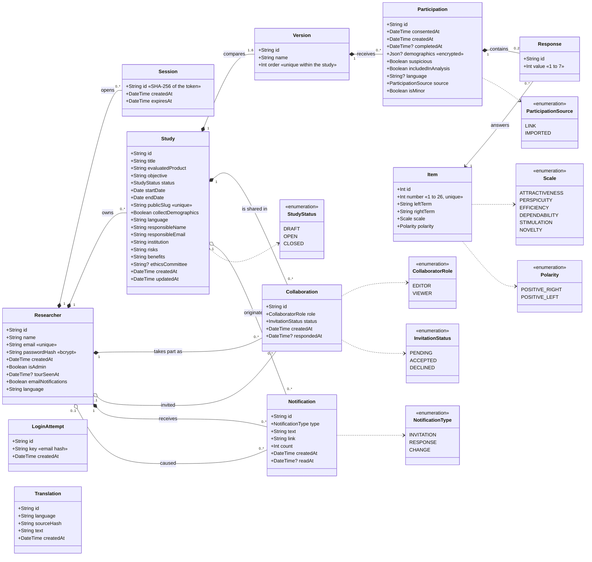

# Klassendiagramm

Zwei Diagramme beschreiben die statische Struktur des UEQ-Tools:

1. **Domänenmodell:** die 11 in PostgreSQL gespeicherten Entitäten und die 7 Aufzählungstypen, wie sie in [`prisma/schema.prisma`](../../prisma/schema.prisma) stehen.
2. **Berechnungsmodul:** die Typen und Funktionen von [`src/ueq/`](../../src/ueq/), die Antworten in Ergebnisse umwandeln, ohne die Datenbank zu berühren.

Die Diagramme sind in allen Sprachen der Dokumentation auf Englisch. Im Code und in den Erläuterungen unten sind die Namen die des Codes, auf Portugiesisch und ohne Akzente: Researcher ist `Pesquisador`, Study ist `Estudo`, Version ist `Versao`, Participation ist `Participacao` und Response ist `Resposta`. Die Typen folgen TypeScript: `?` kennzeichnet ein Feld, das leer sein kann, und `[]` kennzeichnet eine Liste. Die Tabellen, Spalten, Schlüssel und Löschregeln der Datenbank stehen Feld für Feld im [logischen Datenmodell](modelo-logico.md); dieses Dokument zeigt dieselben Entitäten als Klassen, mit den Assoziationen und der Multiplizität jeder einzelnen.

Direkt unter jedem Diagramm stehen das verwendete Werkzeug, die Quelldatei zum Herunterladen und die Version des Tools, die es darstellt.

## 1. Domänenmodell

**Diagrammwerkzeug:** Mermaid 12.2.0 (`classDiagram`), erzeugt mit `pnpm docs:diagramas`. **Quelldatei:** [diagrama-de-classes-1.mmd](fontes/diagrama-de-classes-1.mmd). **Dargestellte Version:** UEQ-Tool vom 17.11.2026.

### Lesehilfe

- **Komposition (gefüllte Raute)** ist kaskadierendes Löschen in der Datenbank. Wird die forschende Person gelöscht, werden ihre Sitzungen, ihre Studien, die Zusammenarbeiten, an denen sie teilnimmt, und die Benachrichtigungen, die sie erhalten hat, gelöscht ([RF06](requisitos.md#rf06)). Wird die Studie gelöscht, werden Versionen, Teilnahmen, Antworten und Zusammenarbeiten gelöscht ([RF17](requisitos.md#rf17)).
- **Aggregation (leere Raute)** ist ein Verweis, der leer wird, wenn die andere Seite gelöscht wird: Löscht die einladende Person ihr Konto, bleibt die Zusammenarbeit bestehen, ohne den Namen der einladenden Person; verschwindet die Studie oder der Urheber einer Benachrichtigung, bleibt die Benachrichtigung in der Glocke der Person, die sie erhalten hat.
- **Item** gehört niemandem: Die 26 Items werden vom Seed aus dem offiziellen Paket geladen ([RNF10](requisitos.md#rnf10)) und von allen Studien geteilt. Eine Antwort verweist auf das Item; das Löschen der Antwort löscht das Item nicht.
- **Versao** gibt es 1 bis 6 Mal pro Studie. Die Reihenfolge ist innerhalb der Studie eindeutig und bestimmt die Reihenfolge auf dem Bildschirm und den Gleichstand bei der Verteilung der Teilnehmenden ([RF26](requisitos.md#rf26)).
- **Participacao** entsteht mit der Einwilligung, ohne Antworten, und erhält die 26 Antworten und `concluidaEm` erst beim Absenden ([RF25](requisitos.md#rf25), [RF33](requisitos.md#rf33)). Deshalb ist die Multiplizität 0..26: null, solange sie läuft, 26 nach dem Abschluss. Eine Teilnahme, die nicht innerhalb von 2 Tagen abgeschlossen wird, wird gelöscht ([RNF13](requisitos.md#rnf13)).
- **Resposta** speichert den Rohwert von 1 (linker Pol) bis 7 (rechter Pol), mit `CHECK` in der Datenbank und Eindeutigkeit pro Teilnahme und Item. Die Umkodierung auf -3 bis +3 erfolgt in der Berechnung, nie in der Datenbank.
- **Participacao.idioma** ist der Sprachcode (`pt`, `es`, `ar`…); bei importierten Teilnahmen bleibt er leer, weil die CSV-Datei die Sprache nicht angibt ([RF61](requisitos.md#rf61)). **Participacao.demografia** speichert die vier optionalen Bereiche, mit AES-256-GCM verschlüsselt, wenn der Schlüssel konfiguriert ist ([RNF14](requisitos.md#rnf14)). **Participacao.menorDeIdade** hält fest, dass die Person die Einwilligung der erziehungsberechtigten Person bestätigt hat ([RF25](requisitos.md#rf25)).
- **Colaboracao** verbindet eine Studie mit einem anderen Konto, als Editor oder Leser. Es gibt höchstens eine pro Studie und Person, und die Studie erscheint für die eingeladene Person erst nach ACEITO (angenommen) ([RF20](requisitos.md#rf20), [RF21](requisitos.md#rf21)).
- **Notificacao** ist das, was die Glocke anzeigt. Benachrichtigungen vom Typ RESPOSTA (Antwort) werden in `quantidade` aufsummiert, solange sie nicht gelesen sind ([RF22](requisitos.md#rf22)).
- **TentativaAcesso** und **Traducao** sind mit keiner anderen Entität verbunden. Die erste speichert nur den Hash der E-Mail-Adresse jeder fehlgeschlagenen Anmeldung ([RNF16](requisitos.md#rnf16)); die zweite speichert jeden bereits von der API übersetzten Text, nach dem Hash des Originals und nach der Sprache ([RF08](requisitos.md#rf08), [RF35](requisitos.md#rf35)).
- **Sessao.id** ist der SHA-256-Hash des Tokens im Cookie: Wer die Datenbank liest, kann kein gültiges Cookie erzeugen ([RNF15](requisitos.md#rnf15)).
- Nichts im Modell identifiziert die teilnehmende Person: Es gibt weder Name noch E-Mail-Adresse, IP oder User-Agent ([RNF12](requisitos.md#rnf12)).

## 2. Berechnungsmodul

Das Modul [`src/ueq/`](../../src/ueq/) besteht aus reinen Funktionen: Es importiert weder Prisma noch React noch Next ([RNF25](requisitos.md#rnf25)). Im Diagramm erscheint jede Datei als Klasse mit dem Stereotyp «module» und den Funktionen, die sie exportiert. Die Eingabe- und Ausgabetypen erscheinen als gewöhnliche Klassen.

```mermaid
classDiagram
    direction TB

    class index {
        <<module>>
        +analyzeStudy(participations, items, config) StudyAnalysis
    }
    class recode {
        <<module>>
        +recode(value, polarity) number
        +recodeParticipant(values, items) number[]
    }
    class statistics {
        <<module>>
        +mean(values) number?
        +sampleStdDev(values) number?
        +confidenceInterval95(mean, sd, n, z) Interval?
        +correlation(x, y) number?
        +cronbachAlpha(columns) number?
    }
    class scales {
        <<module>>
        +scoresPerParticipant(values, items) Record~Scale, number~
        +interpretationBand(mean, neutralBand) InterpretationBand
        +resultByScale(responses, items, parameters) ScaleResult[]
        +resultByItem(responses, items, z) ItemResult[]
    }
    class inconsistency {
        <<module>>
        +rangeByScale(values, items) Record~Scale, number~
        +identicalAnswers(values) number
        +assessSuspicion(values, items, parameters) SuspicionAssessment
        +flagSuspicious(responses, items, parameters) SuspicionAssessment[]
    }
    class benchmark {
        <<module>>
        +classifyBenchmark(scale, mean, table) BenchmarkBand?
    }
    class items {
        <<module>>
        +SCALES
        +GROUPS
        +numbersByScale(items) Record~Scale, number[]~
    }

    class UEQItem {
        +number number
        +Scale scale
        +Polarity polarity
    }
    class ParticipationForAnalysis {
        +number[] values
        +boolean includedInAnalysis
    }
    class AnalysisConfig {
        +protocol
        +BenchmarkTable benchmark
    }
    class InconsistencyParameters {
        +number maxRange
        +number scalesForSuspicion
        +number maxIdenticalAnswers
    }
    class StudyAnalysis {
        +number n
        +number nExcluded
        +AnalyzedScaleResult[] scales
        +groups pragmatic and hedonic
        +ItemResult[] items
        +SuspicionAssessment[] participants
    }
    class ScaleResult {
        +Scale scale
        +number n
        +number? mean
        +number? sd
        +Interval? ci
        +number? alpha
        +InterpretationBand? interpretationBand
    }
    class AnalyzedScaleResult {
        +BenchmarkBand? benchmark
        +boolean alphaBelowMinimum
    }
    class ItemResult {
        +number number
        +Scale scale
        +number n
        +number? mean
        +number? sd
        +Interval? ci
        +number[] distribution
    }
    class SuspicionAssessment {
        +Record~Scale, number~ ranges
        +Scale[] inconsistentScales
        +number identicalAnswers
        +SuspicionReason[] reasons
        +boolean suspicious
    }
    class Interval {
        +number lower
        +number upper
    }
    class BenchmarkLimits {
        +number excellent
        +number good
        +number aboveAverage
        +number belowAverage
    }

    ScaleResult <|-- AnalyzedScaleResult
    AnalysisConfig *-- InconsistencyParameters
    AnalysisConfig *-- "6" BenchmarkLimits
    StudyAnalysis *-- "6" AnalyzedScaleResult
    StudyAnalysis *-- "26" ItemResult
    StudyAnalysis *-- "0..*" SuspicionAssessment
    ScaleResult o-- Interval
    ItemResult o-- Interval

    index ..> ParticipationForAnalysis : receives
    index ..> UEQItem : receives
    index ..> AnalysisConfig : receives
    index ..> StudyAnalysis : returns
    index ..> scales : uses
    index ..> inconsistency : uses
    index ..> benchmark : uses
    index ..> items : uses
    scales ..> recode : uses
    scales ..> statistics : uses
    scales ..> items : uses
    inconsistency ..> recode : uses
    inconsistency ..> items : uses
```

**Diagrammwerkzeug:** Mermaid 12.2.0 (`classDiagram`), erzeugt mit `pnpm docs:diagramas`. **Quelldatei:** [diagrama-de-classes-2.mmd](fontes/diagrama-de-classes-2.mmd). **Dargestellte Version:** UEQ-Tool vom 17.11.2026.

### Lesehilfe

- **`analisarEstudo`** ist der Einstiegspunkt. Die Funktion erhält die Teilnahmen (26 Werte von 1 bis 7 und ob sie in der Auswertung sind), die 26 Items und die Konfiguration. Sie berechnet die Statistiken nur mit den Teilnahmen in der Auswertung und bewertet den Verdacht bei allen ([RF36](requisitos.md#rf36) bis [RF42](requisitos.md#rf42), [RF51](requisitos.md#rf51)).
- **`ConfigAnalise`** hat dasselbe Format wie [`data/protocolo.json`](../../data/protocolo.json) und [`data/benchmark.json`](../../data/benchmark.json). Die Schwellenwerte und Bereiche stehen nicht im Code: Sie ändern sich per Pull Request, mit der Quelle jeder Zahl.
- **Leere Werte** folgen der offiziellen Tabelle: Ohne ausreichendes n, mit einer Standardabweichung von null oder mit einem Item ohne Varianz gibt die Funktion `null` zurück, wo die Tabelle `#NUM!` oder `#DIV/0!` anzeigt.
- **`ResultadoEscalaAnalisada`** ergänzt das Ergebnis der Skala um den Benchmark-Bereich und die Markierung für ein Alpha unter 0,7.
- **`GRUPOS`** definiert die pragmatische Qualität (Durchschaubarkeit, Effizienz und Vertrauenswürdigkeit) und die hedonische Qualität (Stimulation und Originalität). Attraktivität gehört zu keiner der beiden Gruppen ([RF39](requisitos.md#rf39)).
- **`avaliarSuspeita`** wird auch außerhalb des Dashboards verwendet: beim Absenden des Fragebogens, beim Import, auf der Seite Antworten, in der Beispielstudie und bei der Neuberechnung ([UC24](casos-de-uso.md#uc24)). `marcarSuspeitos` wendet dieselbe Bewertung auf eine Liste an.

Jede Formel wurde mit den Daten der Beispielstudie in der [Überprüfung der Berechnung](verificacao-do-calculo.md) von Hand nachgerechnet.

### Wer das Modul verwendet

Das Modul weiß nicht, woher die Daten kommen. Wer in der Datenbank sucht und das Modul aufruft:

| Datei | Was sie tut |
|---|---|
| `src/lib/resultados.ts` | Holt die abgeschlossenen Teilnahmen, baut die Eingabe pro Version und ruft `analisarEstudo` für das Dashboard, das PDF und den Export der Ergebnisse auf |
| `src/lib/participacoes.ts` | Ruft `avaliarSuspeita` für jede Teilnahme auf der Seite Antworten auf |
| `src/lib/exportacoes.ts` | Verwendet `recodificarParticipante` im umkodierten Export |
| `src/app/r/[slug]/acoes.ts` | Ruft `avaliarSuspeita` beim Absenden des Fragebogens auf |
| `src/app/(ferramenta)/(pesquisador)/estudos/[id]/respostas/importar/acoes.ts` | Ruft `avaliarSuspeita` für jede importierte Zeile auf |
| `src/lib/cenarios/respostas-sinteticas.ts` | Ruft `avaliarSuspeita` auf, um zu prüfen, dass die Demo-Antworten zum jeweiligen Szenario passen |
| `prisma/recalcular-suspeitas.ts` | Ruft `avaliarSuspeita` für alle abgeschlossenen Teilnahmen auf |
| `prisma/estudo-exemplo.ts` | Ruft `avaliarSuspeita` beim Speichern der Antworten der Beispielstudie auf |

Der vollständige Weg von der Datenbank bis zum Bildschirm steht im [Sequenzdiagramm der Ergebnisse](diagramas-de-sequencia.md#3-ver-resultados).
