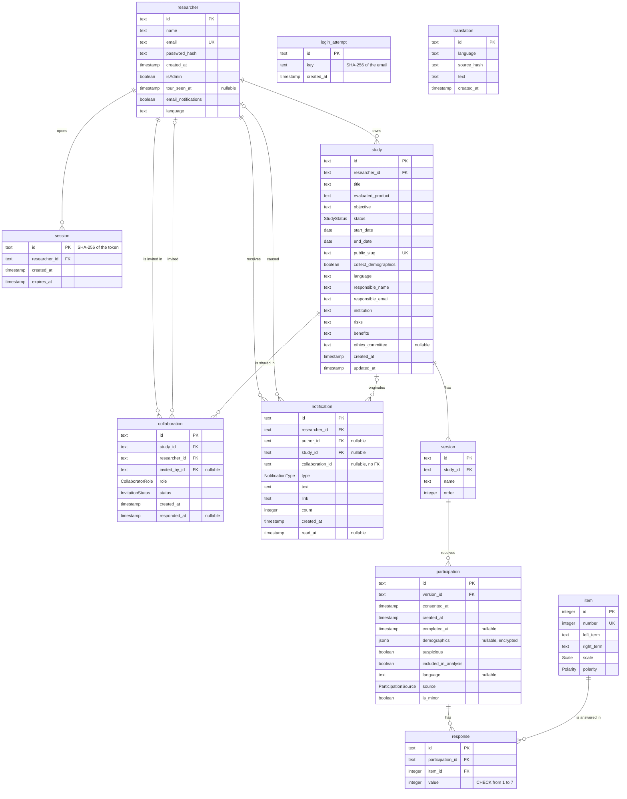

# Logisches Datenmodell der Datenbank

Die Datenbank des UEQ-Tools ist ein **PostgreSQL 16** mit 11 Tabellen und 7 Aufzählungstypen. Das Modell wird in [`prisma/schema.prisma`](../../prisma/schema.prisma) deklariert und durch die 16 Migrations in [`prisma/migrations/`](../../prisma/migrations/) angewendet: 10 ändern die Struktur, die anderen 6 schreiben nur übersetzte Texte in die Tabelle `traducao`. Die Namen unten sind die der Datenbank. Im Code erscheinen dieselben Felder in camelCase (`slug_publico` ist `slugPublico`).

Die Spalten, Schlüssel und Löschregeln in diesem Dokument wurden am 13.11.2026 aus dem Katalog von PostgreSQL selbst gelesen (`information_schema` und `pg_constraint`), mit allen angewendeten Migrations.

## Diagramm

Das Diagramm verwendet die englischen Namen. Die Tabellen unten nennen die tatsächlichen Namen der Datenbank, auf Portugiesisch: `researcher` ist `pesquisador`, `study` ist `estudo`, `version` ist `versao`, `participation` ist `participacao` und `response` ist `resposta`.

**Diagrammwerkzeug:** Mermaid 12.2.0 (`erDiagram`), erzeugt mit `pnpm docs:diagramas`. **Quelldatei:** [modelo-logico-1.mmd](fontes/modelo-logico-1.mmd). **Dargestellte Version:** UEQ-Tool vom 17.11.2026.

Zwei Tabellen stehen absichtlich für sich: `tentativa_acesso` verweist nicht auf das Konto, weil sie nur den Hash der E-Mail-Adresse speichert, und `traducao` ist ein Cache ohne Besitzer.

## Wie die Tabellen zu lesen sind

- **`text`-Schlüssel** werden von der Anwendung mit CUID erzeugt. Die Ausnahme ist `sessao.id`, der Hash des Tokens im Cookie.
- **`timestamp`** ist `timestamp(3) without time zone`, von Prisma in UTC gespeichert.
- **Null** gibt an, dass die Spalte einen leeren Wert akzeptiert. Die anderen sind Pflichtfelder.
- **Standard** ist der Wert der Datenbank, wenn das `INSERT` die Spalte nicht angibt.

## Konto und Zugang

### pesquisador

Das Konto der Person, die das Tool verwendet. Teilnehmende haben kein Konto.

| Spalte | Typ | Null | Standard | Schlüssel | Wofür sie dient |
|---|---|---|---|---|---|
| `id` | text | nein | | PK | Kennung |
| `nome` | text | nein | | | Name, den die Kolleginnen und Kollegen der Studie sehen |
| `email` | text | nein | | Eindeutig | Anmeldung und Ziel der Hinweise |
| `senha_hash` | text | nein | | | bcrypt-Hash, Kostenfaktor 12. Das Passwort wird nie gespeichert |
| `criado_em` | timestamp | nein | jetzt | | Datum des Kontos |
| `administrador` | boolean | nein | `false` | | Öffnet die Seite Administration. Gibt keinen Zugang zu Studien anderer Personen |
| `tutorial_visto_em` | timestamp | ja | | | Leer, bis die Person die Tour beendet, überspringt oder schließt |
| `notificacoes_por_email` | boolean | nein | `true` | | Schickt den Hinweis zusätzlich zur Glocke per E-Mail |
| `idioma` | text | nein | `'pt'` | | Sprache der Oberfläche und Standardsprache der Studien, die die Person anlegt |

### sessao

Eine Zeile pro aktiver Anmeldung. Sie bleibt in der Datenbank, damit eine Passwortänderung die anderen Sitzungen beenden kann.

| Spalte | Typ | Null | Standard | Schlüssel | Wofür sie dient |
|---|---|---|---|---|---|
| `id` | text | nein | | PK | SHA-256 des Tokens im Cookie. Wer die Datenbank liest, kann kein gültiges Cookie erzeugen |
| `pesquisador_id` | text | nein | | FK, Index | Besitzer der Sitzung |
| `criada_em` | timestamp | nein | jetzt | | |
| `expira_em` | timestamp | nein | | | Ende der Gültigkeit |

### tentativa_acesso

Zählt falsche Passwörter, um das Erraten zu begrenzen: 5 Fehler in 15 Minuten sperren die E-Mail-Adresse. Zeilen, die älter als ein Tag sind, werden gelöscht.

| Spalte | Typ | Null | Standard | Schlüssel | Wofür sie dient |
|---|---|---|---|---|---|
| `id` | text | nein | | PK | |
| `chave` | text | nein | | Index mit `criada_em` | SHA-256 der E-Mail-Adresse. Die Adresse wird nicht gespeichert |
| `criada_em` | timestamp | nein | jetzt | Index mit `chave` | Beginn der Zählung |

## Studie

### estudo

| Spalte | Typ | Null | Standard | Schlüssel | Wofür sie dient |
|---|---|---|---|---|---|
| `id` | text | nein | | PK | |
| `pesquisador_id` | text | nein | | FK, Index | Besitzer der Studie |
| `titulo` | text | nein | | | |
| `produto_avaliado` | text | nein | | | |
| `objetivo` | text | nein | | | Wird von den Teilnehmenden in der Einwilligungserklärung gelesen |
| `status` | StatusEstudo | nein | `RASCUNHO` | | Entscheidet, ob der Link Antworten annimmt |
| `data_inicio` | date | nein | | | |
| `data_fim` | date | nein | | | |
| `slug_publico` | text | nein | | Eindeutig | Die Adresse `/r/<slug>` der Teilnehmenden |
| `coletar_demografia` | boolean | nein | `false` | | LGPD, Grundsatz der Erforderlichkeit: Der Schritt mit den optionalen Angaben existiert nur, wenn die forschende Person ihn einschaltet |
| `idioma` | text | nein | `'pt'` | | Sprache, in der die Studie geschrieben wurde und in der der Link öffnet |
| `responsavel_nome` | text | nein | | | Verantwortliche Person der Forschung, in der Einwilligungserklärung angezeigt (LGPD, Art. 9). Das Formular schlägt den Namen des Kontos vor |
| `responsavel_email` | text | nein | | | Kontakt der verantwortlichen Person, in der Einwilligungserklärung angezeigt. Das Formular schlägt die E-Mail-Adresse des Kontos vor |
| `instituicao` | text | nein | | | Institution der Forschung, im Untertitel und in der Einwilligungserklärung |
| `riscos` | text | nein | | | Risiken für die Teilnehmenden, in der Einwilligungserklärung (Resolution CNS 510/2016). Das Formular schlägt einen Text vor |
| `beneficios` | text | nein | | | Nutzen, in der Einwilligungserklärung. Das Formular schlägt einen Text vor |
| `comite_etica` | text | ja | | | Ethikkommission, Votum oder CAAE und Kontakt, wenn die Studie eine Kommission durchlaufen hat |
| `criado_em` | timestamp | nein | jetzt | | |
| `atualizado_em` | timestamp | nein | | | Von Prisma aktualisiert |

### colaboracao

Die Einladung zur Mitarbeit an einer Studie. Die Studie erscheint für die eingeladene Person erst nach `ACEITO` (angenommen).

| Spalte | Typ | Null | Standard | Schlüssel | Wofür sie dient |
|---|---|---|---|---|---|
| `id` | text | nein | | PK | |
| `estudo_id` | text | nein | | FK, eindeutig mit `pesquisador_id` | Jede Person hat eine Einladung pro Studie |
| `pesquisador_id` | text | nein | | FK, Index mit `status` | Eingeladene Person |
| `convidado_por_id` | text | ja | | FK | Einladende Person. Wird leer, wenn dieses Konto gelöscht wird |
| `papel` | PapelColaborador | nein | `EDITOR` | | Was die Person tun darf |
| `status` | StatusConvite | nein | `PENDENTE` | | |
| `criado_em` | timestamp | nein | jetzt | | |
| `respondido_em` | timestamp | ja | | | Zeitpunkt der Annahme oder Ablehnung |

### versao

Die Versionen des Produkts, die die Studie vergleicht. Jede Studie hat mindestens eine, eine Regel, die die Validierung des Formulars sicherstellt.

| Spalte | Typ | Null | Standard | Schlüssel | Wofür sie dient |
|---|---|---|---|---|---|
| `id` | text | nein | | PK | |
| `estudo_id` | text | nein | | FK, eindeutig mit `ordem` | |
| `nome` | text | nein | | | |
| `ordem` | integer | nein | | Eindeutig mit `estudo_id` | Anzeigereihenfolge und Gleichstand bei der Verteilung der Teilnehmenden |

## Fragebogen und Antworten

### item

Die 26 Items des UEQ, vom Seed aus `data/ueq-itens-ptbr.json` geladen. Die Begriffe der anderen 36 Sprachen stehen in `data/ueq-idiomas.json`, nicht in der Datenbank.

| Spalte | Typ | Null | Standard | Schlüssel | Wofür sie dient |
|---|---|---|---|---|---|
| `id` | integer | nein | Sequenz | PK | |
| `numero` | integer | nein | | Eindeutig | Von 1 bis 26, die offizielle Reihenfolge |
| `termo_esquerdo` | text | nein | | | |
| `termo_direito` | text | nein | | | |
| `escala` | Escala | nein | | | Skala, zu der das Item gehört |
| `polaridade` | Polaridade | nein | | | Seite, auf der der positive Begriff steht |

### participacao

Eine Person, die eine Version beantwortet. Es gibt weder Name noch E-Mail-Adresse, IP oder Verbindung zu einem Konto: Das macht die Antwort anonym.

| Spalte | Typ | Null | Standard | Schlüssel | Wofür sie dient |
|---|---|---|---|---|---|
| `id` | text | nein | | PK | Steht auch im Cookie der teilnehmenden Person, solange sie antwortet |
| `versao_id` | text | nein | | FK, Index | Version, die die Person bewertet: die mit den wenigsten Antworten zum Zeitpunkt der Einwilligung |
| `consentiu_em` | timestamp | nein | | | Festhalten der Einwilligung |
| `criada_em` | timestamp | nein | jetzt | | Dient zum Löschen abgebrochener Teilnahmen nach 2 Tagen |
| `concluida_em` | timestamp | ja | | | Leer, solange nichts abgesendet wurde. Nur abgeschlossene Teilnahmen gehen in die Auswertung ein |
| `demografia` | jsonb | ja | | | Altersgruppe, Geschlecht, Bildungsabschluss und Vertrautheit. Mit AES-256-GCM verschlüsselt, wenn `CHAVE_CRIPTOGRAFIA` existiert |
| `suspeita` | boolean | nein | `false` | | Berechnet nach den Regeln des [Protokolls](../ueq-protocolo.md#7-respostas-inconsistentes) |
| `incluida_na_analise` | boolean | nein | `true` | | Entscheidung der forschenden Person. Aus der Auswertung nehmen löscht nichts |
| `idioma` | text | ja | `'pt'` | | Sprache der Antwort. Leer bei importierten Teilnahmen, weil die CSV-Datei sie nicht angibt |
| `origem` | OrigemParticipacao | nein | `LINK` | | Antwort über den Link oder aus einer CSV-Datei importiert |
| `menor_de_idade` | boolean | nein | `false` | | Die Person hat angegeben, jünger als 18 zu sein, und die Einwilligung der erziehungsberechtigten Person bestätigt (LGPD, Art. 14). Ohne die Einwilligung wird die Teilnahme gar nicht angelegt |

### resposta

Eine Zeile pro beantwortetem Item. Eine abgeschlossene Teilnahme hat 26.

| Spalte | Typ | Null | Standard | Schlüssel | Wofür sie dient |
|---|---|---|---|---|---|
| `id` | text | nein | | PK | |
| `participacao_id` | text | nein | | FK, eindeutig mit `item_id` | Verhindert, dass dasselbe Item zweimal beantwortet wird |
| `item_id` | integer | nein | | FK | |
| `valor` | integer | nein | | `CHECK` von 1 bis 7 | 1 ist der linke und 7 der rechte Pol, vor der Umkodierung |

## Hinweise und Übersetzung

### notificacao

Die Glocke in der Kopfzeile. Antworten, die eintreffen, solange der Hinweis ungelesen ist, erhöhen nur `quantidade`.

| Spalte | Typ | Null | Standard | Schlüssel | Wofür sie dient |
|---|---|---|---|---|---|
| `id` | text | nein | | PK | |
| `pesquisador_id` | text | nein | | FK, Index mit `lida_em` | Empfangende Person |
| `autor_id` | text | ja | | FK | Auslösende Person. Wird leer, wenn das Konto gelöscht wird |
| `estudo_id` | text | ja | | FK | Wird leer, wenn die Studie gelöscht wird, und der Hinweis bleibt in der Glocke |
| `colaboracao_id` | text | ja | | Ohne FK | Verweis auf die Einladung, um sie über den Hinweis anzunehmen oder abzulehnen. Kann auf eine Einladung zeigen, die nicht mehr existiert |
| `tipo` | TipoNotificacao | nein | | | |
| `texto` | text | nein | | | Bereits in der Sprache der empfangenden Person |
| `link` | text | nein | | | Pfad innerhalb des Tools |
| `quantidade` | integer | nein | `1` | | Angesammelte Antworten |
| `criada_em` | timestamp | nein | jetzt | | |
| `lida_em` | timestamp | ja | | Index mit `pesquisador_id` | Leer heißt ungelesen |

### traducao

Cache der Übersetzungen durch die Claude-API, damit derselbe Text nicht zweimal übersetzt wird.

| Spalte | Typ | Null | Standard | Schlüssel | Wofür sie dient |
|---|---|---|---|---|---|
| `id` | text | nein | | PK | |
| `idioma` | text | nein | | Eindeutig mit `hash_origem` | Zielsprache |
| `hash_origem` | text | nein | | Eindeutig mit `idioma` | SHA-256 des Originaltextes |
| `texto` | text | nein | | | Die Übersetzung |
| `criada_em` | timestamp | nein | jetzt | | |

## Aufzählungstypen

| Typ | Werte | Bemerkung |
|---|---|---|
| `StatusEstudo` | `RASCUNHO`, `ABERTO`, `ENCERRADO` | Nur `ABERTO` nimmt Antworten an |
| `Escala` | `ATRATIVIDADE`, `PERSPICUIDADE`, `EFICIENCIA`, `CONFIABILIDADE`, `ESTIMULACAO`, `NOVIDADE` | Die 6 Skalen des UEQ |
| `Polaridade` | `POSITIVA_DIREITA`, `POSITIVA_ESQUERDA` | `+` und `-` im [Protokoll](../ueq-protocolo.md#1-itens-escalas-e-polaridade) |
| `OrigemParticipacao` | `LINK`, `IMPORTADA` | |
| `PapelColaborador` | `EDITOR`, `LEITOR` | Der Editor ändert die Studie; der Leser sieht nur und exportiert. Studie löschen und einladen bleiben dem Besitzer vorbehalten |
| `StatusConvite` | `PENDENTE`, `ACEITO`, `RECUSADO` | |
| `TipoNotificacao` | `CONVITE`, `RESPOSTA`, `ALTERACAO` | |

## Was jede Löschung mitnimmt

Alle Fremdschlüssel haben `ON UPDATE CASCADE`. Die Spalte unten ist das `ON DELETE` der Datenbank.

| Fremdschlüssel | Beim Löschen des Elternteils |
|---|---|
| `sessao.pesquisador_id` → `pesquisador` | Löscht |
| `estudo.pesquisador_id` → `pesquisador` | Löscht |
| `colaboracao.pesquisador_id` → `pesquisador` | Löscht |
| `colaboracao.convidado_por_id` → `pesquisador` | Wird leer |
| `colaboracao.estudo_id` → `estudo` | Löscht |
| `versao.estudo_id` → `estudo` | Löscht |
| `participacao.versao_id` → `versao` | Löscht |
| `resposta.participacao_id` → `participacao` | Löscht |
| `resposta.item_id` → `item` | **Verhindert** das Löschen eines Items, das schon eine Antwort hat |
| `notificacao.pesquisador_id` → `pesquisador` | Löscht |
| `notificacao.autor_id` → `pesquisador` | Wird leer |
| `notificacao.estudo_id` → `estudo` | Wird leer |

In der Praxis:

- **Das Konto löschen** löscht die Sitzungen, die Studien, deren Besitzerin die Person ist (mit Versionen, Teilnahmen und Antworten), ihre Einladungen und ihre Hinweise. In Studien anderer Personen verschwindet ihre Mitarbeit als Kollegin oder Kollege, und die Hinweise, die sie ausgelöst hat, bleiben ohne Urheber bestehen.
- **Eine Studie löschen** löscht Versionen, Teilnahmen, Antworten und Einladungen. Die Hinweise bleiben in der Glocke der Empfänger, ohne die Verbindung zur Studie.
- **Eine Version entfernen** löscht in der Datenbank ihre Teilnahmen und Antworten.
- **Kein Item darf verschwinden**, nachdem es eine Antwort hat. Dieses `RESTRICT` schützt das Instrument.

## Regeln, die die Datenbank garantiert, und Regeln, die die Anwendung garantiert

| Regel | Wo sie steht |
|---|---|
| `resposta.valor` zwischen 1 und 7 | `CHECK resposta_valor_entre_1_e_7`, von Hand in der ersten Migration geschrieben, weil Prisma kein `CHECK` deklariert |
| Eine Antwort pro Item in jeder Teilnahme | Eindeutiger Index `(participacao_id, item_id)` |
| Eine Einladung pro Person in jeder Studie | Eindeutiger Index `(estudo_id, pesquisador_id)` |
| Öffentlicher Slug und E-Mail-Adresse ohne Wiederholung | Eindeutige Indizes |
| Genau 26 Antworten in einer abgeschlossenen Teilnahme | Anwendung (`enviarRespostas`, in einer Transaktion) |
| Nur Optionen aus der Liste in `demografia` | Anwendung (`src/lib/demografia.ts`) |
| Wer eine Studie sehen oder ändern darf | Anwendung (`estudoDoPesquisador` in `src/lib/estudos.ts`) |
| Eine seit mehr als 2 Tagen abgebrochene Teilnahme löschen | Anwendung: geschieht, wenn die nächste Person einwilligt |

## Personenbezogene Daten

Diese Übersicht verbindet das Modell mit der Datenschutzerklärung des Tools unter `/privacidade` (LGPD).

| Datum | Tabelle | Schutz |
|---|---|---|
| Name und E-Mail-Adresse | `pesquisador` | Nur für Personen sichtbar, die eine Studie mit der Person teilen |
| Passwort | `pesquisador.senha_hash` | bcrypt-Hash, Kostenfaktor 12 |
| Sitzungscookie | `sessao.id` | Nur der SHA-256-Hash |
| E-Mail-Adresse bei einem Anmeldeversuch | `tentativa_acesso.chave` | Nur der SHA-256-Hash, innerhalb eines Tages gelöscht |
| Demografische Angaben der Teilnehmenden | `participacao.demografia` | Mit AES-256-GCM verschlüsselt, der Schlüssel liegt außerhalb der Datenbank |
| Antworten auf den Fragebogen | `resposta` | Nichts verbindet sie mit einer Person |

Ohne `CHAVE_CRIPTOGRAFIA` in der Umgebung bleiben die demografischen Angaben im Klartext, und die Seite Administration weist darauf hin. Das Skript `pnpm dados:cifrar` verschlüsselt alte Zeilen und läuft im Produktions-Build.
