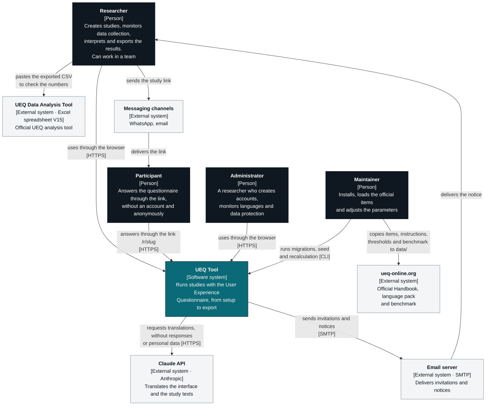
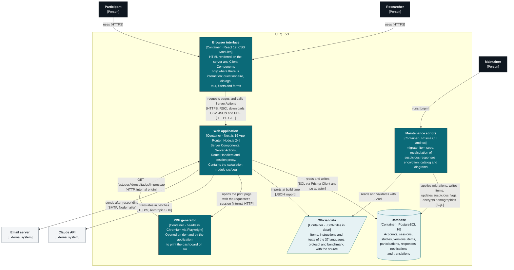
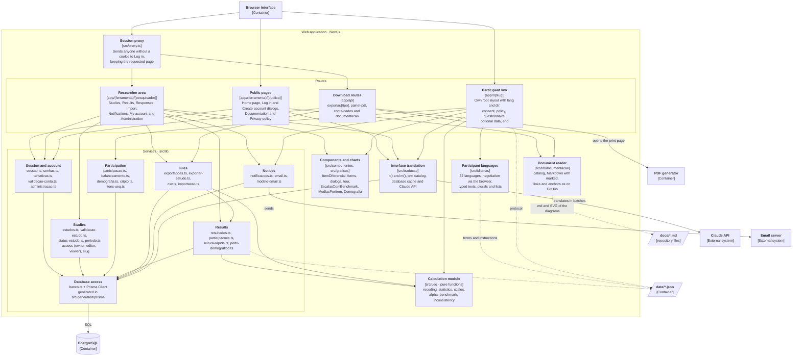
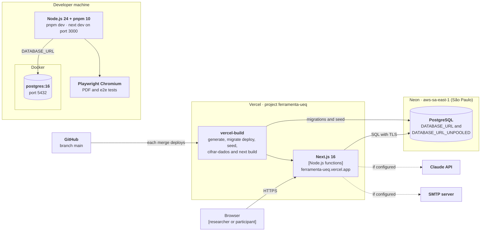

# Architecture

The architecture is described with the [C4 model](https://c4model.com), at three zoom levels:

1. **Context:** who uses the tool and which systems it relates to;
2. **Containers:** the parts that run separately (application, database, PDF generator, scripts) and how they talk to each other;
3. **Components:** how the Next.js application is organized internally.

A fourth diagram shows the deployment, in production and in development.

The diagrams use Mermaid, which GitHub renders directly on the page. Each box shows the name, the type in square brackets and the technology. The arrows say what flows and over which protocol. Right below each diagram are the tool used, the source file to download and the version of the tool it represents.

## Overview

The UEQ Tool is a single web application in **Next.js 16 (App Router)** with **React 19** and **TypeScript strict**, which stores its data in **PostgreSQL 16** through **Prisma 7**. It is live at [ferramenta-ueq.vercel.app](https://ferramenta-ueq.vercel.app), on Vercel, with the database on Neon, in the São Paulo region.

- There is no separate REST API. The pages are Server Components that read the database on the server. Writes are Server Actions called by the forms.
- Only what returns a file is an API route: the CSV exports, the dashboard as PDF, the account data and the documentation downloads.
- The UEQ calculation is isolated in `src/ueq/`, in pure functions, so it can be tested against the official spreadsheet without a database or interface.
- The protocol parameters, the benchmark and the official texts of the 37 languages are versioned JSON files in `data/`, with the source of each value.
- The researcher interface and the study texts are translated on demand by the Claude API, with the result stored in the database. The questionnaire uses only the official UEQ translations.

## Level 1 · Context



**Diagram tool:** Mermaid 12.2.0 (`flowchart`), generated by `pnpm docs:diagramas`. **Source file:** [arquitetura-1.mmd](fontes/arquitetura-1.mmd). **Version represented:** UEQ Tool of 06 Nov 2026.

At run time, the tool calls only two external systems, and both are optional:

- **Claude API:** without `ANTHROPIC_API_KEY`, the interface stays in Portuguese and the study texts stay in their original language. What goes to the API are the interface texts and the title, product, objective and version names of each study. No response, name, email address or demographic data is sent along.
- **Email server:** without the `SMTP_*` variables, the notices stay only in the bell, and whoever invites receives a ready-made email link to send on their own.

The official spreadsheet and the UEQ website come in through people: the team copies the official data to `data/` (with the source in each file). The official spreadsheet export starts from an unmodified copy of the UEQ Data Analysis Tool V15 in `data/planilha-oficial/`, and the researcher opens it in Excel to check the numbers.

## Level 2 · Containers



**Diagram tool:** Mermaid 12.2.0 (`flowchart`), generated by `pnpm docs:diagramas`. **Source file:** [arquitetura-2.mmd](fontes/arquitetura-2.mmd). **Version represented:** UEQ Tool of 06 Nov 2026.

| Container | Technology | Responsibility | Where it is |
|---|---|---|---|
| Browser interface | React 19.3, CSS Modules, CSS variables, hand-made SVG | Show the screens and handle interaction. No component or chart library | `src/app/**/*.tsx` with `"use client"`, `src/componentes/`, `src/graficos/`, `src/styles/` |
| Web application | Next.js 16.4, Node.js 24, Zod 4, bcryptjs, Nodemailer, Anthropic SDK | Render the pages, validate and store data, protect the researcher area, generate exports, translate and notify | `src/app/`, `src/lib/`, `src/ueq/`, `src/idiomas/`, `src/traducao/`, `src/proxy.ts` |
| PDF generator | Playwright 1.64 with its own Chromium in development and `@sparticuz/chromium-min` 153 on Vercel | Print the dashboard to PDF with vector charts | `src/app/api/estudos/[id]/painel-pdf/route.ts` |
| Database | PostgreSQL 16 (Docker in development, Neon in production) | Persist the domain model, with cascade and `CHECK`. Details in the [logical data model](modelo-logico.md) | `prisma/schema.prisma`, `prisma/migrations/`, `docker-compose.yml` |
| Official data | Versioned JSON | Single source of the items, instructions, protocol and benchmark, each with the `fonte` field | `data/` |
| Documentation | Versioned Markdown and SVG | The documents shown in the Documentation tab, the pre-rendered diagrams and the source file of each one | `docs/`, `docs/documentacao/diagramas/`, `docs/documentacao/fontes/` |
| Maintenance scripts | Prisma CLI, tsx | Create the database, load the items, recalculate suspicious responses, encrypt old data, generate the text catalog and the diagrams | `prisma/seed.ts`, `prisma/recalcular-suspeitas.ts`, `prisma/cifrar-dados.ts`, `scripts/` |

## Level 3 · Components of the web application



**Diagram tool:** Mermaid 12.2.0 (`flowchart`), generated by `pnpm docs:diagramas`. **Source file:** [arquitetura-3.mmd](fontes/arquitetura-3.mmd). **Version represented:** UEQ Tool of 06 Nov 2026.

The `matcher` in [`src/proxy.ts`](../../src/proxy.ts) excludes what never requires a session: `/entrar`, `/cadastrar`, `/privacidade`, `/r/`, `/documentacao`, `/api/documentacao` and the site icons. The root `/` goes through the proxy and continues without a cookie. Every new researcher route is protected from the start. The participant link has its own root layout, without the bar and without links to the rest of the tool: whoever responds sees only the form, the language selector and the privacy policy, which has a version at `/r/<slug>/privacidade`.

### Dependency rules

- **`src/ueq/` depends on nothing in the project.** It does not import Prisma, React, Next or `src/lib`. It receives numbers and returns objects. That is what allows it to be tested against the official spreadsheet.
- **Components and charts know nothing about Prisma.** They receive ready-made data through props.
- **Every researcher page, Server Action and route checks the session in the database and the access to the study**, not only the proxy. Access always goes through `estudoDoPesquisador(id, pessoa, "ver" | "editar" | "gerenciar")` or through `filtroDeAcesso`. Without access, the response is the same as for a study that does not exist.
- **The administrator does not see other people's studies.** The responses are research data belonging to whoever runs the study. The Administration pages respond 404 to anyone who is not an administrator.
- **The participant routes read only what the participant may see:** the title, product, objective and status of the study. Nothing about the researcher and nothing from the analysis.
- **Protocol parameters are never in the code.** They come from `data/protocolo.json` and `data/benchmark.json`.
- **Researcher screen text goes through `t()` or `m()`,** and `pnpm i18n:catalogo` generates the catalog. Participant text lives in `src/idiomas/textos/`, one file per language.

## Security and LGPD

| Measure | Where it is |
|---|---|
| Security headers on every response: CSP, HSTS, `X-Frame-Options`, `X-Content-Type-Options`, `Referrer-Policy` and `Permissions-Policy` | `next.config.ts` |
| Password in bcrypt with cost 12, with the hash redone at login when the cost goes up | `src/lib/senhas.ts` |
| 5 wrong passwords within 15 minutes block the email address, counted by its hash | `src/lib/tentativas.ts` |
| Session in the database by the token hash, with an `httpOnly` cookie, `secure` in production | `src/lib/sessao.ts` |
| Demographic data encrypted with AES-256-GCM, with the key outside the database | `src/lib/cripto.ts`, `prisma/cifrar-dados.ts` |
| Demographic data collection off by default in each study | `Estudo.coletarDemografia` |
| A participation abandoned for more than 2 days is deleted | `src/app/r/[slug]/acoes.ts` |
| Download your own data and delete the account, without asking anyone | `src/app/api/conta/dados/route.ts`, `conta/` |
| The destination of `?voltar=` and `?de=` only accepts an internal path | `destinoInterno` in `src/lib/validacao-conta.ts` |
| Public policy, without requiring an account, also inside the participant link | `src/app/(ferramenta)/(publico)/privacidade/`, `src/app/r/[slug]/privacidade/` |

## Architecture decisions

| Decision | Why | Consequence |
|---|---|---|
| Server Components and Server Actions instead of a REST API | Less code between the screen and the database; validation with Zod on the server in each action; forms work with the browser's native behavior | The tool offers no public API. Integrations use the CSV exports |
| Calculation in pure functions in `src/ueq/` | The numbers have to match the official spreadsheet; pure functions can be tested with fixtures and edge cases | The code that fetches the data (`src/lib/resultados.ts`) only builds the input and passes it on |
| Session stored in the database, with the token hash | Changing the password ends the other sessions; whoever reads the database cannot build a cookie | Each researcher page runs a session query (with React's `cache` per request) |
| Two root layouts: tool and participant link | The participant's `<html lang>` and `dir` follow the language chosen by the respondent, and those of the tool follow the account language (WCAG 3.1.1), including Arabic, Hebrew and Persian | `experimental.globalNotFound` in `next.config.ts` for the 404 page |
| Two text systems: `src/idiomas` and `src/traducao` | The questionnaire is a measurement instrument: it needs the official terms and reviewable texts, without machine translation. The rest of the tool can be translated on demand | New participant text requires the 37 files; new researcher text only requires `pnpm i18n:catalogo` |
| On-demand translation, stored in the database | Translate each text only once, with no cost on later reads and without maintaining 37 files by hand | The first visit in a language may come out in Portuguese while the batches run in the background |
| Email sent after the response (`after`) | Whoever clicked does not wait for the email server, and a sending failure does not undo the action | The bell is the record that always exists; the email is an extra |
| Hand-made SVG charts | Full control of `title`, `desc`, contrast, shapes per version and rearrangement on narrow screens | No chart library to update |
| PDF generated by Chromium on the server | The PDF comes out identical to the dashboard, with vector charts and the same fonts | On Vercel, the browser is downloaded on the first call (see [Deployment](#implantação)) |
| Documentation read from the same `.md` files in the repository, with the diagrams rendered beforehand as SVG (`pnpm docs:diagramas`) | A single file for GitHub and for the tool; the tool does not load the Mermaid library and each diagram becomes an image with alternative text | Changing a diagram requires generating the SVG and the source again; a unit test warns about it |
| Long document split into pages at display time, without changing the `.md` | The file remains single and readable on GitHub, and the tool does not force scrolling through a whole document | Links and anchors go through `rotaDaAncora`, which finds the page of each one, and old addresses with only the fragment are redirected |
| Official data in versioned JSON | Every number has a traceable source and changes through a pull request, not in the code | Changing a threshold requires `pnpm suspeitas:recalcular` to update the participations already stored |
| Participant cookies restricted to `/r/<slug>` | Anonymity: only the random participation id, the already-responded flag and the language | The protection against duplicate submission works per browser, not per person |

## Deployment



**Diagram tool:** Mermaid 12.2.0 (`flowchart`), generated by `pnpm docs:diagramas`. **Source file:** [arquitetura-4.mmd](fontes/arquitetura-4.mmd). **Version represented:** UEQ Tool of 06 Nov 2026.

**Production.** Each merge into `main` deploys a new version. The `vercel-build` script runs `prisma generate`, `prisma migrate deploy`, the seed, `prisma/cifrar-dados.ts` and `next build`. In production the seed stores only the 26 items, without a test account. The migrations use `DATABASE_URL_UNPOOLED` when it exists.

**Development.** The step-by-step guide is in the [README](../../README.md#como-rodar).

| Variable | Required | What it is for |
|---|---|---|
| `DATABASE_URL` | Yes | Connection to PostgreSQL |
| `DATABASE_URL_UNPOOLED` | On Neon | Direct connection, used by the migrations |
| `CHAVE_CRIPTOGRAFIA` | In production | AES-256-GCM key for the demographic data. Without it, the data stays in plain text and Administration shows a warning. Keep a copy: without the key, the encrypted data can no longer be read |
| `ANTHROPIC_API_KEY` | No | Turns on machine translation |
| `SMTP_HOST`, `SMTP_PORTA`, `SMTP_USUARIO`, `SMTP_SENHA`, `EMAIL_REMETENTE` | No | Turn on email sending |
| `URL_INTERNA` and `PORT` | No | Address through which the PDF route reaches the application itself. Without `URL_INTERNA`, `http://localhost:$PORT` applies |
| `PESQUISADOR_TESTE_EMAIL` and `PESQUISADOR_TESTE_SENHA` | Only in development | Account created by the seed. They must not exist in production |
| `TRADUCAO_PSEUDO` | Only for checking | With `1`, marks the catalog texts with ⟦ ⟧ to find what does not go through `t()` |

**Dashboard as PDF in production.** The Vercel function has no browser installed. On the first call, the route downloads its own server Chromium (`@sparticuz/chromium-min` 153), which stays in `/tmp` while the function is up, and opens the print page through the public production address. That is why the first generation after an idle period takes longer, and the function limit is 60 s. In development, the Playwright Chromium is used. The CSV exports do not depend on a browser.

## Folder structure

```
src/
  app/
    (ferramenta)/         layout raiz no idioma da conta
      (publico)/          página inicial, Entrar, Criar conta, Documentação, Privacidade
      (pesquisador)/      Estudos, Resultados, Respostas, Notificações, Minha conta, Administração
    r/[slug]/             link do participante, com layout raiz próprio (lang e dir do idioma)
    api/                  downloads: exportar/[tipo], painel-pdf, conta/dados, documentacao
  ueq/                    cálculo do UEQ em funções puras
  lib/                    sessão, estudos, participação, resultados, CSV, avisos, criptografia
  idiomas/                37 idiomas do participante: textos tipados, negociação, plural
  traducao/               t() e m(), catálogo e tradução da interface pela API do Claude
  componentes/            ItemDiferencial, formulários, janelas, tour, ajuda e painéis
  graficos/               EscalasComBenchmark, MediasPorItem e Demografia em SVG
  styles/                 tokens de cor, tipografia e espaçamento
  proxy.ts                checagem otimista de sessão
scripts/                  SVG e fontes dos diagramas; catálogo de textos
prisma/                   schema, migrations, seed, recálculo de suspeitas e cifragem
data/                     itens, instruções, idiomas, protocolo, benchmark e fixtures
tests/e2e/                Playwright com axe-core
docs/                     especificação, requisitos de IHC, protótipos e esta documentação
```
