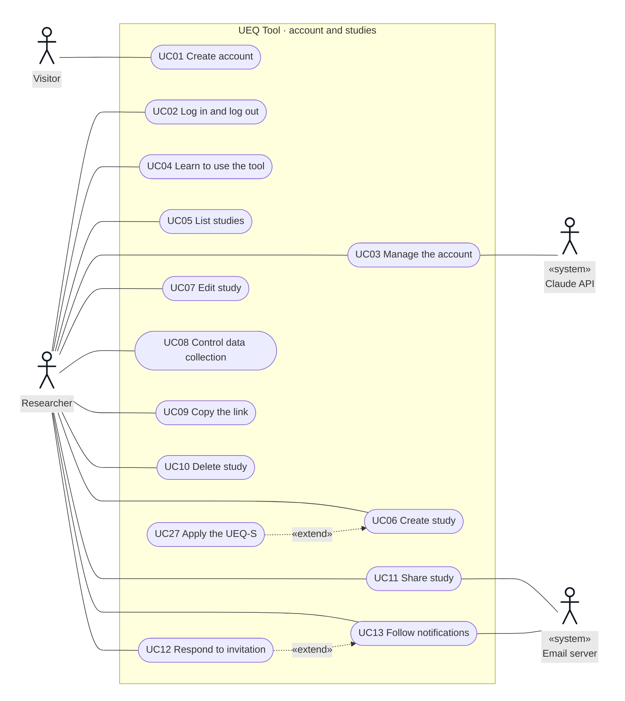
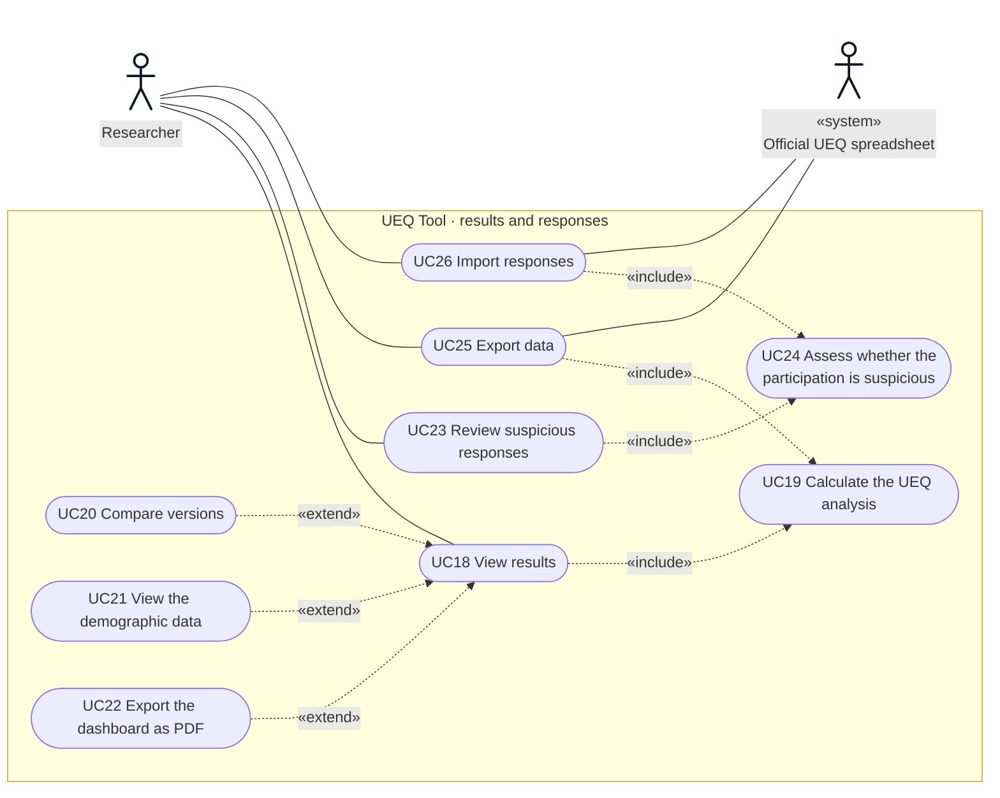
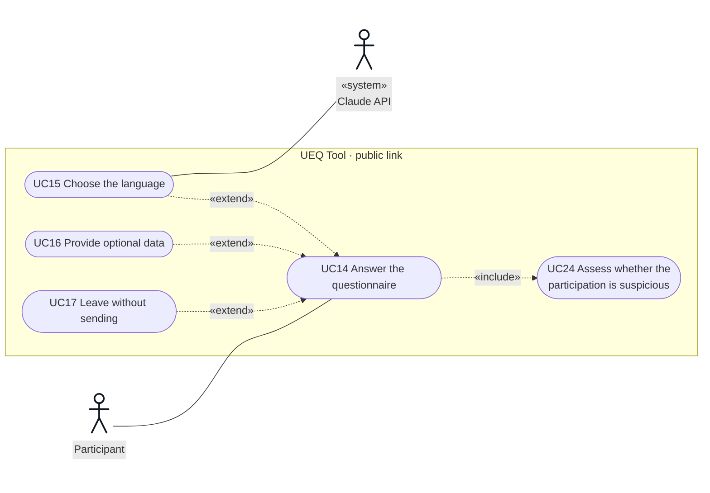
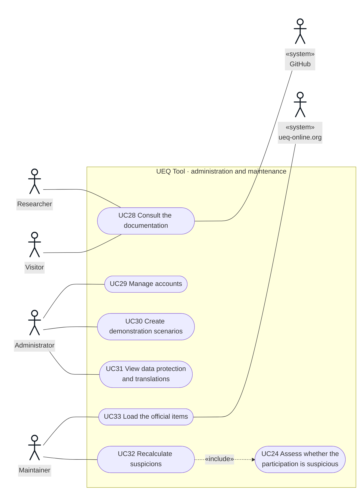
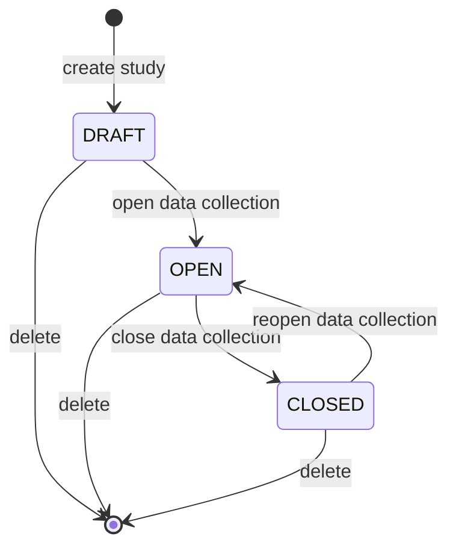

# Use cases

33 use cases describe what each actor does with the UEQ Tool. The diagrams follow the UML use case notation, drawn in Mermaid so that they render directly on GitHub:

- the stick figure is the actor. Primary actors, who start the use case, are on the left; secondary actors, who take part without starting it, are on the right. When the actor is another system, its name carries «system»;
- the rounded shape is the use case;
- the frame is the system boundary;
- the solid line connects the actor to the use case it takes part in;
- the dashed «include» arrow points to a use case that always happens along with it;
- the dashed «extend» arrow leaves an optional use case and points to the use case it extends.

Right below each diagram are the tool used, the source file to download and the version of the tool it represents. The link between each use case and the requirements is in the [list](#lista) and in the [traceability matrix](matriz-rastreabilidade.md#casos-de-uso).

## Actors

| Actor | Who it is | Personas |
|---|---|---|
| Visitor | A person without an account, or who has not logged in yet. Reads the home page and the documentation and can create an account | [PE08](personas.md#pe08) and any researcher before signing up |
| Researcher | Has an account and a session. Owns the studies they create and can be Editor or Viewer of the studies someone else has shared with them | [PE01](personas.md#pe01), [PE02](personas.md#pe02), [PE03](personas.md#pe03) |
| Participant | Responds through the public link. Has no account and never needs a session | [PE04](personas.md#pe04), [PE05](personas.md#pe05), [PE06](personas.md#pe06), [PE07](personas.md#pe07) |
| Administrator | Researcher with the administrator flag: does everything the researcher does and opens the Administration page. Does not see other people's studies | [PE08](personas.md#pe08) |
| Maintainer | Whoever runs the installation commands: migrations, seed and recalculation | [PE08](personas.md#pe08) |

Secondary actors, who take part in a use case without starting it:

| Secondary actor | Where it takes part | What it exchanges with the tool |
|---|---|---|
| Email server «system» | [UC11](#uc11) Share study, [UC13](#uc13) Follow notifications | Delivers the invitation and the notifications by email, when sending is configured |
| Claude API «system» | [UC03](#uc03) Manage the account, [UC15](#uc15) Choose the language | Translates the researcher's interface and the study's title, product and goal. Never translates the questionnaire |
| Official UEQ spreadsheet «system» | [UC25](#uc25) Export data, [UC26](#uc26) Import responses | Receives the responses filled into the spreadsheet itself (UEQ Data Analysis Tool) and is the origin of the imported CSV |
| GitHub «system» | [UC28](#uc28) Consult the documentation | Holds the file of each document, opened through the View on GitHub link |
| ueq-online.org «system» | [UC33](#uc33) Load the official items | Source of the official terms, instructions and benchmark copied into `data/` |

The Participant is always a primary actor: they start their own use case through the link and do not take part in other actors' use cases.

## Diagram 1 · Account and studies

**Diagram tool:** Mermaid 12.2.0 (`flowchart`), generated by `pnpm docs:diagramas`. **Source file:** [casos-de-uso-1.mmd](fontes/casos-de-uso-1.mmd). **Version represented:** UEQ Tool as of 17 Nov 2026.

UC12 extends UC13 because the invitation arrives as a notification: accepting or declining is an optional choice for whoever opens the bell. UC27 extends UC06 because choosing the UEQ-S is an option for whoever creates the study; without it, the study uses the full UEQ.

## Diagram 2 · Results and responses

**Diagram tool:** Mermaid 12.2.0 (`flowchart`), generated by `pnpm docs:diagramas`. **Source file:** [casos-de-uso-2.mmd](fontes/casos-de-uso-2.mmd). **Version represented:** UEQ Tool as of 17 Nov 2026.

UC19 and UC24 have no actor: they only happen inside another use case. Both are the pure functions of the calculation module ([class diagram](diagrama-de-classes.md#2-módulo-de-cálculo)).

## Diagram 3 · Participant

**Diagram tool:** Mermaid 12.2.0 (`flowchart`), generated by `pnpm docs:diagramas`. **Source file:** [casos-de-uso-3.mmd](fontes/casos-de-uso-3.mmd). **Version represented:** UEQ Tool as of 17 Nov 2026.

The Claude API only comes into UC15 to translate the title, product and goal written by the researcher. The 26 items, the instruction and the texts of the participant's screens come from the official, reviewed files, never from the API.

## Diagram 4 · Administration, maintenance and documentation

**Diagram tool:** Mermaid 12.2.0 (`flowchart`), generated by `pnpm docs:diagramas`. **Source file:** [casos-de-uso-4.mmd](fontes/casos-de-uso-4.mmd). **Version represented:** UEQ Tool as of 17 Nov 2026.

The Administrator is a Researcher with an extra permission, so they also perform all the Researcher's use cases in diagrams 1 and 2. The Maintainer does not use the interface: they run commands in the installation's terminal.

## List

| ID | Use case | Primary actor | Requirements | Relationships |
|---|---|---|---|---|
| [UC01](#uc01) | Create account | Visitor | [RF01](requisitos.md#rf01), [RF08](requisitos.md#rf08) | — |
| [UC02](#uc02) | Log in and log out | Researcher | [RF02](requisitos.md#rf02), [RF03](requisitos.md#rf03), [RF11](requisitos.md#rf11) | — |
| [UC03](#uc03) | Manage the account | Researcher | [RF04](requisitos.md#rf04), [RF05](requisitos.md#rf05), [RF06](requisitos.md#rf06), [RF07](requisitos.md#rf07), [RF08](requisitos.md#rf08), [RF23](requisitos.md#rf23) | — |
| [UC04](#uc04) | Learn to use the tool | Researcher | [RF09](requisitos.md#rf09), [RF10](requisitos.md#rf10) | — |
| [UC05](#uc05) | List studies | Researcher | [RF12](requisitos.md#rf12) | — |
| [UC06](#uc06) | Create study | Researcher | [RF13](requisitos.md#rf13), [RF18](requisitos.md#rf18), [RF19](requisitos.md#rf19) | extended by UC27 |
| [UC07](#uc07) | Edit study | Researcher | [RF14](requisitos.md#rf14) | — |
| [UC08](#uc08) | Control data collection | Researcher | [RF15](requisitos.md#rf15) | — |
| [UC09](#uc09) | Copy the link | Researcher | [RF16](requisitos.md#rf16) | — |
| [UC10](#uc10) | Delete study | Researcher | [RF17](requisitos.md#rf17) | — |
| [UC11](#uc11) | Share study | Researcher | [RF20](requisitos.md#rf20) | — |
| [UC12](#uc12) | Respond to invitation | Researcher | [RF21](requisitos.md#rf21) | extends UC13 |
| [UC13](#uc13) | Follow notifications | Researcher | [RF22](requisitos.md#rf22), [RF23](requisitos.md#rf23) | extended by UC12 |
| [UC14](#uc14) | Answer the questionnaire | Participant | [RF24](requisitos.md#rf24), [RF25](requisitos.md#rf25), [RF26](requisitos.md#rf26), [RF27](requisitos.md#rf27), [RF28](requisitos.md#rf28), [RF29](requisitos.md#rf29), [RF30](requisitos.md#rf30), [RF33](requisitos.md#rf33) | includes UC24; extended by UC15, UC16, UC17 |
| [UC15](#uc15) | Choose the language | Participant | [RF34](requisitos.md#rf34), [RF35](requisitos.md#rf35) | extends UC14 |
| [UC16](#uc16) | Provide optional data | Participant | [RF32](requisitos.md#rf32) | extends UC14 |
| [UC17](#uc17) | Leave without sending | Participant | [RF31](requisitos.md#rf31) | extends UC14 |
| [UC18](#uc18) | View results | Researcher | [RF43](requisitos.md#rf43), [RF44](requisitos.md#rf44), [RF45](requisitos.md#rf45), [RF46](requisitos.md#rf46), [RF48](requisitos.md#rf48), [RF49](requisitos.md#rf49) | includes UC19; extended by UC20, UC21, UC22 |
| [UC19](#uc19) | Calculate the UEQ analysis | — | [RF36](requisitos.md#rf36), [RF37](requisitos.md#rf37), [RF38](requisitos.md#rf38), [RF39](requisitos.md#rf39), [RF40](requisitos.md#rf40), [RF41](requisitos.md#rf41), [RF42](requisitos.md#rf42) | included by UC18, UC25 |
| [UC20](#uc20) | Compare versions | Researcher | [RF47](requisitos.md#rf47) | extends UC18 |
| [UC21](#uc21) | View the demographic data | Researcher | [RF50](requisitos.md#rf50) | extends UC18 |
| [UC22](#uc22) | Export the dashboard as PDF | Researcher | [RF60](requisitos.md#rf60) | extends UC18 |
| [UC23](#uc23) | Review suspicious responses | Researcher | [RF52](requisitos.md#rf52), [RF53](requisitos.md#rf53), [RF54](requisitos.md#rf54) | includes UC24 |
| [UC24](#uc24) | Assess whether the participation is suspicious | — | [RF51](requisitos.md#rf51) | included by UC14, UC23, UC26, UC32 |
| [UC25](#uc25) | Export data | Researcher | [RF56](requisitos.md#rf56), [RF57](requisitos.md#rf57), [RF58](requisitos.md#rf58), [RF59](requisitos.md#rf59) | includes UC19 |
| [UC26](#uc26) | Import responses | Researcher | [RF61](requisitos.md#rf61) | includes UC24 |
| [UC27](#uc27) | Apply the UEQ-S | Researcher | [RF62](requisitos.md#rf62) | extends UC06 |
| [UC28](#uc28) | Consult the documentation | Visitor or Researcher | [RF63](requisitos.md#rf63), [RF64](requisitos.md#rf64), [RF65](requisitos.md#rf65) | — |
| [UC29](#uc29) | Manage accounts | Administrator | [RF66](requisitos.md#rf66) | — |
| [UC30](#uc30) | Create demonstration scenarios | Administrator | [RF67](requisitos.md#rf67) | — |
| [UC31](#uc31) | View data protection and translations | Administrator | [RF68](requisitos.md#rf68) | — |
| [UC32](#uc32) | Recalculate suspicions | Maintainer | [RF55](requisitos.md#rf55) | includes UC24 |
| [UC33](#uc33) | Load the official items | Maintainer | [RNF10](requisitos.md#rnf10) | — |

## Specifications

The core use cases have a full specification: actor, preconditions, postconditions, main flow and alternative flows. The others, being short, have only the main flow. The button names are the ones the interface shows in English.

### UC14

**Answer the questionnaire**

| | |
|---|---|
| Actor | Participant |
| Goal | Answer the 26 UEQ items about a version of the product, anonymously |
| Preconditions | The study exists, data collection is open and the participant has the `/r/<slug>` link |
| Success postconditions | There is a completed participation, with 26 responses from 1 to 7, the language, the assigned version, the assessed suspicion and, where applicable, the minor flag |
| Abandonment postconditions | No response saved; a participation that was started and not sent is deleted within 2 days |
| Screens | p1 consent, p2 and p7 questionnaire, p3 missing item, p4 optional data, p5 end, p6 closed link |

Main flow:

1. The participant opens the link. The system picks the study's language (or the browser's, when the study allows it) and shows the consent form: goal, estimated time, what happens after sending, risks, benefits, data storage, voluntary and anonymous participation, who is responsible for the research and the contact.
2. The participant enters their age and clicks "I agree and want to take part".
3. The system assigns the version with the fewest completed responses, creates the participation with the consent date and the language and stores the participation in a cookie restricted to the link.
4. The system shows the official instruction and the 26 items in the official order and polarity, none marked, with the footer "0 of 26 answered" and "Leave without sending".
5. The participant marks a position on each item. The footer updates the counter, and the marks are kept in the browser tab.
6. The participant clicks "Send answers".
7. The system checks the 26 values, assesses the suspicion (UC24) and saves the responses and the completion in a transaction. It marks the link as answered in that browser.
8. If the study collects demographic data, the system shows the optional data step (UC16).
9. The system shows the final page: the responses have been recorded and the person can close the page.

Alternative flows:

- **1a. Study in draft or closed.** The system explains the situation ("not open yet", "response collection has ended") and does not offer the form.
- **1b. Link already answered in this browser.** The system says the responses have already been recorded.
- **1c. Another language.** The participant chooses it in the selector (UC15).
- **1d. Privacy policy.** The participant opens the policy from the consent form, within the link itself, and returns to the form.
- **1e. Copy of the form.** The participant prints or saves as PDF a copy of the consent form.
- **2a. I do not want to take part.** The participant leaves without anything being saved.
- **2b. No age.** The system asks for the age and saves nothing.
- **2c. Under 18.** The system asks for confirmation that the parent or guardian has given authorisation. Without it, nothing is saved; with it, the participation is saved with the minor flag.
- **4a. Participation in progress.** Someone who has already consented and returns to the link goes straight to the questionnaire.
- **5a. Reloading the page.** The system recovers the marked items and says so.
- **5b. Leave without sending (UC17).**
- **7a. Missing items.** The system saves nothing, shows the summary "N items left" with a link to each item and moves the focus to the summary. Back to step 5.
- **7b. Data collection was closed while answering.** The system warns that the study no longer accepts responses.

Rules: [RNF09](requisitos.md#rnf09) (questionnaire free of interface bias), [RNF10](requisitos.md#rnf10) (official terms) and [RNF12](requisitos.md#rnf12) (anonymity). The path from the click to the database is in [sequence diagram 2](diagramas-de-sequencia.md#2-responder-o-questionário).

### UC06

**Create study**

| | |
|---|---|
| Actor | Researcher |
| Preconditions | Valid session |
| Postconditions | Study in RASCUNHO (draft), with a unique public link, 1 to 6 numbered versions, language, responsible researcher, risks and benefits |

Main flow:

1. The researcher clicks "Create study".
2. The system shows the form in numbered sections, with the preview of the participant's consent form alongside. Name, contact email and institution come pre-filled from the account and the last study; risks and benefits come with a suggested text.
3. The researcher enters title, evaluated product, goal, data collection period and language. The system suggests the product as the name of the first version.
4. The researcher adds or renames versions and decides whether the link collects demographic data (off by default).
5. The researcher clicks "Create study". The button shows that it is processing and ignores further clicks.
6. The system validates, generates the public link and saves the study with the versions.
7. The system opens the page of the study in draft, with the confirmation and the "Before opening, check" list.

Alternative flows:

- **6a. Invalid data.** The system shows the error summary with a link to each field, moves the focus to the summary and marks each field with the message. Back to step 3.
- **3a. UEQ-S (UC27).** Under Questionnaire, the researcher chooses UEQ-S, short version. The form states what changes (questionnaire, time on the consent form, dashboard and exported spreadsheet) and that the choice is locked at the first response.

### UC08

**Control data collection**

| | |
|---|---|
| Actor | Researcher (owner or Editor) |
| Preconditions | Valid session and a study owned by the researcher or shared with them as Editor |
| Postconditions | Study status changed; the link starts accepting or refusing responses |

Main flow:

1. On the page of the study in RASCUNHO, the researcher clicks "Open data collection".
2. The system changes the status to ABERTO and announces "Data collection open. The link already accepts responses."
3. Later, the researcher clicks "Close data collection". The system changes it to ENCERRADO; the link now says that response collection has ended.

Alternative flows:

- **3a. Reopen.** With the study closed, "Reopen data collection" sets it back to ABERTO. Because it is reversible, closing does not ask for confirmation.
- **2a. State changed in another tab.** The system refuses the transition and asks the researcher to reload.

**Diagram tool:** Mermaid 12.2.0 (`stateDiagram-v2`), generated by `pnpm docs:diagramas`. **Source file:** [casos-de-uso-5.mmd](fontes/casos-de-uso-5.mmd). **Version represented:** UEQ Tool as of 17 Nov 2026.

### UC11

**Share study**

| | |
|---|---|
| Actor | Researcher who owns the study |
| Secondary actor | Email server |
| Preconditions | Valid session, the researcher's own study, and the invited person already has an account |
| Postconditions | PENDENTE (pending) collaboration with the chosen role and an invitation notification for the invited person |

Main flow:

1. On the study page, the owner clicks "Share".
2. The system opens the dialog with the current team and the invitation field.
3. The owner enters the person's email, chooses Editor or Viewer and confirms.
4. The system creates the pending collaboration, creates the notification in the person's bell and, if sending is configured and the person has not turned it off, sends the email in their language.
5. The system confirms the invitation in the dialog.

Alternative flows:

- **3a. Email without an account.** The system says that the person needs to create an account first.
- **3b. Person already on the team.** The system warns and does not duplicate the invitation.
- **3c. Change role or remove.** The owner changes someone's role, cancels an invitation or removes the person from the team; whoever leaves is notified.
- **3d. Leave the study.** The invited person can also leave the study; the owner is notified.
- **1a. Someone who is not the owner.** Editor and Viewer see the team, but do not invite.

### UC18

**View results**

| | |
|---|---|
| Actor | Researcher (owner, Editor or Viewer) |
| Preconditions | Valid session and access to the study |
| Postconditions | None: the use case only reads |

Main flow:

1. The researcher opens the study's Results tab.
2. The system fetches the completed participations and calculates the analysis of those that are in the analysis, for all versions and for each one (UC19).
3. The system shows the data collection summary, the quick reading, the chart of the 6 scales with benchmark and CI95, the equivalent table, the pragmatic and hedonic means, the per-item chart and the Export section.
4. The researcher opens the explanations of the terms when needed.

Alternative flows:

- **2a. No one in the analysis.** The system shows "No responses in the analysis yet." in place of the charts.
- **3a. Small sample or alpha below 0.7.** The system shows the warning with what it means and what to do.
- **3b. Another version.** The researcher chooses another version; the address keeps the choice.
- **3c. Compare versions (UC20).** With more than one version, the researcher switches to "Compare versions".
- **3d. Demographic data (UC21).** When the study collects it, the sub-tab shows the profile of those who responded.
- **3e. Dashboard as PDF (UC22).**

### UC23

**Review suspicious responses**

| | |
|---|---|
| Actor | Researcher (owner or Editor to make changes; Viewer only sees) |
| Preconditions | Valid session and access to the study |
| Postconditions | Participations marked as in or out of the analysis; no response deleted |

Main flow:

1. The researcher opens the Responses tab.
2. The system shows the overview (in the analysis, out of the analysis, suspicious), the table of participations with the reason for the suspicion, and the suspicion rule alongside.
3. The researcher ticks "Show only suspicious" and opens "View scales" on a row.
4. The system shows the range of each scale, highlighting those that exceeded the threshold.
5. The researcher clicks "Remove suspicious responses from analysis".
6. The system marks the suspicious ones as out of the analysis, without deleting anything, and announces how many were removed.

Alternative flows:

- **5a. One by one.** The researcher unticks "In analysis" on a row. Ticking it again brings the participation back.

### UC25

**Export data**

| | |
|---|---|
| Actor | Researcher (owner, Editor or Viewer) |
| Secondary actor | Official UEQ spreadsheet |
| Preconditions | Valid session and access to the study |
| Postconditions | None in the database; the browser receives the file |

Main flow:

1. In the Export section of the dashboard, the researcher chooses one of the four files: raw responses, coded responses, results by scale (all three in CSV) or the official UEQ spreadsheet (XLSX).
2. The system checks the session and the access to the study, builds the CSV (with BOM, `;` and decimal comma) and returns it as a download, named `ueq_<titulo>_<tipo>_<aaaa-mm-dd>.csv`.
3. For the official spreadsheet, the system fills in the UEQ Data Analysis Tool V15 itself with the participations in the analysis of the version chosen in the dashboard (or of the whole study), starting at Data!A4, in the interface language, and returns `ueq_<titulo>_planilha-oficial[_<versao>]_<aaaa-mm-dd>.xlsx`.
4. The researcher opens the spreadsheet in Excel and clicks Enable Editing: the spreadsheet recalculates with its own formulas, and the researcher checks the numbers against those of the dashboard.

Alternative: **2a.** Without a session or without access to the study, nothing is returned. **3a.** The selection has more than 1000 participations, the maximum of the official spreadsheet: in place of the link, the dashboard explains this and suggests choosing a version or using the raw responses.

### UC26

**Import responses**

| | |
|---|---|
| Actor | Researcher (owner or Editor) |
| Secondary actor | Official UEQ spreadsheet |
| Preconditions | Valid session, edit access to the study and a CSV with 26 values from 1 to 7 per row |
| Postconditions | One completed participation per row, with origin IMPORTADA (imported), no language and the suspicion assessed; or nothing, if there is an error |

Main flow:

1. In Responses, the researcher clicks "Import responses from a CSV".
2. The researcher chooses the version (when there is more than one) and the file, and clicks "View preview".
3. The system reads the file without saving and shows the first rows and the total.
4. The researcher confirms.
5. The system saves all the rows in a transaction, assessing the suspicion of each one (UC24), and returns to Responses with the notice of how many were imported.

Alternative flows:

- **3a. Rows with errors.** The system lists the problem in each row (number of values, value outside 1 to 7) and does not offer the confirmation.
- **3b. Invalid file.** Wrong extension, empty or too large: the system says what to do.

### Other use cases

#### UC01

Create account. The visitor clicks "Create account", which opens in a dialog over the page. They enter name, email, password (with the rules visible before typing) and the tool's language. The system validates, stores the password with bcrypt, creates the session and confirms. Alternative: an email that is already registered shows the error with a link to Log in.

#### UC02

Log in and log out. The researcher clicks "Log in", which opens in a dialog over the page, and enters email and password. The system checks them, creates the session and returns to the requested page, if any. Logging out asks for confirmation in a dialog and deletes the session. Alternatives: a wrong password shows the error without saying which of the two fields is wrong; after 5 wrong passwords in 15 minutes, the email has to wait before trying again.

#### UC03

Manage the account. In My account, the researcher saves name and email, changes the password (which ends the other sessions), chooses the tool's language, turns email notifications on or off, downloads the account data as JSON or deletes the account by typing the email. The language can also be changed with the selector in the bar. Interface texts that are not yet translated into the chosen language are requested from the Claude API and stored.

#### UC04

Learn to use the tool. On first access, the system opens the guided tour on the real screens; the person moves forward by performing the action, skips or closes it. On any page, the (?) in the header opens the help for that page, from which the tour can be viewed again.

#### UC05

List studies. The system shows the table of the researcher's studies and, in another section, those shared with them, with title, product, status, versions, responses and last response. The title leads to the study page.

#### UC07

Edit study. Same as UC06, with the data filled in. With data collection open, a version that already has responses cannot be removed. The study's partners are notified of the change.

#### UC09

Copy the link. The researcher clicks "Copy link"; the system copies the public address and announces that it was copied.

#### UC10

Delete study. Only the owner deletes. The researcher opens "Delete study", reads how many responses go with it and types the title. The system deletes in cascade the versions, participations, responses and collaborations and returns to the list.

#### UC12

Respond to invitation. In the bell, the invited person accepts or declines the invitation. If accepted, the study appears in "Shared with you"; if declined, whoever sent the invitation is notified.

#### UC13

Follow notifications. The bell shows how many notifications have not been read: invitations, new responses (grouped while unread) and changes made by partners. Opening a notification leads to where it belongs and marks it as read. Each notification also goes by email when sending is configured and the person has not turned it off.

#### UC15

Choose the language. On the consent form or on the questionnaire, the participant chooses the language in the selector and clicks "Apply". The system stores the choice in a cookie for the link, adjusts `lang` and `dir` (right to left in Arabic, Hebrew and Persian), keeps the marks already made and shows the notice when the UEQ translation has not been approved by the authors. The study's title, product and goal appear translated by the Claude API; without a translation, they stay in the original.

#### UC16

Provide optional data. The participant answers age group, gender, education and familiarity with the product, all with "Prefer not to say", or clicks "Skip this step". Only options from the list are saved, encrypted.

#### UC17

Leave without sending. The participant clicks "Leave without sending" and confirms in the dialog. The system saves no response and shows the exit page.

#### UC19

Calculate the UEQ analysis. The system recodes the responses to -3 to +3, calculates per scale n, mean, standard deviation, CI95, Cronbach's alpha and interpretation, classifies against the benchmark, and calculates pragmatic, hedonic and each item. Only the participations in the analysis enter the statistics. The formulas are in the [UEQ Protocol](../ueq-protocolo.md) and were checked by hand in the [calculation verification](verificacao-do-calculo.md).

#### UC20

Compare versions. The researcher chooses "Compare versions". The system shows a marker with a different shape for each version on each scale and the reading of the largest differences.

#### UC21

View the demographic data. In the Demographic data sub-tab, the system shows each question in a chart with the table of numbers, separating those who preferred not to answer and those who skipped, with a filter by version.

#### UC22

Export the dashboard as PDF. The researcher clicks "Dashboard as PDF". The system opens the print page in a headless browser, with the same version and mode, and returns an A4 PDF with title, n and date in the header.

#### UC24

Assess whether the participation is suspicious. With the 26 values, the system calculates the range per scale and the number of identical responses and marks the participation as suspicious if it exceeds the thresholds in `data/protocolo.json` (3 or more scales with a range greater than 3, or more than 15 identical responses).

#### UC27

Apply the UEQ-S. When creating the study, the researcher chooses between the full UEQ and the UEQ-S (8 items: pragmatic, hedonic and overall quality). The participant answers the 8 pairs, with the negative term always on the left; the responses are stored in the equivalent UEQ items. The results show the UEQ-S in its own tab, with its benchmark and official spreadsheet. Alternative: once the study already has responses, editing shows the choice locked and the reason, and the server refuses the change.

#### UC28

Consult the documentation. Anyone, with or without an account, opens /documentacao; the researcher also gets there through the Documentation link in the bar. The system shows the sections in tabs and, in each section, one document per sub-tab, read from the repository's `.md`, with the diagrams as images that open in full screen and the information card that says what the document is, what it is for, who should read it, the file on GitHub and the downloads. A long document opens as a table of contents, and each section gets its own page. Alternative: an address outside the catalogue gives the not found page.

#### UC29

Manage accounts. In Administration › Accounts, the administrator sees the accounts, with the number of studies of each one, creates an account for another person and grants or removes the administrator flag. Someone who is not an administrator cannot open the page.

#### UC30

Create demonstration scenarios. In Administration › Scenarios, the administrator chooses a scenario, and the system creates in their account a study with made-up responses consistent with the scenario's profile.

#### UC31

View data protection and translations. In Administration › Data protection, the system shows whether the encryption key and email sending are configured; in Administration › Languages, how much of each interface language has already been translated.

#### UC32

Recalculate suspicions. After changing `data/protocolo.json`, the maintainer runs `pnpm suspeitas:recalcular`. The system reassesses all completed participations (UC24).

#### UC33

Load the official items. The maintainer runs `pnpm db:seed`. The system validates `data/ueq-itens-ptbr.json`, copied from the official package from ueq-online.org, and saves the 26 items; if something is wrong, it stops and says which item.
