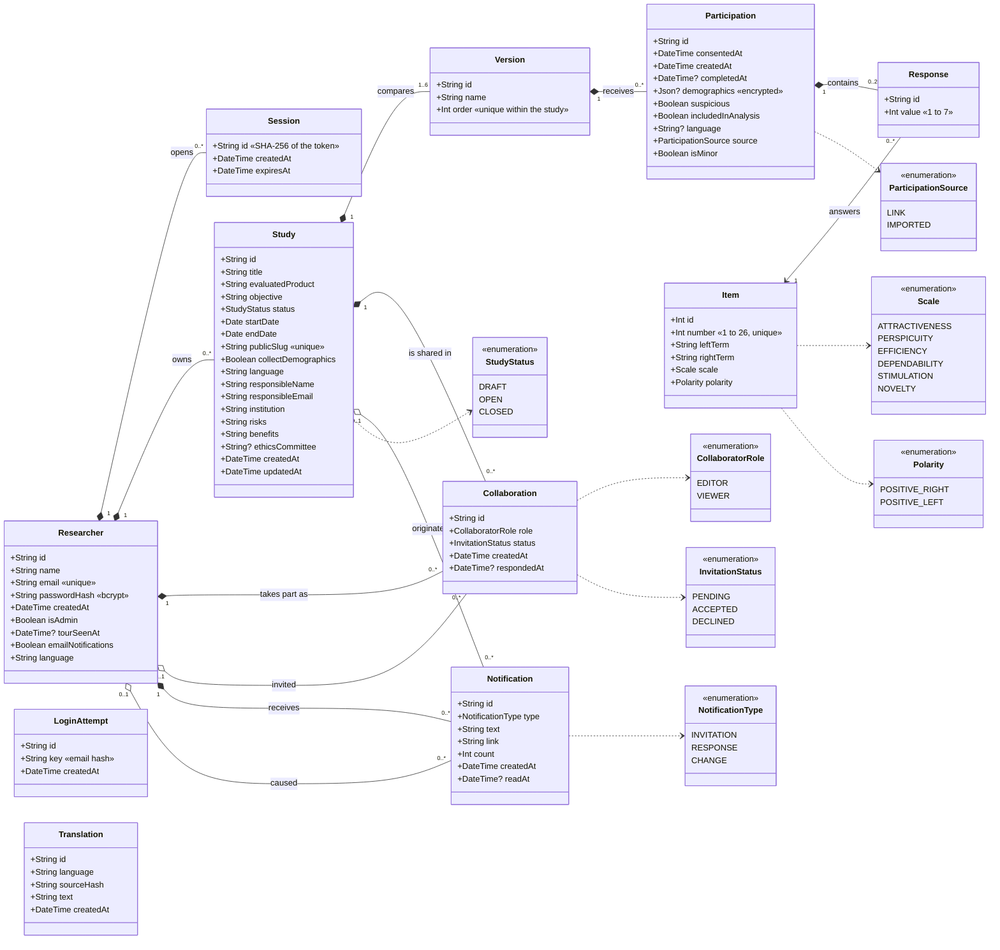

# Class diagram

Two diagrams describe the static structure of the UEQ Tool:

1. **Domain model:** the 11 entities stored in PostgreSQL and the 7 enumerated types, as they appear in [`prisma/schema.prisma`](../../prisma/schema.prisma).
2. **Calculation module:** the types and functions of [`src/ueq/`](../../src/ueq/), which turn responses into results without touching the database.

The diagrams are in English in every language of the documentation. In the code and in the explanations below, the names are the code's, in Portuguese and without diacritics: Researcher is `Pesquisador`, Study is `Estudo`, Version is `Versao`, Participation is `Participacao` and Response is `Resposta`. The types follow TypeScript: `?` marks a field that may be empty and `[]` marks a list. The database tables, columns, keys and deletion rules, field by field, are in the [logical data model](modelo-logico.md); this document shows the same entities as classes, with their associations and the multiplicity of each one.

Right below each diagram are the tool used, the source file to download and the version of the tool it represents.

## 1. Domain model

**Diagram tool:** Mermaid 12.2.0 (`classDiagram`), generated by `pnpm docs:diagramas`. **Source file:** [diagrama-de-classes-1.mmd](fontes/diagrama-de-classes-1.mmd). **Version represented:** UEQ Tool of 17 Nov 2026.

### How to read it

- **Composition (filled diamond)** is cascade deletion in the database. Deleting the researcher deletes their sessions, their studies, the collaborations they joined and the notifications they received ([RF06](requisitos.md#rf06)). Deleting the study deletes versions, participations, responses and collaborations ([RF17](requisitos.md#rf17)).
- **Aggregation (hollow diamond)** is a reference that becomes empty when the other side is deleted: if the person who sent an invitation deletes their account, the collaboration remains, without the inviter's name; if the study or the author of a notification disappears, the notification remains in the bell of the person who received it.
- **Item** belongs to no one: the 26 items are loaded by the seed from the official package ([RNF10](requisitos.md#rnf10)) and shared by all studies. A response points to the item; deleting the response does not delete the item.
- **Versao** exists 1 to 6 times per study. The order is unique within the study and defines the order on screen and the tie-break when distributing participants ([RF26](requisitos.md#rf26)).
- **Participacao** is created at consent, without responses, and only gets the 26 responses and `concluidaEm` on submission ([RF25](requisitos.md#rf25), [RF33](requisitos.md#rf33)). That is why the multiplicity is 0..26: zero while it is in progress, 26 once completed. One that is not completed within 2 days is deleted ([RNF13](requisitos.md#rnf13)).
- **Resposta** stores the raw value from 1 (left pole) to 7 (right pole), with a `CHECK` in the database and uniqueness per participation and item. Recoding to -3 to +3 happens in the calculation, never in the database.
- **Participacao.idioma** is the language code (`pt`, `es`, `ar`…); it is empty for imported participations, because the CSV does not state the language ([RF61](requisitos.md#rf61)). **Participacao.demografia** stores the four optional ranges, encrypted with AES-256-GCM when the key is configured ([RNF14](requisitos.md#rnf14)). **Participacao.menorDeIdade** records that the person confirmed the authorization of their parent or guardian ([RF25](requisitos.md#rf25)).
- **Colaboracao** links a study to another account, as Editor or Viewer. There is at most one per study and person, and the study only appears for the invited person after it is ACEITO (accepted) ([RF20](requisitos.md#rf20), [RF21](requisitos.md#rf21)).
- **Notificacao** is what the bell shows. Those of type RESPOSTA add up in `quantidade` while they are unread ([RF22](requisitos.md#rf22)).
- **TentativaAcesso** and **Traducao** are not linked to any other entity. The first stores only the email hash of each failed login ([RNF16](requisitos.md#rnf16)); the second stores each text already translated by the API, keyed by the hash of the original and by the language ([RF08](requisitos.md#rf08), [RF35](requisitos.md#rf35)).
- **Sessao.id** is the SHA-256 hash of the cookie token: whoever reads the database cannot build a valid cookie ([RNF15](requisitos.md#rnf15)).
- Nothing in the model identifies the participant: there is no name, email, IP or user agent ([RNF12](requisitos.md#rnf12)).

## 2. Calculation module

The [`src/ueq/`](../../src/ueq/) module is made of pure functions: it does not import Prisma, React or Next ([RNF25](requisitos.md#rnf25)). In the diagram, each file appears as a class with the «module» stereotype and the functions it exports. The input and output types appear as ordinary classes.

```mermaid
classDiagram
    direction TB

    class index {
        <<module>>
        +analyzeStudy(participations, items, config) StudyAnalysis
    }
    class recode {
        <<module>>
        +recode(value, polarity) number
        +recodeParticipant(values, items) number[]
    }
    class statistics {
        <<module>>
        +mean(values) number?
        +sampleStdDev(values) number?
        +confidenceInterval95(mean, sd, n, z) Interval?
        +correlation(x, y) number?
        +cronbachAlpha(columns) number?
    }
    class scales {
        <<module>>
        +scoresPerParticipant(values, items) Record~Scale, number~
        +interpretationBand(mean, neutralBand) InterpretationBand
        +resultByScale(responses, items, parameters) ScaleResult[]
        +resultByItem(responses, items, z) ItemResult[]
    }
    class inconsistency {
        <<module>>
        +rangeByScale(values, items) Record~Scale, number~
        +identicalAnswers(values) number
        +assessSuspicion(values, items, parameters) SuspicionAssessment
        +flagSuspicious(responses, items, parameters) SuspicionAssessment[]
    }
    class benchmark {
        <<module>>
        +classifyBenchmark(scale, mean, table) BenchmarkBand?
    }
    class items {
        <<module>>
        +SCALES
        +GROUPS
        +numbersByScale(items) Record~Scale, number[]~
    }

    class UEQItem {
        +number number
        +Scale scale
        +Polarity polarity
    }
    class ParticipationForAnalysis {
        +number[] values
        +boolean includedInAnalysis
    }
    class AnalysisConfig {
        +protocol
        +BenchmarkTable benchmark
    }
    class InconsistencyParameters {
        +number maxRange
        +number scalesForSuspicion
        +number maxIdenticalAnswers
    }
    class StudyAnalysis {
        +number n
        +number nExcluded
        +AnalyzedScaleResult[] scales
        +groups pragmatic and hedonic
        +ItemResult[] items
        +SuspicionAssessment[] participants
    }
    class ScaleResult {
        +Scale scale
        +number n
        +number? mean
        +number? sd
        +Interval? ci
        +number? alpha
        +InterpretationBand? interpretationBand
    }
    class AnalyzedScaleResult {
        +BenchmarkBand? benchmark
        +boolean alphaBelowMinimum
    }
    class ItemResult {
        +number number
        +Scale scale
        +number n
        +number? mean
        +number? sd
        +Interval? ci
        +number[] distribution
    }
    class SuspicionAssessment {
        +Record~Scale, number~ ranges
        +Scale[] inconsistentScales
        +number identicalAnswers
        +SuspicionReason[] reasons
        +boolean suspicious
    }
    class Interval {
        +number lower
        +number upper
    }
    class BenchmarkLimits {
        +number excellent
        +number good
        +number aboveAverage
        +number belowAverage
    }

    ScaleResult <|-- AnalyzedScaleResult
    AnalysisConfig *-- InconsistencyParameters
    AnalysisConfig *-- "6" BenchmarkLimits
    StudyAnalysis *-- "6" AnalyzedScaleResult
    StudyAnalysis *-- "26" ItemResult
    StudyAnalysis *-- "0..*" SuspicionAssessment
    ScaleResult o-- Interval
    ItemResult o-- Interval

    index ..> ParticipationForAnalysis : receives
    index ..> UEQItem : receives
    index ..> AnalysisConfig : receives
    index ..> StudyAnalysis : returns
    index ..> scales : uses
    index ..> inconsistency : uses
    index ..> benchmark : uses
    index ..> items : uses
    scales ..> recode : uses
    scales ..> statistics : uses
    scales ..> items : uses
    inconsistency ..> recode : uses
    inconsistency ..> items : uses
```

**Diagram tool:** Mermaid 12.2.0 (`classDiagram`), generated by `pnpm docs:diagramas`. **Source file:** [diagrama-de-classes-2.mmd](fontes/diagrama-de-classes-2.mmd). **Version represented:** UEQ Tool of 17 Nov 2026.

### How to read it

- **`analisarEstudo`** is the entry point. It receives the participations (26 values from 1 to 7 and whether they are in the analysis), the 26 items and the configuration. It computes the statistics only with those that are in the analysis and assesses suspicion for all of them ([RF36](requisitos.md#rf36) to [RF42](requisitos.md#rf42), [RF51](requisitos.md#rf51)).
- **`ConfigAnalise`** has the same format as [`data/protocolo.json`](../../data/protocolo.json) and [`data/benchmark.json`](../../data/benchmark.json). The thresholds and ranges are not in the code: they change through a pull request, with the source of each number.
- **Empty values** follow the official spreadsheet: without enough n, with a standard deviation of zero or with an item that does not vary, the function returns `null` where the spreadsheet shows `#NUM!` or `#DIV/0!`.
- **`ResultadoEscalaAnalisada`** adds to the scale result the benchmark range and the flag for alpha below 0.7.
- **`GRUPOS`** defines the Pragmatic Quality (Perspicuity, Efficiency and Dependability) and the Hedonic Quality (Stimulation and Novelty). Attractiveness is outside both groups ([RF39](requisitos.md#rf39)).
- **`avaliarSuspeita`** is also used outside the dashboard: when the questionnaire is submitted, on import, on the Responses page, in the sample study and in the recalculation ([UC24](casos-de-uso.md#uc24)). `marcarSuspeitos` applies the same assessment to a list.

Each formula was redone by hand, with the data of the sample study, in the [calculation verification](verificacao-do-calculo.md).

### Who uses the module

The module does not know where the data comes from. The files that query the database and call the module:

| File | What it does |
|---|---|
| `src/lib/resultados.ts` | Fetches the completed participations, builds the input per version and calls `analisarEstudo` for the dashboard, the PDF and the results export |
| `src/lib/participacoes.ts` | Calls `avaliarSuspeita` for each participation on the Responses page |
| `src/lib/exportacoes.ts` | Uses `recodificarParticipante` in the coded export |
| `src/app/r/[slug]/acoes.ts` | Calls `avaliarSuspeita` when the questionnaire is submitted |
| `src/app/(ferramenta)/(pesquisador)/estudos/[id]/respostas/importar/acoes.ts` | Calls `avaliarSuspeita` on each imported row |
| `src/lib/cenarios/respostas-sinteticas.ts` | Calls `avaliarSuspeita` to check that the demonstration responses stay consistent with each scenario |
| `prisma/recalcular-suspeitas.ts` | Calls `avaliarSuspeita` on all completed participations |
| `prisma/estudo-exemplo.ts` | Calls `avaliarSuspeita` when saving the responses of the sample study |

The complete path, from the database to the screen, is in the [results sequence diagram](diagramas-de-sequencia.md#3-ver-resultados).
