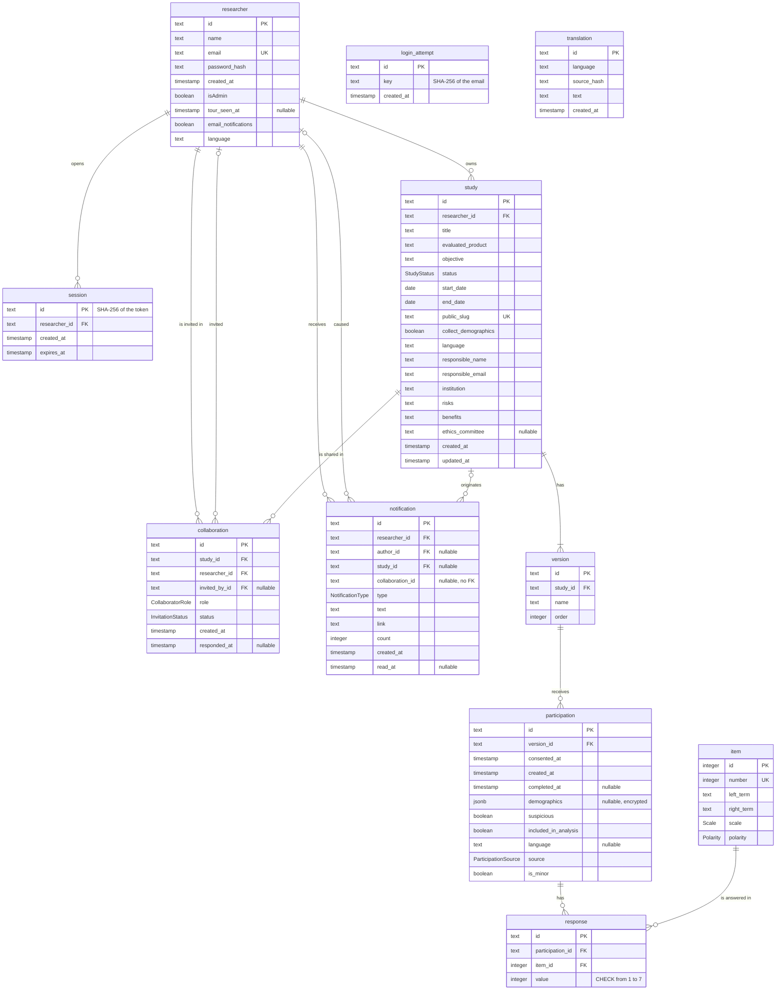

# Logical data model of the database

The UEQ Tool database is a **PostgreSQL 16** database with 11 tables and 7 enumerated types. The model is declared in [`prisma/schema.prisma`](../../prisma/schema.prisma) and applied by the 16 migrations in [`prisma/migrations/`](../../prisma/migrations/): 10 change the structure, and the other 6 only write translated texts into the `traducao` table. The names below are the ones in the database. In the code, the same fields appear in camelCase (`slug_publico` is `slugPublico`).

The columns, keys and deletion rules in this document were read from PostgreSQL's own catalog (`information_schema` and `pg_constraint`) on 13 Nov 2026, with all migrations applied.

## Diagram

The diagram uses the English names. The tables below give the real database names, in Portuguese: `researcher` is `pesquisador`, `study` is `estudo`, `version` is `versao`, `participation` is `participacao` and `response` is `resposta`.

**Diagram tool:** Mermaid 12.2.0 (`erDiagram`), generated by `pnpm docs:diagramas`. **Source file:** [modelo-logico-1.mmd](fontes/modelo-logico-1.mmd). **Version represented:** UEQ Tool of 17 Nov 2026.

Two tables are unlinked on purpose: `tentativa_acesso` does not point to the account, because it stores only the email hash, and `traducao` is a cache with no owner.

## How to read the tables

- **`text` keys** are generated by the application with CUID. The exception is `sessao.id`, which is the hash of the cookie token.
- **`timestamp`** is `timestamp(3) without time zone`, stored in UTC by Prisma.
- **Null** indicates that the column accepts an empty value. The others are mandatory.
- **Default** is the database value when the `INSERT` does not provide the column.

## Account and access

### pesquisador

The account of the person who uses the tool. The participant has no account.

| Column | Type | Null | Default | Key | Purpose |
|---|---|---|---|---|---|
| `id` | text | no | | PK | Identifier |
| `nome` | text | no | | | Name shown to study colleagues |
| `email` | text | no | | Unique | Login and destination of notices |
| `senha_hash` | text | no | | | bcrypt hash, cost 12. The password is never stored |
| `criado_em` | timestamp | no | now | | Account date |
| `administrador` | boolean | no | `false` | | Opens the Administration page. Does not give access to other people's studies |
| `tutorial_visto_em` | timestamp | yes | | | Empty until the person finishes, skips or closes the tour |
| `notificacoes_por_email` | boolean | no | `true` | | Besides the bell, sends the notice by email |
| `idioma` | text | no | `'pt'` | | Interface language and default for the studies the person creates |

### sessao

One row per active login. It is kept in the database so that changing the password can end the other sessions.

| Column | Type | Null | Default | Key | Purpose |
|---|---|---|---|---|---|
| `id` | text | no | | PK | SHA-256 of the cookie token. Whoever reads the database cannot build a valid cookie |
| `pesquisador_id` | text | no | | FK, index | Owner of the session |
| `criada_em` | timestamp | no | now | | |
| `expira_em` | timestamp | no | | | End of validity |

### tentativa_acesso

Counts wrong passwords to limit guessing: 5 errors in 15 minutes lock the email. Rows older than one day are deleted.

| Column | Type | Null | Default | Key | Purpose |
|---|---|---|---|---|---|
| `id` | text | no | | PK | |
| `chave` | text | no | | Index with `criada_em` | SHA-256 of the email. The email is not stored |
| `criada_em` | timestamp | no | now | Index with `chave` | Start of the count |

## Study

### estudo

| Column | Type | Null | Default | Key | Purpose |
|---|---|---|---|---|---|
| `id` | text | no | | PK | |
| `pesquisador_id` | text | no | | FK, index | Owner of the study |
| `titulo` | text | no | | | |
| `produto_avaliado` | text | no | | | |
| `objetivo` | text | no | | | Read by the participant at consent |
| `status` | StatusEstudo | no | `RASCUNHO` | | Decides whether the link accepts responses |
| `data_inicio` | date | no | | | |
| `data_fim` | date | no | | | |
| `slug_publico` | text | no | | Unique | The participant's `/r/<slug>` address |
| `coletar_demografia` | boolean | no | `false` | | LGPD, necessity principle: the optional data step only exists if the researcher turns it on |
| `idioma` | text | no | `'pt'` | | Language in which the study was written and in which the link opens |
| `responsavel_nome` | text | no | | | Person responsible for the research, shown in the consent form (LGPD, Art. 9). The form suggests the account name |
| `responsavel_email` | text | no | | | Contact of the person responsible, shown in the consent form. The form suggests the account email |
| `instituicao` | text | no | | | Research institution, in the subtitle and in the consent form |
| `riscos` | text | no | | | Risks to the participant, in the consent form (CNS Resolution 510/2016). The form suggests a text |
| `beneficios` | text | no | | | Benefits, in the consent form. The form suggests a text |
| `comite_etica` | text | yes | | | Ethics committee, opinion or CAAE and contact, when the study went through one |
| `criado_em` | timestamp | no | now | | |
| `atualizado_em` | timestamp | no | | | Updated by Prisma |

### colaboracao

The invitation to work on a study. The study only appears for the invited person after `ACEITO`.

| Column | Type | Null | Default | Key | Purpose |
|---|---|---|---|---|---|
| `id` | text | no | | PK | |
| `estudo_id` | text | no | | FK, unique with `pesquisador_id` | Each person has one invitation per study |
| `pesquisador_id` | text | no | | FK, index with `status` | Who was invited |
| `convidado_por_id` | text | yes | | FK | Who invited. Becomes empty if that account is deleted |
| `papel` | PapelColaborador | no | `EDITOR` | | What the person can do |
| `status` | StatusConvite | no | `PENDENTE` | | |
| `criado_em` | timestamp | no | now | | |
| `respondido_em` | timestamp | yes | | | When the person accepted or declined |

### versao

The versions of the product that the study compares. Every study has at least one, a rule enforced by the form validation.

| Column | Type | Null | Default | Key | Purpose |
|---|---|---|---|---|---|
| `id` | text | no | | PK | |
| `estudo_id` | text | no | | FK, unique with `ordem` | |
| `nome` | text | no | | | |
| `ordem` | integer | no | | Unique with `estudo_id` | Display order and tie-break when distributing participants |

## Questionnaire and responses

### item

The 26 UEQ items, loaded by the seed from `data/ueq-itens-ptbr.json`. The terms in the other 36 languages are in `data/ueq-idiomas.json`, not in the database.

| Column | Type | Null | Default | Key | Purpose |
|---|---|---|---|---|---|
| `id` | integer | no | sequence | PK | |
| `numero` | integer | no | | Unique | From 1 to 26, the official order |
| `termo_esquerdo` | text | no | | | |
| `termo_direito` | text | no | | | |
| `escala` | Escala | no | | | Which scale the item belongs to |
| `polaridade` | Polaridade | no | | | Which side the positive term is on |

### participacao

One person answering one version. There is no name, email, IP or link to an account: that is what makes the response anonymous.

| Column | Type | Null | Default | Key | Purpose |
|---|---|---|---|---|---|
| `id` | text | no | | PK | Also goes in the participant's cookie while they answer |
| `versao_id` | text | no | | FK, index | Version the person evaluates: the one with the fewest responses when they consented |
| `consentiu_em` | timestamp | no | | | Record of the consent |
| `criada_em` | timestamp | no | now | | Used to delete abandoned ones after 2 days |
| `concluida_em` | timestamp | yes | | | Empty until submitted. Only completed ones enter the analysis |
| `demografia` | jsonb | yes | | | Age range, gender, education and familiarity. Encrypted with AES-256-GCM when `CHAVE_CRIPTOGRAFIA` exists |
| `suspeita` | boolean | no | `false` | | Calculated by the rules of the [protocol](../ueq-protocolo.md#7-respostas-inconsistentes) |
| `incluida_na_analise` | boolean | no | `true` | | The researcher's decision. Removing from the analysis deletes nothing |
| `idioma` | text | yes | `'pt'` | | Language in which the person answered. Empty for imported ones, because the CSV does not state it |
| `origem` | OrigemParticipacao | no | `LINK` | | Response through the link or imported from CSV |
| `menor_de_idade` | boolean | no | `false` | | The person declared being under 18 and confirmed the authorization of their parent or guardian (LGPD, Art. 14). Without the authorization, the participation is not even created |

### resposta

One row per answered item. A completed participation has 26.

| Column | Type | Null | Default | Key | Purpose |
|---|---|---|---|---|---|
| `id` | text | no | | PK | |
| `participacao_id` | text | no | | FK, unique with `item_id` | Prevents answering the same item twice |
| `item_id` | integer | no | | FK | |
| `valor` | integer | no | | `CHECK` from 1 to 7 | 1 is the left pole and 7 the right one, before recoding |

## Notices and translation

### notificacao

The bell in the header. Responses that arrive while the notice has not been read only increase `quantidade`.

| Column | Type | Null | Default | Key | Purpose |
|---|---|---|---|---|---|
| `id` | text | no | | PK | |
| `pesquisador_id` | text | no | | FK, index with `lida_em` | Who receives it |
| `autor_id` | text | yes | | FK | Who caused it. Becomes empty if the account is deleted |
| `estudo_id` | text | yes | | FK | Becomes empty if the study is deleted, and the notice stays in the bell |
| `colaboracao_id` | text | yes | | No FK | Reference to the invitation, to accept or decline it from the notice. It may point to an invitation that no longer exists |
| `tipo` | TipoNotificacao | no | | | |
| `texto` | text | no | | | Already in the recipient's language |
| `link` | text | no | | | Path inside the tool |
| `quantidade` | integer | no | `1` | | Accumulated responses |
| `criada_em` | timestamp | no | now | | |
| `lida_em` | timestamp | yes | | Index with `pesquisador_id` | Empty means unread |

### traducao

Cache of the translations made by the Claude API, so that the same text is not translated twice.

| Column | Type | Null | Default | Key | Purpose |
|---|---|---|---|---|---|
| `id` | text | no | | PK | |
| `idioma` | text | no | | Unique with `hash_origem` | Target language |
| `hash_origem` | text | no | | Unique with `idioma` | SHA-256 of the original text |
| `texto` | text | no | | | The translation |
| `criada_em` | timestamp | no | now | | |

## Enumerated types

| Type | Values | Note |
|---|---|---|
| `StatusEstudo` | `RASCUNHO`, `ABERTO`, `ENCERRADO` | Only `ABERTO` accepts responses |
| `Escala` | `ATRATIVIDADE`, `PERSPICUIDADE`, `EFICIENCIA`, `CONFIABILIDADE`, `ESTIMULACAO`, `NOVIDADE` | The 6 UEQ scales |
| `Polaridade` | `POSITIVA_DIREITA`, `POSITIVA_ESQUERDA` | `+` and `-` in the [protocol](../ueq-protocolo.md#1-itens-escalas-e-polaridade) |
| `OrigemParticipacao` | `LINK`, `IMPORTADA` | |
| `PapelColaborador` | `EDITOR`, `LEITOR` | An editor works on the study; a viewer only views and exports. Deleting the study and inviting remain with the owner |
| `StatusConvite` | `PENDENTE`, `ACEITO`, `RECUSADO` | |
| `TipoNotificacao` | `CONVITE`, `RESPOSTA`, `ALTERACAO` | |

## What each deletion takes with it

All foreign keys have `ON UPDATE CASCADE`. The column below is the database's `ON DELETE`.

| Foreign key | When the parent is deleted |
|---|---|
| `sessao.pesquisador_id` → `pesquisador` | Deletes |
| `estudo.pesquisador_id` → `pesquisador` | Deletes |
| `colaboracao.pesquisador_id` → `pesquisador` | Deletes |
| `colaboracao.convidado_por_id` → `pesquisador` | Becomes empty |
| `colaboracao.estudo_id` → `estudo` | Deletes |
| `versao.estudo_id` → `estudo` | Deletes |
| `participacao.versao_id` → `versao` | Deletes |
| `resposta.participacao_id` → `participacao` | Deletes |
| `resposta.item_id` → `item` | **Prevents** deleting an item that already has a response |
| `notificacao.pesquisador_id` → `pesquisador` | Deletes |
| `notificacao.autor_id` → `pesquisador` | Becomes empty |
| `notificacao.estudo_id` → `estudo` | Becomes empty |

In practice:

- **Deleting the account** deletes the sessions, the studies the person owns (with versions, participations and responses), their invitations and their notices. In other people's studies, their participation as a colleague disappears, and the notices they caused remain, without an author.
- **Deleting a study** deletes versions, participations, responses and invitations. The notices stay in the bell of whoever received them, without the link to the study.
- **Removing a version**, in the database, deletes its participations and responses.
- **No item can disappear** once it has a response. This `RESTRICT` protects the instrument.

## Rules the database enforces and rules the application enforces

| Rule | Where it lives |
|---|---|
| `resposta.valor` between 1 and 7 | `CHECK resposta_valor_entre_1_e_7`, written by hand in the initial migration, because Prisma does not declare `CHECK` |
| One response per item in each participation | Unique index `(participacao_id, item_id)` |
| One invitation per person in each study | Unique index `(estudo_id, pesquisador_id)` |
| Public slug and email without repetition | Unique indexes |
| Exactly 26 responses in a completed participation | Application (`enviarRespostas`, in a transaction) |
| Only options from the list in `demografia` | Application (`src/lib/demografia.ts`) |
| Who can view or change a study | Application (`estudoDoPesquisador` in `src/lib/estudos.ts`) |
| Deleting a participation abandoned for more than 2 days | Application: it happens when the next person consents |

## Personal data

This map links the model to the tool's privacy policy, at `/privacidade` (LGPD).

| Data | Table | Protection |
|---|---|---|
| Name and email | `pesquisador` | Only shown to people who share a study with the person |
| Password | `pesquisador.senha_hash` | bcrypt hash, cost 12 |
| Session cookie | `sessao.id` | Only the SHA-256 hash |
| Email in a login attempt | `tentativa_acesso.chave` | Only the SHA-256 hash, deleted within one day |
| Participant's demographic data | `participacao.demografia` | Encrypted with AES-256-GCM, with the key outside the database |
| Questionnaire responses | `resposta` | Nothing links them to a person |

Without `CHAVE_CRIPTOGRAFIA` in the environment, the demographics stay in plain text and the Administration page shows a warning. The `pnpm dados:cifrar` script encrypts the old rows and runs in the production build.
