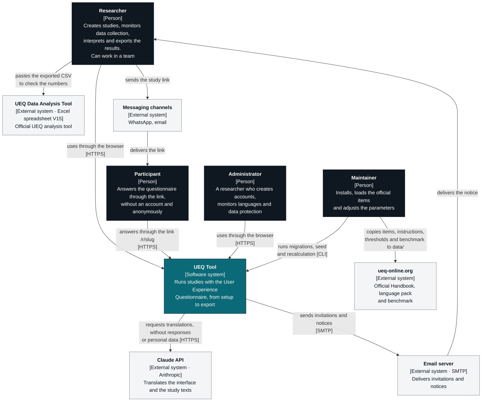
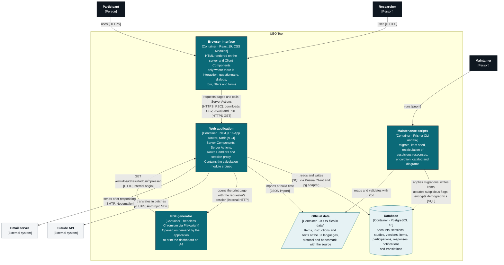
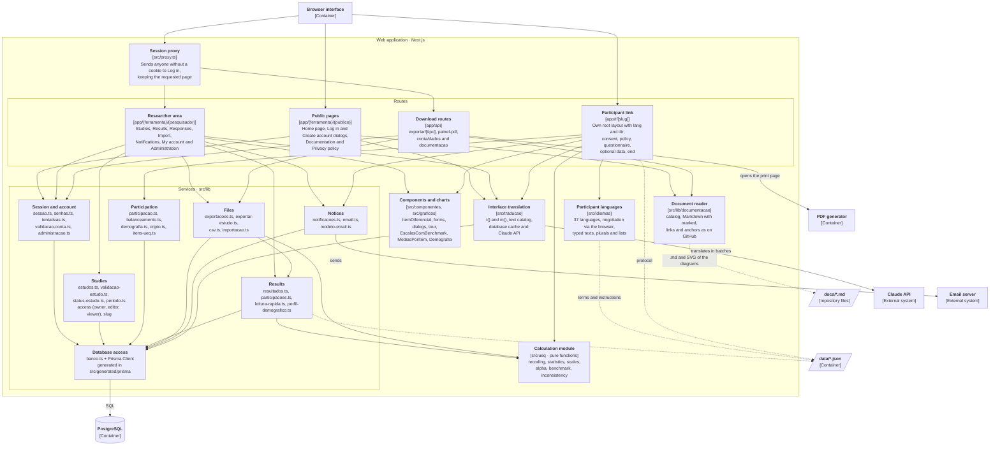
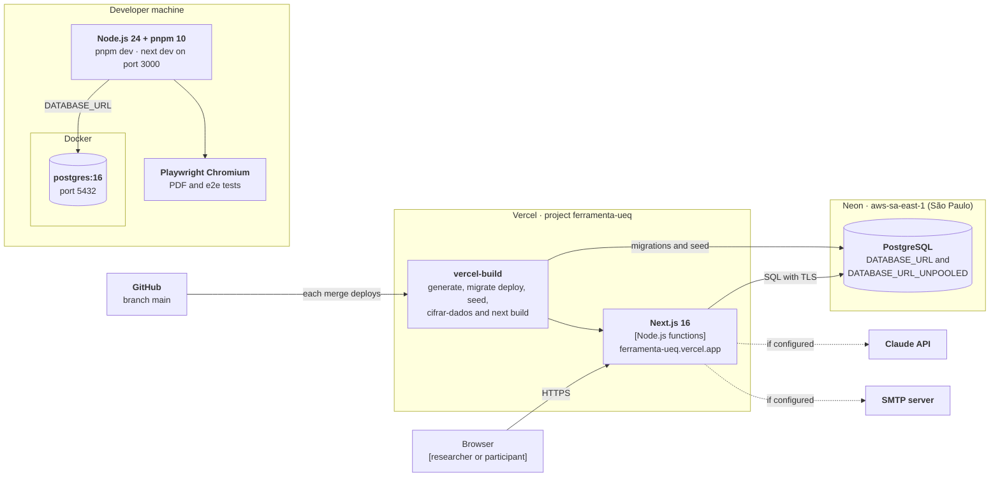

# Arquitectura

La arquitectura se describe con el [modelo C4](https://c4model.com), en tres niveles de zoom:

1. **Contexto:** quién usa la herramienta y con qué sistemas se relaciona;
2. **Contenedores:** las partes que se ejecutan por separado (aplicación, base de datos, generador de PDF, scripts) y cómo se comunican;
3. **Componentes:** cómo se organiza por dentro la aplicación Next.js.

Un cuarto diagrama muestra el despliegue, en producción y en desarrollo.

Los diagramas usan Mermaid, que GitHub dibuja directamente en la página. Cada recuadro lleva el nombre, el tipo entre corchetes y la tecnología. Las flechas indican qué pasa y por qué protocolo. Justo debajo de cada diagrama están la herramienta utilizada, el archivo fuente para descargar y la versión de la herramienta que representa.

## Visión general

La Herramienta UEQ es una aplicación web única en **Next.js 16 (App Router)** con **React 19** y **TypeScript strict**, que guarda los datos en un **PostgreSQL 16** mediante **Prisma 7**. Está en línea en [ferramenta-ueq.vercel.app](https://ferramenta-ueq.vercel.app), en Vercel, con la base de datos en Neon, región de São Paulo.

- No existe una API REST separada. Las páginas son Server Components que leen la base de datos en el servidor. Las escrituras son Server Actions llamadas por los formularios.
- Solo lo que devuelve un archivo es una ruta de API: las exportaciones en CSV, el panel en PDF, los datos de la cuenta y las descargas de la documentación.
- El cálculo del UEQ queda aislado en `src/ueq/`, en funciones puras, para poder probarlo contra la hoja oficial sin base de datos ni interfaz.
- Los parámetros del protocolo, el benchmark y los textos oficiales de los 37 idiomas son archivos JSON versionados en `data/`, con la fuente de cada valor.
- La interfaz del investigador y los textos de los estudios se traducen bajo demanda con la API de Claude, y el resultado se guarda en la base de datos. El cuestionario usa solo las traducciones oficiales del UEQ.

## Nivel 1 · Contexto



**Herramienta del diagrama:** Mermaid 12.2.0 (`flowchart`), generado por `pnpm docs:diagramas`. **Archivo fuente:** [arquitetura-1.mmd](fontes/arquitetura-1.mmd). **Versión representada:** Herramienta UEQ del 06/11/2026.

En tiempo de ejecución, la herramienta llama solo a dos sistemas externos, y ambos son opcionales:

- **API de Claude:** sin `ANTHROPIC_API_KEY`, la interfaz queda en portugués y los textos de los estudios quedan en el idioma original. A la API van los textos de la interfaz y el título, el producto, el objetivo y los nombres de versión de cada estudio. Ninguna respuesta, nombre, correo electrónico o dato demográfico va con ellos.
- **Servidor de correo:** sin las variables `SMTP_*`, los avisos quedan solo en la campana, y quien invita recibe un enlace de correo listo para enviar por su cuenta.

La hoja oficial y el sitio del UEQ entran por medio de personas: el equipo copia los datos oficiales a `data/` (con la fuente en cada archivo). La exportación de la hoja oficial parte de una copia sin modificar de la UEQ Data Analysis Tool V15 en `data/planilha-oficial/`, y el investigador la abre en Excel para comprobar los números.

## Nivel 2 · Contenedores



**Herramienta del diagrama:** Mermaid 12.2.0 (`flowchart`), generado por `pnpm docs:diagramas`. **Archivo fuente:** [arquitetura-2.mmd](fontes/arquitetura-2.mmd). **Versión representada:** Herramienta UEQ del 06/11/2026.

| Contenedor | Tecnología | Responsabilidad | Dónde está |
|---|---|---|---|
| Interfaz en el navegador | React 19.3, CSS Modules, variables CSS, SVG hecho a mano | Mostrar las pantallas y gestionar la interacción. Sin biblioteca de componentes ni de gráficos | `src/app/**/*.tsx` con `"use client"`, `src/componentes/`, `src/graficos/`, `src/styles/` |
| Aplicación web | Next.js 16.4, Node.js 24, Zod 4, bcryptjs, Nodemailer, SDK de Anthropic | Renderizar las páginas, validar y guardar datos, proteger el área del investigador, generar exportaciones, traducir y avisar | `src/app/`, `src/lib/`, `src/ueq/`, `src/idiomas/`, `src/traducao/`, `src/proxy.ts` |
| Generador de PDF | Playwright 1.64 con su propio Chromium en desarrollo y `@sparticuz/chromium-min` 153 en Vercel | Imprimir el panel en PDF con gráficos vectoriales | `src/app/api/estudos/[id]/painel-pdf/route.ts` |
| Base de datos | PostgreSQL 16 (Docker en desarrollo, Neon en producción) | Persistir el modelo de dominio, con cascada y `CHECK`. Detalles en el [modelo lógico](modelo-logico.md) | `prisma/schema.prisma`, `prisma/migrations/`, `docker-compose.yml` |
| Datos oficiales | JSON versionado | Fuente única de los ítems, instrucciones, protocolo y benchmark, cada uno con el campo `fonte` | `data/` |
| Documentación | Markdown y SVG versionados | Los documentos que muestra la pestaña Documentación, los diagramas ya dibujados y el archivo fuente de cada uno | `docs/`, `docs/documentacao/diagramas/`, `docs/documentacao/fontes/` |
| Scripts de mantenimiento | Prisma CLI, tsx | Crear la base de datos, cargar los ítems, recalcular sospechas, cifrar datos antiguos, generar el catálogo de textos y los diagramas | `prisma/seed.ts`, `prisma/recalcular-suspeitas.ts`, `prisma/cifrar-dados.ts`, `scripts/` |

## Nivel 3 · Componentes de la aplicación web



**Herramienta del diagrama:** Mermaid 12.2.0 (`flowchart`), generado por `pnpm docs:diagramas`. **Archivo fuente:** [arquitetura-3.mmd](fontes/arquitetura-3.mmd). **Versión representada:** Herramienta UEQ del 06/11/2026.

El `matcher` de [`src/proxy.ts`](../../src/proxy.ts) excluye lo que nunca exige sesión: `/entrar`, `/cadastrar`, `/privacidade`, `/r/`, `/documentacao`, `/api/documentacao` y los iconos del sitio. La raíz `/` pasa por el proxy y sigue sin cookie. Toda ruta nueva del investigador nace ya protegida. El enlace del participante tiene un layout raíz propio, sin barra y sin enlace al resto de la herramienta: quien responde ve solo el formulario, el selector de idioma y la política de privacidad, que tiene una versión en `/r/<slug>/privacidade`.

### Reglas de dependencia

- **`src/ueq/` no depende de nada del proyecto.** No importa Prisma, React, Next ni `src/lib`. Recibe números y devuelve objetos. Es lo que permite probarlo contra la hoja oficial.
- **Los componentes y los gráficos no saben nada de Prisma.** Reciben datos ya preparados por props.
- **Toda página, Server Action y ruta del investigador comprueba la sesión en la base de datos y el acceso al estudio**, no solo el proxy. El acceso pasa siempre por `estudoDoPesquisador(id, pessoa, "ver" | "editar" | "gerenciar")` o por `filtroDeAcesso`. Sin acceso, la respuesta es igual a la de un estudio que no existe.
- **El administrador no ve estudios de otras personas.** Las respuestas son datos de investigación de quien dirige el estudio. Las páginas de Administración responden 404 a quien no es administrador.
- **Las rutas del participante solo leen lo que el participante puede ver:** título, producto, objetivo y estado del estudio. Nada del investigador y nada del análisis.
- **Los parámetros del protocolo nunca quedan en el código.** Vienen de `data/protocolo.json` y `data/benchmark.json`.
- **El texto de pantalla del investigador pasa por `t()` o `m()`,** y `pnpm i18n:catalogo` genera el catálogo. El texto del participante queda en `src/idiomas/textos/`, un archivo por idioma.

## Seguridad y LGPD

| Medida | Dónde está |
|---|---|
| Cabeceras de seguridad en toda respuesta: CSP, HSTS, `X-Frame-Options`, `X-Content-Type-Options`, `Referrer-Policy` y `Permissions-Policy` | `next.config.ts` |
| Contraseña con bcrypt de coste 12, con el hash rehecho en el inicio de sesión cuando sube el coste | `src/lib/senhas.ts` |
| 5 contraseñas incorrectas en 15 minutos bloquean el correo, contando por su hash | `src/lib/tentativas.ts` |
| Sesión en la base de datos por el hash del token, con cookie `httpOnly` y `secure` en producción | `src/lib/sessao.ts` |
| Datos demográficos cifrados con AES-256-GCM, con la clave fuera de la base de datos | `src/lib/cripto.ts`, `prisma/cifrar-dados.ts` |
| Recogida demográfica desactivada por defecto en cada estudio | `Estudo.coletarDemografia` |
| La participación abandonada desde hace más de 2 días se borra | `src/app/r/[slug]/acoes.ts` |
| Descargar los propios datos y eliminar la cuenta, sin pedírselo a nadie | `src/app/api/conta/dados/route.ts`, `conta/` |
| El destino de `?voltar=` y `?de=` solo acepta una ruta interna | `destinoInterno` en `src/lib/validacao-conta.ts` |
| Política pública, sin exigir cuenta, también dentro del enlace del participante | `src/app/(ferramenta)/(publico)/privacidade/`, `src/app/r/[slug]/privacidade/` |

## Decisiones de arquitectura

| Decisión | Por qué | Consecuencia |
|---|---|---|
| Server Components y Server Actions en lugar de una API REST | Menos código entre la pantalla y la base de datos; validación con Zod en el servidor en cada acción; los formularios funcionan con el comportamiento nativo del navegador | La herramienta no ofrece una API pública. Las integraciones usan las exportaciones en CSV |
| Cálculo en funciones puras en `src/ueq/` | El número tiene que coincidir con la hoja oficial; las funciones puras se pueden probar con fixtures y casos límite | Quien obtiene los datos (`src/lib/resultados.ts`) solo monta la entrada y la traspasa |
| Sesión guardada en la base de datos, con el hash del token | Cambiar la contraseña cierra las demás sesiones; quien lea la base de datos no puede montar una cookie | Cada página del investigador hace una consulta de sesión (con `cache` de React por solicitud) |
| Dos layouts raíz: herramienta y enlace del participante | El `<html lang>` y el `dir` del participante siguen el idioma elegido por quien responde, y los de la herramienta siguen el idioma de la cuenta (WCAG 3.1.1), incluidos árabe, hebreo y persa | `experimental.globalNotFound` en `next.config.ts` para la página 404 |
| Dos sistemas de texto: `src/idiomas` y `src/traducao` | El cuestionario es un instrumento de medida: necesita los términos oficiales y textos revisables, sin traducción automática. El resto de la herramienta puede traducirse bajo demanda | Un texto nuevo del participante exige los 37 archivos; un texto nuevo del investigador solo exige `pnpm i18n:catalogo` |
| Traducción bajo demanda, guardada en la base de datos | Traducir cada texto una sola vez, sin coste en las lecturas siguientes y sin mantener 37 archivos a mano | La primera visita a un idioma puede salir en portugués mientras los lotes se ejecutan en segundo plano |
| Correo enviado después de la respuesta (`after`) | Quien hizo clic no espera al servidor de correo, y un fallo de envío no deshace la acción | La campana es el registro que siempre existe; el correo es un extra |
| Gráficos en SVG hechos a mano | Control total de `title`, `desc`, contraste, formas por versión y reorganización en pantalla estrecha | Sin biblioteca de gráficos que actualizar |
| PDF generado por Chromium en el servidor | El PDF sale igual que el panel, con gráficos vectoriales y las mismas fuentes | En Vercel, el navegador se descarga en la primera llamada (véase [Despliegue](#implantação)) |
| Documentación leída de los mismos `.md` del repositorio, con los diagramas dibujados antes, en SVG (`pnpm docs:diagramas`) | Un solo archivo para GitHub y para la herramienta; la herramienta no carga la biblioteca Mermaid y cada diagrama se convierte en una imagen con texto alternativo | Cambiar un diagrama exige generar de nuevo el SVG y la fuente; una prueba unitaria avisa |
| Documento largo dividido en páginas en el momento de mostrarlo, sin cambiar el `.md` | El archivo sigue siendo único y legible en GitHub, y la herramienta no obliga a desplazarse por un documento entero | Los enlaces y anclas pasan por `rotaDaAncora`, que encuentra la página de cada una, y las direcciones antiguas con solo el fragmento se redirigen |
| Datos oficiales en JSON versionado | Cada número tiene una fuente rastreable y cambia mediante pull request, no en el código | Cambiar un umbral exige `pnpm suspeitas:recalcular` para actualizar las participaciones ya guardadas |
| Cookies del participante restringidas a `/r/<slug>` | Anonimato: solo el id aleatorio de la participación, la marca de ya respondido y el idioma | La protección contra el envío duplicado vale por navegador, no por persona |

## Despliegue



**Herramienta del diagrama:** Mermaid 12.2.0 (`flowchart`), generado por `pnpm docs:diagramas`. **Archivo fuente:** [arquitetura-4.mmd](fontes/arquitetura-4.mmd). **Versión representada:** Herramienta UEQ del 06/11/2026.

**Producción.** Cada merge en `main` publica una versión nueva. El script `vercel-build` ejecuta `prisma generate`, `prisma migrate deploy`, el seed, `prisma/cifrar-dados.ts` y `next build`. En producción el seed guarda solo los 26 ítems, sin cuenta de prueba. Las migraciones usan `DATABASE_URL_UNPOOLED` cuando existe.

**Desarrollo.** El paso a paso está en el [README](../../README.md#como-rodar).

| Variable | Obligatoria | Para qué sirve |
|---|---|---|
| `DATABASE_URL` | Sí | Conexión con PostgreSQL |
| `DATABASE_URL_UNPOOLED` | En Neon | Conexión directa, usada por las migraciones |
| `CHAVE_CRIPTOGRAFIA` | En producción | Clave AES-256-GCM de los datos demográficos. Sin ella, el dato queda en texto plano y Administración avisa. Guarde una copia: sin la clave, el dato cifrado ya no se puede leer |
| `ANTHROPIC_API_KEY` | No | Activa la traducción automática |
| `SMTP_HOST`, `SMTP_PORTA`, `SMTP_USUARIO`, `SMTP_SENHA`, `EMAIL_REMETENTE` | No | Activan el envío de correo |
| `URL_INTERNA` y `PORT` | No | Dirección por la que la ruta del PDF alcanza la propia aplicación. Sin `URL_INTERNA`, vale `http://localhost:$PORT` |
| `PESQUISADOR_TESTE_EMAIL` y `PESQUISADOR_TESTE_SENHA` | Solo en desarrollo | Cuenta creada por el seed. No deben existir en producción |
| `TRADUCAO_PSEUDO` | Solo para comprobación | Con `1`, marca los textos del catálogo con ⟦ ⟧ para encontrar lo que no pasa por `t()` |

**Panel en PDF en producción.** La función de Vercel no tiene navegador instalado. En la primera llamada, la ruta descarga un Chromium propio para servidor (`@sparticuz/chromium-min` 153), que queda en `/tmp` mientras la función siga activa, y abre la página de impresión por la dirección pública de producción. Por eso la primera generación después de un tiempo inactivo tarda más, y el límite de la función es de 60 s. En desarrollo, vale el Chromium de Playwright. Las exportaciones en CSV no dependen de un navegador.

## Estructura de carpetas

```
src/
  app/
    (ferramenta)/         layout raiz no idioma da conta
      (publico)/          página inicial, Entrar, Criar conta, Documentação, Privacidade
      (pesquisador)/      Estudos, Resultados, Respostas, Notificações, Minha conta, Administração
    r/[slug]/             link do participante, com layout raiz próprio (lang e dir do idioma)
    api/                  downloads: exportar/[tipo], painel-pdf, conta/dados, documentacao
  ueq/                    cálculo do UEQ em funções puras
  lib/                    sessão, estudos, participação, resultados, CSV, avisos, criptografia
  idiomas/                37 idiomas do participante: textos tipados, negociação, plural
  traducao/               t() e m(), catálogo e tradução da interface pela API do Claude
  componentes/            ItemDiferencial, formulários, janelas, tour, ajuda e painéis
  graficos/               EscalasComBenchmark, MediasPorItem e Demografia em SVG
  styles/                 tokens de cor, tipografia e espaçamento
  proxy.ts                checagem otimista de sessão
scripts/                  SVG e fontes dos diagramas; catálogo de textos
prisma/                   schema, migrations, seed, recálculo de suspeitas e cifragem
data/                     itens, instruções, idiomas, protocolo, benchmark e fixtures
tests/e2e/                Playwright com axe-core
docs/                     especificação, requisitos de IHC, protótipos e esta documentação
```
