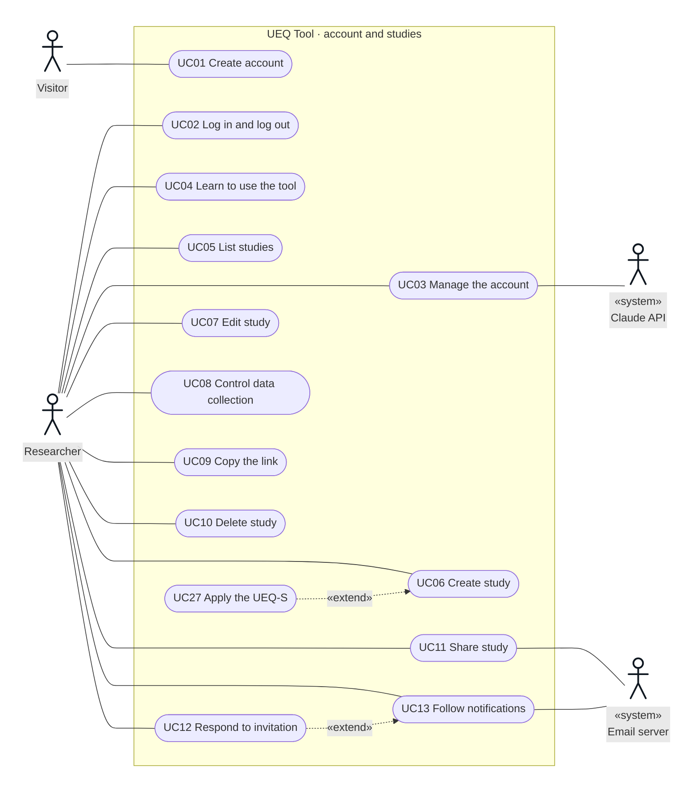
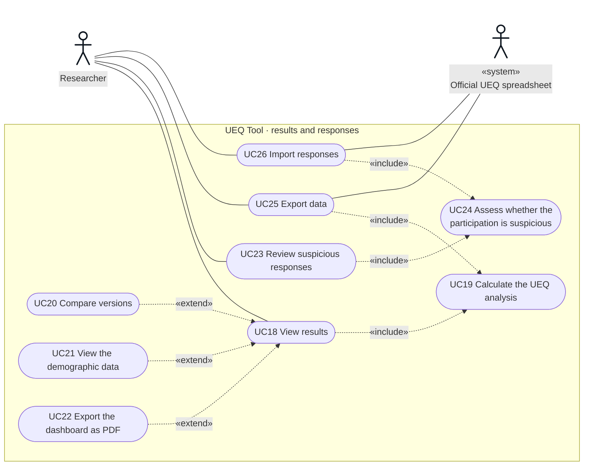
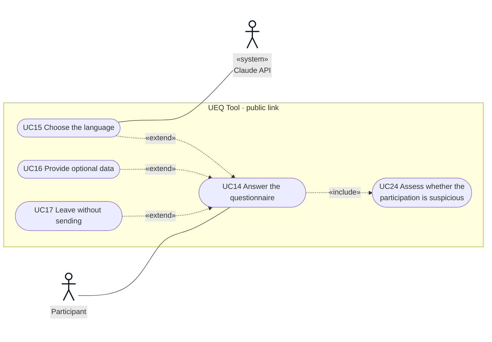
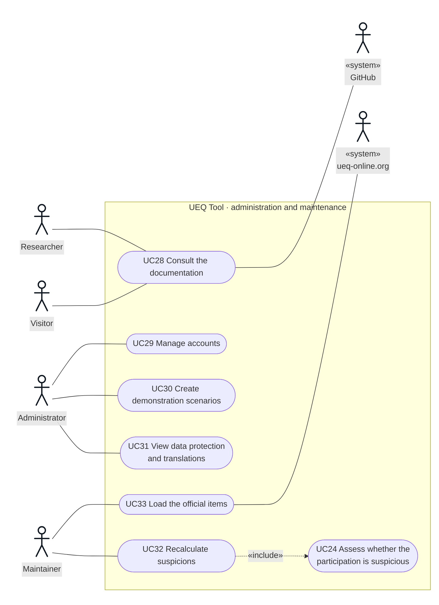
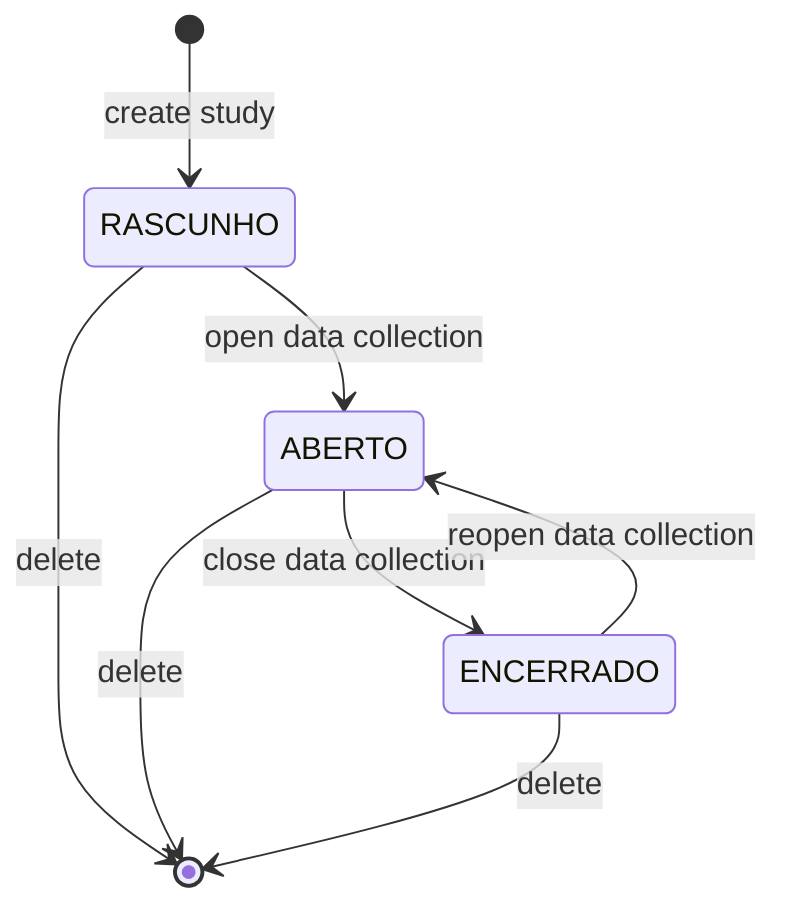

# Casos de uso

33 casos de uso describen lo que cada actor hace con la Herramienta UEQ. Los diagramas siguen la notación UML de casos de uso, dibujada en Mermaid para que se muestre directamente en GitHub:

- el muñeco es el actor. Los primarios, que inician el caso de uso, están a la izquierda; los secundarios, que participan sin iniciarlo, están a la derecha. Cuando el actor es otro sistema, su nombre lleva «sistema»;
- la forma redondeada es el caso de uso;
- el marco es el límite del sistema;
- la línea continua une al actor con el caso de uso en el que participa;
- la flecha discontinua «include» apunta a un caso de uso que siempre ocurre junto con él;
- la flecha discontinua «extend» sale de un caso de uso opcional y apunta al caso de uso que extiende.

Justo debajo de cada diagrama están la herramienta utilizada, el archivo fuente para descargar y la versión de la herramienta que representa. La relación de cada caso de uso con los requisitos está en la [lista](#lista) y en la [matriz de trazabilidad](matriz-rastreabilidade.md#casos-de-uso).

## Actores

| Actor | Quién es | Personas |
|---|---|---|
| Visitante | Persona sin cuenta, o que todavía no ha iniciado sesión. Lee la página de inicio y la documentación y puede crear una cuenta | [PE08](personas.md#pe08) y cualquier investigador antes de registrarse |
| Investigador | Tiene cuenta y sesión. Es propietario de los estudios que crea y puede ser Editor o Lector de los estudios que otra persona ha compartido con él | [PE01](personas.md#pe01), [PE02](personas.md#pe02), [PE03](personas.md#pe03) |
| Participante | Responde a través del enlace público. No tiene cuenta y nunca necesita sesión | [PE04](personas.md#pe04), [PE05](personas.md#pe05), [PE06](personas.md#pe06), [PE07](personas.md#pe07) |
| Administrador | Investigador con la marca de administrador: hace todo lo que hace el investigador y abre la página Administración. No ve los estudios de otras personas | [PE08](personas.md#pe08) |
| Mantenedor | Quien ejecuta los comandos de la instalación: migrations, seed y recálculo | [PE08](personas.md#pe08) |

Actores secundarios, que participan en un caso de uso sin iniciarlo:

| Actor secundario | Dónde participa | Qué intercambia con la herramienta |
|---|---|---|
| Servidor de correo electrónico «sistema» | [UC11](#uc11) Compartir estudio, [UC13](#uc13) Seguir las notificaciones | Entrega la invitación y las notificaciones por correo electrónico, cuando el envío está configurado |
| API de Claude «sistema» | [UC03](#uc03) Gestionar la cuenta, [UC15](#uc15) Elegir el idioma | Traduce la interfaz del investigador y el título, el producto y el objetivo del estudio. Nunca traduce el cuestionario |
| Hoja oficial del UEQ «sistema» | [UC25](#uc25) Exportar datos, [UC26](#uc26) Importar respuestas | Recibe las respuestas rellenadas en la propia hoja (UEQ Data Analysis Tool) y es el origen del CSV importado |
| GitHub «sistema» | [UC28](#uc28) Consultar la documentación | Guarda el archivo de cada documento, que se abre con el enlace Ver en GitHub |
| ueq-online.org «sistema» | [UC33](#uc33) Cargar los ítems oficiales | Fuente de los términos, las instrucciones y el benchmark oficiales copiados en `data/` |

El Participante es siempre actor primario: inicia su propio caso de uso a través del enlace y no participa en los casos de uso de otros actores.

## Diagrama 1 · Cuenta y estudios

**Herramienta del diagrama:** Mermaid 12.2.0 (`flowchart`), generado por `pnpm docs:diagramas`. **Archivo fuente:** [casos-de-uso-1.mmd](fontes/casos-de-uso-1.mmd). **Versión representada:** Herramienta UEQ del 17/11/2026.

UC12 extiende UC13 porque la invitación llega como notificación: aceptarla o rechazarla es una elección opcional de quien abre la campana. UC27 extiende UC06 porque elegir el UEQ-S es una opción de quien crea el estudio; sin ella, el estudio usa el UEQ completo.

## Diagrama 2 · Resultados y respuestas

**Herramienta del diagrama:** Mermaid 12.2.0 (`flowchart`), generado por `pnpm docs:diagramas`. **Archivo fuente:** [casos-de-uso-2.mmd](fontes/casos-de-uso-2.mmd). **Versión representada:** Herramienta UEQ del 17/11/2026.

UC19 y UC24 no tienen actor: solo ocurren dentro de otro caso de uso. Ambos son las funciones puras del módulo de cálculo ([diagrama de clases](diagrama-de-classes.md#2-módulo-de-cálculo)).

## Diagrama 3 · Participante

**Herramienta del diagrama:** Mermaid 12.2.0 (`flowchart`), generado por `pnpm docs:diagramas`. **Archivo fuente:** [casos-de-uso-3.mmd](fontes/casos-de-uso-3.mmd). **Versión representada:** Herramienta UEQ del 17/11/2026.

La API de Claude solo interviene en UC15 para traducir el título, el producto y el objetivo escritos por el investigador. Los 26 ítems, la instrucción y los textos de las pantallas del participante proceden de los archivos oficiales y revisados, nunca de la API.

## Diagrama 4 · Administración, mantenimiento y documentación

**Herramienta del diagrama:** Mermaid 12.2.0 (`flowchart`), generado por `pnpm docs:diagramas`. **Archivo fuente:** [casos-de-uso-4.mmd](fontes/casos-de-uso-4.mmd). **Versión representada:** Herramienta UEQ del 17/11/2026.

El Administrador es un Investigador con un permiso adicional, por eso también realiza todos los casos de uso del Investigador de los diagramas 1 y 2. El Mantenedor no usa la interfaz: ejecuta comandos en el terminal de la instalación.

## Lista

| ID | Caso de uso | Actor primario | Requisitos | Relaciones |
|---|---|---|---|---|
| [UC01](#uc01) | Crear cuenta | Visitante | [RF01](requisitos.md#rf01), [RF08](requisitos.md#rf08) | — |
| [UC02](#uc02) | Entrar y salir | Investigador | [RF02](requisitos.md#rf02), [RF03](requisitos.md#rf03), [RF11](requisitos.md#rf11) | — |
| [UC03](#uc03) | Gestionar la cuenta | Investigador | [RF04](requisitos.md#rf04), [RF05](requisitos.md#rf05), [RF06](requisitos.md#rf06), [RF07](requisitos.md#rf07), [RF08](requisitos.md#rf08), [RF23](requisitos.md#rf23) | — |
| [UC04](#uc04) | Aprender a usar la herramienta | Investigador | [RF09](requisitos.md#rf09), [RF10](requisitos.md#rf10) | — |
| [UC05](#uc05) | Listar estudios | Investigador | [RF12](requisitos.md#rf12) | — |
| [UC06](#uc06) | Crear estudio | Investigador | [RF13](requisitos.md#rf13), [RF18](requisitos.md#rf18), [RF19](requisitos.md#rf19) | extendido por UC27 |
| [UC07](#uc07) | Editar estudio | Investigador | [RF14](requisitos.md#rf14) | — |
| [UC08](#uc08) | Controlar la recogida | Investigador | [RF15](requisitos.md#rf15) | — |
| [UC09](#uc09) | Copiar el enlace | Investigador | [RF16](requisitos.md#rf16) | — |
| [UC10](#uc10) | Eliminar estudio | Investigador | [RF17](requisitos.md#rf17) | — |
| [UC11](#uc11) | Compartir estudio | Investigador | [RF20](requisitos.md#rf20) | — |
| [UC12](#uc12) | Responder a la invitación | Investigador | [RF21](requisitos.md#rf21) | extiende UC13 |
| [UC13](#uc13) | Seguir las notificaciones | Investigador | [RF22](requisitos.md#rf22), [RF23](requisitos.md#rf23) | extendido por UC12 |
| [UC14](#uc14) | Responder al cuestionario | Participante | [RF24](requisitos.md#rf24), [RF25](requisitos.md#rf25), [RF26](requisitos.md#rf26), [RF27](requisitos.md#rf27), [RF28](requisitos.md#rf28), [RF29](requisitos.md#rf29), [RF30](requisitos.md#rf30), [RF33](requisitos.md#rf33) | incluye UC24; extendido por UC15, UC16, UC17 |
| [UC15](#uc15) | Elegir el idioma | Participante | [RF34](requisitos.md#rf34), [RF35](requisitos.md#rf35) | extiende UC14 |
| [UC16](#uc16) | Facilitar datos opcionales | Participante | [RF32](requisitos.md#rf32) | extiende UC14 |
| [UC17](#uc17) | Salir sin enviar | Participante | [RF31](requisitos.md#rf31) | extiende UC14 |
| [UC18](#uc18) | Ver resultados | Investigador | [RF43](requisitos.md#rf43), [RF44](requisitos.md#rf44), [RF45](requisitos.md#rf45), [RF46](requisitos.md#rf46), [RF48](requisitos.md#rf48), [RF49](requisitos.md#rf49) | incluye UC19; extendido por UC20, UC21, UC22 |
| [UC19](#uc19) | Calcular el análisis UEQ | — | [RF36](requisitos.md#rf36), [RF37](requisitos.md#rf37), [RF38](requisitos.md#rf38), [RF39](requisitos.md#rf39), [RF40](requisitos.md#rf40), [RF41](requisitos.md#rf41), [RF42](requisitos.md#rf42) | incluido por UC18, UC25 |
| [UC20](#uc20) | Comparar versiones | Investigador | [RF47](requisitos.md#rf47) | extiende UC18 |
| [UC21](#uc21) | Ver los datos demográficos | Investigador | [RF50](requisitos.md#rf50) | extiende UC18 |
| [UC22](#uc22) | Exportar el panel en PDF | Investigador | [RF60](requisitos.md#rf60) | extiende UC18 |
| [UC23](#uc23) | Revisar respuestas sospechosas | Investigador | [RF52](requisitos.md#rf52), [RF53](requisitos.md#rf53), [RF54](requisitos.md#rf54) | incluye UC24 |
| [UC24](#uc24) | Evaluar si la participación es sospechosa | — | [RF51](requisitos.md#rf51) | incluido por UC14, UC23, UC26, UC32 |
| [UC25](#uc25) | Exportar datos | Investigador | [RF56](requisitos.md#rf56), [RF57](requisitos.md#rf57), [RF58](requisitos.md#rf58), [RF59](requisitos.md#rf59) | incluye UC19 |
| [UC26](#uc26) | Importar respuestas | Investigador | [RF61](requisitos.md#rf61) | incluye UC24 |
| [UC27](#uc27) | Aplicar el UEQ-S | Investigador | [RF62](requisitos.md#rf62) | extiende UC06 |
| [UC28](#uc28) | Consultar la documentación | Visitante o Investigador | [RF63](requisitos.md#rf63), [RF64](requisitos.md#rf64), [RF65](requisitos.md#rf65) | — |
| [UC29](#uc29) | Gestionar cuentas | Administrador | [RF66](requisitos.md#rf66) | — |
| [UC30](#uc30) | Crear escenarios de demostración | Administrador | [RF67](requisitos.md#rf67) | — |
| [UC31](#uc31) | Ver protección de datos y traducciones | Administrador | [RF68](requisitos.md#rf68) | — |
| [UC32](#uc32) | Recalcular sospechas | Mantenedor | [RF55](requisitos.md#rf55) | incluye UC24 |
| [UC33](#uc33) | Cargar los ítems oficiales | Mantenedor | [RNF10](requisitos.md#rnf10) | — |

## Especificaciones

Los casos de uso centrales tienen especificación completa: actor, precondiciones, poscondiciones, flujo principal y flujos alternativos. Los demás, por ser cortos, tienen solo el flujo principal. Los nombres de los botones son los que muestra la interfaz en español.

### UC14

**Responder al cuestionario**

| | |
|---|---|
| Actor | Participante |
| Objetivo | Responder a los 26 ítems del UEQ sobre una versión del producto, de forma anónima |
| Precondiciones | El estudio existe, la recogida está abierta y el participante tiene el enlace `/r/<slug>` |
| Poscondiciones de éxito | Existe una participación concluida, con 26 respuestas de 1 a 7, el idioma, la versión asignada, la sospecha evaluada y, en su caso, la marca de menor de edad |
| Poscondiciones de abandono | Ninguna respuesta guardada; la participación iniciada y no enviada se elimina en un plazo de 2 días |
| Pantallas | p1 consentimiento, p2 y p7 cuestionario, p3 ítem pendiente, p4 datos opcionales, p5 fin, p6 enlace cerrado |

Flujo principal:

1. El participante abre el enlace. El sistema elige el idioma del estudio (o el del navegador, cuando el estudio lo permite) y muestra el formulario de consentimiento: objetivo, tiempo estimado, qué ocurre después del envío, riesgos, beneficios, conservación de los datos, participación voluntaria y anónima, quién es responsable de la investigación y el contacto.
2. El participante indica su edad y hace clic en "Estoy de acuerdo y quiero participar".
3. El sistema asigna la versión con menos respuestas concluidas, crea la participación con la fecha del consentimiento y el idioma y guarda la participación en una cookie restringida al enlace.
4. El sistema muestra la instrucción oficial y los 26 ítems en el orden y la polaridad oficiales, ninguno marcado, con el pie "0 de 26 respondidos" y "Salir sin enviar".
5. El participante marca una posición en cada ítem. El pie actualiza el contador, y las marcas se guardan en la pestaña del navegador.
6. El participante hace clic en "Enviar respuestas".
7. El sistema comprueba los 26 valores, evalúa la sospecha (UC24) y guarda las respuestas y la conclusión en una transacción. Marca el enlace como respondido en ese navegador.
8. Si el estudio recoge datos demográficos, el sistema muestra la etapa de datos opcionales (UC16).
9. El sistema muestra la página final: las respuestas se han registrado y la persona puede cerrar la página.

Flujos alternativos:

- **1a. Estudio en borrador o cerrado.** El sistema explica la situación ("todavía no está abierto", "la recogida de respuestas ha terminado") y no ofrece el formulario.
- **1b. Enlace ya respondido en este navegador.** El sistema indica que las respuestas ya se han registrado.
- **1c. Otro idioma.** El participante lo elige en el selector (UC15).
- **1d. Política de privacidad.** El participante abre la política desde el formulario, dentro del propio enlace, y vuelve al formulario.
- **1e. Copia del formulario.** El participante imprime o guarda en PDF una copia del formulario de consentimiento.
- **2a. No quiero participar.** El participante sale sin que se guarde nada.
- **2b. Sin edad.** El sistema pide la edad y no guarda nada.
- **2c. Menor de 18 años.** El sistema pide la confirmación de que el padre, la madre o el tutor legal lo ha autorizado. Sin ella, no guarda nada; con ella, guarda la participación con la marca de menor de edad.
- **4a. Participación en curso.** Quien ya dio su consentimiento y vuelve al enlace va directamente al cuestionario.
- **5a. Recargar la página.** El sistema recupera los ítems marcados y lo avisa.
- **5b. Salir sin enviar (UC17).**
- **7a. Ítems pendientes.** El sistema no guarda nada, muestra el resumen "Faltan N ítems" con un enlace a cada ítem y lleva el foco al resumen. Vuelve al paso 5.
- **7b. La recogida se cerró durante la respuesta.** El sistema avisa de que el estudio ya no acepta respuestas.

Reglas: [RNF09](requisitos.md#rnf09) (cuestionario sin sesgo de interfaz), [RNF10](requisitos.md#rnf10) (términos oficiales) y [RNF12](requisitos.md#rnf12) (anonimato). El camino desde el clic hasta la base de datos está en el [diagrama de secuencia 2](diagramas-de-sequencia.md#2-responder-o-questionário).

### UC06

**Crear estudio**

| | |
|---|---|
| Actor | Investigador |
| Precondiciones | Sesión válida |
| Poscondiciones | Estudio en RASCUNHO (borrador), con enlace público único, de 1 a 6 versiones numeradas, idioma, responsable, riesgos y beneficios |

Flujo principal:

1. El investigador hace clic en "Crear estudio".
2. El sistema muestra el formulario en secciones numeradas, con la vista previa del formulario de consentimiento del participante al lado. Nombre, correo electrónico de contacto e institución vienen rellenados a partir de la cuenta y del último estudio; riesgos y beneficios vienen con un texto sugerido.
3. El investigador indica título, producto evaluado, objetivo, periodo de recogida e idioma. El sistema sugiere el producto como nombre de la primera versión.
4. El investigador añade o renombra versiones y decide si el enlace recoge datos demográficos (desactivado por defecto).
5. El investigador hace clic en "Crear estudio". El botón muestra que está procesando e ignora nuevos clics.
6. El sistema valida, genera el enlace público y guarda el estudio con las versiones.
7. El sistema abre la página del estudio en borrador, con la confirmación y la lista "Antes de abrir, compruebe".

Flujos alternativos:

- **6a. Datos no válidos.** El sistema muestra el resumen de errores con un enlace a cada campo, lleva el foco al resumen y marca cada campo con el mensaje. Vuelve al paso 3.
- **3a. UEQ-S (UC27).** En Cuestionario, el investigador elige UEQ-S, versión corta. El formulario indica qué cambia (cuestionario, tiempo en el formulario de consentimiento, panel y hoja exportada) y que la elección se bloquea con la primera respuesta.

### UC08

**Controlar la recogida**

| | |
|---|---|
| Actor | Investigador (propietario o Editor) |
| Precondiciones | Sesión válida y estudio del investigador o compartido con él como Editor |
| Poscondiciones | Estado del estudio cambiado; el enlace pasa a aceptar o rechazar respuestas |

Flujo principal:

1. En la página del estudio en RASCUNHO, el investigador hace clic en "Abrir recogida".
2. El sistema cambia el estado a ABERTO y anuncia "Recogida abierta. El enlace ya acepta respuestas."
3. Más tarde, el investigador hace clic en "Cerrar recogida". El sistema lo cambia a ENCERRADO; el enlace pasa a indicar que la recogida de respuestas ha terminado.

Flujos alternativos:

- **3a. Reabrir.** Con el estudio cerrado, "Reabrir recogida" lo devuelve a ABERTO. Como es reversible, cerrar no pide confirmación.
- **2a. El estado cambió en otra pestaña.** El sistema rechaza la transición y pide recargar.

**Herramienta del diagrama:** Mermaid 12.2.0 (`stateDiagram-v2`), generado por `pnpm docs:diagramas`. **Archivo fuente:** [casos-de-uso-5.mmd](fontes/casos-de-uso-5.mmd). **Versión representada:** Herramienta UEQ del 17/11/2026.

### UC11

**Compartir estudio**

| | |
|---|---|
| Actor | Investigador propietario del estudio |
| Actor secundario | Servidor de correo electrónico |
| Precondiciones | Sesión válida, estudio del propio investigador y la persona invitada ya tiene cuenta |
| Poscondiciones | Colaboración PENDENTE (pendiente) con el rol elegido y una notificación de invitación para la persona invitada |

Flujo principal:

1. En la página del estudio, el propietario hace clic en "Compartir".
2. El sistema abre la ventana con el equipo actual y el campo de invitación.
3. El propietario indica el correo electrónico de la persona, elige Editor o Lector y confirma.
4. El sistema crea la colaboración pendiente, crea la notificación en la campana de la persona y, si el envío está configurado y la persona no lo ha desactivado, envía el correo electrónico en su idioma.
5. El sistema confirma la invitación en la ventana.

Flujos alternativos:

- **3a. Correo electrónico sin cuenta.** El sistema indica que la persona necesita crear una cuenta antes.
- **3b. La persona ya está en el equipo.** El sistema avisa y no duplica la invitación.
- **3c. Cambiar el rol o quitar.** El propietario cambia el rol de alguien, cancela una invitación o quita a la persona del equipo; quien sale recibe un aviso.
- **3d. Salir del estudio.** Quien fue invitado también puede salir del estudio; el propietario recibe un aviso.
- **1a. Quien no es propietario.** Editor y Lector ven el equipo, pero no invitan.

### UC18

**Ver resultados**

| | |
|---|---|
| Actor | Investigador (propietario, Editor o Lector) |
| Precondiciones | Sesión válida y acceso al estudio |
| Poscondiciones | Ninguna: el caso de uso solo lee |

Flujo principal:

1. El investigador abre la pestaña Resultados del estudio.
2. El sistema obtiene las participaciones concluidas y calcula el análisis de las que están en el análisis, para todas las versiones y para cada una (UC19).
3. El sistema muestra el resumen de la recogida, la lectura rápida, el gráfico de las 6 escalas con benchmark e IC95, la tabla equivalente, las medias pragmática y hedónica, el gráfico por ítem y la sección Exportar.
4. El investigador abre las explicaciones de los términos cuando lo necesita.

Flujos alternativos:

- **2a. Nadie en el análisis.** El sistema muestra "Todavía no hay respuestas en el análisis." en lugar de los gráficos.
- **3a. Muestra pequeña o alfa inferior a 0,7.** El sistema muestra el aviso con lo que significa y lo que conviene hacer.
- **3b. Otra versión.** El investigador elige otra versión; la dirección guarda la elección.
- **3c. Comparar versiones (UC20).** Con más de una versión, el investigador cambia a "Comparar versiones".
- **3d. Datos demográficos (UC21).** Cuando el estudio los recoge, la subpestaña muestra el perfil de quienes respondieron.
- **3e. Panel en PDF (UC22).**

### UC23

**Revisar respuestas sospechosas**

| | |
|---|---|
| Actor | Investigador (propietario o Editor para cambiar; el Lector solo ve) |
| Precondiciones | Sesión válida y acceso al estudio |
| Poscondiciones | Participaciones marcadas como dentro o fuera del análisis; ninguna respuesta eliminada |

Flujo principal:

1. El investigador abre la pestaña Respuestas.
2. El sistema muestra el panorama (en el análisis, fuera del análisis, sospechosas), la tabla de participaciones con el motivo de la sospecha y la regla de sospecha al lado.
3. El investigador marca "Mostrar solo sospechosas" y abre "Ver escalas" en una fila.
4. El sistema muestra la amplitud de cada escala y destaca las que superaron el umbral.
5. El investigador hace clic en "Quitar sospechosas del análisis".
6. El sistema marca las sospechosas como fuera del análisis, sin eliminar nada, y anuncia cuántas salieron.

Flujos alternativos:

- **5a. Una a una.** El investigador desmarca "En el análisis" en una fila. Marcarla de nuevo devuelve la participación.

### UC25

**Exportar datos**

| | |
|---|---|
| Actor | Investigador (propietario, Editor o Lector) |
| Actor secundario | Hoja oficial del UEQ |
| Precondiciones | Sesión válida y acceso al estudio |
| Poscondiciones | Ninguna en la base de datos; el navegador recibe el archivo |

Flujo principal:

1. En la sección Exportar del panel, el investigador elige uno de los cuatro archivos: respuestas brutas, respuestas recodificadas, resultados por escala (los tres en CSV) o la hoja oficial del UEQ (XLSX).
2. El sistema comprueba la sesión y el acceso al estudio, monta el CSV (con BOM, `;` y coma decimal) y lo devuelve como descarga, con el nombre `ueq_<titulo>_<tipo>_<aaaa-mm-dd>.csv`.
3. En la hoja oficial, el sistema rellena la propia UEQ Data Analysis Tool V15 con las participaciones en el análisis de la versión elegida en el panel (o del estudio entero), a partir de Data!A4, en el idioma de la interfaz, y devuelve `ueq_<titulo>_planilha-oficial[_<versao>]_<aaaa-mm-dd>.xlsx`.
4. El investigador abre la hoja en Excel y hace clic en Habilitar edición: la hoja se recalcula con sus propias fórmulas, y el investigador compara los números con los del panel.

Alternativo: **2a.** Sin sesión o sin acceso al estudio, no se devuelve nada. **3a.** La selección tiene más de 1000 participaciones, el máximo de la hoja oficial: en lugar del enlace, el panel lo explica y sugiere elegir una versión o usar las respuestas brutas.

### UC26

**Importar respuestas**

| | |
|---|---|
| Actor | Investigador (propietario o Editor) |
| Actor secundario | Hoja oficial del UEQ |
| Precondiciones | Sesión válida, acceso de edición al estudio y un CSV con 26 valores de 1 a 7 por fila |
| Poscondiciones | Una participación concluida por fila, con origen IMPORTADA (importada), sin idioma y con la sospecha evaluada; o nada, si hay un error |

Flujo principal:

1. En Respuestas, el investigador hace clic en "Importar respuestas desde un CSV".
2. El investigador elige la versión (cuando hay más de una) y el archivo, y hace clic en "Ver vista previa".
3. El sistema lee el archivo sin guardar y muestra las primeras filas y el total.
4. El investigador confirma.
5. El sistema guarda todas las filas en una transacción, evaluando la sospecha de cada una (UC24), y vuelve a Respuestas con el aviso de cuántas se importaron.

Flujos alternativos:

- **3a. Filas con errores.** El sistema enumera el problema de cada fila (número de valores, valor fuera de 1 a 7) y no ofrece la confirmación.
- **3b. Archivo no válido.** Extensión incorrecta, vacío o demasiado grande: el sistema indica qué hacer.

### Demás casos de uso

#### UC01

Crear cuenta. El visitante hace clic en "Crear cuenta", que se abre en una ventana sobre la página. Indica nombre, correo electrónico, contraseña (con las reglas visibles antes de escribir) y el idioma de la herramienta. El sistema valida, guarda la contraseña con bcrypt, crea la sesión y confirma. Alternativo: un correo electrónico ya registrado muestra el error con un enlace a Entrar.

#### UC02

Entrar y salir. El investigador hace clic en "Entrar", que se abre en una ventana sobre la página, e indica correo electrónico y contraseña. El sistema los comprueba, crea la sesión y vuelve a la página solicitada, si la hay. Salir pide confirmación en una ventana y elimina la sesión. Alternativos: una contraseña incorrecta muestra el error sin decir cuál de los dos campos es incorrecto; después de 5 contraseñas incorrectas en 15 minutos, el correo electrónico debe esperar antes de intentarlo de nuevo.

#### UC03

Gestionar la cuenta. En Mi cuenta, el investigador guarda nombre y correo electrónico, cambia la contraseña (lo que cierra las demás sesiones), elige el idioma de la herramienta, activa o desactiva las notificaciones por correo electrónico, descarga los datos de la cuenta en JSON o elimina la cuenta escribiendo el correo electrónico. El idioma también se cambia con el selector de la barra. Los textos de la interfaz que todavía no están traducidos al idioma elegido se solicitan a la API de Claude y se guardan.

#### UC04

Aprender a usar la herramienta. En el primer acceso, el sistema abre el recorrido guiado en las pantallas reales; la persona avanza realizando la acción, lo omite o lo cierra. En cualquier página, el (?) de la cabecera abre la ayuda de esa página, desde donde se puede volver a ver el recorrido.

#### UC05

Listar estudios. El sistema muestra la tabla de los estudios del investigador y, en otra sección, los compartidos con él, con título, producto, estado, versiones, respuestas y última respuesta. El título lleva a la página del estudio.

#### UC07

Editar estudio. Igual que UC06, con los datos rellenados. Con la recogida abierta, no se puede quitar una versión que ya tiene respuestas. Los colaboradores del estudio reciben un aviso del cambio.

#### UC09

Copiar el enlace. El investigador hace clic en "Copiar enlace"; el sistema copia la dirección pública y anuncia que la ha copiado.

#### UC10

Eliminar estudio. Solo el propietario elimina. El investigador abre "Eliminar estudio", lee cuántas respuestas se eliminan con él y escribe el título. El sistema elimina en cascada versiones, participaciones, respuestas y colaboraciones y vuelve a la lista.

#### UC12

Responder a la invitación. En la campana, la persona invitada acepta o rechaza la invitación. Si la acepta, el estudio aparece en "Compartidos con usted"; si la rechaza, quien la invitó recibe un aviso.

#### UC13

Seguir las notificaciones. La campana muestra cuántas notificaciones no se han leído: invitaciones, respuestas nuevas (agrupadas mientras no se leen) y cambios realizados por los colaboradores. Abrir una notificación lleva a su lugar y la marca como leída. Cada notificación también se envía por correo electrónico cuando el envío está configurado y la persona no lo ha desactivado.

#### UC15

Elegir el idioma. En el formulario de consentimiento o en el cuestionario, el participante elige el idioma en el selector y hace clic en "Aplicar". El sistema guarda la elección en una cookie del enlace, ajusta `lang` y `dir` (de derecha a izquierda en árabe, hebreo y persa), conserva las marcas ya hechas y muestra el aviso cuando la traducción del UEQ no ha sido aprobada por los autores. El título, el producto y el objetivo del estudio aparecen traducidos por la API de Claude; sin traducción, se quedan en el original.

#### UC16

Facilitar datos opcionales. El participante responde franja de edad, género, nivel de estudios y familiaridad con el producto, todas con "Prefiero no responder", o hace clic en "Saltar esta etapa". Solo se guardan opciones de la lista, cifradas.

#### UC17

Salir sin enviar. El participante hace clic en "Salir sin enviar" y confirma en la ventana. El sistema no guarda ninguna respuesta y muestra la página de salida.

#### UC19

Calcular el análisis UEQ. El sistema recodifica las respuestas de -3 a +3, calcula por escala n, media, desviación estándar, IC95, alfa de Cronbach e interpretación, clasifica según el benchmark y calcula la calidad pragmática, la hedónica y cada ítem. Solo las participaciones en el análisis entran en las estadísticas. Las fórmulas están en el [Protocolo UEQ](../ueq-protocolo.md) y se comprobaron a mano en la [verificación del cálculo](verificacao-do-calculo.md).

#### UC20

Comparar versiones. El investigador elige "Comparar versiones". El sistema muestra un marcador de forma diferente para cada versión en cada escala y la lectura de las mayores diferencias.

#### UC21

Ver los datos demográficos. En la subpestaña Datos demográficos, el sistema muestra cada pregunta en un gráfico con la tabla de los números, separando a quienes prefirieron no responder y a quienes saltaron la etapa, con filtro por versión.

#### UC22

Exportar el panel en PDF. El investigador hace clic en "Panel en PDF". El sistema abre la página de impresión en un navegador sin interfaz gráfica, con la misma versión y el mismo modo, y devuelve un PDF A4 con título, n y fecha en la cabecera.

#### UC24

Evaluar si la participación es sospechosa. Con los 26 valores, el sistema calcula la amplitud por escala y el número de respuestas iguales y marca la participación como sospechosa si supera los umbrales de `data/protocolo.json` (3 o más escalas con amplitud mayor que 3, o más de 15 respuestas iguales).

#### UC27

Aplicar el UEQ-S. Al crear el estudio, el investigador elige entre el UEQ completo y el UEQ-S (8 ítems: calidad pragmática, hedónica y global). El participante responde a los 8 pares, con el término negativo siempre a la izquierda; las respuestas se guardan en los ítems equivalentes del UEQ. Los resultados muestran el UEQ-S en una pestaña propia, con su benchmark y su hoja oficial. Alternativo: con el estudio ya respondido, la edición muestra la elección bloqueada y el motivo, y el servidor rechaza el cambio.

#### UC28

Consultar la documentación. Cualquier persona, con o sin cuenta, abre /documentacao; el investigador también llega a través del enlace Documentación de la barra. El sistema muestra las secciones en pestañas y, en cada sección, un documento por subpestaña, leído del `.md` del repositorio, con los diagramas como imágenes que se abren a pantalla completa y la ficha que indica qué es el documento, para qué sirve, quién debe leerlo, el archivo en GitHub y las descargas. Un documento largo se abre como índice, y cada sección tiene su propia página. Alternativo: una dirección fuera del catálogo lleva a la página de no encontrado.

#### UC29

Gestionar cuentas. En Administración › Cuentas, el administrador ve las cuentas, con la cantidad de estudios de cada una, crea una cuenta para otra persona y concede o retira la marca de administrador. Quien no es administrador no puede abrir la página.

#### UC30

Crear escenarios de demostración. En Administración › Escenarios, el administrador elige un escenario, y el sistema crea en su cuenta un estudio con respuestas inventadas coherentes con el perfil del escenario.

#### UC31

Ver protección de datos y traducciones. En Administración › Protección de datos, el sistema muestra si la clave de cifrado y el envío de correo electrónico están configurados; en Administración › Idiomas, cuánto de cada idioma de la interfaz ya se ha traducido.

#### UC32

Recalcular sospechas. Después de cambiar `data/protocolo.json`, el mantenedor ejecuta `pnpm suspeitas:recalcular`. El sistema vuelve a evaluar todas las participaciones concluidas (UC24).

#### UC33

Cargar los ítems oficiales. El mantenedor ejecuta `pnpm db:seed`. El sistema valida `data/ueq-itens-ptbr.json`, copiado del paquete oficial de ueq-online.org, y guarda los 26 ítems; si algo está mal, se detiene e indica qué ítem.
