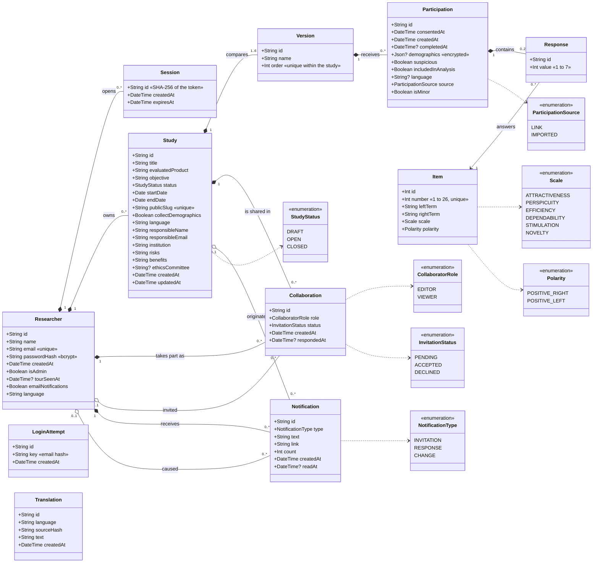

# Diagrama de clases

Dos diagramas describen la estructura estática de la Herramienta UEQ:

1. **Modelo de dominio:** las 11 entidades guardadas en PostgreSQL y los 7 tipos enumerados, tal como están en [`prisma/schema.prisma`](../../prisma/schema.prisma).
2. **Módulo de cálculo:** los tipos y las funciones de [`src/ueq/`](../../src/ueq/), que transforman respuestas en resultados sin tocar la base de datos.

Los diagramas están en inglés en todos los idiomas de la documentación. En el código y en las explicaciones de abajo, los nombres son los del código, en portugués y sin tilde: Researcher es `Pesquisador`, Study es `Estudo`, Version es `Versao`, Participation es `Participacao` y Response es `Resposta`. Los tipos siguen TypeScript: `?` marca un campo que puede estar vacío y `[]` marca una lista. Las tablas, columnas, claves y reglas de eliminación de la base de datos, campo por campo, están en el [modelo lógico](modelo-logico.md); este documento muestra las mismas entidades como clases, con las asociaciones y la multiplicidad de cada una.

Justo debajo de cada diagrama están la herramienta utilizada, el archivo fuente para descargar y la versión de la herramienta que representa.

## 1. Modelo de dominio

**Herramienta del diagrama:** Mermaid 12.2.0 (`classDiagram`), generado por `pnpm docs:diagramas`. **Archivo fuente:** [diagrama-de-classes-1.mmd](fontes/diagrama-de-classes-1.mmd). **Versión representada:** Herramienta UEQ del 17/11/2026.

### Lectura

- **La composición (rombo relleno)** es eliminación en cascada en la base de datos. Borrar al investigador borra sus sesiones, sus estudios, las colaboraciones en las que participa y las notificaciones que recibió ([RF06](requisitos.md#rf06)). Borrar el estudio borra versiones, participaciones, respuestas y colaboraciones ([RF17](requisitos.md#rf17)).
- **La agregación (rombo vacío)** es una referencia que queda vacía cuando se borra el otro lado: si quien invitó elimina su cuenta, la colaboración continúa, sin el nombre de quien invitó; si el estudio o el autor de una notificación desaparece, la notificación sigue en la campana de quien la recibió.
- **Item** no pertenece a nadie: los 26 ítems los carga el seed a partir del paquete oficial ([RNF10](requisitos.md#rnf10)) y los comparten todos los estudios. Una respuesta apunta al ítem; borrar la respuesta no borra el ítem.
- **Versao** tiene de 1 a 6 por estudio. El orden es único dentro del estudio y define el orden en pantalla y el desempate en la distribución de los participantes ([RF26](requisitos.md#rf26)).
- **Participacao** nace con el consentimiento, sin respuestas, y solo recibe las 26 respuestas y `concluidaEm` en el envío ([RF25](requisitos.md#rf25), [RF33](requisitos.md#rf33)). Por eso la multiplicidad es 0..26: cero mientras está en curso, 26 después de concluida. La que no se concluye en 2 días se borra ([RNF13](requisitos.md#rnf13)).
- **Resposta** guarda el valor bruto de 1 (polo izquierdo) a 7 (polo derecho), con `CHECK` en la base de datos y unicidad por participación e ítem. La recodificación a -3…+3 ocurre en el cálculo, nunca en la base de datos.
- **Participacao.idioma** es el código del idioma (`pt`, `es`, `ar`…); queda vacío en las importadas, porque el CSV no indica el idioma ([RF61](requisitos.md#rf61)). **Participacao.demografia** guarda los cuatro rangos opcionales, cifrados con AES-256-GCM cuando la clave está configurada ([RNF14](requisitos.md#rnf14)). **Participacao.menorDeIdade** registra que la persona confirmó la autorización de su representante legal ([RF25](requisitos.md#rf25)).
- **Colaboracao** vincula un estudio a otra cuenta, como Editor o Lector. Hay como máximo una por estudio y persona, y el estudio solo aparece para la persona invitada después de ACEITO (aceptada) ([RF20](requisitos.md#rf20), [RF21](requisitos.md#rf21)).
- **Notificacao** es lo que muestra la campana. Las de tipo RESPOSTA (respuesta) se suman en `quantidade` mientras no se leen ([RF22](requisitos.md#rf22)).
- **TentativaAcesso** y **Traducao** no se vinculan con ninguna otra entidad. La primera guarda solo el hash del correo electrónico de cada inicio de sesión fallido ([RNF16](requisitos.md#rnf16)); la segunda guarda cada texto ya traducido por la API, por el hash del original y por el idioma ([RF08](requisitos.md#rf08), [RF35](requisitos.md#rf35)).
- **Sessao.id** es el hash SHA-256 del token de la cookie: quien lee la base de datos no puede armar una cookie válida ([RNF15](requisitos.md#rnf15)).
- Nada en el modelo identifica al participante: no hay nombre, correo electrónico, IP ni user-agent ([RNF12](requisitos.md#rnf12)).

## 2. Módulo de cálculo

El módulo [`src/ueq/`](../../src/ueq/) está hecho de funciones puras: no importa Prisma, React ni Next ([RNF25](requisitos.md#rnf25)). En el diagrama, cada archivo aparece como una clase con el estereotipo «module» y las funciones que exporta. Los tipos de entrada y salida aparecen como clases comunes.

```mermaid
classDiagram
    direction TB

    class index {
        <<module>>
        +analyzeStudy(participations, items, config) StudyAnalysis
    }
    class recode {
        <<module>>
        +recode(value, polarity) number
        +recodeParticipant(values, items) number[]
    }
    class statistics {
        <<module>>
        +mean(values) number?
        +sampleStdDev(values) number?
        +confidenceInterval95(mean, sd, n, z) Interval?
        +correlation(x, y) number?
        +cronbachAlpha(columns) number?
    }
    class scales {
        <<module>>
        +scoresPerParticipant(values, items) Record~Scale, number~
        +interpretationBand(mean, neutralBand) InterpretationBand
        +resultByScale(responses, items, parameters) ScaleResult[]
        +resultByItem(responses, items, z) ItemResult[]
    }
    class inconsistency {
        <<module>>
        +rangeByScale(values, items) Record~Scale, number~
        +identicalAnswers(values) number
        +assessSuspicion(values, items, parameters) SuspicionAssessment
        +flagSuspicious(responses, items, parameters) SuspicionAssessment[]
    }
    class benchmark {
        <<module>>
        +classifyBenchmark(scale, mean, table) BenchmarkBand?
    }
    class items {
        <<module>>
        +SCALES
        +GROUPS
        +numbersByScale(items) Record~Scale, number[]~
    }

    class UEQItem {
        +number number
        +Scale scale
        +Polarity polarity
    }
    class ParticipationForAnalysis {
        +number[] values
        +boolean includedInAnalysis
    }
    class AnalysisConfig {
        +protocol
        +BenchmarkTable benchmark
    }
    class InconsistencyParameters {
        +number maxRange
        +number scalesForSuspicion
        +number maxIdenticalAnswers
    }
    class StudyAnalysis {
        +number n
        +number nExcluded
        +AnalyzedScaleResult[] scales
        +groups pragmatic and hedonic
        +ItemResult[] items
        +SuspicionAssessment[] participants
    }
    class ScaleResult {
        +Scale scale
        +number n
        +number? mean
        +number? sd
        +Interval? ci
        +number? alpha
        +InterpretationBand? interpretationBand
    }
    class AnalyzedScaleResult {
        +BenchmarkBand? benchmark
        +boolean alphaBelowMinimum
    }
    class ItemResult {
        +number number
        +Scale scale
        +number n
        +number? mean
        +number? sd
        +Interval? ci
        +number[] distribution
    }
    class SuspicionAssessment {
        +Record~Scale, number~ ranges
        +Scale[] inconsistentScales
        +number identicalAnswers
        +SuspicionReason[] reasons
        +boolean suspicious
    }
    class Interval {
        +number lower
        +number upper
    }
    class BenchmarkLimits {
        +number excellent
        +number good
        +number aboveAverage
        +number belowAverage
    }

    ScaleResult <|-- AnalyzedScaleResult
    AnalysisConfig *-- InconsistencyParameters
    AnalysisConfig *-- "6" BenchmarkLimits
    StudyAnalysis *-- "6" AnalyzedScaleResult
    StudyAnalysis *-- "26" ItemResult
    StudyAnalysis *-- "0..*" SuspicionAssessment
    ScaleResult o-- Interval
    ItemResult o-- Interval

    index ..> ParticipationForAnalysis : receives
    index ..> UEQItem : receives
    index ..> AnalysisConfig : receives
    index ..> StudyAnalysis : returns
    index ..> scales : uses
    index ..> inconsistency : uses
    index ..> benchmark : uses
    index ..> items : uses
    scales ..> recode : uses
    scales ..> statistics : uses
    scales ..> items : uses
    inconsistency ..> recode : uses
    inconsistency ..> items : uses
```

**Herramienta del diagrama:** Mermaid 12.2.0 (`classDiagram`), generado por `pnpm docs:diagramas`. **Archivo fuente:** [diagrama-de-classes-2.mmd](fontes/diagrama-de-classes-2.mmd). **Versión representada:** Herramienta UEQ del 17/11/2026.

### Lectura

- **`analisarEstudo`** es la puerta de entrada. Recibe las participaciones (26 valores de 1 a 7 y si están en el análisis), los 26 ítems y la configuración. Calcula las estadísticas solo con las que están en el análisis y evalúa la sospecha de todas ([RF36](requisitos.md#rf36) a [RF42](requisitos.md#rf42), [RF51](requisitos.md#rf51)).
- **`ConfigAnalise`** tiene el mismo formato que [`data/protocolo.json`](../../data/protocolo.json) y [`data/benchmark.json`](../../data/benchmark.json). Los umbrales y los rangos no están en el código: cambian mediante pull request, con la fuente de cada número.
- **Los valores vacíos** siguen la hoja oficial: sin n suficiente, con desviación estándar cero o con un ítem que no varía, la función devuelve `null` donde la hoja muestra `#NUM!` o `#DIV/0!`.
- **`ResultadoEscalaAnalisada`** añade al resultado de la escala el rango del benchmark y la marca de alfa por debajo de 0,7.
- **`GRUPOS`** define la calidad pragmática (Perspicuidad, Eficiencia y Confiabilidad) y la hedónica (Estimulación y Novedad). Atractivo queda fuera de los dos grupos ([RF39](requisitos.md#rf39)).
- **`avaliarSuspeita`** también se usa fuera del panel: en el envío del cuestionario, en la importación, en la página Respuestas, en el estudio de ejemplo y en el recálculo ([UC24](casos-de-uso.md#uc24)). `marcarSuspeitos` aplica la misma evaluación a una lista.

Cada fórmula se rehízo a mano, con los datos del estudio de ejemplo, en la [verificación del cálculo](verificacao-do-calculo.md).

### Quién usa el módulo

El módulo no sabe de dónde vienen los datos. Quién busca en la base de datos y llama al módulo:

| Archivo | Qué hace |
|---|---|
| `src/lib/resultados.ts` | Busca las participaciones concluidas, arma la entrada por versión y llama a `analisarEstudo` para el panel, el PDF y la exportación de resultados |
| `src/lib/participacoes.ts` | Llama a `avaliarSuspeita` para cada participación de la página Respuestas |
| `src/lib/exportacoes.ts` | Usa `recodificarParticipante` en la exportación recodificada |
| `src/app/r/[slug]/acoes.ts` | Llama a `avaliarSuspeita` en el envío del cuestionario |
| `src/app/(ferramenta)/(pesquisador)/estudos/[id]/respostas/importar/acoes.ts` | Llama a `avaliarSuspeita` en cada fila importada |
| `src/lib/cenarios/respostas-sinteticas.ts` | Llama a `avaliarSuspeita` para comprobar que las respuestas de demostración son coherentes con cada escenario |
| `prisma/recalcular-suspeitas.ts` | Llama a `avaliarSuspeita` en todas las participaciones concluidas |
| `prisma/estudo-exemplo.ts` | Llama a `avaliarSuspeita` al guardar las respuestas del estudio de ejemplo |

El camino completo, de la base de datos a la pantalla, está en el [diagrama de secuencia de resultados](diagramas-de-sequencia.md#3-ver-resultados).
