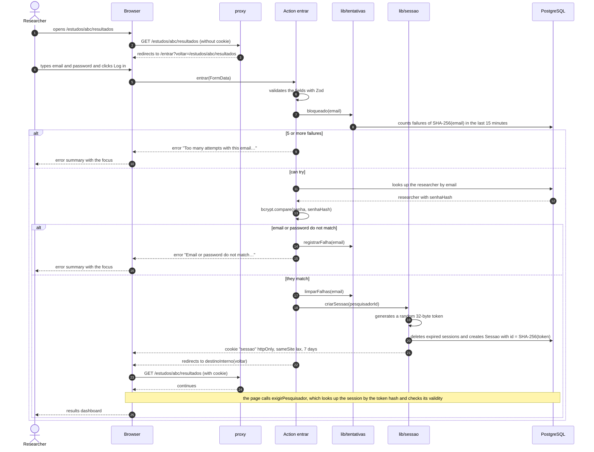
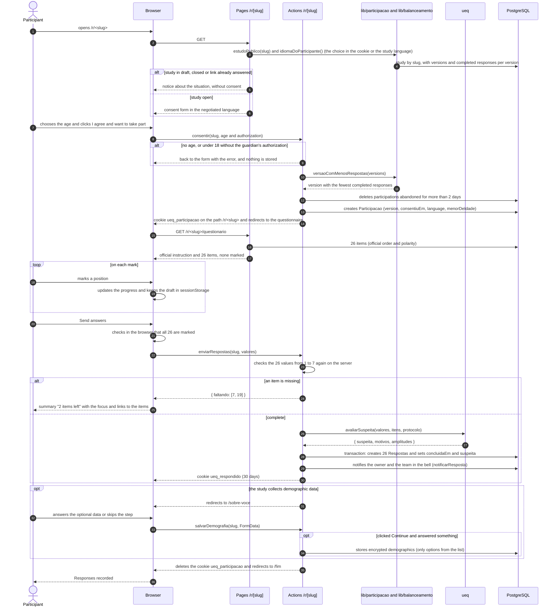
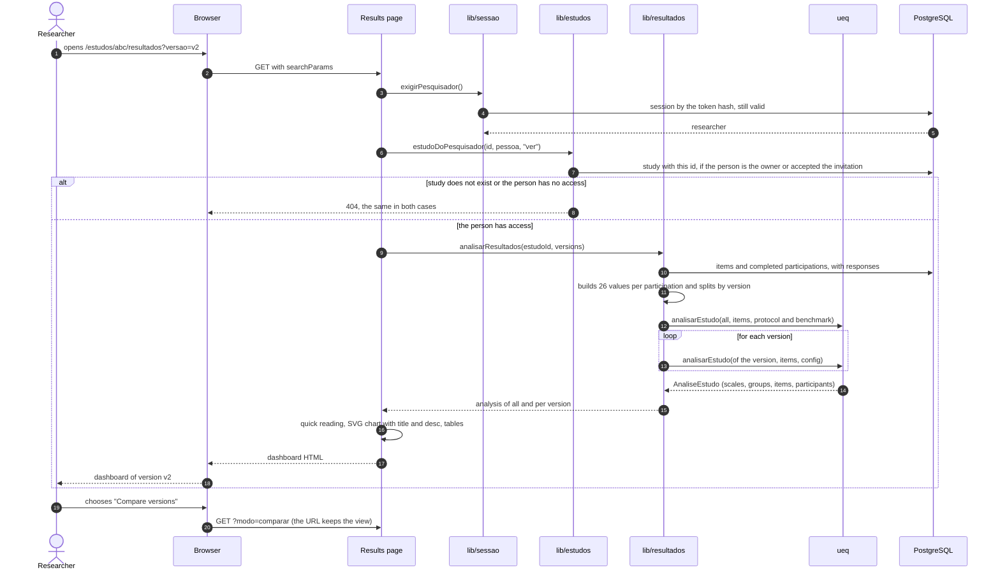
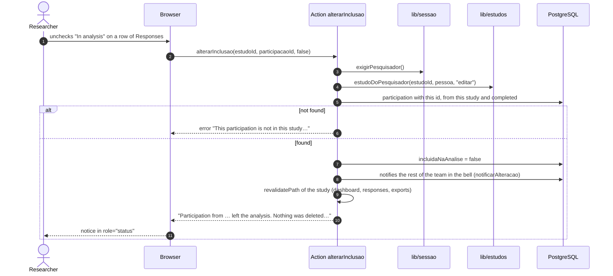
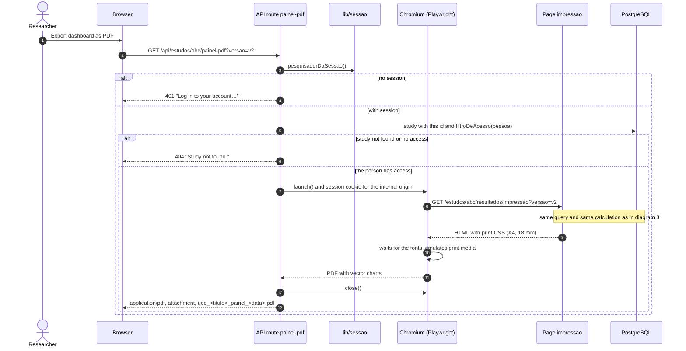
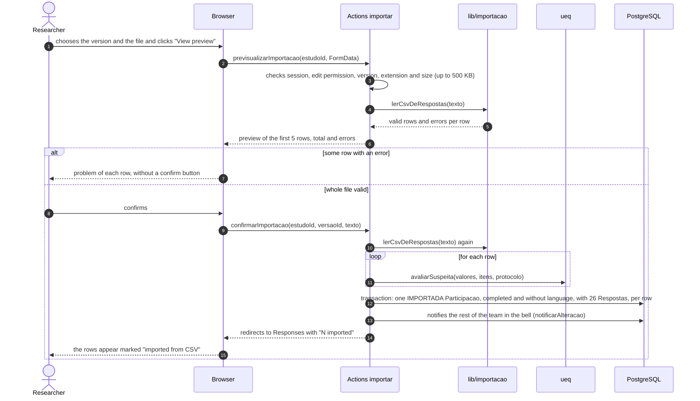
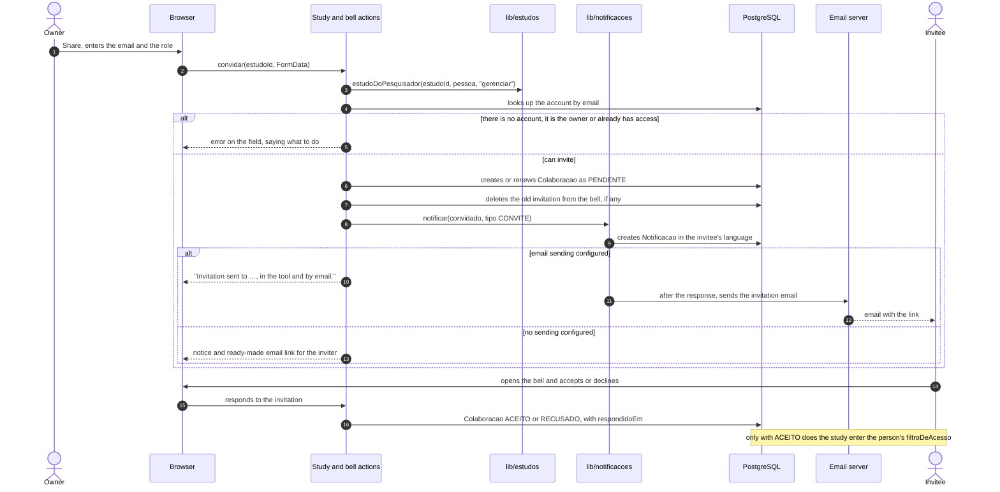
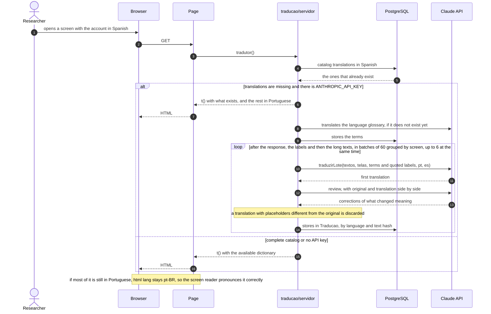

# Diagramas de secuencia

Ocho diagramas muestran cómo se comunican las partes de la herramienta en los flujos más importantes. Los participantes de cada diagrama son los bloques de la [arquitectura](arquitetura.md):

- **Navegador:** la página React en el navegador de la persona (Client Components y formularios);
- **proxy:** [`src/proxy.ts`](../../src/proxy.ts), que se ejecuta antes de cada solicitud;
- **Página:** un Server Component del App Router;
- **Acción:** una Server Action (`"use server"`);
- **Ruta de API:** un Route Handler en `src/app/api/`;
- **lib:** los servicios de `src/lib/` (sesión, estudios, participación, resultados…);
- **ueq:** el módulo de cálculo [`src/ueq/`](../../src/ueq/), funciones puras;
- **PostgreSQL:** la base de datos, a la que se accede mediante Prisma.

La flecha continua es una llamada; la flecha discontinua es una respuesta. Justo debajo de cada diagrama están la herramienta utilizada, el archivo fuente para descargar y la versión de la herramienta que representa.

La columna de casos de uso y la de requisitos se rellenarán cuando esos documentos se publiquen.

| Diagrama | Caso de uso | Requisitos principales |
|---|---|---|
| [1. Iniciar sesión y volver a la página solicitada](#1-entrar-e-voltar-à-página-pedida) | por definir | por definir |
| [2. Responder el cuestionario](#2-responder-o-questionário) | por definir | por definir |
| [3. Ver resultados](#3-ver-resultados) | por definir | por definir |
| [4. Sacar una participación del análisis](#4-tirar-uma-participação-da-análise) | por definir | por definir |
| [5. Exportar el panel en PDF](#5-exportar-o-painel-em-pdf) | por definir | por definir |
| [6. Importar respuestas por CSV](#6-importar-respostas-por-csv) | por definir | por definir |
| [7. Invitar a alguien al estudio](#7-convidar-alguém-para-o-estudo) | por definir | por definir |
| [8. Traducir la interfaz bajo demanda](#8-traduzir-a-interface-sob-demanda) | por definir | por definir |

## 1. Iniciar sesión y volver a la página solicitada

El proxy solo comprueba si existe la cookie. Quien garantiza que la sesión es válida es la consulta a la base de datos, que se hace en toda página y acción del investigador. `/entrar` muestra la página de inicio con la ventana de Entrar abierta. Sin página solicitada, el inicio de sesión termina en la página de inicio.

**Herramienta del diagrama:** Mermaid 12.2.0 (`sequenceDiagram`), generado por `pnpm docs:diagramas`. **Archivo fuente:** [diagramas-de-sequencia-1.mmd](fontes/diagramas-de-sequencia-1.mmd). **Versión representada:** Herramienta UEQ del 06/11/2026.

## 2. Responder el cuestionario

No se guarda nada sobre la persona antes del consentimiento, y ninguna respuesta se guarda antes del envío completo. La etapa de datos opcionales solo existe cuando el investigador activó la recogida en el estudio. El título, el producto y el objetivo se muestran traducidos al idioma de quien responde, como en el [diagrama 8](#8-traduzir-a-interface-sob-demanda).

**Herramienta del diagrama:** Mermaid 12.2.0 (`sequenceDiagram`), generado por `pnpm docs:diagramas`. **Archivo fuente:** [diagramas-de-sequencia-2.mmd](fontes/diagramas-de-sequencia-2.mmd). **Versión representada:** Herramienta UEQ del 17/11/2026.

## 3. Ver resultados

Todo el cálculo estadístico ocurre en `src/ueq`. La página solo obtiene los datos, los organiza por versión y los dibuja.

**Herramienta del diagrama:** Mermaid 12.2.0 (`sequenceDiagram`), generado por `pnpm docs:diagramas`. **Archivo fuente:** [diagramas-de-sequencia-3.mmd](fontes/diagramas-de-sequencia-3.mmd). **Versión representada:** Herramienta UEQ del 06/11/2026.

## 4. Sacar una participación del análisis

Excluir del análisis solo cambia un campo. No se borra nada, y el cambio aparece en el panel y en las exportaciones. El lector no llega hasta aquí: la acción exige el permiso de editar.

**Herramienta del diagrama:** Mermaid 12.2.0 (`sequenceDiagram`), generado por `pnpm docs:diagramas`. **Archivo fuente:** [diagramas-de-sequencia-4.mmd](fontes/diagramas-de-sequencia-4.mmd). **Versión representada:** Herramienta UEQ del 06/11/2026.

## 5. Exportar el panel en PDF

El servidor abre la página de impresión en un Chromium sin pantalla, con la sesión de quien lo solicitó, y devuelve el PDF. En Vercel, ese Chromium se descarga en la primera llamada, como explica la [arquitectura](arquitetura.md#implantação).

**Herramienta del diagrama:** Mermaid 12.2.0 (`sequenceDiagram`), generado por `pnpm docs:diagramas`. **Archivo fuente:** [diagramas-de-sequencia-5.mmd](fontes/diagramas-de-sequencia-5.mmd). **Versión representada:** Herramienta UEQ del 06/11/2026.

La ruta usa siempre el origen interno del servidor, nunca la cabecera `Host` de la solicitud, para que la cookie de sesión no vaya a otro dominio.

## 6. Importar respuestas por CSV

Dos pasos: la vista previa lee sin guardar; la confirmación guarda todo en una transacción.

**Herramienta del diagrama:** Mermaid 12.2.0 (`sequenceDiagram`), generado por `pnpm docs:diagramas`. **Archivo fuente:** [diagramas-de-sequencia-6.mmd](fontes/diagramas-de-sequencia-6.mmd). **Versión representada:** Herramienta UEQ del 06/11/2026.

El servidor vuelve a leer el archivo en la confirmación: la vista previa no es de fiar solo porque venga del navegador.

## 7. Invitar a alguien al estudio

Solo el propietario invita. La persona debe tener ya una cuenta, y el estudio solo le aparece después de aceptar. El correo sale después de la respuesta, y el aviso en la campana existe incluso sin servidor de correo.

**Herramienta del diagrama:** Mermaid 12.2.0 (`sequenceDiagram`), generado por `pnpm docs:diagramas`. **Archivo fuente:** [diagramas-de-sequencia-7.mmd](fontes/diagramas-de-sequencia-7.mmd). **Versión representada:** Herramienta UEQ del 06/11/2026.

## 8. Traducir la interfaz bajo demanda

La pantalla nunca espera a la traducción de la interfaz. Lo que todavía no se ha traducido sale en portugués, y los lotes se ejecutan después de la respuesta. Cada lote se guarda en cuanto vuelve, así que una ejecución interrumpida continúa desde donde se detuvo. Los textos escritos por el investigador siguen un camino parecido, pero la página espera hasta 8 segundos a la API antes de mostrar el original.

**Herramienta del diagrama:** Mermaid 12.2.0 (`sequenceDiagram`), generado por `pnpm docs:diagramas`. **Archivo fuente:** [diagramas-de-sequencia-8.mmd](fontes/diagramas-de-sequencia-8.mmd). **Versión representada:** Herramienta UEQ del 06/11/2026.
