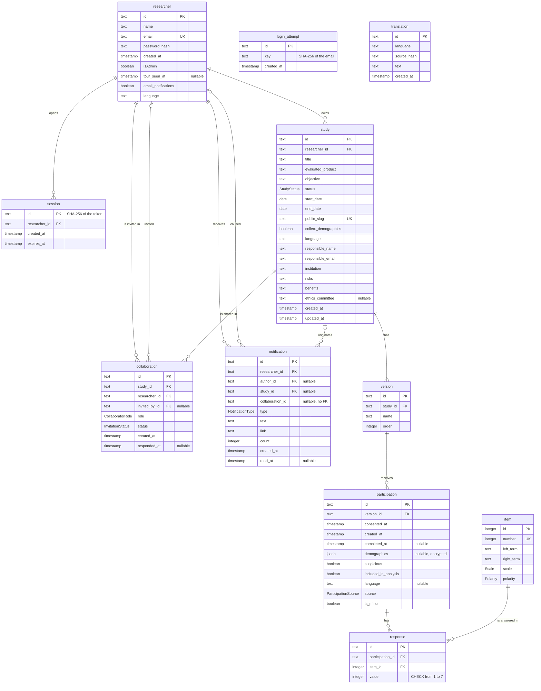

# Modelo lógico de la base de datos

La base de datos de la Herramienta UEQ es un **PostgreSQL 16** con 11 tablas y 7 tipos enumerados. El modelo se declara en [`prisma/schema.prisma`](../../prisma/schema.prisma) y lo aplican las 16 migrations de [`prisma/migrations/`](../../prisma/migrations/): 10 cambian la estructura, y las otras 6 solo graban textos traducidos en la tabla `traducao`. Los nombres de abajo son los de la base de datos. En el código, los mismos campos aparecen en camelCase (`slug_publico` es `slugPublico`).

Las columnas, las claves y las reglas de eliminación de este documento se leyeron del catálogo del propio PostgreSQL (`information_schema` y `pg_constraint`) el 13/11/2026, con todas las migrations aplicadas.

## Diagrama

El diagrama usa los nombres en inglés. Las tablas de abajo traen los nombres reales de la base de datos, en portugués: `researcher` es `pesquisador`, `study` es `estudo`, `version` es `versao`, `participation` es `participacao` y `response` es `resposta`.

**Herramienta del diagrama:** Mermaid 12.2.0 (`erDiagram`), generado por `pnpm docs:diagramas`. **Archivo fuente:** [modelo-logico-1.mmd](fontes/modelo-logico-1.mmd). **Versión representada:** Herramienta UEQ del 17/11/2026.

Dos tablas quedan sueltas a propósito: `tentativa_acesso` no apunta a la cuenta, porque guarda solo el hash del correo electrónico, y `traducao` es una caché sin dueño.

## Cómo leer las tablas

- **Las claves `text`** las genera la aplicación con CUID. La excepción es `sessao.id`, que es el hash del token de la cookie.
- **`timestamp`** es `timestamp(3) without time zone`, grabado en UTC por Prisma.
- **Nulo** indica que la columna acepta un valor vacío. Las demás son obligatorias.
- **Predeterminado** es el valor de la base de datos cuando el `INSERT` no informa la columna.

## Cuenta y acceso

### pesquisador

La cuenta de quien usa la herramienta. El participante no tiene cuenta.

| Columna | Tipo | Nulo | Predeterminado | Clave | Para qué sirve |
|---|---|---|---|---|---|
| `id` | text | no | | PK | Identificador |
| `nome` | text | no | | | Nombre que ven los colegas de estudio |
| `email` | text | no | | Único | Inicio de sesión y destino de los avisos |
| `senha_hash` | text | no | | | Hash bcrypt, coste 12. La contraseña nunca se graba |
| `criado_em` | timestamp | no | ahora | | Fecha de la cuenta |
| `administrador` | boolean | no | `false` | | Abre la página de Administración. No da acceso a estudios de otras personas |
| `tutorial_visto_em` | timestamp | sí | | | Vacío hasta que la persona termina, omite o cierra el recorrido guiado |
| `notificacoes_por_email` | boolean | no | `true` | | Además de la campana, envía el aviso por correo electrónico |
| `idioma` | text | no | `'pt'` | | Idioma de la interfaz y predeterminado de los estudios que la persona crea |

### sessao

Una fila por inicio de sesión activo. Queda en la base de datos para que cambiar la contraseña pueda cerrar las otras sesiones.

| Columna | Tipo | Nulo | Predeterminado | Clave | Para qué sirve |
|---|---|---|---|---|---|
| `id` | text | no | | PK | SHA-256 del token de la cookie. Quien lee la base de datos no puede armar una cookie válida |
| `pesquisador_id` | text | no | | FK, índice | Dueño de la sesión |
| `criada_em` | timestamp | no | ahora | | |
| `expira_em` | timestamp | no | | | Fin de la validez |

### tentativa_acesso

Cuenta las contraseñas incorrectas para limitar los intentos de adivinarlas: 5 errores en 15 minutos bloquean el correo electrónico. Las filas con más de un día se borran.

| Columna | Tipo | Nulo | Predeterminado | Clave | Para qué sirve |
|---|---|---|---|---|---|
| `id` | text | no | | PK | |
| `chave` | text | no | | Índice con `criada_em` | SHA-256 del correo electrónico. El correo no se guarda |
| `criada_em` | timestamp | no | ahora | Índice con `chave` | Inicio del conteo |

## Estudio

### estudo

| Columna | Tipo | Nulo | Predeterminado | Clave | Para qué sirve |
|---|---|---|---|---|---|
| `id` | text | no | | PK | |
| `pesquisador_id` | text | no | | FK, índice | Dueño del estudio |
| `titulo` | text | no | | | |
| `produto_avaliado` | text | no | | | |
| `objetivo` | text | no | | | Lo lee el participante en el consentimiento |
| `status` | StatusEstudo | no | `RASCUNHO` | | Decide si el enlace acepta respuestas |
| `data_inicio` | date | no | | | |
| `data_fim` | date | no | | | |
| `slug_publico` | text | no | | Único | La dirección `/r/<slug>` del participante |
| `coletar_demografia` | boolean | no | `false` | | LGPD, principio de necesidad: la etapa de datos opcionales solo existe si el investigador la activa |
| `idioma` | text | no | `'pt'` | | Idioma en que se escribió el estudio y en el que abre el enlace |
| `responsavel_nome` | text | no | | | Quién responde por la investigación, mostrado en el formulario de consentimiento (LGPD, art. 9). El formulario sugiere el nombre de la cuenta |
| `responsavel_email` | text | no | | | Contacto del responsable, mostrado en el formulario de consentimiento. El formulario sugiere el correo de la cuenta |
| `instituicao` | text | no | | | Institución de la investigación, en el subtítulo y en el formulario de consentimiento |
| `riscos` | text | no | | | Riesgos para el participante, en el formulario de consentimiento (Resolución CNS 510/2016). El formulario sugiere un texto |
| `beneficios` | text | no | | | Beneficios, en el formulario de consentimiento. El formulario sugiere un texto |
| `comite_etica` | text | sí | | | Comité de ética, dictamen o CAAE y contacto, cuando el estudio pasó por uno |
| `criado_em` | timestamp | no | ahora | | |
| `atualizado_em` | timestamp | no | | | Lo actualiza Prisma |

### colaboracao

La invitación para trabajar en un estudio. El estudio solo aparece para la persona invitada después de `ACEITO` (aceptada).

| Columna | Tipo | Nulo | Predeterminado | Clave | Para qué sirve |
|---|---|---|---|---|---|
| `id` | text | no | | PK | |
| `estudo_id` | text | no | | FK, único con `pesquisador_id` | Cada persona tiene una invitación por estudio |
| `pesquisador_id` | text | no | | FK, índice con `status` | Quién fue invitado |
| `convidado_por_id` | text | sí | | FK | Quién invitó. Queda vacío si esa cuenta se elimina |
| `papel` | PapelColaborador | no | `EDITOR` | | Lo que la persona puede hacer |
| `status` | StatusConvite | no | `PENDENTE` | | |
| `criado_em` | timestamp | no | ahora | | |
| `respondido_em` | timestamp | sí | | | Cuándo aceptó o rechazó |

### versao

Las versiones del producto que el estudio compara. Todo estudio tiene al menos una, regla que garantiza la validación del formulario.

| Columna | Tipo | Nulo | Predeterminado | Clave | Para qué sirve |
|---|---|---|---|---|---|
| `id` | text | no | | PK | |
| `estudo_id` | text | no | | FK, único con `ordem` | |
| `nome` | text | no | | | |
| `ordem` | integer | no | | Único con `estudo_id` | Orden de visualización y desempate en la distribución de los participantes |

## Cuestionario y respuestas

### item

Los 26 ítems del UEQ, cargados por el seed a partir de `data/ueq-itens-ptbr.json`. Los términos de los otros 36 idiomas están en `data/ueq-idiomas.json`, no en la base de datos.

| Columna | Tipo | Nulo | Predeterminado | Clave | Para qué sirve |
|---|---|---|---|---|---|
| `id` | integer | no | secuencia | PK | |
| `numero` | integer | no | | Único | De 1 a 26, el orden oficial |
| `termo_esquerdo` | text | no | | | |
| `termo_direito` | text | no | | | |
| `escala` | Escala | no | | | A qué escala pertenece el ítem |
| `polaridade` | Polaridade | no | | | De qué lado está el término positivo |

### participacao

Una persona respondiendo una versión. No hay nombre, correo electrónico, IP ni vínculo con una cuenta: eso es lo que hace anónima la respuesta.

| Columna | Tipo | Nulo | Predeterminado | Clave | Para qué sirve |
|---|---|---|---|---|---|
| `id` | text | no | | PK | También va en la cookie del participante mientras responde |
| `versao_id` | text | no | | FK, índice | Versión que la persona evalúa: la que tenía menos respuestas cuando dio su consentimiento |
| `consentiu_em` | timestamp | no | | | Registro del consentimiento |
| `criada_em` | timestamp | no | ahora | | Se usa para borrar las abandonadas después de 2 días |
| `concluida_em` | timestamp | sí | | | Vacío mientras no se ha enviado. Solo las concluidas entran en el análisis |
| `demografia` | jsonb | sí | | | Rango de edad, género, escolaridad y familiaridad. Cifrada con AES-256-GCM cuando existe `CHAVE_CRIPTOGRAFIA` |
| `suspeita` | boolean | no | `false` | | Calculada por las reglas del [protocolo](../ueq-protocolo.md#7-respostas-inconsistentes) |
| `incluida_na_analise` | boolean | no | `true` | | Decisión del investigador. Sacar del análisis no borra nada |
| `idioma` | text | sí | `'pt'` | | Idioma en que respondió. Vacío en las importadas, porque el CSV no lo indica |
| `origem` | OrigemParticipacao | no | `LINK` | | Respuesta por el enlace o importada de un CSV |
| `menor_de_idade` | boolean | no | `false` | | La persona declaró tener menos de 18 años y confirmó la autorización de su representante legal (LGPD, art. 14). Sin la autorización, la participación ni siquiera se crea |

### resposta

Una fila por ítem respondido. Una participación concluida tiene 26.

| Columna | Tipo | Nulo | Predeterminado | Clave | Para qué sirve |
|---|---|---|---|---|---|
| `id` | text | no | | PK | |
| `participacao_id` | text | no | | FK, único con `item_id` | Impide responder el mismo ítem dos veces |
| `item_id` | integer | no | | FK | |
| `valor` | integer | no | | `CHECK` de 1 a 7 | 1 es el polo izquierdo y 7 el derecho, antes de la recodificación |

## Avisos y traducción

### notificacao

La campana del encabezado. Las respuestas que llegan mientras el aviso no se ha leído solo aumentan `quantidade`.

| Columna | Tipo | Nulo | Predeterminado | Clave | Para qué sirve |
|---|---|---|---|---|---|
| `id` | text | no | | PK | |
| `pesquisador_id` | text | no | | FK, índice con `lida_em` | Quién lo recibe |
| `autor_id` | text | sí | | FK | Quién lo causó. Queda vacío si la cuenta se elimina |
| `estudo_id` | text | sí | | FK | Queda vacío si el estudio se elimina, y el aviso sigue en la campana |
| `colaboracao_id` | text | sí | | Sin FK | Referencia a la invitación, para aceptarla o rechazarla desde el aviso. Puede apuntar a una invitación que ya no existe |
| `tipo` | TipoNotificacao | no | | | |
| `texto` | text | no | | | Ya en el idioma de quien lo recibe |
| `link` | text | no | | | Ruta dentro de la herramienta |
| `quantidade` | integer | no | `1` | | Respuestas acumuladas |
| `criada_em` | timestamp | no | ahora | | |
| `lida_em` | timestamp | sí | | Índice con `pesquisador_id` | Vacío significa no leído |

### traducao

Caché de las traducciones hechas por la API de Claude, para no traducir el mismo texto dos veces.

| Columna | Tipo | Nulo | Predeterminado | Clave | Para qué sirve |
|---|---|---|---|---|---|
| `id` | text | no | | PK | |
| `idioma` | text | no | | Único con `hash_origem` | Idioma de destino |
| `hash_origem` | text | no | | Único con `idioma` | SHA-256 del texto original |
| `texto` | text | no | | | La traducción |
| `criada_em` | timestamp | no | ahora | | |

## Tipos enumerados

| Tipo | Valores | Observación |
|---|---|---|
| `StatusEstudo` | `RASCUNHO`, `ABERTO`, `ENCERRADO` | Solo `ABERTO` acepta respuestas |
| `Escala` | `ATRATIVIDADE`, `PERSPICUIDADE`, `EFICIENCIA`, `CONFIABILIDADE`, `ESTIMULACAO`, `NOVIDADE` | Las 6 escalas del UEQ |
| `Polaridade` | `POSITIVA_DIREITA`, `POSITIVA_ESQUERDA` | `+` y `-` en el [protocolo](../ueq-protocolo.md#1-itens-escalas-e-polaridade) |
| `OrigemParticipacao` | `LINK`, `IMPORTADA` | |
| `PapelColaborador` | `EDITOR`, `LEITOR` | El editor modifica el estudio; el lector solo ve y exporta. Eliminar el estudio e invitar quedan en manos del dueño |
| `StatusConvite` | `PENDENTE`, `ACEITO`, `RECUSADO` | |
| `TipoNotificacao` | `CONVITE`, `RESPOSTA`, `ALTERACAO` | |

## Lo que arrastra cada eliminación

Todas las claves foráneas tienen `ON UPDATE CASCADE`. La columna de abajo es el `ON DELETE` de la base de datos.

| Clave foránea | Al borrar el padre |
|---|---|
| `sessao.pesquisador_id` → `pesquisador` | Borra |
| `estudo.pesquisador_id` → `pesquisador` | Borra |
| `colaboracao.pesquisador_id` → `pesquisador` | Borra |
| `colaboracao.convidado_por_id` → `pesquisador` | Queda vacío |
| `colaboracao.estudo_id` → `estudo` | Borra |
| `versao.estudo_id` → `estudo` | Borra |
| `participacao.versao_id` → `versao` | Borra |
| `resposta.participacao_id` → `participacao` | Borra |
| `resposta.item_id` → `item` | **Impide** eliminar el ítem que ya tiene respuesta |
| `notificacao.pesquisador_id` → `pesquisador` | Borra |
| `notificacao.autor_id` → `pesquisador` | Queda vacío |
| `notificacao.estudo_id` → `estudo` | Queda vacío |

En la práctica:

- **Eliminar la cuenta** borra las sesiones, los estudios de los que la persona es dueña (con versiones, participaciones y respuestas), sus invitaciones y sus avisos. En estudios de otras personas, su participación como colega desaparece, y los avisos que causó continúan, sin autor.
- **Eliminar un estudio** borra versiones, participaciones, respuestas e invitaciones. Los avisos quedan en la campana de quien los recibió, sin el vínculo con el estudio.
- **Quitar una versión**, en la base de datos, borra sus participaciones y respuestas.
- **Ningún ítem puede desaparecer** después de tener respuesta. Ese `RESTRICT` protege el instrumento.

## Reglas que garantiza la base de datos y reglas que garantiza la aplicación

| Regla | Dónde está |
|---|---|
| `resposta.valor` entre 1 y 7 | `CHECK resposta_valor_entre_1_e_7`, escrito a mano en la migration inicial, porque Prisma no declara `CHECK` |
| Una respuesta por ítem en cada participación | Índice único `(participacao_id, item_id)` |
| Una invitación por persona en cada estudio | Índice único `(estudo_id, pesquisador_id)` |
| Slug público y correo electrónico sin repetición | Índices únicos |
| Exactamente 26 respuestas en una participación concluida | Aplicación (`enviarRespostas`, en una transacción) |
| Solo opciones de la lista en `demografia` | Aplicación (`src/lib/demografia.ts`) |
| Quién puede ver o cambiar un estudio | Aplicación (`estudoDoPesquisador` en `src/lib/estudos.ts`) |
| Borrar la participación abandonada hace más de 2 días | Aplicación: ocurre cuando la siguiente persona da su consentimiento |

## Datos personales

Este mapa vincula el modelo con la política de privacidad de la herramienta, en `/privacidade` (LGPD).

| Dato | Tabla | Protección |
|---|---|---|
| Nombre y correo electrónico | `pesquisador` | Solo los ve quien comparte un estudio con la persona |
| Contraseña | `pesquisador.senha_hash` | Hash bcrypt, coste 12 |
| Cookie de sesión | `sessao.id` | Solo el hash SHA-256 |
| Correo electrónico en un intento de inicio de sesión | `tentativa_acesso.chave` | Solo el hash SHA-256, borrado en un día como máximo |
| Datos demográficos del participante | `participacao.demografia` | Cifrados con AES-256-GCM, con la clave fuera de la base de datos |
| Respuestas al cuestionario | `resposta` | Nada las vincula a una persona |

Sin `CHAVE_CRIPTOGRAFIA` en el entorno, la demografía queda en texto plano y la página de Administración lo avisa. El script `pnpm dados:cifrar` cifra las filas antiguas y se ejecuta en el build de producción.
