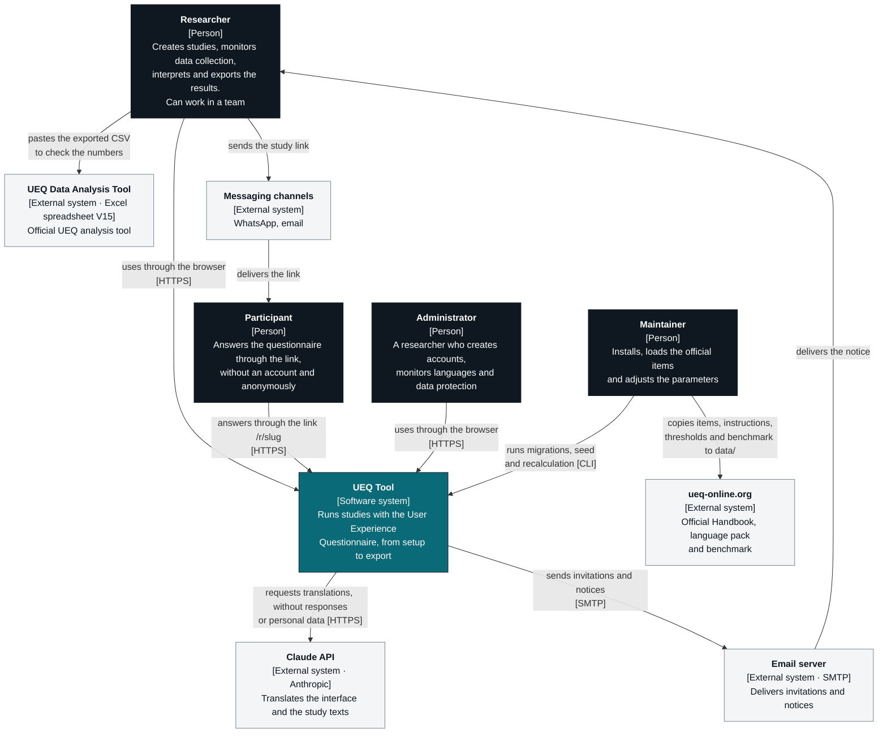
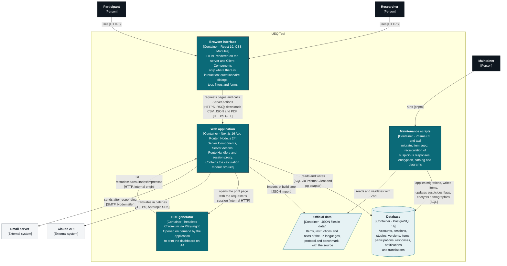
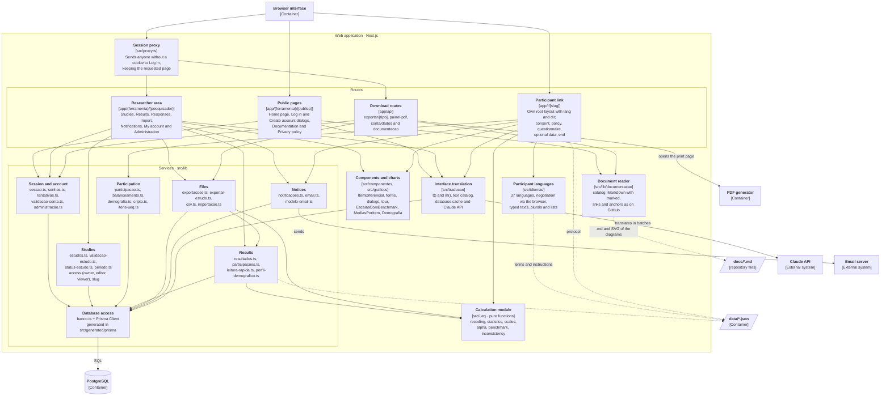
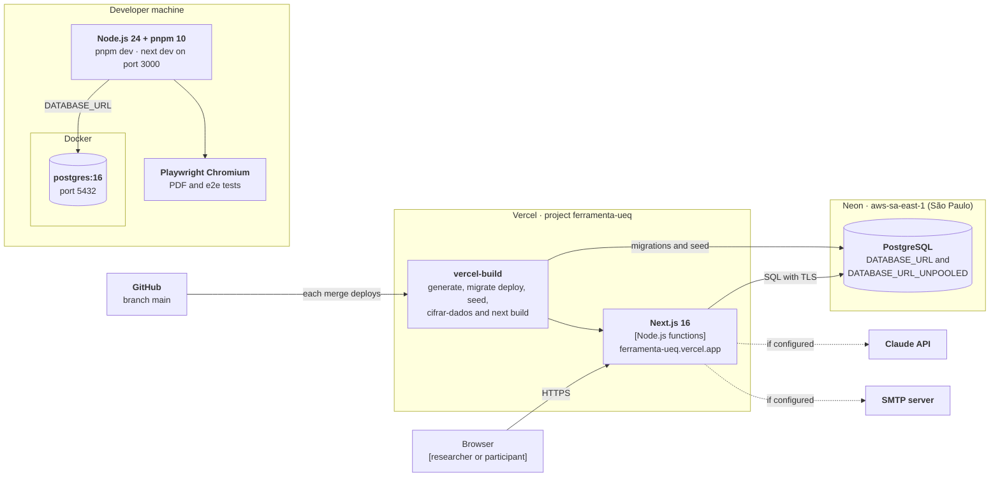

# Architecture

L'architecture est décrite avec le [modèle C4](https://c4model.com), à trois niveaux de zoom :

1. **Contexte :** qui utilise l'outil et avec quels systèmes il est en relation ;
2. **Conteneurs :** les parties qui s'exécutent séparément (application, base de données, générateur de PDF, scripts) et comment elles communiquent ;
3. **Composants :** comment l'application Next.js est organisée à l'intérieur.

Un quatrième diagramme montre le déploiement, en production et en développement.

Les diagrammes utilisent Mermaid, que GitHub dessine directement dans la page. Chaque boîte porte le nom, le type entre crochets et la technologie. Les flèches indiquent ce qui passe et par quel protocole. Juste sous chaque diagramme figurent l'outil utilisé, le fichier source à télécharger et la version de l'outil qu'il représente.

## Vue d'ensemble

L'Outil UEQ est une application web unique en **Next.js 16 (App Router)** avec **React 19** et **TypeScript strict**, qui stocke les données dans un **PostgreSQL 16** via **Prisma 7**. Il est en ligne sur [ferramenta-ueq.vercel.app](https://ferramenta-ueq.vercel.app), sur Vercel, avec la base de données chez Neon, région de São Paulo.

- Il n'y a pas d'API REST séparée. Les pages sont des Server Components qui lisent la base de données sur le serveur. Les écritures sont des Server Actions appelées par les formulaires.
- Seul ce qui renvoie un fichier est une route d'API : les exportations en CSV, le tableau de bord en PDF, les données du compte et les téléchargements de la documentation.
- Le calcul de l'UEQ est isolé dans `src/ueq/`, en fonctions pures, pour être testé par rapport au tableur officiel sans base de données ni interface.
- Les paramètres du protocole, le benchmark et les textes officiels des 37 langues sont des fichiers JSON versionnés dans `data/`, avec la source de chaque valeur.
- L'interface du chercheur et les textes des études sont traduits à la demande par l'API de Claude, avec le résultat stocké dans la base de données. Le questionnaire n'utilise que les traductions officielles de l'UEQ.

## Niveau 1 · Contexte



**Outil du diagramme :** Mermaid 12.2.0 (`flowchart`), généré par `pnpm docs:diagramas`. **Fichier source :** [arquitetura-1.mmd](fontes/arquitetura-1.mmd). **Version représentée :** Outil UEQ du 06/11/2026.

À l'exécution, l'outil n'appelle que deux systèmes externes, et tous deux sont facultatifs :

- **API de Claude :** sans `ANTHROPIC_API_KEY`, l'interface reste en portugais et les textes des études restent dans leur langue d'origine. Ce qui part vers l'API, ce sont les textes de l'interface et le titre, le produit, l'objectif et les noms de version de chaque étude. Aucune réponse, aucun nom, aucune adresse e-mail ni aucune donnée démographique n'y part.
- **Serveur de messagerie :** sans les variables `SMTP_*`, les avis restent seulement dans la cloche, et la personne qui invite reçoit un lien e-mail prêt à envoyer elle-même.

Le tableur officiel et le site de l'UEQ entrent par des personnes : l'équipe copie les données officielles dans `data/` (avec la source dans chaque fichier). L'exportation du tableur officiel part d'une copie sans modification de l'UEQ Data Analysis Tool V15 dans `data/planilha-oficial/`, et le chercheur l'ouvre dans Excel pour vérifier les nombres.

## Niveau 2 · Conteneurs



**Outil du diagramme :** Mermaid 12.2.0 (`flowchart`), généré par `pnpm docs:diagramas`. **Fichier source :** [arquitetura-2.mmd](fontes/arquitetura-2.mmd). **Version représentée :** Outil UEQ du 06/11/2026.

| Conteneur | Technologie | Responsabilité | Où il se trouve |
|---|---|---|---|
| Interface dans le navigateur | React 19.3, CSS Modules, variables CSS, SVG fait à la main | Afficher les écrans et gérer l'interaction. Sans bibliothèque de composants ni de graphiques | `src/app/**/*.tsx` avec `"use client"`, `src/componentes/`, `src/graficos/`, `src/styles/` |
| Application web | Next.js 16.4, Node.js 24, Zod 4, bcryptjs, Nodemailer, SDK d'Anthropic | Rendre les pages, valider et enregistrer les données, protéger l'espace du chercheur, générer les exportations, traduire et avertir | `src/app/`, `src/lib/`, `src/ueq/`, `src/idiomas/`, `src/traducao/`, `src/proxy.ts` |
| Générateur de PDF | Playwright 1.64 avec son Chromium en développement et `@sparticuz/chromium-min` 153 sur Vercel | Imprimer le tableau de bord en PDF avec des graphiques vectoriels | `src/app/api/estudos/[id]/painel-pdf/route.ts` |
| Base de données | PostgreSQL 16 (Docker en développement, Neon en production) | Persister le modèle de domaine, avec cascade et `CHECK`. Détails dans le [modèle logique](modelo-logico.md) | `prisma/schema.prisma`, `prisma/migrations/`, `docker-compose.yml` |
| Données officielles | JSON versionné | Source unique des items, instructions, protocole et benchmark, chacun avec le champ `fonte` | `data/` |
| Documentation | Markdown et SVG versionnés | Les documents affichés par l'onglet Documentation, les diagrammes déjà dessinés et le fichier source de chacun | `docs/`, `docs/documentacao/diagramas/`, `docs/documentacao/fontes/` |
| Scripts de maintenance | Prisma CLI, tsx | Créer la base de données, charger les items, recalculer les suspicions, chiffrer les anciennes données, générer le catalogue de textes et les diagrammes | `prisma/seed.ts`, `prisma/recalcular-suspeitas.ts`, `prisma/cifrar-dados.ts`, `scripts/` |

## Niveau 3 · Composants de l'application web



**Outil du diagramme :** Mermaid 12.2.0 (`flowchart`), généré par `pnpm docs:diagramas`. **Fichier source :** [arquitetura-3.mmd](fontes/arquitetura-3.mmd). **Version représentée :** Outil UEQ du 06/11/2026.

Le `matcher` de [`src/proxy.ts`](../../src/proxy.ts) exclut ce qui n'exige jamais de session : `/entrar`, `/cadastrar`, `/privacidade`, `/r/`, `/documentacao`, `/api/documentacao` et les icônes du site. La racine `/` passe par le proxy et continue sans cookie. Toute nouvelle route du chercheur naît déjà protégée. Le lien du participant a sa propre mise en page racine, sans barre et sans lien vers le reste de l'outil : la personne qui répond ne voit que le formulaire, le sélecteur de langue et la politique de confidentialité, qui a une version sur `/r/<slug>/privacidade`.

### Règles de dépendance

- **`src/ueq/` ne dépend de rien dans le projet.** Il n'importe ni Prisma, ni React, ni Next, ni `src/lib`. Il reçoit des nombres et renvoie des objets. C'est ce qui permet de le tester par rapport au tableur officiel.
- **Les composants et les graphiques ne connaissent pas Prisma.** Ils reçoivent des données prêtes par props.
- **Chaque page, Server Action et route du chercheur vérifie la session dans la base de données et l'accès à l'étude**, pas seulement le proxy. L'accès passe toujours par `estudoDoPesquisador(id, pessoa, "ver" | "editar" | "gerenciar")` ou par `filtroDeAcesso`. Sans accès, la réponse est identique à celle d'une étude qui n'existe pas.
- **L'administrateur ne voit pas les études d'autres personnes.** Les réponses sont des données de recherche de la personne qui mène l'étude. Les pages d'Administration répondent 404 à qui n'est pas administrateur.
- **Les routes du participant ne lisent que ce que le participant peut voir :** titre, produit, objectif et statut de l'étude. Rien du chercheur et rien de l'analyse.
- **Les paramètres du protocole ne sont jamais dans le code.** Ils viennent de `data/protocolo.json` et `data/benchmark.json`.
- **Le texte d'écran du chercheur passe par `t()` ou `m()`,** et `pnpm i18n:catalogo` génère le catalogue. Le texte du participant se trouve dans `src/idiomas/textos/`, un fichier par langue.

## Sécurité et LGPD

| Mesure | Où elle se trouve |
|---|---|
| En-têtes de sécurité dans chaque réponse : CSP, HSTS, `X-Frame-Options`, `X-Content-Type-Options`, `Referrer-Policy` et `Permissions-Policy` | `next.config.ts` |
| Mot de passe en bcrypt coût 12, avec un hachage refait à la connexion quand le coût augmente | `src/lib/senhas.ts` |
| 5 mots de passe erronés en 15 minutes bloquent l'adresse e-mail, comptée par son hachage | `src/lib/tentativas.ts` |
| Session dans la base de données par le hachage du jeton, avec un cookie `httpOnly` et `secure` en production | `src/lib/sessao.ts` |
| Données démographiques chiffrées avec AES-256-GCM, avec la clé hors de la base de données | `src/lib/cripto.ts`, `prisma/cifrar-dados.ts` |
| Collecte démographique désactivée par défaut dans chaque étude | `Estudo.coletarDemografia` |
| Une participation abandonnée depuis plus de 2 jours est supprimée | `src/app/r/[slug]/acoes.ts` |
| Télécharger ses propres données et supprimer le compte, sans rien demander à personne | `src/app/api/conta/dados/route.ts`, `conta/` |
| La destination de `?voltar=` et `?de=` n'accepte qu'un chemin interne | `destinoInterno` dans `src/lib/validacao-conta.ts` |
| Politique publique, sans exiger de compte, aussi à l'intérieur du lien du participant | `src/app/(ferramenta)/(publico)/privacidade/`, `src/app/r/[slug]/privacidade/` |

## Décisions d'architecture

| Décision | Pourquoi | Conséquence |
|---|---|---|
| Server Components et Server Actions au lieu d'une API REST | Moins de code entre l'écran et la base de données ; validation avec Zod sur le serveur à chaque action ; les formulaires fonctionnent avec le comportement natif du navigateur | L'outil n'offre pas d'API publique. Les intégrations utilisent les exportations en CSV |
| Calcul en fonctions pures dans `src/ueq/` | Le nombre doit correspondre au tableur officiel ; les fonctions pures se testent avec des fixtures et des cas limites | Celui qui récupère les données (`src/lib/resultados.ts`) ne fait que construire l'entrée et la transmettre |
| Session stockée dans la base de données, avec le hachage du jeton | Changer le mot de passe ferme les autres sessions ; quiconque lit la base de données ne peut pas fabriquer un cookie | Chaque page du chercheur fait une requête de session (avec le `cache` de React par requête) |
| Deux mises en page racines : l'outil et le lien du participant | Le `<html lang>` et le `dir` du participant suivent la langue choisie par la personne qui répond, et ceux de l'outil suivent la langue du compte (WCAG 3.1.1), y compris l'arabe, l'hébreu et le persan | `experimental.globalNotFound` dans `next.config.ts` pour la page 404 |
| Deux systèmes de texte : `src/idiomas` et `src/traducao` | Le questionnaire est un instrument de mesure : il exige les termes officiels et des textes révisables, sans traduction automatique. Le reste de l'outil peut être traduit à la demande | Un nouveau texte du participant exige les 37 fichiers ; un nouveau texte du chercheur n'exige que `pnpm i18n:catalogo` |
| Traduction à la demande, stockée dans la base de données | Traduire chaque texte une seule fois, sans coût lors des lectures suivantes et sans maintenir 37 fichiers à la main | La première visite dans une langue peut s'afficher en portugais pendant que les lots s'exécutent en arrière-plan |
| E-mail envoyé après la réponse (`after`) | La personne qui a cliqué n'attend pas le serveur de messagerie, et un échec d'envoi n'annule pas l'action | La cloche est l'enregistrement qui existe toujours ; l'e-mail est un plus |
| Graphiques en SVG faits à la main | Contrôle total de `title`, `desc`, du contraste, des formes par version et de la réorganisation sur écran étroit | Pas de bibliothèque de graphiques à mettre à jour |
| PDF généré par Chromium sur le serveur | Le PDF sort identique au tableau de bord, avec des graphiques vectoriels et les mêmes polices | Sur Vercel, le navigateur est téléchargé au premier appel (voir [Déploiement](#implantação)) |
| Documentation lue depuis les mêmes `.md` du dépôt, avec les diagrammes dessinés à l'avance, en SVG (`pnpm docs:diagramas`) | Un seul fichier pour GitHub et pour l'outil ; l'outil ne charge pas la bibliothèque Mermaid et chaque diagramme devient une image avec un texte alternatif | Modifier un diagramme exige de régénérer le SVG et la source ; un test unitaire le signale |
| Document long divisé en pages à l'affichage, sans modifier le `.md` | Le fichier reste unique et lisible sur GitHub, et l'outil n'oblige pas à faire défiler un document entier | Les liens et les ancres passent par `rotaDaAncora`, qui trouve la page de chacune, et les anciennes adresses avec seulement le fragment sont redirigées |
| Données officielles en JSON versionné | Chaque nombre a une source traçable et change par pull request, pas dans le code | Modifier un seuil exige `pnpm suspeitas:recalcular` pour mettre à jour les participations déjà enregistrées |
| Cookies du participant limités à `/r/<slug>` | Anonymat : seulement l'identifiant aléatoire de la participation, la marque « déjà répondu » et la langue | La protection contre l'envoi en double vaut par navigateur, pas par personne |

## Déploiement



**Outil du diagramme :** Mermaid 12.2.0 (`flowchart`), généré par `pnpm docs:diagramas`. **Fichier source :** [arquitetura-4.mmd](fontes/arquitetura-4.mmd). **Version représentée :** Outil UEQ du 06/11/2026.

**Production.** Chaque merge dans `main` publie une nouvelle version. Le script `vercel-build` exécute `prisma generate`, `prisma migrate deploy`, le seed, `prisma/cifrar-dados.ts` et `next build`. En production, le seed n'enregistre que les 26 items, sans compte de test. Les migrations utilisent `DATABASE_URL_UNPOOLED` quand elle existe.

**Développement.** La marche à suivre se trouve dans le [README](../../README.md#como-rodar).

| Variable | Obligatoire | À quoi elle sert |
|---|---|---|
| `DATABASE_URL` | Oui | Connexion à PostgreSQL |
| `DATABASE_URL_UNPOOLED` | Chez Neon | Connexion directe, utilisée par les migrations |
| `CHAVE_CRIPTOGRAFIA` | En production | Clé AES-256-GCM des données démographiques. Sans elle, la donnée reste en texte clair et Administration le signale. Gardez-en une copie : sans la clé, la donnée chiffrée ne peut plus être lue |
| `ANTHROPIC_API_KEY` | Non | Active la traduction automatique |
| `SMTP_HOST`, `SMTP_PORTA`, `SMTP_USUARIO`, `SMTP_SENHA`, `EMAIL_REMETENTE` | Non | Activent l'envoi d'e-mails |
| `URL_INTERNA` et `PORT` | Non | Adresse par laquelle la route du PDF atteint l'application elle-même. Sans `URL_INTERNA`, c'est `http://localhost:$PORT` |
| `PESQUISADOR_TESTE_EMAIL` et `PESQUISADOR_TESTE_SENHA` | Seulement en développement | Compte créé par le seed. Ne doivent pas exister en production |
| `TRADUCAO_PSEUDO` | Seulement pour vérification | Avec `1`, marque les textes du catalogue avec ⟦ ⟧ pour trouver ce qui ne passe pas par `t()` |

**Tableau de bord en PDF en production.** La fonction Vercel n'a pas de navigateur installé. Au premier appel, la route télécharge un Chromium propre au serveur (`@sparticuz/chromium-min` 153), qui reste dans `/tmp` tant que la fonction est active, et ouvre la page d'impression par l'adresse publique de production. C'est pourquoi la première génération après une période d'inactivité prend plus de temps, et la limite de la fonction est de 60 s. En développement, c'est le Chromium de Playwright qui est utilisé. Les exportations en CSV ne dépendent pas d'un navigateur.

## Structure des dossiers

```
src/
  app/
    (ferramenta)/         layout raiz no idioma da conta
      (publico)/          página inicial, Entrar, Criar conta, Documentação, Privacidade
      (pesquisador)/      Estudos, Resultados, Respostas, Notificações, Minha conta, Administração
    r/[slug]/             link do participante, com layout raiz próprio (lang e dir do idioma)
    api/                  downloads: exportar/[tipo], painel-pdf, conta/dados, documentacao
  ueq/                    cálculo do UEQ em funções puras
  lib/                    sessão, estudos, participação, resultados, CSV, avisos, criptografia
  idiomas/                37 idiomas do participante: textos tipados, negociação, plural
  traducao/               t() e m(), catálogo e tradução da interface pela API do Claude
  componentes/            ItemDiferencial, formulários, janelas, tour, ajuda e painéis
  graficos/               EscalasComBenchmark, MediasPorItem e Demografia em SVG
  styles/                 tokens de cor, tipografia e espaçamento
  proxy.ts                checagem otimista de sessão
scripts/                  SVG e fontes dos diagramas; catálogo de textos
prisma/                   schema, migrations, seed, recálculo de suspeitas e cifragem
data/                     itens, instruções, idiomas, protocolo, benchmark e fixtures
tests/e2e/                Playwright com axe-core
docs/                     especificação, requisitos de IHC, protótipos e esta documentação
```
