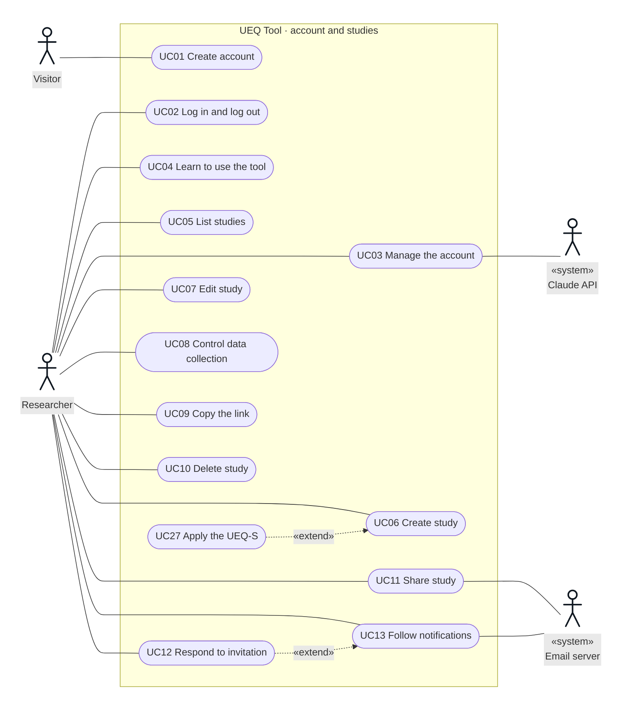
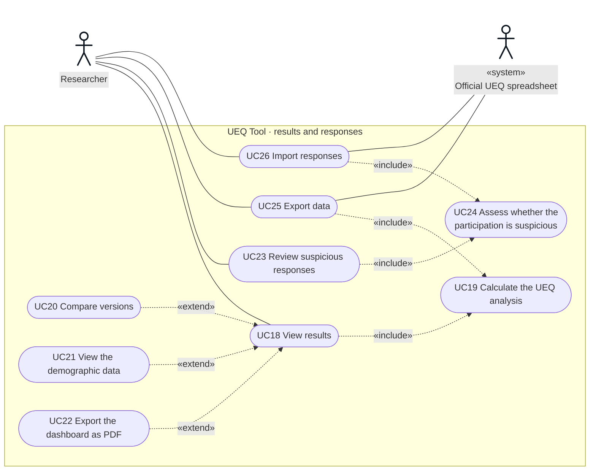
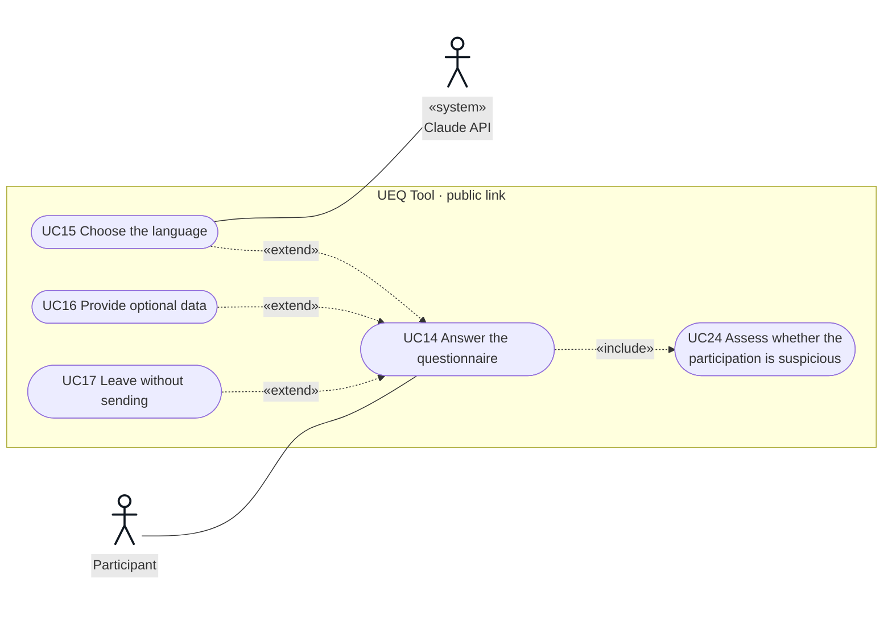
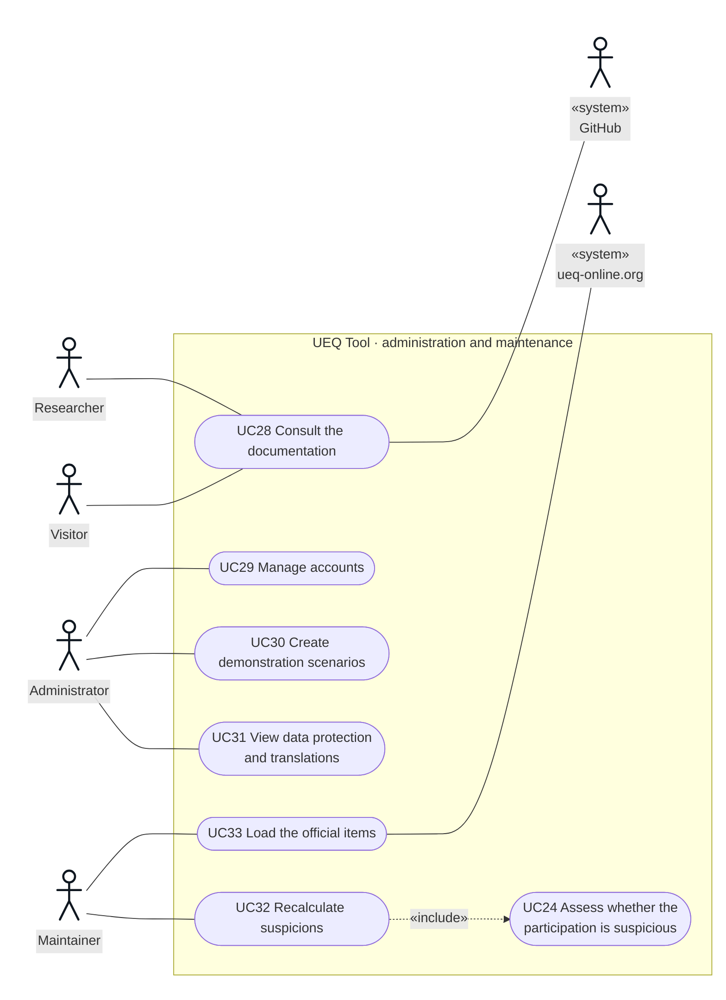
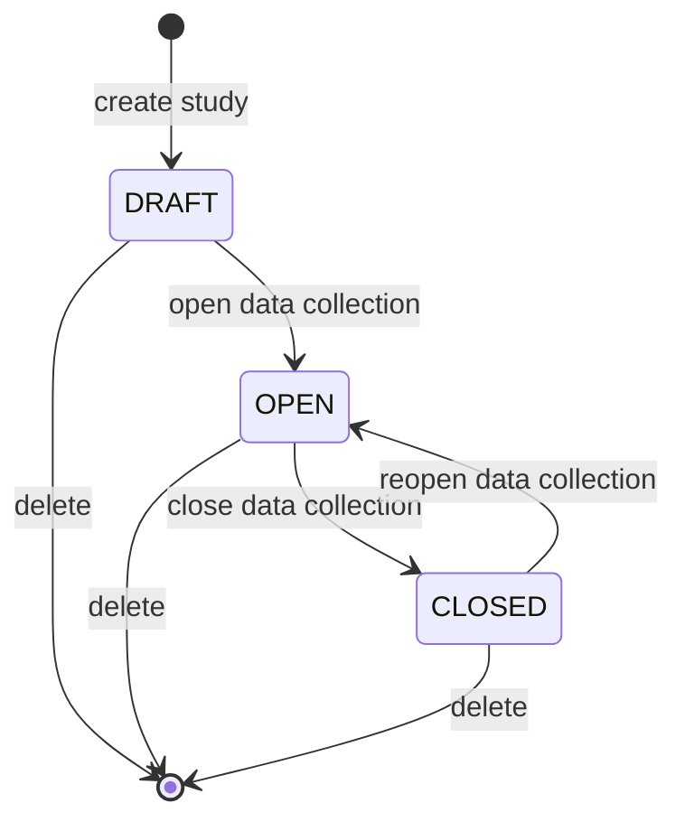

# Cas d'utilisation

33 cas d'utilisation décrivent ce que chaque acteur fait avec l'Outil UEQ. Les diagrammes suivent la notation UML des cas d'utilisation, dessinée en Mermaid pour s'afficher directement sur GitHub :

- le bonhomme est l'acteur. Les acteurs principaux, qui déclenchent le cas d'utilisation, sont à gauche ; les acteurs secondaires, qui y participent sans le déclencher, sont à droite. Quand l'acteur est un autre système, son nom porte «system» ;
- la forme arrondie est le cas d'utilisation ;
- le cadre est la frontière du système ;
- la ligne pleine relie l'acteur au cas d'utilisation auquel il participe ;
- la flèche pointillée «include» pointe vers un cas d'utilisation qui a toujours lieu en même temps ;
- la flèche pointillée «extend» part d'un cas d'utilisation facultatif et pointe vers le cas d'utilisation qu'il étend.

Juste sous chaque diagramme figurent l'outil utilisé, le fichier source à télécharger et la version de l'outil qu'il représente. Le lien entre chaque cas d'utilisation et les exigences se trouve dans la [liste](#lista) et dans la [matrice de traçabilité](matriz-rastreabilidade.md#casos-de-uso).

## Acteurs

| Acteur | Qui c'est | Personas |
|---|---|---|
| Visiteur | Personne sans compte, ou qui ne s'est pas encore connectée. Lit la page d'accueil et la documentation et peut créer un compte | [PE08](personas.md#pe08) et tout chercheur avant l'inscription |
| Chercheur | A un compte et une session. Est propriétaire des études qu'il crée et peut être Éditeur ou Lecteur des études qu'une autre personne a partagées avec lui | [PE01](personas.md#pe01), [PE02](personas.md#pe02), [PE03](personas.md#pe03) |
| Participant | Répond par le lien public. N'a pas de compte et n'a jamais besoin de session | [PE04](personas.md#pe04), [PE05](personas.md#pe05), [PE06](personas.md#pe06), [PE07](personas.md#pe07) |
| Administrateur | Chercheur avec la marque d'administrateur : fait tout ce que fait le chercheur et ouvre la page Administration. Ne voit pas les études d'autres personnes | [PE08](personas.md#pe08) |
| Mainteneur | Personne qui exécute les commandes de l'installation : migrations, seed et recalcul | [PE08](personas.md#pe08) |

Acteurs secondaires, qui participent à un cas d'utilisation sans le déclencher :

| Acteur secondaire | Où il participe | Ce qu'il échange avec l'outil |
|---|---|---|
| Serveur de messagerie «system» | [UC11](#uc11) Partager une étude, [UC13](#uc13) Suivre les notifications | Livre l'invitation et les notifications par e-mail, quand l'envoi est configuré |
| API de Claude «system» | [UC03](#uc03) Gérer le compte, [UC15](#uc15) Choisir la langue | Traduit l'interface du chercheur ainsi que le titre, le produit et l'objectif de l'étude. Ne traduit jamais le questionnaire |
| Tableur officiel de l'UEQ «system» | [UC25](#uc25) Exporter les données, [UC26](#uc26) Importer des réponses | Reçoit les réponses remplies en lui-même (UEQ Data Analysis Tool) et est l'origine du CSV importé |
| GitHub «system» | [UC28](#uc28) Consulter la documentation | Conserve le fichier de chaque document, ouvert par le lien Voir sur GitHub |
| ueq-online.org «system» | [UC33](#uc33) Charger les items officiels | Source des termes, des instructions et du benchmark officiels copiés dans `data/` |

Le Participant est toujours un acteur principal : il déclenche son propre cas d'utilisation par le lien et ne participe pas aux cas d'utilisation des autres acteurs.

## Diagramme 1 · Compte et études

**Outil du diagramme :** Mermaid 12.2.0 (`flowchart`), généré par `pnpm docs:diagramas`. **Fichier source :** [casos-de-uso-1.mmd](fontes/casos-de-uso-1.mmd). **Version représentée :** Outil UEQ du 17/11/2026.

UC12 étend UC13 car l'invitation arrive sous forme de notification : accepter ou refuser est un choix facultatif de la personne qui ouvre la cloche. UC27 étend UC06 car choisir l'UEQ-S est une option de la personne qui crée l'étude ; sans elle, l'étude utilise l'UEQ complet.

## Diagramme 2 · Résultats et réponses

**Outil du diagramme :** Mermaid 12.2.0 (`flowchart`), généré par `pnpm docs:diagramas`. **Fichier source :** [casos-de-uso-2.mmd](fontes/casos-de-uso-2.mmd). **Version représentée :** Outil UEQ du 17/11/2026.

UC19 et UC24 n'ont pas d'acteur : ils n'ont lieu qu'à l'intérieur d'un autre cas d'utilisation. Ce sont les fonctions pures du module de calcul ([diagramme de classes](diagrama-de-classes.md#2-módulo-de-cálculo)).

## Diagramme 3 · Participant

**Outil du diagramme :** Mermaid 12.2.0 (`flowchart`), généré par `pnpm docs:diagramas`. **Fichier source :** [casos-de-uso-3.mmd](fontes/casos-de-uso-3.mmd). **Version représentée :** Outil UEQ du 17/11/2026.

L'API de Claude n'intervient dans UC15 que pour traduire le titre, le produit et l'objectif rédigés par le chercheur. Les 26 items, l'instruction et les textes des écrans du participant viennent des fichiers officiels et relus, jamais de l'API.

## Diagramme 4 · Administration, maintenance et documentation

**Outil du diagramme :** Mermaid 12.2.0 (`flowchart`), généré par `pnpm docs:diagramas`. **Fichier source :** [casos-de-uso-4.mmd](fontes/casos-de-uso-4.mmd). **Version représentée :** Outil UEQ du 17/11/2026.

L'Administrateur est un Chercheur avec une permission de plus ; il réalise donc aussi tous les cas d'utilisation du Chercheur des diagrammes 1 et 2. Le Mainteneur n'utilise pas l'interface : il exécute des commandes dans le terminal de l'installation.

## Liste

| ID | Cas d'utilisation | Acteur principal | Exigences | Relations |
|---|---|---|---|---|
| [UC01](#uc01) | Créer un compte | Visiteur | [RF01](requisitos.md#rf01), [RF08](requisitos.md#rf08) | — |
| [UC02](#uc02) | Se connecter et se déconnecter | Chercheur | [RF02](requisitos.md#rf02), [RF03](requisitos.md#rf03), [RF11](requisitos.md#rf11) | — |
| [UC03](#uc03) | Gérer le compte | Chercheur | [RF04](requisitos.md#rf04), [RF05](requisitos.md#rf05), [RF06](requisitos.md#rf06), [RF07](requisitos.md#rf07), [RF08](requisitos.md#rf08), [RF23](requisitos.md#rf23) | — |
| [UC04](#uc04) | Apprendre à utiliser l'outil | Chercheur | [RF09](requisitos.md#rf09), [RF10](requisitos.md#rf10) | — |
| [UC05](#uc05) | Lister les études | Chercheur | [RF12](requisitos.md#rf12) | — |
| [UC06](#uc06) | Créer une étude | Chercheur | [RF13](requisitos.md#rf13), [RF18](requisitos.md#rf18), [RF19](requisitos.md#rf19) | étendu par UC27 |
| [UC07](#uc07) | Modifier une étude | Chercheur | [RF14](requisitos.md#rf14) | — |
| [UC08](#uc08) | Contrôler la collecte | Chercheur | [RF15](requisitos.md#rf15) | — |
| [UC09](#uc09) | Copier le lien | Chercheur | [RF16](requisitos.md#rf16) | — |
| [UC10](#uc10) | Supprimer une étude | Chercheur | [RF17](requisitos.md#rf17) | — |
| [UC11](#uc11) | Partager une étude | Chercheur | [RF20](requisitos.md#rf20) | — |
| [UC12](#uc12) | Répondre à une invitation | Chercheur | [RF21](requisitos.md#rf21) | étend UC13 |
| [UC13](#uc13) | Suivre les notifications | Chercheur | [RF22](requisitos.md#rf22), [RF23](requisitos.md#rf23) | étendu par UC12 |
| [UC14](#uc14) | Répondre au questionnaire | Participant | [RF24](requisitos.md#rf24), [RF25](requisitos.md#rf25), [RF26](requisitos.md#rf26), [RF27](requisitos.md#rf27), [RF28](requisitos.md#rf28), [RF29](requisitos.md#rf29), [RF30](requisitos.md#rf30), [RF33](requisitos.md#rf33) | inclut UC24 ; étendu par UC15, UC16, UC17 |
| [UC15](#uc15) | Choisir la langue | Participant | [RF34](requisitos.md#rf34), [RF35](requisitos.md#rf35) | étend UC14 |
| [UC16](#uc16) | Fournir les données facultatives | Participant | [RF32](requisitos.md#rf32) | étend UC14 |
| [UC17](#uc17) | Quitter sans envoyer | Participant | [RF31](requisitos.md#rf31) | étend UC14 |
| [UC18](#uc18) | Voir les résultats | Chercheur | [RF43](requisitos.md#rf43), [RF44](requisitos.md#rf44), [RF45](requisitos.md#rf45), [RF46](requisitos.md#rf46), [RF48](requisitos.md#rf48), [RF49](requisitos.md#rf49) | inclut UC19 ; étendu par UC20, UC21, UC22 |
| [UC19](#uc19) | Calculer l'analyse UEQ | — | [RF36](requisitos.md#rf36), [RF37](requisitos.md#rf37), [RF38](requisitos.md#rf38), [RF39](requisitos.md#rf39), [RF40](requisitos.md#rf40), [RF41](requisitos.md#rf41), [RF42](requisitos.md#rf42) | inclus par UC18, UC25 |
| [UC20](#uc20) | Comparer les versions | Chercheur | [RF47](requisitos.md#rf47) | étend UC18 |
| [UC21](#uc21) | Voir les données démographiques | Chercheur | [RF50](requisitos.md#rf50) | étend UC18 |
| [UC22](#uc22) | Exporter le tableau de bord en PDF | Chercheur | [RF60](requisitos.md#rf60) | étend UC18 |
| [UC23](#uc23) | Examiner les réponses suspectes | Chercheur | [RF52](requisitos.md#rf52), [RF53](requisitos.md#rf53), [RF54](requisitos.md#rf54) | inclut UC24 |
| [UC24](#uc24) | Évaluer la suspicion de la participation | — | [RF51](requisitos.md#rf51) | inclus par UC14, UC23, UC26, UC32 |
| [UC25](#uc25) | Exporter les données | Chercheur | [RF56](requisitos.md#rf56), [RF57](requisitos.md#rf57), [RF58](requisitos.md#rf58), [RF59](requisitos.md#rf59) | inclut UC19 |
| [UC26](#uc26) | Importer des réponses | Chercheur | [RF61](requisitos.md#rf61) | inclut UC24 |
| [UC27](#uc27) | Appliquer l'UEQ-S | Chercheur | [RF62](requisitos.md#rf62) | étend UC06 |
| [UC28](#uc28) | Consulter la documentation | Visiteur ou Chercheur | [RF63](requisitos.md#rf63), [RF64](requisitos.md#rf64), [RF65](requisitos.md#rf65) | — |
| [UC29](#uc29) | Gérer les comptes | Administrateur | [RF66](requisitos.md#rf66) | — |
| [UC30](#uc30) | Créer des scénarios de démonstration | Administrateur | [RF67](requisitos.md#rf67) | — |
| [UC31](#uc31) | Voir la protection des données et les traductions | Administrateur | [RF68](requisitos.md#rf68) | — |
| [UC32](#uc32) | Recalculer les suspicions | Mainteneur | [RF55](requisitos.md#rf55) | inclut UC24 |
| [UC33](#uc33) | Charger les items officiels | Mainteneur | [RNF10](requisitos.md#rnf10) | — |

## Spécifications

Les cas d'utilisation centraux ont une spécification complète : acteur, préconditions, postconditions, flux principal et flux alternatifs. Les autres, plus courts, n'ont que le flux principal. Les noms des boutons sont ceux de l'interface en français.

### UC14

**Répondre au questionnaire**

| | |
|---|---|
| Acteur | Participant |
| Objectif | Répondre aux 26 items de l'UEQ sur une version du produit, de manière anonyme |
| Préconditions | L'étude existe, la collecte est ouverte et le participant a le lien `/r/<slug>` |
| Postconditions de succès | Il existe une participation terminée, avec 26 réponses de 1 à 7, la langue, la version attribuée, la suspicion évaluée et, le cas échéant, la marque de mineur |
| Postconditions d'abandon | Aucune réponse enregistrée ; la participation commencée et non envoyée est supprimée dans un délai de 2 jours |
| Écrans | p1 consentement, p2 et p7 questionnaire, p3 item manquant, p4 données facultatives, p5 fin, p6 lien fermé |

Flux principal :

1. Le participant ouvre le lien. Le système choisit la langue de l'étude (ou celle du navigateur, quand l'étude le permet) et affiche le formulaire de consentement : objectif, durée estimée, ce qui se passe après l'envoi, risques, bénéfices, conservation des données, participation volontaire et anonyme, responsable de la recherche et contact.
2. Le participant indique son âge et clique sur « J’accepte et je veux participer ».
3. Le système attribue la version qui a le moins de réponses terminées, crée la participation avec la date du consentement et la langue et stocke la participation dans un cookie limité au lien.
4. Le système affiche l'instruction officielle et les 26 items dans l'ordre et avec la polarité officiels, aucun coché, avec le pied de page « 0 sur 26 répondus » et « Quitter sans envoyer ».
5. Le participant coche une position pour chaque item. Le pied de page met le compteur à jour, et les choix restent enregistrés dans l'onglet du navigateur.
6. Le participant clique sur « Envoyer les réponses ».
7. Le système vérifie les 26 valeurs, évalue la suspicion (UC24) et enregistre les réponses et l'achèvement dans une transaction. Il marque le lien comme répondu dans ce navigateur.
8. Si l'étude recueille des données démographiques, le système affiche l'étape des données facultatives (UC16).
9. Le système affiche la page finale : les réponses ont été enregistrées et la personne peut fermer la page.

Flux alternatifs :

- **1a. Étude en brouillon ou clôturée.** Le système explique la situation (« pas encore ouverte », « la collecte est terminée ») et ne propose pas le formulaire de consentement.
- **1b. Lien déjà répondu dans ce navigateur.** Le système indique que les réponses ont déjà été enregistrées.
- **1c. Autre langue.** Le participant choisit dans le sélecteur (UC15).
- **1d. Politique de confidentialité.** Le participant ouvre la politique depuis le formulaire de consentement, dans le lien lui-même, et revient au formulaire.
- **1e. Copie du formulaire.** Le participant imprime ou enregistre en PDF une copie du formulaire de consentement.
- **2a. Je ne veux pas participer.** Le participant part sans que rien soit enregistré.
- **2b. Sans âge.** Le système demande l'âge et n'enregistre rien.
- **2c. Moins de 18 ans.** Le système demande la confirmation que le représentant légal a donné son autorisation. Sans elle, il n'enregistre rien ; avec elle, il enregistre la participation avec la marque de mineur.
- **4a. Participation en cours.** La personne qui a déjà donné son consentement et revient au lien va directement au questionnaire.
- **5a. Recharger la page.** Le système récupère les items cochés et le signale.
- **5b. Quitter sans envoyer (UC17).**
- **7a. Items manquants.** Le système n'enregistre rien, affiche le résumé « Il reste N éléments » avec un lien vers chaque item et place le focus sur le résumé. Retour à l'étape 5.
- **7b. La collecte a été clôturée pendant la réponse.** Le système indique que l'étude n'accepte plus de réponses.

Règles : [RNF09](requisitos.md#rnf09) (questionnaire sans biais d'interface), [RNF10](requisitos.md#rnf10) (termes officiels) et [RNF12](requisitos.md#rnf12) (anonymat). Le chemin du clic jusqu'à la base de données se trouve dans le [diagramme de séquence 2](diagramas-de-sequencia.md#2-responder-o-questionário).

### UC06

**Créer une étude**

| | |
|---|---|
| Acteur | Chercheur |
| Préconditions | Session valide |
| Postconditions | Étude en RASCUNHO (brouillon), avec un lien public unique, de 1 à 6 versions numérotées, la langue, le responsable, les risques et les bénéfices |

Flux principal :

1. Le chercheur clique sur « Créer une étude ».
2. Le système affiche le formulaire en sections numérotées, avec l'aperçu du formulaire de consentement du participant à côté. Le nom, l'adresse e-mail de contact et l'institution sont pré-remplis à partir du compte et de la dernière étude ; les risques et les bénéfices viennent avec un texte suggéré.
3. Le chercheur indique le titre, le produit évalué, l'objectif, la période de collecte et la langue. Le système suggère le produit comme nom de la première version.
4. Le chercheur ajoute ou renomme des versions et décide si le lien recueille des données démographiques (désactivé par défaut).
5. Le chercheur clique sur « Créer une étude ». Le bouton montre qu'il est en cours de traitement et ignore les nouveaux clics.
6. Le système valide, génère le lien public et enregistre l'étude avec les versions.
7. Le système ouvre la page de l'étude en brouillon, avec la confirmation et la liste « Avant d'ouvrir, vérifiez ».

Flux alternatifs :

- **6a. Données invalides.** Le système affiche le résumé des erreurs avec un lien vers chaque champ, place le focus sur le résumé et marque chaque champ avec le message. Retour à l'étape 3.
- **3a. UEQ-S (UC27).** Dans Questionnaire, le chercheur choisit UEQ-S, version courte. Le formulaire indique ce qui change (questionnaire, durée dans le formulaire de consentement, tableau de bord et tableur exporté) et que le choix se verrouille à la première réponse.

### UC08

**Contrôler la collecte**

| | |
|---|---|
| Acteur | Chercheur (propriétaire ou Éditeur) |
| Préconditions | Session valide et étude du chercheur ou partagée avec lui comme Éditeur |
| Postconditions | Statut de l'étude modifié ; le lien accepte ou refuse désormais les réponses |

Flux principal :

1. Sur la page de l'étude en RASCUNHO (brouillon), le chercheur clique sur « Ouvrir la collecte ».
2. Le système passe le statut à ABERTO (ouverte) et annonce « Collecte ouverte. Le lien accepte déjà des réponses. »
3. Plus tard, le chercheur clique sur « Fermer la collecte ». Le système passe à ENCERRADO (clôturée) ; le lien indique désormais que la collecte est terminée.

Flux alternatifs :

- **3a. Rouvrir.** Avec l'étude clôturée, « Rouvrir la collecte » revient à ABERTO. Comme c'est réversible, la clôture ne demande pas de confirmation.
- **2a. L'état a changé dans un autre onglet.** Le système refuse la transition et demande de recharger.

**Outil du diagramme :** Mermaid 12.2.0 (`stateDiagram-v2`), généré par `pnpm docs:diagramas`. **Fichier source :** [casos-de-uso-5.mmd](fontes/casos-de-uso-5.mmd). **Version représentée :** Outil UEQ du 17/11/2026.

### UC11

**Partager une étude**

| | |
|---|---|
| Acteur | Chercheur propriétaire de l'étude |
| Acteur secondaire | Serveur de messagerie |
| Préconditions | Session valide, étude du chercheur lui-même et la personne invitée a déjà un compte |
| Postconditions | Collaboration PENDENTE (en attente) avec le rôle choisi et une notification d'invitation pour la personne invitée |

Flux principal :

1. Sur la page de l'étude, le propriétaire clique sur « Partager ».
2. Le système ouvre la fenêtre avec l'équipe actuelle et le champ d'invitation.
3. Le propriétaire indique l'adresse e-mail de la personne, choisit Éditeur ou Lecteur et confirme.
4. Le système crée la collaboration en attente, crée la notification dans la cloche de la personne et, si l'envoi est configuré et que la personne ne l'a pas désactivé, envoie l'e-mail dans sa langue.
5. Le système confirme l'invitation dans la fenêtre.

Flux alternatifs :

- **3a. Adresse e-mail sans compte.** Le système indique que la personne doit d'abord créer un compte.
- **3b. La personne fait déjà partie de l'équipe.** Le système le signale et ne duplique pas l'invitation.
- **3c. Changer de rôle ou retirer.** Le propriétaire change le rôle de quelqu'un, annule une invitation ou retire la personne de l'équipe ; la personne retirée est prévenue.
- **3d. Quitter l'étude.** La personne invitée peut aussi quitter l'étude ; le propriétaire est prévenu.
- **1a. Personne qui n'est pas propriétaire.** L'Éditeur et le Lecteur voient l'équipe, mais n'invitent pas.

### UC18

**Voir les résultats**

| | |
|---|---|
| Acteur | Chercheur (propriétaire, Éditeur ou Lecteur) |
| Préconditions | Session valide et accès à l'étude |
| Postconditions | Aucune : le cas d'utilisation ne fait que lire |

Flux principal :

1. Le chercheur ouvre l'onglet Résultats de l'étude.
2. Le système récupère les participations terminées et calcule l'analyse de celles qui sont dans l'analyse, pour toutes les versions et pour chacune (UC19).
3. Le système affiche le résumé de la collecte, la lecture rapide, le graphique des 6 échelles avec le benchmark et l'IC95, le tableau équivalent, les moyennes pragmatique et hédonique, le graphique par item et la section Exporter.
4. Le chercheur ouvre les explications des termes quand il en a besoin.

Flux alternatifs :

- **2a. Personne dans l'analyse.** Le système affiche « Aucune réponse dans l'analyse pour l'instant. » à la place des graphiques.
- **3a. Petit échantillon ou alpha inférieur à 0,7.** Le système affiche l'avertissement avec ce qu'il signifie et ce qu'il faut faire.
- **3b. Autre version.** Le chercheur choisit une autre version ; l'adresse garde le choix.
- **3c. Comparer les versions (UC20).** Avec plus d'une version, le chercheur passe à « Comparer les versions ».
- **3d. Données démographiques (UC21).** Quand l'étude les recueille, le sous-onglet affiche le profil des répondants.
- **3e. Tableau de bord en PDF (UC22).**

### UC23

**Examiner les réponses suspectes**

| | |
|---|---|
| Acteur | Chercheur (propriétaire ou Éditeur pour modifier ; le Lecteur ne fait que voir) |
| Préconditions | Session valide et accès à l'étude |
| Postconditions | Participations marquées comme dans l'analyse ou hors de l'analyse ; aucune réponse supprimée |

Flux principal :

1. Le chercheur ouvre l'onglet Réponses.
2. Le système affiche la vue d'ensemble (dans l'analyse, hors de l'analyse, suspectes), le tableau des participations avec le motif de la suspicion et la règle de suspicion à côté.
3. Le chercheur coche « Afficher seulement les suspectes » et ouvre « Voir les échelles » sur une ligne.
4. Le système affiche l'amplitude de chaque échelle, en mettant en évidence celles qui dépassent le seuil.
5. Le chercheur clique sur « Retirer les suspectes de l'analyse ».
6. Le système marque les suspectes comme hors de l'analyse, sans rien supprimer, et annonce combien ont été retirées.

Flux alternatifs :

- **5a. Une par une.** Le chercheur décoche « Dans l'analyse » sur une ligne. La recocher remet la participation.

### UC25

**Exporter les données**

| | |
|---|---|
| Acteur | Chercheur (propriétaire, Éditeur ou Lecteur) |
| Acteur secondaire | Tableur officiel de l'UEQ |
| Préconditions | Session valide et accès à l'étude |
| Postconditions | Aucune dans la base de données ; le navigateur reçoit le fichier |

Flux principal :

1. Dans la section Exporter du tableau de bord, le chercheur choisit l'un des quatre fichiers : réponses brutes, réponses recodées, résultats par échelle (les trois en CSV) ou le tableur officiel de l'UEQ (XLSX).
2. Le système vérifie la session et l'accès à l'étude, construit le CSV (avec BOM, `;` et virgule décimale) et le renvoie en téléchargement, sous le nom `ueq_<titulo>_<tipo>_<aaaa-mm-dd>.csv`.
3. Pour le tableur officiel, le système remplit l'UEQ Data Analysis Tool V15 elle-même avec les participations dans l'analyse de la version choisie dans le tableau de bord (ou de l'étude entière), à partir de Data!A4, dans la langue de l'interface, et renvoie `ueq_<titulo>_planilha-oficial[_<versao>]_<aaaa-mm-dd>.xlsx`.
4. Le chercheur ouvre le tableur dans Excel et clique sur Activer la modification : le tableur se recalcule avec ses propres formules, et il compare les nombres avec ceux du tableau de bord.

Alternatif : **2a.** Sans session ou sans accès à l'étude, rien ne sort. **3a.** La sélection compte plus de 1000 participations, le maximum du tableur officiel : à la place du lien, le tableau de bord explique et suggère de choisir une version ou d'utiliser les réponses brutes.

### UC26

**Importer des réponses**

| | |
|---|---|
| Acteur | Chercheur (propriétaire ou Éditeur) |
| Acteur secondaire | Tableur officiel de l'UEQ |
| Préconditions | Session valide, accès en modification à l'étude et un CSV avec 26 valeurs de 1 à 7 par ligne |
| Postconditions | Une participation terminée par ligne, avec l'origine IMPORTADA (importée), sans langue et avec la suspicion évaluée ; ou rien, s'il y a une erreur |

Flux principal :

1. Dans Réponses, le chercheur clique sur « Importer des réponses depuis un CSV ».
2. Le chercheur choisit la version (quand il y en a plus d'une) et le fichier, puis clique sur « Voir l'aperçu ».
3. Le système lit le fichier sans enregistrer et affiche les premières lignes et le total.
4. Le chercheur confirme.
5. Le système enregistre toutes les lignes dans une transaction, en évaluant la suspicion de chacune (UC24), et revient à Réponses avec l'avis du nombre de réponses importées.

Flux alternatifs :

- **3a. Lignes avec erreur.** Le système liste le problème de chaque ligne (nombre de valeurs, valeur hors de 1 à 7) et ne propose pas la confirmation.
- **3b. Fichier invalide.** Mauvaise extension, vide ou trop volumineux : le système indique quoi faire.

### Autres cas d'utilisation

#### UC01

Créer un compte. Le visiteur clique sur « Créer un compte », qui s'ouvre dans une fenêtre au-dessus de la page. Il indique son nom, son adresse e-mail, son mot de passe (avec les règles visibles avant la saisie) et la langue de l'outil. Le système valide, enregistre le mot de passe avec bcrypt, crée la session et confirme. Alternatif : une adresse e-mail déjà enregistrée affiche l'erreur avec un lien vers Se connecter.

#### UC02

Se connecter et se déconnecter. Le chercheur clique sur « Se connecter », qui s'ouvre dans une fenêtre au-dessus de la page, et indique son adresse e-mail et son mot de passe. Le système vérifie, crée la session et revient à la page demandée, s'il y en a une. La déconnexion demande une confirmation dans une fenêtre et supprime la session. Alternatifs : un mot de passe erroné affiche l'erreur sans dire lequel des deux champs est faux ; après 5 mots de passe erronés en 15 minutes, l'adresse e-mail doit attendre avant de réessayer.

#### UC03

Gérer le compte. Dans Mon compte, le chercheur enregistre son nom et son adresse e-mail, change son mot de passe (ce qui ferme les autres sessions), choisit la langue de l'outil, active ou désactive les notifications par e-mail, télécharge les données du compte en JSON ou supprime le compte en saisissant son adresse e-mail. La langue se change aussi par le sélecteur de la barre. Les textes de l'interface pas encore traduits dans la langue choisie sont demandés à l'API de Claude et conservés.

#### UC04

Apprendre à utiliser l'outil. Au premier accès, le système ouvre la visite guidée sur les vrais écrans ; la personne avance en réalisant l'action, passe ou ferme. Sur n'importe quelle page, le (?) de l'en-tête ouvre l'aide de cette page, d'où la visite peut être revue.

#### UC05

Lister les études. Le système affiche le tableau des études du chercheur et, dans une autre section, celles partagées avec lui, avec titre, produit, statut, versions, réponses et dernière réponse. Le titre mène à la page de l'étude.

#### UC07

Modifier une étude. Comme UC06, avec les données pré-remplies. Avec la collecte ouverte, une version qui a déjà des réponses ne peut pas être retirée. Les partenaires de l'étude sont prévenus de la modification.

#### UC09

Copier le lien. Le chercheur clique sur « Copier le lien » ; le système copie l'adresse publique et annonce qu'elle a été copiée.

#### UC10

Supprimer une étude. Seul le propriétaire supprime. Le chercheur ouvre « Supprimer l'étude », lit combien de réponses partent avec elle et saisit le titre. Le système supprime en cascade les versions, participations, réponses et collaborations, et revient à la liste.

#### UC12

Répondre à une invitation. Dans la cloche, la personne invitée accepte ou refuse l'invitation. Si elle l'accepte, l'étude apparaît dans « Partagées avec vous » ; si elle la refuse, la personne qui a invité est prévenue.

#### UC13

Suivre les notifications. La cloche affiche le nombre de notifications non lues : invitations, nouvelles réponses (regroupées tant qu'elles ne sont pas lues) et modifications faites par les partenaires. Ouvrir une notification mène à l'endroit concerné et la marque comme lue. Chaque notification est aussi envoyée par e-mail quand l'envoi est configuré et que la personne ne l'a pas désactivé.

#### UC15

Choisir la langue. Dans le formulaire de consentement ou le questionnaire, le participant choisit la langue dans le sélecteur et clique sur « Appliquer ». Le système garde le choix dans un cookie du lien, ajuste `lang` et `dir` (de droite à gauche en arabe, en hébreu et en persan), conserve les choix déjà faits et affiche l'avertissement quand la traduction de l'UEQ n'a pas été approuvée par les auteurs. Le titre, le produit et l'objectif de l'étude apparaissent traduits par l'API de Claude ; sans traduction, ils restent dans la langue d'origine.

#### UC16

Fournir les données facultatives. Le participant indique sa tranche d'âge, son genre, son niveau d'études et sa familiarité avec le produit, toutes avec « Je préfère ne pas répondre », ou clique sur « Passer cette étape ». Seules les options de la liste sont enregistrées, chiffrées.

#### UC17

Quitter sans envoyer. Le participant clique sur « Quitter sans envoyer » et confirme dans la fenêtre. Le système n'enregistre aucune réponse et affiche la page de sortie.

#### UC19

Calculer l'analyse UEQ. Le système recode les réponses en -3…+3, calcule par échelle n, moyenne, écart type, IC95, alpha de Cronbach et interprétation, classe dans le benchmark, calcule la pragmatique, l'hédonique et chaque item. Seules les participations dans l'analyse entrent dans les statistiques. Les formules sont dans le [Protocole UEQ](../ueq-protocolo.md) et ont été vérifiées à la main dans la [vérification du calcul](verificacao-do-calculo.md).

#### UC20

Comparer les versions. Le chercheur choisit « Comparer les versions ». Le système affiche un marqueur de forme différente par version sur chaque échelle et la lecture des plus grandes différences.

#### UC21

Voir les données démographiques. Dans le sous-onglet Données démographiques, le système affiche chaque question dans un graphique avec le tableau des nombres, en séparant les personnes qui ont préféré ne pas répondre et celles qui ont passé l'étape, avec un filtre par version.

#### UC22

Exporter le tableau de bord en PDF. Le chercheur clique sur « Tableau de bord en PDF ». Le système ouvre la page d'impression dans un navigateur sans écran, avec la même version et le même mode, et renvoie un PDF A4 avec le titre, n et la date dans l'en-tête.

#### UC24

Évaluer la suspicion de la participation. Avec les 26 valeurs, le système calcule l'amplitude par échelle et le nombre de réponses identiques et marque la participation comme suspecte si elle dépasse les seuils de `data/protocolo.json` (3 échelles ou plus avec une amplitude supérieure à 3, ou plus de 15 réponses identiques).

#### UC27

Appliquer l'UEQ-S. En créant l'étude, le chercheur choisit entre l'UEQ complet et l'UEQ-S (8 items : qualité pragmatique, hédonique et générale). Le participant répond aux 8 paires, avec le terme négatif toujours à gauche ; les réponses sont stockées dans les items équivalents de l'UEQ. Les résultats affichent l'UEQ-S dans un onglet propre, avec son benchmark et son tableur officiel. Alternatif : quand l'étude a déjà des réponses, la modification affiche le choix verrouillé et le motif, et le serveur refuse le changement.

#### UC28

Consulter la documentation. Toute personne, avec ou sans compte, ouvre /documentacao ; le chercheur y arrive aussi par le lien Documentation de la barre. Le système affiche les sections en onglets et, dans chaque section, un document par sous-onglet, lu depuis le `.md` du dépôt, avec les diagrammes comme images qui s'ouvrent en plein écran et la fiche qui indique ce qu'est le document, à quoi il sert, qui doit le lire, le fichier sur GitHub et les téléchargements. Un document long s'ouvre comme un sommaire, et chaque section a sa propre page. Alternatif : une adresse hors du catalogue donne la page introuvable.

#### UC29

Gérer les comptes. Dans Administration › Comptes, l'administrateur voit les comptes, avec le nombre d'études de chacun, crée un compte pour une autre personne et donne ou retire la marque d'administrateur. Une personne qui n'est pas administratrice n'ouvre pas la page.

#### UC30

Créer des scénarios de démonstration. Dans Administration › Scénarios, l'administrateur choisit un scénario, et le système crée sur son compte une étude avec des réponses inventées cohérentes avec le profil du scénario.

#### UC31

Voir la protection des données et les traductions. Dans Administration › Protection des données, le système indique si la clé de chiffrement et l'envoi d'e-mails sont configurés ; dans Administration › Langues, quelle part de chaque langue de l'interface a déjà été traduite.

#### UC32

Recalculer les suspicions. Après une modification de `data/protocolo.json`, le mainteneur exécute `pnpm suspeitas:recalcular`. Le système réévalue toutes les participations terminées (UC24).

#### UC33

Charger les items officiels. Le mainteneur exécute `pnpm db:seed`. Le système valide `data/ueq-itens-ptbr.json`, copié du paquet officiel d'ueq-online.org, et enregistre les 26 items ; si quelque chose ne va pas, il s'arrête et indique quel item.
