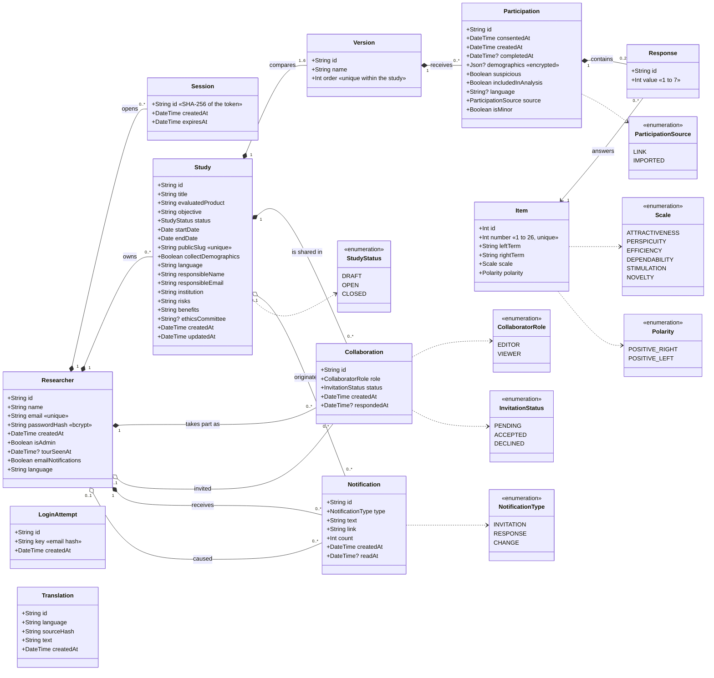

# Diagramme de classes

Deux diagrammes décrivent la structure statique de l'Outil UEQ :

1. **Modèle de domaine :** les 11 entités stockées dans PostgreSQL et les 7 types énumérés, tels qu'ils figurent dans [`prisma/schema.prisma`](../../prisma/schema.prisma).
2. **Module de calcul :** les types et les fonctions de [`src/ueq/`](../../src/ueq/), qui transforment des réponses en résultats sans toucher à la base de données.

Les diagrammes sont en anglais dans toutes les langues de la documentation. Dans le code et dans les explications ci-dessous, les noms sont ceux du code, en portugais et sans accents : Researcher est `Pesquisador`, Study est `Estudo`, Version est `Versao`, Participation est `Participacao` et Response est `Resposta`. Les types suivent TypeScript : `?` marque un champ qui peut être vide et `[]` marque une liste. Les tables, colonnes, clés et règles de suppression de la base de données, champ par champ, se trouvent dans le [modèle logique](modelo-logico.md) ; ce document montre les mêmes entités sous forme de classes, avec les associations et la multiplicité de chacune.

Juste sous chaque diagramme figurent l'outil utilisé, le fichier source à télécharger et la version de l'outil qu'il représente.

## 1. Modèle de domaine

**Outil du diagramme :** Mermaid 12.2.0 (`classDiagram`), généré par `pnpm docs:diagramas`. **Fichier source :** [diagrama-de-classes-1.mmd](fontes/diagrama-de-classes-1.mmd). **Version représentée :** Outil UEQ du 17/11/2026.

### Lecture

- **La composition (losange plein)** est une suppression en cascade dans la base de données. Supprimer le chercheur supprime ses sessions, ses études, les collaborations auxquelles il participe et les notifications qu'il a reçues ([RF06](requisitos.md#rf06)). Supprimer l'étude supprime les versions, les participations, les réponses et les collaborations ([RF17](requisitos.md#rf17)).
- **L'agrégation (losange vide)** est une référence qui devient vide quand l'autre côté est supprimé : si la personne qui a invité supprime son compte, la collaboration continue, sans le nom de la personne qui a invité ; si l'étude ou l'auteur d'une notification disparaît, la notification reste dans la cloche de la personne qui l'a reçue.
- **Item** n'appartient à personne : les 26 items sont chargés par le seed à partir du paquet officiel ([RNF10](requisitos.md#rnf10)) et partagés par toutes les études. Une réponse pointe vers l'item ; supprimer la réponse ne supprime pas l'item.
- **Versao** compte de 1 à 6 versions par étude. L'ordre est unique dans l'étude et définit l'ordre à l'écran et le départage dans la répartition des participants ([RF26](requisitos.md#rf26)).
- **Participacao** naît au consentement, sans réponses, et ne reçoit les 26 réponses et `concluidaEm` qu'à l'envoi ([RF25](requisitos.md#rf25), [RF33](requisitos.md#rf33)). C'est pourquoi la multiplicité est 0..26 : zéro tant qu'elle est en cours, 26 une fois terminée. Celle qui n'est pas terminée en 2 jours est supprimée ([RNF13](requisitos.md#rnf13)).
- **Resposta** stocke la valeur brute de 1 (pôle gauche) à 7 (pôle droit), avec un `CHECK` dans la base de données et l'unicité par participation et par item. Le recodage en -3…+3 se fait dans le calcul, jamais dans la base de données.
- **Participacao.idioma** est le code de la langue (`pt`, `es`, `ar`…) ; il reste vide pour les participations importées, car le CSV n'indique pas la langue ([RF61](requisitos.md#rf61)). **Participacao.demografia** stocke les quatre tranches facultatives, chiffrées avec AES-256-GCM quand la clé est configurée ([RNF14](requisitos.md#rnf14)). **Participacao.menorDeIdade** enregistre que la personne a confirmé l'autorisation de son responsable légal ([RF25](requisitos.md#rf25)).
- **Colaboracao** relie une étude à un autre compte, comme Éditeur ou Lecteur. Il y en a au plus une par étude et par personne, et l'étude n'apparaît pour la personne invitée qu'après ACEITO (acceptée) ([RF20](requisitos.md#rf20), [RF21](requisitos.md#rf21)).
- **Notificacao** est ce que montre la cloche. Celles de type RESPOSTA (réponse) s'additionnent dans `quantidade` tant qu'elles ne sont pas lues ([RF22](requisitos.md#rf22)).
- **TentativaAcesso** et **Traducao** ne sont liées à aucune autre entité. La première ne stocke que le hachage de l'adresse e-mail de chaque connexion échouée ([RNF16](requisitos.md#rnf16)) ; la seconde stocke chaque texte déjà traduit par l'API, par le hachage de l'original et par la langue ([RF08](requisitos.md#rf08), [RF35](requisitos.md#rf35)).
- **Sessao.id** est le hachage SHA-256 du jeton du cookie : quiconque lit la base de données ne peut pas fabriquer un cookie valide ([RNF15](requisitos.md#rnf15)).
- Rien dans le modèle n'identifie le participant : il n'y a ni nom, ni adresse e-mail, ni IP, ni user-agent ([RNF12](requisitos.md#rnf12)).

## 2. Module de calcul

Le module [`src/ueq/`](../../src/ueq/) est fait de fonctions pures : il n'importe ni Prisma, ni React, ni Next ([RNF25](requisitos.md#rnf25)). Dans le diagramme, chaque fichier apparaît comme une classe avec le stéréotype «module» et les fonctions qu'il exporte. Les types d'entrée et de sortie apparaissent comme des classes ordinaires.

```mermaid
classDiagram
    direction TB

    class index {
        <<module>>
        +analyzeStudy(participations, items, config) StudyAnalysis
    }
    class recode {
        <<module>>
        +recode(value, polarity) number
        +recodeParticipant(values, items) number[]
    }
    class statistics {
        <<module>>
        +mean(values) number?
        +sampleStdDev(values) number?
        +confidenceInterval95(mean, sd, n, z) Interval?
        +correlation(x, y) number?
        +cronbachAlpha(columns) number?
    }
    class scales {
        <<module>>
        +scoresPerParticipant(values, items) Record~Scale, number~
        +interpretationBand(mean, neutralBand) InterpretationBand
        +resultByScale(responses, items, parameters) ScaleResult[]
        +resultByItem(responses, items, z) ItemResult[]
    }
    class inconsistency {
        <<module>>
        +rangeByScale(values, items) Record~Scale, number~
        +identicalAnswers(values) number
        +assessSuspicion(values, items, parameters) SuspicionAssessment
        +flagSuspicious(responses, items, parameters) SuspicionAssessment[]
    }
    class benchmark {
        <<module>>
        +classifyBenchmark(scale, mean, table) BenchmarkBand?
    }
    class items {
        <<module>>
        +SCALES
        +GROUPS
        +numbersByScale(items) Record~Scale, number[]~
    }

    class UEQItem {
        +number number
        +Scale scale
        +Polarity polarity
    }
    class ParticipationForAnalysis {
        +number[] values
        +boolean includedInAnalysis
    }
    class AnalysisConfig {
        +protocol
        +BenchmarkTable benchmark
    }
    class InconsistencyParameters {
        +number maxRange
        +number scalesForSuspicion
        +number maxIdenticalAnswers
    }
    class StudyAnalysis {
        +number n
        +number nExcluded
        +AnalyzedScaleResult[] scales
        +groups pragmatic and hedonic
        +ItemResult[] items
        +SuspicionAssessment[] participants
    }
    class ScaleResult {
        +Scale scale
        +number n
        +number? mean
        +number? sd
        +Interval? ci
        +number? alpha
        +InterpretationBand? interpretationBand
    }
    class AnalyzedScaleResult {
        +BenchmarkBand? benchmark
        +boolean alphaBelowMinimum
    }
    class ItemResult {
        +number number
        +Scale scale
        +number n
        +number? mean
        +number? sd
        +Interval? ci
        +number[] distribution
    }
    class SuspicionAssessment {
        +Record~Scale, number~ ranges
        +Scale[] inconsistentScales
        +number identicalAnswers
        +SuspicionReason[] reasons
        +boolean suspicious
    }
    class Interval {
        +number lower
        +number upper
    }
    class BenchmarkLimits {
        +number excellent
        +number good
        +number aboveAverage
        +number belowAverage
    }

    ScaleResult <|-- AnalyzedScaleResult
    AnalysisConfig *-- InconsistencyParameters
    AnalysisConfig *-- "6" BenchmarkLimits
    StudyAnalysis *-- "6" AnalyzedScaleResult
    StudyAnalysis *-- "26" ItemResult
    StudyAnalysis *-- "0..*" SuspicionAssessment
    ScaleResult o-- Interval
    ItemResult o-- Interval

    index ..> ParticipationForAnalysis : receives
    index ..> UEQItem : receives
    index ..> AnalysisConfig : receives
    index ..> StudyAnalysis : returns
    index ..> scales : uses
    index ..> inconsistency : uses
    index ..> benchmark : uses
    index ..> items : uses
    scales ..> recode : uses
    scales ..> statistics : uses
    scales ..> items : uses
    inconsistency ..> recode : uses
    inconsistency ..> items : uses
```

**Outil du diagramme :** Mermaid 12.2.0 (`classDiagram`), généré par `pnpm docs:diagramas`. **Fichier source :** [diagrama-de-classes-2.mmd](fontes/diagrama-de-classes-2.mmd). **Version représentée :** Outil UEQ du 17/11/2026.

### Lecture

- **`analisarEstudo`** est la porte d'entrée. Elle reçoit les participations (26 valeurs de 1 à 7 et si elles sont dans l'analyse), les 26 items et la configuration. Elle calcule les statistiques uniquement avec celles qui sont dans l'analyse et évalue la suspicion de toutes ([RF36](requisitos.md#rf36) à [RF42](requisitos.md#rf42), [RF51](requisitos.md#rf51)).
- **`ConfigAnalise`** a le même format que [`data/protocolo.json`](../../data/protocolo.json) et [`data/benchmark.json`](../../data/benchmark.json). Les seuils et les tranches ne sont pas dans le code : ils changent par pull request, avec la source de chaque nombre.
- **Les valeurs vides** suivent le tableur officiel : sans n suffisant, avec un écart type nul ou avec un item qui ne varie pas, la fonction renvoie `null` là où le tableur affiche `#NUM!` ou `#DIV/0!`.
- **`ResultadoEscalaAnalisada`** ajoute au résultat de l'échelle la tranche du benchmark et la marque d'un alpha inférieur à 0,7.
- **`GRUPOS`** définit la qualité pragmatique (Clarté, Efficacité et Fiabilité) et la qualité hédonique (Stimulation et Nouveauté). L'Attractivité reste en dehors des deux groupes ([RF39](requisitos.md#rf39)).
- **`avaliarSuspeita`** est aussi utilisée en dehors du tableau de bord : à l'envoi du questionnaire, à l'importation, sur la page Réponses, dans l'étude d'exemple et lors du recalcul ([UC24](casos-de-uso.md#uc24)). `marcarSuspeitos` applique la même évaluation à une liste.

Chaque formule a été refaite à la main, avec les données de l'étude d'exemple, dans la [vérification du calcul](verificacao-do-calculo.md).

### Qui utilise le module

Le module ne sait pas d'où viennent les données. Ceux qui interrogent la base de données et appellent le module :

| Fichier | Ce qu'il fait |
|---|---|
| `src/lib/resultados.ts` | Récupère les participations terminées, construit l'entrée par version et appelle `analisarEstudo` pour le tableau de bord, le PDF et l'exportation des résultats |
| `src/lib/participacoes.ts` | Appelle `avaliarSuspeita` pour chaque participation de la page Réponses |
| `src/lib/exportacoes.ts` | Utilise `recodificarParticipante` dans l'exportation recodée |
| `src/app/r/[slug]/acoes.ts` | Appelle `avaliarSuspeita` à l'envoi du questionnaire |
| `src/app/(ferramenta)/(pesquisador)/estudos/[id]/respostas/importar/acoes.ts` | Appelle `avaliarSuspeita` pour chaque ligne importée |
| `src/lib/cenarios/respostas-sinteticas.ts` | Appelle `avaliarSuspeita` pour vérifier que les réponses de démonstration sont cohérentes avec chaque scénario |
| `prisma/recalcular-suspeitas.ts` | Appelle `avaliarSuspeita` pour toutes les participations terminées |
| `prisma/estudo-exemplo.ts` | Appelle `avaliarSuspeita` en enregistrant les réponses de l'étude d'exemple |

Le chemin complet, de la base de données à l'écran, se trouve dans le [diagramme de séquence des résultats](diagramas-de-sequencia.md#3-ver-resultados).
