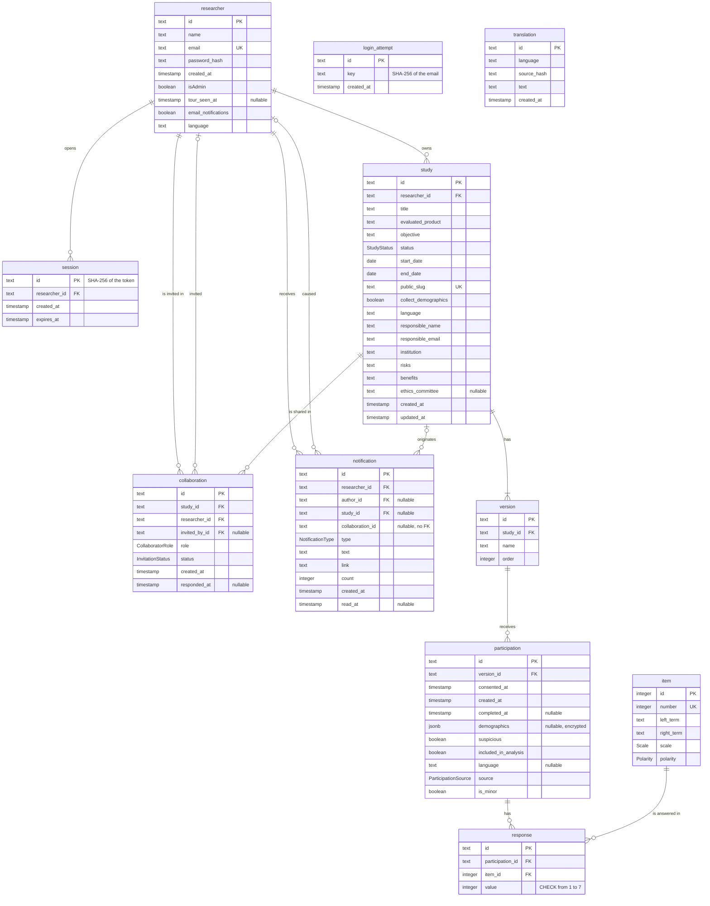

# Modèle logique de la base de données

La base de données de l'Outil UEQ est un **PostgreSQL 16** avec 11 tables et 7 types énumérés. Le modèle est déclaré dans [`prisma/schema.prisma`](../../prisma/schema.prisma) et appliqué par les 16 migrations de [`prisma/migrations/`](../../prisma/migrations/) : 10 modifient la structure, et les 6 autres n'enregistrent que des textes traduits dans la table `traducao`. Les noms ci-dessous sont ceux de la base de données. Dans le code, les mêmes champs apparaissent en camelCase (`slug_publico` est `slugPublico`).

Les colonnes, les clés et les règles de suppression de ce document ont été lues dans le catalogue de PostgreSQL lui-même (`information_schema` et `pg_constraint`) le 13/11/2026, avec toutes les migrations appliquées.

## Diagramme

Le diagramme utilise les noms en anglais. Les tableaux ci-dessous donnent les vrais noms de la base de données, en portugais : `researcher` est `pesquisador`, `study` est `estudo`, `version` est `versao`, `participation` est `participacao` et `response` est `resposta`.

**Outil du diagramme :** Mermaid 12.2.0 (`erDiagram`), généré par `pnpm docs:diagramas`. **Fichier source :** [modelo-logico-1.mmd](fontes/modelo-logico-1.mmd). **Version représentée :** Outil UEQ du 17/11/2026.

Deux tables restent isolées exprès : `tentativa_acesso` ne pointe pas vers le compte, car elle ne stocke que le hachage de l'adresse e-mail, et `traducao` est un cache sans propriétaire.

## Comment lire les tableaux

- **Les clés `text`** sont générées par l'application avec CUID. L'exception est `sessao.id`, qui est le hachage du jeton du cookie.
- **`timestamp`** est `timestamp(3) without time zone`, enregistré en UTC par Prisma.
- **Nul** indique que la colonne accepte une valeur vide. Les autres sont obligatoires.
- **Défaut** est la valeur de la base de données quand l'`INSERT` n'indique pas la colonne.

## Compte et accès

### pesquisador

Le compte de la personne qui utilise l'outil. Le participant n'a pas de compte.

| Colonne | Type | Nul | Défaut | Clé | À quoi elle sert |
|---|---|---|---|---|---|
| `id` | text | non | | PK | Identifiant |
| `nome` | text | non | | | Nom affiché aux collègues d'étude |
| `email` | text | non | | Unique | Connexion et destination des avis |
| `senha_hash` | text | non | | | Hachage bcrypt, coût 12. Le mot de passe n'est jamais enregistré |
| `criado_em` | timestamp | non | maintenant | | Date du compte |
| `administrador` | boolean | non | `false` | | Ouvre la page Administration. Ne donne pas accès aux études d'autres personnes |
| `tutorial_visto_em` | timestamp | oui | | | Vide jusqu'à ce que la personne termine, passe ou ferme la visite guidée |
| `notificacoes_por_email` | boolean | non | `true` | | En plus de la cloche, envoie l'avis par e-mail |
| `idioma` | text | non | `'pt'` | | Langue de l'interface et langue par défaut des études que la personne crée |

### sessao

Une ligne par connexion active. Elle reste dans la base de données pour que le changement de mot de passe puisse fermer les autres sessions.

| Colonne | Type | Nul | Défaut | Clé | À quoi elle sert |
|---|---|---|---|---|---|
| `id` | text | non | | PK | SHA-256 du jeton du cookie. Quiconque lit la base de données ne peut pas fabriquer un cookie valide |
| `pesquisador_id` | text | non | | FK, index | Propriétaire de la session |
| `criada_em` | timestamp | non | maintenant | | |
| `expira_em` | timestamp | non | | | Fin de la validité |

### tentativa_acesso

Compte les mots de passe erronés pour limiter les tentatives de deviner : 5 erreurs en 15 minutes bloquent l'adresse e-mail. Les lignes de plus d'un jour sont supprimées.

| Colonne | Type | Nul | Défaut | Clé | À quoi elle sert |
|---|---|---|---|---|---|
| `id` | text | non | | PK | |
| `chave` | text | non | | Index avec `criada_em` | SHA-256 de l'adresse e-mail. L'adresse n'est pas conservée |
| `criada_em` | timestamp | non | maintenant | Index avec `chave` | Début du comptage |

## Étude

### estudo

| Colonne | Type | Nul | Défaut | Clé | À quoi elle sert |
|---|---|---|---|---|---|
| `id` | text | non | | PK | |
| `pesquisador_id` | text | non | | FK, index | Propriétaire de l'étude |
| `titulo` | text | non | | | |
| `produto_avaliado` | text | non | | | |
| `objetivo` | text | non | | | Lu par le participant dans le formulaire de consentement |
| `status` | StatusEstudo | non | `RASCUNHO` | | Décide si le lien accepte des réponses |
| `data_inicio` | date | non | | | |
| `data_fim` | date | non | | | |
| `slug_publico` | text | non | | Unique | L'adresse `/r/<slug>` du participant |
| `coletar_demografia` | boolean | non | `false` | | LGPD, principe de nécessité : l'étape des données facultatives n'existe que si le chercheur l'active |
| `idioma` | text | non | `'pt'` | | Langue dans laquelle l'étude a été rédigée et dans laquelle le lien s'ouvre |
| `responsavel_nome` | text | non | | | Responsable de la recherche, affiché dans le formulaire de consentement (LGPD, art. 9). Le formulaire suggère le nom du compte |
| `responsavel_email` | text | non | | | Contact du responsable, affiché dans le formulaire de consentement. Le formulaire suggère l'adresse e-mail du compte |
| `instituicao` | text | non | | | Institution de la recherche, dans le sous-titre et dans le formulaire de consentement |
| `riscos` | text | non | | | Risques pour le participant, dans le formulaire de consentement (Résolution CNS 510/2016). Le formulaire suggère un texte |
| `beneficios` | text | non | | | Bénéfices, dans le formulaire de consentement. Le formulaire suggère un texte |
| `comite_etica` | text | oui | | | Comité d'éthique, avis ou CAAE et contact, quand l'étude est passée par un comité |
| `criado_em` | timestamp | non | maintenant | | |
| `atualizado_em` | timestamp | non | | | Mis à jour par Prisma |

### colaboracao

L'invitation à travailler sur une étude. L'étude n'apparaît pour la personne invitée qu'après `ACEITO` (acceptée).

| Colonne | Type | Nul | Défaut | Clé | À quoi elle sert |
|---|---|---|---|---|---|
| `id` | text | non | | PK | |
| `estudo_id` | text | non | | FK, unique avec `pesquisador_id` | Chaque personne a une invitation par étude |
| `pesquisador_id` | text | non | | FK, index avec `status` | Personne invitée |
| `convidado_por_id` | text | oui | | FK | Personne qui a invité. Devient vide si ce compte est supprimé |
| `papel` | PapelColaborador | non | `EDITOR` | | Ce que la personne peut faire |
| `status` | StatusConvite | non | `PENDENTE` | | |
| `criado_em` | timestamp | non | maintenant | | |
| `respondido_em` | timestamp | oui | | | Moment de l'acceptation ou du refus |

### versao

Les versions du produit que l'étude compare. Toute étude en a au moins une, règle garantie par la validation du formulaire.

| Colonne | Type | Nul | Défaut | Clé | À quoi elle sert |
|---|---|---|---|---|---|
| `id` | text | non | | PK | |
| `estudo_id` | text | non | | FK, unique avec `ordem` | |
| `nome` | text | non | | | |
| `ordem` | integer | non | | Unique avec `estudo_id` | Ordre d'affichage et départage dans la répartition des participants |

## Questionnaire et réponses

### item

Les 26 items de l'UEQ, chargés par le seed à partir de `data/ueq-itens-ptbr.json`. Les termes des 36 autres langues se trouvent dans `data/ueq-idiomas.json`, pas dans la base de données.

| Colonne | Type | Nul | Défaut | Clé | À quoi elle sert |
|---|---|---|---|---|---|
| `id` | integer | non | séquence | PK | |
| `numero` | integer | non | | Unique | De 1 à 26, l'ordre officiel |
| `termo_esquerdo` | text | non | | | |
| `termo_direito` | text | non | | | |
| `escala` | Escala | non | | | Échelle à laquelle appartient l'item |
| `polaridade` | Polaridade | non | | | Côté du terme positif |

### participacao

Une personne qui répond à une version. Il n'y a ni nom, ni adresse e-mail, ni IP, ni lien avec un compte : c'est ce qui rend la réponse anonyme.

| Colonne | Type | Nul | Défaut | Clé | À quoi elle sert |
|---|---|---|---|---|---|
| `id` | text | non | | PK | Va aussi dans le cookie du participant pendant qu'il répond |
| `versao_id` | text | non | | FK, index | Version que la personne évalue : celle qui avait le moins de réponses au moment du consentement |
| `consentiu_em` | timestamp | non | | | Enregistrement du consentement |
| `criada_em` | timestamp | non | maintenant | | Sert à supprimer les participations abandonnées après 2 jours |
| `concluida_em` | timestamp | oui | | | Vide tant que rien n'a été envoyé. Seules les participations terminées entrent dans l'analyse |
| `demografia` | jsonb | oui | | | Tranche d'âge, genre, niveau d'études et familiarité. Chiffrée avec AES-256-GCM quand `CHAVE_CRIPTOGRAFIA` existe |
| `suspeita` | boolean | non | `false` | | Calculée par les règles du [protocole](../ueq-protocolo.md#7-respostas-inconsistentes) |
| `incluida_na_analise` | boolean | non | `true` | | Décision du chercheur. Retirer de l'analyse ne supprime rien |
| `idioma` | text | oui | `'pt'` | | Langue de la réponse. Vide pour les participations importées, car le CSV ne l'indique pas |
| `origem` | OrigemParticipacao | non | `LINK` | | Réponse par le lien ou importée d'un CSV |
| `menor_de_idade` | boolean | non | `false` | | La personne a déclaré avoir moins de 18 ans et a confirmé l'autorisation de son responsable légal (LGPD, art. 14). Sans l'autorisation, la participation n'est même pas créée |

### resposta

Une ligne par item répondu. Une participation terminée en a 26.

| Colonne | Type | Nul | Défaut | Clé | À quoi elle sert |
|---|---|---|---|---|---|
| `id` | text | non | | PK | |
| `participacao_id` | text | non | | FK, unique avec `item_id` | Empêche de répondre deux fois au même item |
| `item_id` | integer | non | | FK | |
| `valor` | integer | non | | `CHECK` de 1 à 7 | 1 est le pôle gauche et 7 le pôle droit, avant le recodage |

## Avis et traduction

### notificacao

La cloche de l'en-tête. Les réponses qui arrivent tant que l'avis n'a pas été lu ne font qu'augmenter `quantidade`.

| Colonne | Type | Nul | Défaut | Clé | À quoi elle sert |
|---|---|---|---|---|---|
| `id` | text | non | | PK | |
| `pesquisador_id` | text | non | | FK, index avec `lida_em` | Destinataire |
| `autor_id` | text | oui | | FK | Personne à l'origine de l'avis. Devient vide si le compte est supprimé |
| `estudo_id` | text | oui | | FK | Devient vide si l'étude est supprimée, et l'avis reste dans la cloche |
| `colaboracao_id` | text | oui | | Sans FK | Référence à l'invitation, pour l'accepter ou la refuser depuis l'avis. Peut pointer vers une invitation qui n'existe plus |
| `tipo` | TipoNotificacao | non | | | |
| `texto` | text | non | | | Déjà dans la langue du destinataire |
| `link` | text | non | | | Chemin dans l'outil |
| `quantidade` | integer | non | `1` | | Réponses accumulées |
| `criada_em` | timestamp | non | maintenant | | |
| `lida_em` | timestamp | oui | | Index avec `pesquisador_id` | Vide signifie non lu |

### traducao

Cache des traductions faites par l'API de Claude, pour ne pas traduire deux fois le même texte.

| Colonne | Type | Nul | Défaut | Clé | À quoi elle sert |
|---|---|---|---|---|---|
| `id` | text | non | | PK | |
| `idioma` | text | non | | Unique avec `hash_origem` | Langue cible |
| `hash_origem` | text | non | | Unique avec `idioma` | SHA-256 du texte original |
| `texto` | text | non | | | La traduction |
| `criada_em` | timestamp | non | maintenant | | |

## Types énumérés

| Type | Valeurs | Remarque |
|---|---|---|
| `StatusEstudo` | `RASCUNHO`, `ABERTO`, `ENCERRADO` | Seul `ABERTO` accepte des réponses |
| `Escala` | `ATRATIVIDADE`, `PERSPICUIDADE`, `EFICIENCIA`, `CONFIABILIDADE`, `ESTIMULACAO`, `NOVIDADE` | Les 6 échelles de l'UEQ |
| `Polaridade` | `POSITIVA_DIREITA`, `POSITIVA_ESQUERDA` | `+` et `-` dans le [protocole](../ueq-protocolo.md#1-itens-escalas-e-polaridade) |
| `OrigemParticipacao` | `LINK`, `IMPORTADA` | |
| `PapelColaborador` | `EDITOR`, `LEITOR` | L'éditeur modifie l'étude ; le lecteur ne fait que voir et exporter. Supprimer l'étude et inviter restent réservés au propriétaire |
| `StatusConvite` | `PENDENTE`, `ACEITO`, `RECUSADO` | |
| `TipoNotificacao` | `CONVITE`, `RESPOSTA`, `ALTERACAO` | |

## Ce que chaque suppression entraîne

Toutes les clés étrangères ont `ON UPDATE CASCADE`. La colonne ci-dessous est le `ON DELETE` de la base de données.

| Clé étrangère | À la suppression du parent |
|---|---|
| `sessao.pesquisador_id` → `pesquisador` | Supprime |
| `estudo.pesquisador_id` → `pesquisador` | Supprime |
| `colaboracao.pesquisador_id` → `pesquisador` | Supprime |
| `colaboracao.convidado_por_id` → `pesquisador` | Devient vide |
| `colaboracao.estudo_id` → `estudo` | Supprime |
| `versao.estudo_id` → `estudo` | Supprime |
| `participacao.versao_id` → `versao` | Supprime |
| `resposta.participacao_id` → `participacao` | Supprime |
| `resposta.item_id` → `item` | **Empêche** la suppression de l'item qui a déjà une réponse |
| `notificacao.pesquisador_id` → `pesquisador` | Supprime |
| `notificacao.autor_id` → `pesquisador` | Devient vide |
| `notificacao.estudo_id` → `estudo` | Devient vide |

En pratique :

- **Supprimer le compte** supprime les sessions, les études dont la personne est propriétaire (avec versions, participations et réponses), ses invitations et ses avis. Dans les études d'autres personnes, sa participation en tant que collègue disparaît, et les avis qu'elle a provoqués restent, sans auteur.
- **Supprimer une étude** supprime les versions, les participations, les réponses et les invitations. Les avis restent dans la cloche de leurs destinataires, sans le lien avec l'étude.
- **Retirer une version**, dans la base de données, supprime ses participations et ses réponses.
- **Aucun item ne peut disparaître** après avoir reçu une réponse. Ce `RESTRICT` protège l'instrument.

## Règles garanties par la base de données et règles garanties par l'application

| Règle | Où elle se trouve |
|---|---|
| `resposta.valor` entre 1 et 7 | `CHECK resposta_valor_entre_1_e_7`, écrit à la main dans la migration initiale, car Prisma ne déclare pas de `CHECK` |
| Une réponse par item dans chaque participation | Index unique `(participacao_id, item_id)` |
| Une invitation par personne dans chaque étude | Index unique `(estudo_id, pesquisador_id)` |
| Slug public et adresse e-mail sans doublon | Index uniques |
| Exactement 26 réponses dans une participation terminée | Application (`enviarRespostas`, dans une transaction) |
| Uniquement des options de la liste dans `demografia` | Application (`src/lib/demografia.ts`) |
| Qui peut voir ou modifier une étude | Application (`estudoDoPesquisador` dans `src/lib/estudos.ts`) |
| Supprimer une participation abandonnée depuis plus de 2 jours | Application : cela se produit quand la personne suivante donne son consentement |

## Données personnelles

Cette carte relie le modèle à la politique de confidentialité de l'outil, sur `/privacidade` (LGPD).

| Donnée | Table | Protection |
|---|---|---|
| Nom et adresse e-mail | `pesquisador` | Visibles uniquement par les personnes qui partagent une étude avec la personne |
| Mot de passe | `pesquisador.senha_hash` | Hachage bcrypt, coût 12 |
| Cookie de session | `sessao.id` | Uniquement le hachage SHA-256 |
| Adresse e-mail lors d'une tentative de connexion | `tentativa_acesso.chave` | Uniquement le hachage SHA-256, supprimé dans un délai d'un jour |
| Données démographiques du participant | `participacao.demografia` | Chiffrées avec AES-256-GCM, avec la clé hors de la base de données |
| Réponses au questionnaire | `resposta` | Rien ne les relie à une personne |

Sans `CHAVE_CRIPTOGRAFIA` dans l'environnement, les données démographiques restent en texte clair et la page Administration le signale. Le script `pnpm dados:cifrar` chiffre les anciennes lignes et s'exécute lors du build de production.
